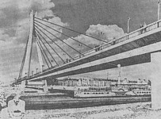
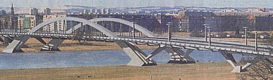
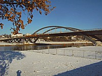

* * *

* * *

**Technische Daten:**

**Gesamtlänge:** 636 m

**Länge Stromfeld:** 148 m

**Breite:** 24,40 m

**Haupttunnel:** 395 / 408 m

**max. Gefälle:** 6 %

**Nebentunnel Ost:** 285 m

**Nebentunnel West:** 45 m

**Gesamtkosten:** ca. 180,5 Mio. Euro

Bereits Ende des 19. Jahrhunderts war zur Entlastung der innerstädtischen Brücken ein
Neubau zwischen Johannstadt und der Äußeren Neustadt vorgesehen. Dieser sollte nach dem Generalbauplan der Stadt Desden von 1862 zugleich Teil des äußeren
Environweges sein, einer geplanten Ringstraße, welche über Fetscherstraße und Stauffenbergallee führen und die bebaute Stadt von der offenen Landschaft abgrenzen
sollte. Bis zur Jahrhundertwende wurden diese Planungen mehrfach modifiziert. Als Standort plante man seinerzeit den heutigen [Thomas-Müntzer-Platz](../../../zentrum/johannstadt/strassen_johannstadt/), welcher deshalb
halbkreisförmig angelegt wurde und als Altstädter Brückenkopf dienen sollte. Bedingt durch den Ersten und Zweiten Weltkrieg wurden diese Vorhaben jedoch nicht weiter
verfolgt. Erst zu DDR-Zeiten griff man die Idee wieder auf und nahm eine zusätzliche Elbquerung 1970 in den Generalverkehrsplan auf. 1978/79 wurde ein erster Entwurf vorgestellt, der eine achtspurige Fahrbahn und zwei
monumentale Brückenköpfe vorsah. Nach weiteren Untersuchungen beschloss das Ministerium für Verkehrswesen der
DDR 1988 den Neubau einer Elbbrücke am Waldschlösschen. Im Ergebnis eines Wettbewerbs stellte ein Planungsteam
des Autobahnbau-Kombinates Dresden unter Leitung von Rudolf Kusche eine überarbeitete Planung für eine ca. 600 Meter lange Schrägseilbrücke vor _(Bild)_
. Bedingt durch die politische Wende kam es jedoch nicht mehr zum Baustart.

Im Januar 1990 bestätigte die Dresdner Stadtverordnetenversammlung ein “Leitbild für die künftige Verkehrspolitik im
Ballungsgebiet Dresden”. Auf dessen Basis erarbeitete man ein neues Verkehrskonzept, in welchem auch der Standort
einer neuen Elbbrücke eine Rolle spielte. Neben der Elbquerung am Waldschlösschen wurden 1992-94 auch Alternativen
am Thomas-Müntzer-Platz und zwischen Laubegast und Niederpoyritz, eine dritte Marienbrücke sowie ein Brückenbau
zwischen Ostragehege und Erfurter Straße geprüft, letztlich jedoch verworfen. Am 15. August 1996 verabschiedete der
Stadtrat mit deutlicher Mehrheit einen Beschluss zum Bau der Waldschlößchenbrücke. Eine Unterschriftensammlung für ein Bürgerbegehren zugunsten eines alternativen Mehrbrückenkonzeptes scheiterte am Widerspruch des
Oberbürgermeisters und des Regierungspräsidiums.

Im Ergebnis eines Wettbewerbs setzte sich das Projekt der Berliner Architekten Thomas Kolb und Henry Ripke durch.
Dieses schlug einen gewaltigen Bogen über dem Fluss vor, welcher an beiden Ufern zugleich als Fußgängeraufgang dienen
soll. Die neue Brücke erhielt Platz für vier Fahrspuren sowie separate Fuß- und Radwege an beiden Seiten. Auf eine
ursprünglich vorgesehene Gleistrasse für die Straßenbahn wurde aus Kostengründen verzichtet. Auf Neustädter Seite
sollte die Straße in einen Tunnel zur Stauffenbergallee münden, welcher über Rampen die Auffahrt zur Bautzner Straße
ermöglicht. Am 29. November 2000 erfolgte durch Oberbürgermeister Herbert Wagner am Johannstädter Ufer der erste Spatenstich.

Allerdings regte sich gegen den Brückenbau heftiger Widerstand, der auch nach mehrfachen Umplanungen des
Ursprungsentwurfs nicht endete. Maßgeblich dazu bei trug 2004 die Verleihung des UNESCO-Welterbetitels für das Dresdner Elbtal. Nachdem die UNESCO erklärt hatte, dass Dresden diesen Titel im Fall eines Baus der
Waldschlösschenbrücke wieder verlieren würde und Dresden im Juli 2006 auf die “Rote Liste” des bedrohten
Weltkulturerbes setzte, entwickelte sich ein mehrjähriger juristischer Streit um den Bau. Obwohl sich im Februar 2005
67,8 % der Dresdner in einem Bürgerentscheid für den Bau der Brücke ausgesprochen hatten, kamen nun erneut veränderte Entwürfe sowie die Idee eines Elbtunnels auf.

Im Juli 2006 stimmte der Stadtrat überraschend gegen einen Baubeginn, woraufhin
das Regierungspräsidium diesen selbst anordnete. Umweltverbände klagten daraufhin wegen der drohenden Zerstörung des Lebensraumes geschützter Tier- und
Pflanzenarten. Die im Elbtal vorkommende Fledermausart “Kleine Hufeisennase” wurde dabei zum Symbol des Widerstands gegen den Brückenbau. Dennoch wurde
nach mehreren Gerichtsentscheidungen im November 2007 mit den Vorarbeiten begonnen. 2008-10 folgte der Bau der Anschlusstunnel auf Neustädter Seite, der
Brückenpfeiler und die Montage des Hauptteils mit dem Brückenbogen. Dieser wurde am 19. Dezember 2010 mit Hilfe von Spezialtransportwagen und Pontons über den Fluss gezogen und an seinen Bestimmungsort verbracht _(Foto)_. Im Anschluss erfolgten die weiteren Arbeiten an der Brücke und ihren Zufahrten. Die feierliche Einweihung der neuen Elbquerung erfolgte am 24. August 2013 im Rahmen eines großen Bürgerfestes.

**_Fotos:_** _Eröffnung der Waldschlösschenbrücke am 24. August 2013_

* * *

 \[ [Nord](../../../nord/)\] \[ [Nordwest](../../../nordwest/)\] \[ [Neustadt](../../../neustadt/)\] \[ [Nordost](../../../nordost/)\]
 \[ [West](../../../west/)\] \[ [Zentrum](../../../zentrum/)\] \[ [Südwest](../../../sudwest/)\] \[ [Süd](../../../sud/)\] \[ [Südost](../../../sudost/)\] \[ [Ost](../../../ost/)\] \[ [Register](../../../Register/register.html)\] \[ [Kontakt](../../../Kontakt/kontakt.html)\] \[ [Impressum](../../../impressum/)\]
