* * *

* * *

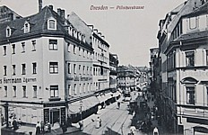Die Pirnaische Vorstadt umfasst das östlich der inneren Altstadt gelegene Stadtgebiet zwischen Pirnaischem Platz, [St. Petersburger Straße](../../Zentrum/Pirnaische_Vorstadt/Strassen_Pirnaische_Vorstadt/St_Petersburger_Strasse/st_petersburger_strasse.html), [Bürgerwiese](../../Zentrum/Pirnaische_Vorstadt/Strassen_Pirnaische_Vorstadt/BurgerwieseS/burgerwieses.html), [Lennestraße](../../zentrum/pirnaische_vorstadt/strassen_pirnaische_vorstadt/), [Güntzstraße](../../zentrum/johannstadt/strassen_johannstadt/) und Elbe. Bis zum Abbruch der Stadtbefestigung nach 1820 lag es außerhalb der Festungsmauern. Der Name erinnert an das vor dem früheren Pirnaischen Tor gelegene, aus drei Vorstadtgemeinden bestehende Stadtviertel: die Rampischen Gemeinde (Ziegelstraße - Pillnitzer Straße), die Pirnaische Gemeinde (Grunaer, Pirnaische und Zinzendorfstraße) und die Borngassengemeinde (Borngasse am Georgplatz). Hinzu kam später die Halbeulengassengemeinde in der angrenzenden Seevorstadt, deren kurioser Name eine Zusammensetzung aus der nur einseitig bebauten Halben Gasse und der Eulengasse, beide in der Nähe der Bürgerwiese gelegen, war. Erst Ende des 18. Jahrhunderts wurden die mittlerweile deutlich angewachsenen Gemeinden zusammengefasst und ab 1835 amtlich als Pirnaische Vorstadt bezeichnet.

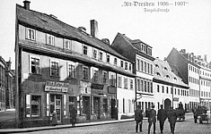Ursprünglich war das Areal zwischen Bürgerwiese und Elbe von einem alten Elbarm und dem [Landgraben](../../ost/striesen/landgraben/) durchzogen, der sich von Striesen über die heutige Holbeinstraße erstreckte und erst 1875 trockengelegt wurde. Die Lehmablagerungen dieses Flusslaufs führten schon früh zur Ansiedlung mehrerer Ziegeleien, an die noch heute die Ziegelstraße erinnert _(Foto rechts)_. Die mittelalterliche Besiedlung der Vorstadt begann entlang zweier hier verlaufender Verkehrswege. So verband die Rampische Straße (später [Pillnitzer Straße](../../Zentrum/Pirnaische_Vorstadt/Strassen_Pirnaische_Vorstadt/Pillnitzer_Strasse/pillnitzer_strasse.html)) das Stadtzentrum mit dem auf Johannstädter Flur gelegenen Rampischen Vorwerk, während die [Pirnaische Straße](../../Zentrum/Pirnaische_Vorstadt/Strassen_Pirnaische_Vorstadt/Pirnaische_Strasse/pirnaische_strasse.html) vom Pirnaischen Tor aus in Richtung Osten führte. Hinzu kam eine kleine Siedlung rund um die alte Borngasse (Borngassengemeinde) sowie eine Fischersiedlung in der Nähe der Elbe. Mit dem Ausbau der Festungsanlagen der Stadt nach 1520 siedelten sich vor den Mauern weitere Ackerbürger, Gärtner und Elbfischer an.

Bereits um 1603 zählten diese Vorstädte zusammen über 2000 Einwohner, meist aus den ärmeren Schichten. Die Verwaltung erfolgte durch je einen Richter, dem ein bis zwei Gerichtsschöppen, ein Gemeindeschreiber und eine Heimbürgin zur Seite standen. Übergeordnet war diesen der Rat zu Dresden sowie als oberste Instanz der Kurfürst. Diese Rechtsstruktur hatte zur Folge, dass die Vorstadtgemeinden nur eingeschränkte Rechte besaßen und wirtschaftlich und politisch von der Stadt Dresden abhängig waren.

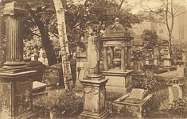Wichtige kommunale Einrichtungen auf dem Gelände der Pirnaischen Vorstadt waren die bereits im 14. Jahrhundert erstmals erwähnte [Amtsziegelscheune](../../Zentrum/Pirnaische_Vorstadt/Strassen_Pirnaische_Vorstadt/Ratsziegelei/ratsziegelei.html) an der späteren [Ziegelstraße](../../zentrum/pirnaische_vorstadt/strassen_pirnaische_vorstadt/), der Böhmische Holzhof am Elbufer sowie der 1571 angelegte Johannisfriedhof mit der alten [Johanniskirche](../../Zentrum/Pirnaische_Vorstadt/Johanneskirche/johanneskirche.html). 1680 kam der am äußersten Rand des städtischen Weichbildes gelegene [Eliasfriedhof](../../Zentrum/Pirnaische_Vorstadt/Eliasfriedhof/eliasfriedhof.html) als Pest- und Armenfriedhof hinzu _(Foto um 1910)_. Wirtschaftlich war vor allem die Ziegelherstellung von Bedeutung, welche bis zur Erschöpfung der Lehmvorkommen um 1850 betrieben wurde. Außerdem gab es hier Felder, Gärtnereien und kleinere Handwerksbetriebe. Zu den Höhepunkten im gesellschaftlichen Leben des Stadtviertels gehörte die bis 1840 alljährlich auf der "Ziegelwiese" abgehaltene [Vogelwiese](../../zentrum/johannstadt/vogelwiese/), größtes Volksfest der Stadt.

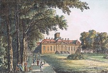Im Siebenjährigen Krieg gehörte die Pirnaische Vorstadt zu den am stärksten in Mitleidenschaft gezogenen Stadtteilen. Am 10. November 1758 brannten preußische Soldaten bei der Belagerung Dresdens 285 Häuser der Vorstadt nieder, wobei 10 Menschen ums Leben kamen. Mit der Aktion sollte der Vormarsch des österreichischen Feldmarschalls Daun verhindert werden. Schwer betroffen war das Viertel auch im August 1813 durch Kämpfe zwischen französischen und alliierten Truppen im Umfeld des Großen Gartens. Nach den Napoleonischen Kriegen erfolgte schließlich die Niederlegung der Dresdner Festungsanlagen, deren Flächen ab 1820 mit Gartengrundstücken und einigen Gärtnereien belegt wurden. Dabei behielt der Stadtteil zunächst seinen vorstädtischen Charakter. Lediglich an den Hauptausfallstraßen dominierte bis zu den "Schlägen", den zur Akziseerhebung dienenden Einnehmerstationen der Stadt, geschlossene Bebauung mit meist zwei- bis dreistöckigen Gebäuden. Im südlichen Teil der Pirnaischen Vorstadt blieben hingegen Grünflächen erhalten. Das betraf zunächst das Areal des alten Johannisfriedhofes sowie die Gartenanlagen der [Sekundogenitur](../../Zentrum/Pirnaische_Vorstadt/Blüherpark/Bluherpark.html) mit dem Palais des zweitgeborenen Prinzen an der [Zinzendorfstraße](../../Zentrum/Pirnaische_Vorstadt/Strassen_Pirnaische_Vorstadt/Zinzendorfstrasse/Zinzendorfstrasse.html) _(Bild um 1840)_. Ab 1843 hatte der Hofgärtner Terscheck die einstige [Bürgerwiese](../../Zentrum/Pirnaische_Vorstadt/Burgerwiese/burgerwiese.html), einen zuvor als Grün- und Weideland genutzten Teil der Stadt, in einen parkartigen Grünzug umgestaltet.

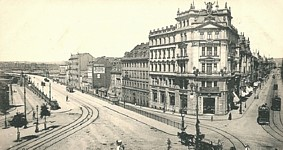Erst im letzten Drittel des 19. Jahrhunderts änderte sich nach Verabschiedung eines Generalbauplanes 1862 der Charakter der Vorstadt völlig. An Stelle ehemaliger Ziegeleien, Gärten und Wiesen traten mehrgeschossige Wohn- und Geschäftshäuser. In Ergänzung der vorhandenen Straßen entstand zudem ein völlig neues Straßennetz, flankiert von meist viergeschossigen Mietshäusern in geschlossener Bauweise. Im November 1871 erwarb die Dresdner Baugesellschaft über 42.000 Quadratmeter Bauland und begann zwischen Grunaer, Mathilden-, Pillnitzer und Eliasstraße mit den Bau von Mietshäusern. 1874 wurde der frühere Environweg als Teil des äußeren Stadtrings ausgebaut und erhielt den Namen Lennéstraße. Bis heute bildet diese den östlichen Abschluss der Pirnaischen Vorstadt. 1879 erfolgte der Durchbruch der [Grunaer Straße](../../Zentrum/Pirnaische_Vorstadt/Strassen_Pirnaische_Vorstadt/Grunaer_Straße/grunaer_strasse.html) als neuer Ausfallstraße vom Pirnaischen Platz in Richtung Osten. Zur verkehrstechnischen Erschließung trug auch der Bau der [Albertbrücke](../../zentrum/johannstadt/albertbrucke/) (1875-77) und der [Carolabrücke](../../Zentrum/Pirnaische_Vorstadt/Carolabrücke/carolabrücke.html) (1892-95) als vorerst letzte Elbquerung der Innenstadt bei _( **Foto:** Carolabrücke, Elbberg und Marschallstraße um 1910)_.

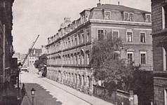Neben Wohn- und Geschäftshäusern entstanden verschiedene öffentliche Gebäude, Schulen, Kirchen und kulturelle Einrichtungen. Kirchlich unterstand ein Großteil der Pirnaischen Vorstadt ab 1877 der neu geweihten [Johanniskirche](../../Zentrum/Pirnaische_Vorstadt/Johanneskirche/johanneskirche.html) an der Pillnitzer Straße. Weitere wichtige Bauten waren die Gerichtsgebäude an der Pillnitzer und der Lothringer Straße, die neue [Kreuzschule](../../Zentrum/Pirnaische_Vorstadt/Strassen_Pirnaische_Vorstadt/Georgplatz/Kreuzschule/kreuzschule.html) und weitere Schulbauten, das 1906 eröffnete [Güntzbad](../../Zentrum/Pirnaische_Vorstadt/Strassen_Pirnaische_Vorstadt/Guntzbad/guntzbad.html), der Gebäudekomplex der [Tierärztlichen Hochschule](../../Zentrum/Pirnaische_Vorstadt/Strassen_Pirnaische_Vorstadt/Zirkusstraße/Tierärztliche_Hochschule/tierärztliche_hochschule.html) _(Foto)_ und das [Ehrlichsche Gestift](../../Zentrum/Pirnaische_Vorstadt/Strassen_Pirnaische_Vorstadt/Ehrlichsches_Gestift/ehrlichsches_gestift.html) mit Schule und Stiftskirche. 1907 wurde an der Grunaer Straße / Albrechtstraße (Blüherstraße) das [Haus der Dresdner Kunstgenossenschaft](../../Zentrum/Pirnaische_Vorstadt/Strassen_Pirnaische_Vorstadt/Grunaer_Straße/Kunstlerhaus/kunstlerhaus.html) eingeweiht, wenig später das [Christliche Hospiz](../../Zentrum/Pirnaische_Vorstadt/Strassen_Pirnaische_Vorstadt/Zinzendorfstrasse/zinzendorfstrasse.html) an der Zinzendorfstraße. Kulturelle Einrichtungen wie das [Residenztheater](../../Zentrum/Pirnaische_Vorstadt/Strassen_Pirnaische_Vorstadt/Zirkusstraße/Residenztheater/residenztheater.html) und der um 1900 fertiggestellte [Ausstellungspalast](../../zentrum/pirnaische_vorstadt/ausstellungsgelande/) ergänzten das Stadtbild.

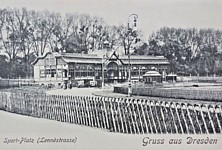Die verbliebenen Freiflächen im Südosten des Stadtteils dienten ab 1896 als Sportanlagen. Nach dem Ersten Weltkrieg folgten in diesem Teil Sport- und Freizeitstätten wie die 1923 eingeweihte [Ilgen-Kampfbahn](../../Zentrum/Pirnaische_Vorstadt/Rudolf-Harbig-Stadion/Rudolf-Harbig-Stadion.html) (Rudolf-Harbig-Stadion) und das 1926 eröffnete [Georg-Arnhold-Bad](../../Zentrum/Pirnaische_Vorstadt/Arnholdbad/arnholdbad.html). Schon 1896 hatte die Stadt Dresden dafür größere Wiesenflächen erworben _( **Foto:** Sportplatz Lennéstraße)_. Unweit davon errichtete Wilhelm Kreis zwischen 1927 und 1930 im Park der früheren Sekundogenitur den Monumentalbau des [Deutschen Hygienemuseums](../../Zentrum/Pirnaische_Vorstadt/Strassen_Pirnaische_Vorstadt/Hygienemuseum/hygienemuseum.html). Leider gingen dabei große Teile der Gartenanlage verloren. Die Reste gliederte man 1927 der Bürgerwiese an, so dass mit Blüherpark, den Sportanlagen und dem Großen Garten ein großes zusammenhängendes Grüngebiet entstand.

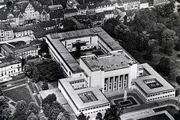Nach der Machtübernahme der Nationalsozialisten waren in der südlichen Pirnaischen Vorstadt gravierende Veränderungen vorgesehen. Planungen von 1934 sahen vor, zwischen Großem Garten und Rathausplatz ein "Gauforum" als neuen politischen Mittelpunkt der Stadt zu errichten. Mit den Entwürfen wurden Stadtbaurat Paul Wolf und der Architekt Wilhelm Kreis beauftragt. Hier sollten u.a. ein "Gauhaus" als Sitz für Gauleiter Martin Mutschmann und eine "Halle der Zwanzigtausend" mit einem Aufmarschplatz für nationale Großveranstaltungen entstehen. Mit Beginn des Zweiten Weltkrieges wurden die Vorbereitungen gestoppt. Das Bild rechts zeigt das dafür vorgesehene Gelände um das Hygienemuseum um 1935.

Beim Luftangriff am 13./14. Februar 1945 gehörte die Pirnaische Vorstadt zu den am schwersten getroffenen Stadtteilen. Von den Wohn- und Geschäftshäusern überstand ein einziges Gebäude am Eliasfriedhof die Bombennacht. Aber auch Kirchen, Kulturstätten, öffentliche Gebäude und das Hygienemuseum fielen den Bomben zum Opfer bzw. wurden schwer beschädigt. In keinem Stadtviertel gab es soviele Tote wie in diesem Gebiet.

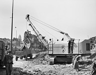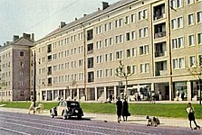Bereits kurz nach Kriegsende begann die großflächige Enttrümmerung, die den Abriss fast aller Ruinen zur Folge hatte, so dass heute nur noch wenige Bauten an die Vorkriegszeit erinnern _(Foto 1947 / SLUB - Fotothek)_. Am 22. April 1951 begann an der Grunaer Straße mit dem ersten Spatenstich der Wiederaufbau der Dresdner Innenstadt Die Wohnhäuser entlang dieser Hauptstraße erhielten dabei Ladeneinbauten und eine passende künstlerische Gestaltung, die sie heute zu Denkmalen der Nachkriegszeit machen _(Foto rechts)_. Wenig später folgten Neubauten im nördlichen Teil der Vorstadt, wobei man das vorhandene Straßennetz zum Teil veränderte. Der gut erhaltene Turm der Johanneskirche wurde 1954 trotz Protestes der Denkmalpflege und kirchlicher Kreise gesprengt. Die Straßenzüge in Richtung Elbe wurden meist mit schlichten mehrgeschossigen Wohnblocks bebaut. Hier befindet sich auch das [Sächsische Serumwerk](../../Zentrum/Pirnaische_Vorstadt/Strassen_Pirnaische_Vorstadt/Zirkusstraße/Serumwerk/serumwerk.html) in den zum Teil wiederaufgebauten und später erweiterten Bauten der früheren Tierärztlichen Hochschule. Durch Ausbau der Ruine des Ehrlichschen Gestifts erhielt die [Musikhochschule](../../Zentrum/Pirnaische_Vorstadt/Musikhochschule/musikhochschule.html) Musikhochschule 1951 neue Räume. Weitgehend originalgetreu präsentiert sich bis heute das Landgericht an der Lothringer Straße, ein 1892 fertig gestellter Bau im Neorenaissancestil. Insgesamt wurden im nördlichen Teil der Pirnaischen Vorstadt bis in die 1970er Jahre ca. 2000 Wohnungen errichtet.

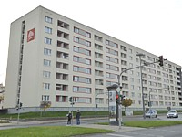Komplett verändert zeigt sich heute auch die einstige Amalienstraße, die als Teil der wichtigen Nord-Süd-Verbindung in die [St. Petersburger Straße](../../Zentrum/Pirnaische_Vorstadt/Strassen_Pirnaische_Vorstadt/St_Petersburger_Strasse/st_petersburger_strasse.html) einbezogen wurde. Eine um 1970 fertiggestellte Wohnzeile _(Foto)_ bildet die Grenze zwischen Stadtzentrum und Pirnaischer Vorstadt. Flankiert wurden die Häuser durch zwei Punkthochhäuser am Elbufer, von denen eines nach 1990 wegen seines störenden Einflusses auf die Blickbeziehungen wieder abgerissen wurde. Im südlichen Teil zwischen Grunaer Straße und Bürgerwiese errichtete das DDR-Elektrotechnik-Kombinat [robotron](../../Zentrum/Pirnaische_Vorstadt/Robotron/robotron.html) mehrere Verwaltungsgebäude. 2016 erfolgte ein teilweiser Abriss zugunsten einer geplanten neuen Wohnbebauung. Ein Großteil des südlichen Bereichs der Pirnaischen Vorstadt wartet noch heute auf eine städtebauliche Neugestaltung, für die bislang nur Planungen existieren.

Schulen in der Pirnaischen Vorstadt:

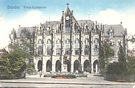Kreuzschule: Bis zur Zerstörung 1945 stand am Georgplatz in der Pirnaischen Vorstadt der neogotische Schulbau der [Kreuzschule](../../Zentrum/Pirnaische_Vorstadt/Strassen_Pirnaische_Vorstadt/Georgplatz/Kreuzschule/kreuzschule.html). Die als älteste Dresdner Schule bereits 1300 erstmals erwähnte Einrichtung hatte das von Christian Friedrich Arnold entworfene Gebäude am 1. Mai 1866 eingeweiht. Am 13./14. Februar 1945 wurde auch die Kreuzschule zerstört und brannte völlig aus. Daraufhin nutzte man zunächst einige Räume im Wettiner Gymnasium, ab 1947 das ehemalige [Freimaurerinstitut](../../ost/striesen/) in Striesen, wo sich das Gymnasium bis heute befindet. Am ursprünglichen Standort erinnert nur noch das einst vor dem Schulhaus stehende Theodor-Körner-Denkmal an das Gebäude.

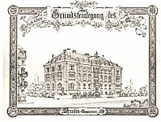Ehrlichsches Gestift: Die bis zur Zerstörung 1945 am Straßburger Platz / Ecke Blochmannstraße befindliche Schule ging auf die 1740 vom Kaufmann Johann Georg Ehrlich (1676-1743) ins Leben gerufene [Ehrlichsche Schulstiftung](../../Zentrum/Pirnaische_Vorstadt/Strassen_Pirnaische_Vorstadt/Ehrlichsches_Gestift/ehrlichsches_gestift.html) zurück. Ursprünglich befand sich diese in der Nähe des Freiberger Platzes, wurde jedoch 1880 in den neuen Gebäudekomplex in der Pirnaischen Vorstadt verlegt. Dafür entstand an der Blochmannstraße 2 ein neues Schulgebäude mit Turnhalle. Erweiterungsbauten erfolgten 1907 mit dem von Hans Erlwein entworfenen Erziehungshaus und einer Stiftskirche.

1945 wurden die Gebäude zerstört bzw. stark beschädigt. Lediglich das einstige Erziehungshaus von Erlwein überstand den Abbruch und wurde 1950/51 in veränderter Form wieder aufgebaut. Bis 1981 wurde es von der [Musikhochschule](../../Zentrum/Pirnaische_Vorstadt/Musikhochschule/musikhochschule.html) genutzt. Heute gehört es zu einer berufsbildenen Einrichtung, für die 2016/17 ein moderner Neubau entstand. Nutzer des Schulcampus am Straßburger Platz sind die Akademie für Wirtschaft und Verwaltung, die Akademie für berufliche Bildung und die Fachhochschule Dresden (FHD).

Höhere Töchterschule: Um die zuvor vernachlässigte Bildung von Mädchen zu verbessern, entstanden in vielen Städten, u.a. auch in Dresden im 19. Jahrhundert sogenannte "Höhere Töchterschulen". Am 21. Oktober 1806 wurde eine "Öffentliche Mädchenschule für den mittleren und höheren Bürgerstand" auf der Großen Meißner Gasse 10 in der Nähe des Neustädter Marktes eröffnet. Bereits knapp zwei Jahre später zog die auch Ratstöchterschule genannte Einrichtung in die Altstadt auf die Große Brüdergasse um (Eröffnung am 1. Mai 1808). Erster Rektor war Friedrich Gottlob Haan, der 1809 jedoch als Professor an die [chirurgisch-medizinische Akademie](../../zentrum/johannstadt/universitatsklinikum/) wechselte. Der Besuch der Schule war kostenpflichtig. Aus den so gewonnenen Einnahmen konnte 1816 das zuvor gemietete "Müllersche Haus" vom Rat erworben werden.

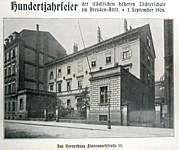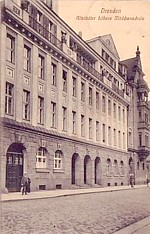Mit dem Gesetz über das höhere Mädchenbildungswesen vom 16. Juni 1910 wurden die höheren Mädchenschulen den Realschulen gleichgestellt. Als weiterführende Studieneinrichtungen dienten höhere Frauenbildungsschulen bzw. höhere Haushaltungsschulen, die nach erfolgreichem Abschluss zum Studium berechtigten. Um künftig den Schülerinnen bessere Bedingungen zu geben, erwarb die Stadt das Gebäude Zinzendorfstraße 15, welches sich einst ab 1838 im Besitz des Bildhauers Ernst Rietschel befunden hatte _(Foto links)_. Nach Plänen von Hans Erlwein entstand auf dem Areal ein Neubau für die Ratstöchterschule. Der bauplastische Schmuck an der Fassade stammte von Alexander Höfer und bestand aus vier Bronzegruppen mit Darstellung spielender Kinder. Bemerkenswert waren auch einige Gittertüren mit floralen Motiven und lernenden Mädchen. Motive aus der Pflanzen- und Vogelwelt setzten das künstlerische Programm an den Brüstungsgittern im dritten Obergeschoss fort _(Foto rechts)_.

Nach dem Ersten Weltkrieg gab es weitere Schulreformen. In diesem Zusammenhang wurde die Ratstöchterschule 1920 offiziell in Altstädter Höhere Mädchenschule umbenannt. Die Aufnahme der Schülerinnen erfolgte nun nach Ende der vierjährigen Grundschulzeit und war mit einer Aufnahmeprüfung verbunden. In den 1920er Jahren besuchten ca. 1000 Mädchen die Schule, die auch ein Schullandheim in Bärenfels besaß. 1945 fiel das Gebäude den Bomben zum Opfer, womit auch die Geschichte der Schule endete. Teile der aus den Trümmern geborgenen Kunstgitter befinden sich heute im Lapidarium.

Volksschulen: Im Zuge des Ausbaus der Pirnaischen Vorstadt entstanden in diesem Viertel in der zweiten Hälfte des 19. Jahrhunderts mehrere Volksschulen, die sämtlich im Zweiten Weltkrieg zerstört wurden. So gab es auf der Pestalozzistraße gleich zwei dieser Schulen: die 1. Volksschule (Nr. 2) und die 18. Volksschule (Nr. 4). Weitere Schulen befanden sich an der Marschallstraße 21 (10. Volksschule), am Seidnitzer Platz 6 (11. Volksschule) und an der Blochmannstraße 2/4 (78.Volksschule). Zwischen 1903 und 1906 folgte in Nachbarschaft zur Kreuzschule ein Schulbau für die I. Bürgerschule und die 9. Bezirksschule.

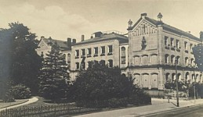1\. und 18. Bezirksschule: Das Gebäude der 1. Bezirksschule entstand 1866/67 nach Plänen des Architekten Theodor Friedrich an der [Pestalozzistraße](../../zentrum/pirnaische_vorstadt/strassen_pirnaische_vorstadt/) 2\. Wenig später folgte auf dem Nachbargrundstück Nr. 4 die 18. Bezirksschule. Beide Schulen wurden nach dem Ersten Weltkrieg bei gleichlautender Nummerierung zu Volksschulen. In den Räumen der 1. Volksschule befand sich zudem ab 1932 eine jüdische Religionsschule. 1945 fielen die Schulgebäude dem Luftangriff zum Opfer.

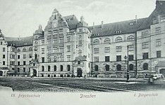I. Bürgerschule und 9. Bezirksschule: Beide Schulen entstanden Ende des 19. Jahrhunderts und hatten ihren Sitz zunächst an der Johannesstraße 18 bzw. am Georgplatz. Die 9. Bezirksschule nutzte dabei ab 1879 die Räume des ehemaligen [Waisenhauses](../../Zentrum/Pirnaische_Vorstadt/Strassen_Pirnaische_Vorstadt/Georgplatz/georgplatz.html). Da diese jedoch nicht mehr den Anforderungen genügten, entschied man sich für einen gemeinsamen Neubau für beide Schulen. Dafür wurde das alte Waisenhaus 1903 abgetragen und an seiner Stelle der Grundstein für einen modernen Schulkomplex gelegt (Georgplatz 4/5). Die Planungen für die 1906 vollendeten Gebäude stammten vom Dresdner Stadtbaurat Hans Erlwein.

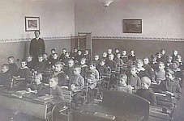Der zum Zeitpunkt seiner Fertigstellung zu den modernsten Schulen der Stadt gehörende Komplex war zugleich Ort innovativer Entwicklungen. Am 15. Juli 1907 fanden hier erstmals in Deutschland Zahnuntersuchungen an den Schülern statt. Die Anregung dazu hatte Karl August Lingner, später Initiator der I. Internationalen Hygieneausstellung gegeben. Aus diesen Reihenuntersuchungen ging eine der ersten Schulzahnkliniken in Deutschland hervor. In der 1. Etage des Gebäudes hatte der Verein zur Förderung Dresdens ein "Lesemuseum" eingerichtet. Dieses verfügte u.a. über ein Unterhaltungs- und Damenzimmer, ein Schreibzimmer sowie mehrere Leseräume, in denen die Besucher rund 100 deutsche Tageszeitungen lesen konnten. Im Keller der Schule befand sich ein Brausebad.

Nach dem Ersten Weltkrieg kam es zu einer Umstrukturierung des Dresdner Schulsystems. Aus der 9. Bezirksschule wurde 1919 die 9. Volksschule, aus der 1. Bürgerschule die 46. Volksschule. Letztere war bis zum Verbot durch die Nazis von 1920 bis 1933 eine Versuchsschule zur Erprobung neuer pädagogischer Konzepte. Später diente sie bis zur Zerstörung des Komplexes als Hilfsschule und II. Fach- und Fortbildungsschule.

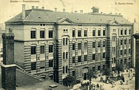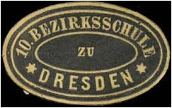10\. Volksschule: Ende des 19. Jahrhunderts entstand am Terrassenufer 11/13 eine weitere Bezirksschule, deren Grundstück sich bis zur Marschallstraße 21 erstreckte. Auf dem Grundstück befanden sich mehrere Gebäude und eine Doppelturnhalle. Zu den hier beschäftigen Lehrkräften gehörte Otto Lippold (+ 1910), der zugleich Vorsitzender der Fibelkommission des Dresdner Lehrervereins war und 1906 eine für alle Volksschulen neue Fibel verfasste. Ab 1919 wirkte hier der spätere Volkskundler Karl Ewald Fritzsch (1894-1974). 1932 wechselte Fritzsch an die Technische Hochschule, promovierte dort 1942 zum Dr. phil. und war nach dem Zweiten Weltkrieg am Wiederaufbau der Landesstelle für Volksforschung beteiligt.

Neben der 10. Bezirksschule gab es in den Gebäuden noch zwei weitere Einrichtungen. Im Dezember 1906 erteilte die Schulbehörde die Genehmigung, in der Turnhalle eine staatliche Impfstelle einzurichten. Zu festgelegten Zeiten fanden hier fortan Reihen-Impfaktionen statt. Außerdem hatte die Ende des 19. Jahrhunderts gegründete Fachschule der Dresdner Köche-Innung einige Räume gemietet. Unter Regie des Obermeisters der Innung, Ernst Lößnitzer, rief man 1901 eine fachspezifische Ausbildung für Köche ins Leben. Die Fachschule bestand bis zum 1. Mai 1935.

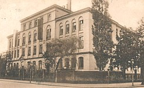11\. Volksschule: Das Gebäude der 11. Volksschule entstand 1876/77 nach Plänen von Theodor Friedrich an der Blochmannstraße 6 unmittelbar am Seidnitzer Platz. Der dreiflüglige Bau besaß 20 Klassenräume, einen Zeichensaal, Lehrer- und Beratungszimmer sowie Wohnungen für Direktor und Schuldiener. Den Abschluss des Schulhofes bildete eine Sporthalle.

Nach dem Ersten Weltkrieg wurde die 6. Bürgerschule zur 11. Volksschule und bestand in dieser Form bis 1938. Außerdem hatte im Haus eine Volksbibliothek ihren Sitz. Ab 1938 nutzte die Musikakademie das Gebäude (Seidnitzer Platz 6), bevor dieses 1945 den Bomben zum Opfer fiel.

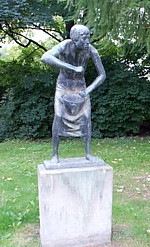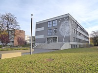18\. POS "Käthe Kollwitz": Das Gebäude der 18. Polytechnischen Oberschule entstand in den 1960er Jahren am Terrassenufer 15 und gehörte zu den ersten Plattenbau-Schulen des weit verbreiteten Typs "Dresden Atrium". Charakteristisch sind die beiden Haupthäuser, die durch zwei Verbindungsgänge mit einander verbunden sind und so zwei kleine Innenhöfe bilden. Wegen der Nähe zum Käthe-Kollwitz-Ufer erhielt die 18. POS nach der deutschen Zeichnerin und Bildhauerin den Namen "Käthe Kollwitz". Nach 1990 wurde die 18. POS geschlossen. Das Gebäude dient heute als Ausweichquartier für Schulen, deren Stamnmhäuser gerade saniert werden. Zu diesem Zweck errichtete man 2018 noch ein zusätzliches Schulgebäude in Modulbauweise _(Foto rechts)_.

Vor der Schule steht eine lebensgroße Bronze-Plastik von Johannes Peschel aus dem Jahr 1965 _(Foto links)_. Die Plastik "Stumme Kattrin" zeigt eine Figur aus Bertolt Brechts Drama "Mutter Courage und ihre Kinder". In diesem Stück fügte der Dichter mit der "stummen Kattrin" extra eine Rolle ohne Text ein, um seiner im Exil ihrer Muttersprache beraubten Lebensgefährtin Helene Weigel eine Auftrittsmöglichkeit zu geben. Das Mädchen opfert sich in diesem Stück selbst, als sie mit dem Schlagen einer Trommel die Bevölkerung vor den heranrückenden Soldaten warnt und deshalb erschossen wird.

19\. POS "Julius Fucik": 1968 entstand an der Zinzendorfstraße 4 ein weiterer Schulneubau vom Typ "Dresden Atrium". Benannt war diese Schule nach dem tschechoslowakischen Widerstandskämpfer Julius Fucik, der 1943 von den Nazis hingerichtet wurde. 1991 bezog die Förderschule für Erziehungshilfe das Gebäude. Die Bildungseinrichtung setzt die Arbeit der erstmals 1965 eingerichteten Versuchsklassen für Kinder mit Auffälligkeiten im Leistungs- und Sozialbereich fort. Am 11. November 1992 erhielt diese Schule den Namen des Schriftstellers Erich Kästner verliehen. Betreut werden hier Schüler im Grundschulbereich durch Förder- und Grundschullehrer mit sonderpädagogischen Zusatzausbildungen, z.B. bei Verhaltensauffälligkeit, Lern- oder Sprachbehinderung.

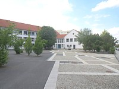Marie-Curie-Gymnasium: Das Gebäude an der Zirkusstraße (ehem. Herbert-Bochow-Straße) entstand 1959/60 für die 2. Polytechnische Oberschule. In Form und Gestaltung unterscheidet es sich deutlich von späteren Typenbauten. Der Baukörper ist im Pavillonsystem mit großzügigen Fensterbändern gestaltet, erhielt verschiedene künstlerische Elemente und stellt deshalb ein wichtiges Zeugnis der Dresdner Nachkriegsarchitektur dar. Am 11. Juli 1973 erhielt die Schule den Namen "Herbert Bochow". Schul- und Straßenname erinnerten an den 1942 hingerichteten Arbeiterschriftsteller und Widerstandskämpfer Herbert Bochow.

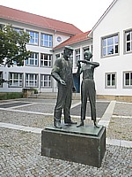Im Zuge der Umstruktierung des sächsischen Schulsystems wurde aus der 2. POS 1991 das Marie-Curie-Gymnasium, ein Gymnasium mit naturwissenschaftlichem, künstlerischem und gesellschaftswissenschaftlichem Profil. Namensgeberin ist die französische Physikerin Marie Curie, die für ihre Forschungen zur Radioaktivität 1903 den Nobelpreis für Physik, 1911 den Nobelpreis für Chemie erhielt. 2013/14 wurde das Gebäude grundlegend saniert und um einen dreistöckigen Neubau erweitert. Die Planungen stammen vom Dresdner Architektenbüro "Code Unique". In diesem Zusammenhang entstand auch eine neue Dreifeld-Sporthalle. Die Wiedereröffnung erfolgte am 5. September 2014.

Im Freigelände vor der Schule fanden mehrere Kunstwerke Aufstellung. Markanteste ist die Plastik "Polytechnischer Unterricht" von Johannes Peschel _(Foto rechts)_. Die 1960/61 entstandene Bronzegruppe zeigt einen Lehrmeister und eine Schülerin in Arbeitskleidung und erinnert an den 1959 in der DDR eingeführten polytechnischen Unterricht, bei dem Schüler der höheren Klassenstufen praktische Erfahrungen in den Betrieben sammeln sollten. Dargestellt ist eine Szene, in der das Mädchen unter Anleitung etwas mit einem Mikrometer vermisst.

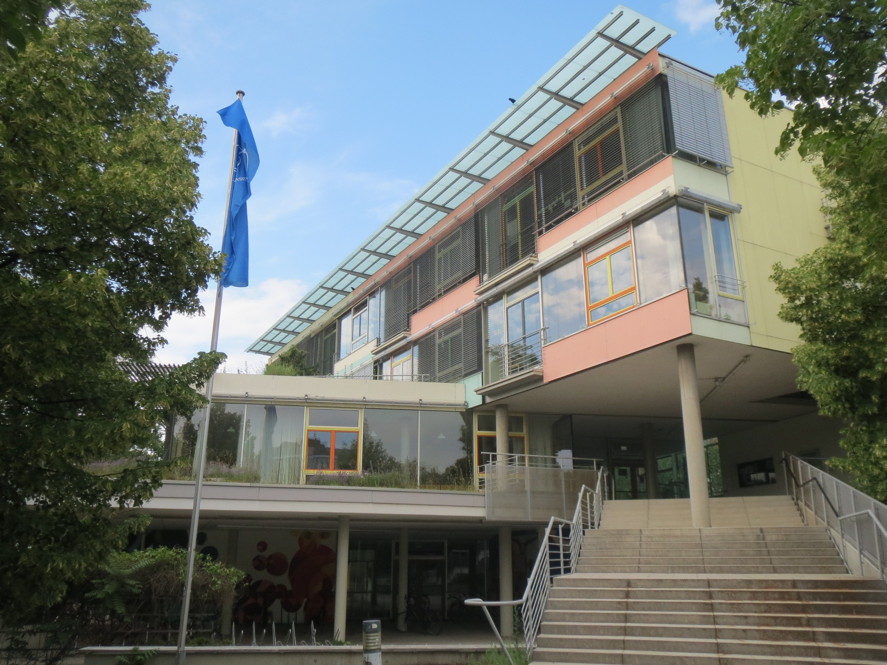St.-Benno-Gymnasium: Die Geschichte dieser vom Bistum Dresden-Meißen getragenen Schule reicht bis ins 18. Jahrhundert zurück. 1709 wurde sie als katholische Lateinschule gegründet. Namenspatron war der legendäre Bischof Benno des wiedererrichteten Bistums Meißen. Das Schulhaus befand sich nach dem Ersten Weltkrieg bis zur Schließung 1939 in der dafür umgebauten Struveschen Villa auf der Wiener Straße 33. Wie alle konfessionellen Schulen musste mit Kriegsbeginn auch das St.-Benno-Gymnasium auf Weisung der Behörden geschlossen werden.

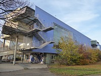Erst nach der Wiedervereinigung war eine Neugründung der Schule möglich. Zunächst befand sie sich ab 1991 bis 1996 im Hinterhaus der Dreikönigsschule auf der Louisenstraße in der Äußeren Neustadt. Einige Klassen waren in einer Zweigstelle auf der Andreas-Schubert-Straße untergebracht. 1996 entstand auf dem Grundstück der 1945 zerstörten und später gesprengten [Johanneskirche](../../Zentrum/Pirnaische_Vorstadt/Johanneskirche/johanneskirche.html) an der Pillnitzer Straße 39 ein moderner Neubau. Das architektonisch ungewöhnliche Schulgebäude wurde nach Plänen des Architektenbüros Günter Behnisch & Partner gestaltet _(Fotos)_. Es besitzt eine farbige Putzfassade mit verglasten Vorbauten und begrünten Dachterrassen. Im Inneren sind neben den Klassenräumen und Fachkabinetten auch ein Video- und Tonstudio, ein Übungsraum für die Katholischen Kapellknaben und eine Sporthalle untergebracht. Heute gilt das St.-Benno-Gymnasium als einer der architektonisch interessantesten Neubauten der Nachwendezeit. Auf dem Vorplatz erinnern einige Trümmerfragmente an die zerstörte Johanneskirche.

[_Weiterführende Literatur und Quellen_](../../impressum/quellenverzeichnis/)

 \[ [Home](../../index.html)\] \[ [Nord](../../nord/)\] \[ [Nordwest](../../nordwest/)\] \[ [Neustadt](../../neustadt/)\] \[ [Nordost](../../nordost/)\] \[ [West](../../west/)\] \[ [Zentrum](../../zentrum/)\] \[ [Südwest](../../sudwest/)\] \[ [Süd](../../sud/)\]
 \[ [Südost](../../sudost/)\] \[ [Ost](../../ost/)\] \[ [Register](../../Register/register.html)\] \[ [Kontakt](../../Kontakt/kontakt.html)\] \[ [Impressum](../../impressum/)\]
