* * *

**Werbeplakate Dresdner Ausstellungen**

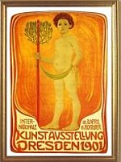

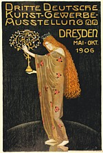

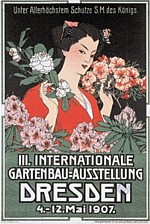

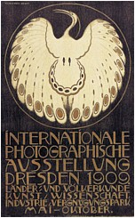

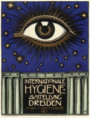

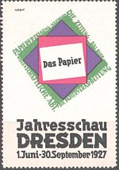

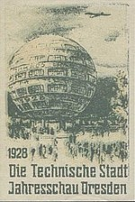

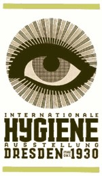

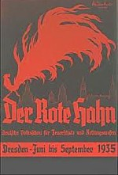

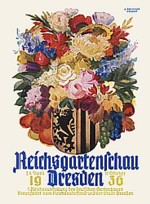

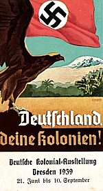

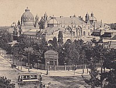Die Geschichte des Ausstellungsgeländes am [Straßburger Platz](../../../zentrum/pirnaische_vorstadt/strassen_pirnaische_vorstadt/strassburger_platz/) (früher Stübelplatz) begann im Jahr 1896, als hier der neue Ausstellungspalast eröffnet wurde. Zuvor hatte es bereits verschiedene Ausstellungen an anderen Orten der Stadt gegeben, u.a. in der Orangerie an der Herzogin Garten, im Johanneum und im Gewerbehaus an der Ostra-Allee. Zu deren Förderern gehörten die 1826 gegründete "Flora" - Gesellschaft für Gartenbau und Botanik sowie der 1834 auf Anregung von Andreas Schubert entstandene Gewerbeverein. Aus Anlass des 6. Deutschen Turnfestes auf den Feldern an der Grunaer Straße entstand 1885 die Idee, auf dieser verkehrsgünstig gelegenen Freifläche ein Areal für künftige Großausstellungen zu schaffen. Zwei Jahre später fand im Großen Garten die I. Internationale Gartenbauausstellung statt, für welche zahlreiche temporäre Gebäude errichtet wurden. Der Erfolg dieser Ausstellung trug maßgeblich dazu bei, am Nordwestrand des Großen Gartens Planungen für ein ständig nutzbares Ausstellungsgelände zu erarbeiten und in die Tat umzusetzen. 1888 fand dafür ein städtebaulicher Wettbewerb statt, den der Architekt Alfred Hauschild gewann. 1894 bestätigten die Stadtverordneten das Projekt und ließen das bislang geltende Bauverbot vom König aufheben.

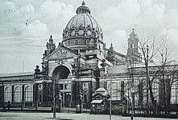Zwischen 1894 und 1896 entstand nun nach Plänen von Stadtbaurat Edmund Bräter und Stadtbaumeister Richard Möbius das im Stil der Neorenaissance gestaltete T-förmige Hauptgebäude, der sogenannte Ausstellungspalast. An den Mittelbau
mit Oberlicht und Kuppel schlossen sich zwei Eckgebäude und ein rechteckiger Saalbau an. Im Inneren befanden sich mehrere Säle sowie Gesellschafts- und Verwaltungsräume und ein Restaurant. Die offizielle Einweihung erfolgte im
Rahmen der II. Internationalen Gartenbauausstellung am 2. Mai 1896. Zu den Ehrengästen gehörte der sächsische König Albert. Wenige Tage später wurde auch Kaiser Wilhelm II. als Besucher begrüßt. Für zwei Wochen konnten die Besucher
hier und auf dem angrenzenden 12,5 Hektar großen Freigelände die Leistungen sächsischer Gärtner und Landschaftsgestalter bewundern.

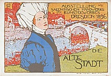Ein weiterer Höhepunkt des Eröffnungsjahres war die viel besuchte Schau "Die Alte Stadt", bei der an der Lennéstraße zwischen Grunaer Straße und Johann-Georgen- Allee Nachbauten historischer Gebäude im Stil einer mittelalterlichen deutschen Stadt errichtet wurden. Die Planungen oblagen den Architekten Bruno Adam (alte Stadt) und Adolf Grothe (wendisches Dorf). Zu den Attraktionen der offiziell "Ausstellung des Sächsischen Handwerks und Kunstgewerbes" genannten Schau gehörten ein Marktplatz mit Rathaus im Stil des 17. Jahrhunderts, eine Festungsanlage mit Torturm und Zugbrücke sowie das "wendische Dorf" als Reminiszenz an die bäuerliche sorbische Kultur in Sachsen. Neben fiktiven Gebäuden wurden dafür auch einige Dresdner Wahrzeichen wie der Queckbrunnen und das Belvedere der Brühlschen Terrasse nachgebildet. In den Häusern befanden sich kleine Museen, Präsentationen kunsthandwerklicher Arbeiten und zahlreiche, meist von Dresdner Gastronomen bewirtschaftete Gaststätten. Darsteller in historischen Kostümen rundeten das "mittelalterliche" Bild ab. Im wendischen Dorf boten Windmühle, Fährhaus, Museum und ein mit Kähnen befahrbarer künstlicher Kanal weitere Anziehungspunkte. Die vom 20. Juni bis 27. September 1896 geöffnete Ausstattung soll historischen Überlieferungen zufolge mehrere Millionen Besucher angezogen haben.

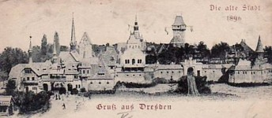

**_Foto:_** _Ausstellung "Die alte Stadt" 1896_

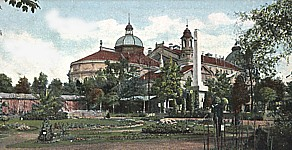In der Folgezeit wurden der Ausstellungspalast und das angrenzende Freigelände für Gewerbe- und Kunstausstellungen, Tier- und Blumenschauen, aber auch für Konzerte und ähnliche Veranstaltungen genutzt. Insgesamt fanden zwischen 1898 und 1912 elf große Ausstellungen statt. So gab es im Jahr 1900 die "Deutsche Bauausstellung", drei Jahre später die "Deutsche Städteausstellung", bei denen moderne Konzepte im Städtebau, neuartige Bautechniken und -konstruktionen vorgestellt wurden _(Foto rechts)_. Zeichnungen, Modelle und Fotografien zeigten, wie künftig Krankenhäuser, Schulen, Schlachthöfe, Elektrizitätswerke und Feuerwachen gestaltet werden sollten. Erstmals verkehrte bei diese Schau eine elektrische Ausstellungsbahn. Auf Anregung des Dresdner Unternehmers Karl August Lingners wurde zudem eine Sonderschau zum Thema "Volkskrankheiten und ihre Bekämpfung" organisiert. Im Rahmen der Ausstellung wurde 1903 die Gründung des "Deutschen Städtetag" beschlossen.

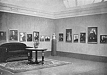1906 gab es am Stübelplatz die "3. Deutsche Kunstgewerbeausstellung", die den Bogen von künstlerisch gestalteten Möbeln und Innenausstattungen bis zu Verpackungen spannte. Die Schau war Ausgangspunkt für die Gründung des Deutschen Werkbundes und Initialzündung für Karl Schmidts Pläne zur [Gartenstadt Hellerau](../../../nord/hellerau/). 1907 folgte die III. Internationale Gartenbau-Ausstellung, 1909 die Internationale Photographische Ausstellung (IPHAD). Schirmherr dieser Leistungsschau der Fotografie war König Friedrich August III. von Sachsen. Die vom 1. Mai bis zum 10. Oktober geöffnete Ausstellung zog über 1.600 Aussteller aus mehr als 20 Ländern, darunter aus der Türkei, England, Japan, der USA und Australien an. Verschiedene Abteilungen präsentierten künstlerische Fotografie, Reklame und wissenschaftliche Arbeiten sowie technische Neuentwicklungen _(Foto)_.

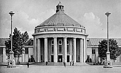Unter Regie Karl August Lingner fand vom 6. Mai bis zum 31. Oktober 1911 die I. Internationale Hygieneausstellung statt, die mehr als 5 Millionen Besucher anzog und bis dahin meistbesuchte Schau in Dresden war. In mehreren Pavillons waren Exponate zum Thema Gesundheit und Hygiene zu sehen, wobei die von Lingner selbst konzipierte Halle "Der Mensch" _(Foto)_ das Kernstück der Schau bildete. Die dort gezeigten Exponate waren später Grundstock für das [Deutsche Hygiene-Museum](../../../Zentrum/Pirnaische_Vorstadt/Strassen_Pirnaische_Vorstadt/Hygienemuseum/hygienemuseum.html). Erhalten blieb auch der für die Ausstellung aus Shanghai transportierte Staatspavillon Chinas, der ab 1912 als Lesehalle im [Kurpark Weißer Hirsch](../../../nordost/page10246/rathauspark/) aufgestellt wurde.

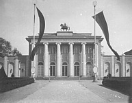Höhepunkte im Kulturleben der Stadt waren die von 1897 bis 1912 regelmäßig durchgeführten internationalen Kunstausstellungen. Mit Beginn des Ersten Weltkrieges endete diese Entwicklung und der Ausstellungspalast wurde in ein Lazarett umgewandelt. Trotzdem gelang es der Stadt Dresden, zwischen 1914 und 1916 an der Lennéstraße ein modernes Kunstausstellungsgebäude zu bauen. Die Planungen stammten von Hans Erlwein, die Leitung übernahm nach dessen Tod
der Stadtbaudirektor Carl Hirschmann. Das neoklassizistische Gebäude bestand aus einem schlichten weißen Hauptbau mit Freitreppe und Säulenvorhalle _(Foto)_, einem rechtwinklig angefügten Verwaltungsgebäude und drei miteinander verbundenen Pavillons. Den Mittelbau krönte eine vom Bildhauer Georg Wrba geschaffene Diana-Plastik.

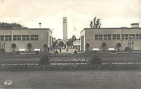Erst 1921 gelang es, an die Traditionen der Vorkriegszeit anzuknüpfen. Dafür gründete sich ein "Verein zur Veranstaltung der Jahresschau Deutscher Arbeit Dresden", der ein neues Konzept für das Areal erarbeitete. Ab 1922 war das Gelände Schauplatz der bis 1939 alljährlich durchgeführten "Dresdner Jahresschauen" zu wechselnden Themen, welche als Kombination von Gewerbe- und populärwissenschaftlichen Ausstellungen tausende Besucher anzogen. Themen waren u.a. "Porzellan, Keramik, Glas" (1922), "Spiel und Sport" (1923), "Textil" (1924) "Wohnung und Siedlung" (1925), "Das Papier" (1927 - _Foto)_, "Die technische Stadt" (1928) sowie "Reisen und Wandern" (1929). Die Jahresschau 1926 war als Gartenbauausstellung dem 100. Jubiläum der "Flora" gewidmet und wurde mit einer Kunstausstellung kombiniert. Dafür wurden Teile des Großen Gartens einbezogen und die Herkulesallee zur "Straße der 100 Brunnen" umgestaltet. Wahrzeichen der Schau war ein 35 Meter hoher Turmbau, der als "Grüner Dom" das Gelände überragte. Heute erinnert noch der erhalten gebliebene Mosaikbrunnen an diese Ausstellung.

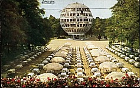Für die einzelnen Jahresschauen entstanden rund um den Ausstellungspalast verschiedene Nebengebäude, welche zum Teil nach dem Ende der Schau beseitigt, teilweise aber auch erhalten blieben. Im Rahmen der Jahresschau von 1923 wurde die alte Radrennbahn zum [Sportstadion](../../../Zentrum/Pirnaische_Vorstadt/Rudolf-Harbig-Stadion/rudolf-harbig-stadion.html) umgebaut. 1927 gab es im Rahmen der Jahresschau "Das Papier" einen "sprechenden Zeitungsturm" sowie Präsentationen aller großen Dresdner Tageszeitungen. Für Aufsehen sorgte das 1928 für die Jahresschau "Die technische Stadt" errichtete [Kugelhaus](../../../Zentrum/Pirnaische_Vorstadt/Ausstellungsgelande/Kugelhaus/kugelhaus.html), erstes derartiges Gebäude der Welt. 1938 musste das Gebäude den ideologischen Vorstellungen der Nazis weichen. In weiteren Hallen wurden technische Errungenschaften dieser Zeit vorgeführt, u.a. der erste deutsche Tonfilm.

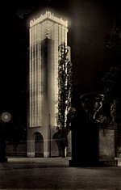Die am 17. Mai 1930 eröffnete II. Internationale Hygieneausstellung mit Ausstellern aus 22 Staaten war Geburtsstunde des Hygienemuseums, mit welchem Lingners Vermächtnis umgesetzt werden konnte. Die Dresdner [Lingner-Werke](../../../zentrum/sudvorstadt/strassen_sudvorstadt/zwickauer_strasse/lingner-werke/) begleiteten die Exposition mit einem großangelegten Werbefeldzug, bei dem eigene Luftschiffe und Kleinflugzeuge zum Einsatz kamen. Konkurrent Chlorodont errichtete einen 37 Meter hohen Reklameturm, welcher nachts von 1700 Glühlampen beleuchtet wurde _(Foto)_. Wegen des großen Erfolgs dieser Ausstellung gab es bereits 1931 eine Fortsetzung in etwas veränderter Form, welche jedoch deutlich weniger Besucher anzog. Zur Erschließung des ausgedehnten Ausstellungsgeländes kam 1930
erstmals eine Liliputeisenbahn zum Einsatz, deren Strecke von der Bürgerwiese aus über die Lennéstraße hinweg zum Kugelhaus führte und an den Eichwiesen im Großen Garten endete. Die 1925 gebauten Dampfloks wurden auch später noch als Ausstellungsbahn eingesetzt und gehören seit 1950 zum Fahrzeugbestand der Dresdner Parkeisenbahn.

Zu den bedeutenden Expositionen außerhalb der Jahresschauen gehörte die vom 2. bis 4. Dezember 1927 durchgeführte "25. Deutsche Nationale Jubiläums-Geflügel-Ausstellung". Mit über 12.000 Tieren und ca. 2000 Züchtern war sie bislang
größte Schau ihrer Art in Europa.

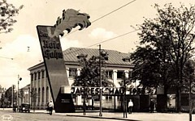Mit Machtantritt der Nationalsozialisten wurden auch die Ausstellungskonzepte der Jahresschauen den neuen ideologischen Vorstellungen der Machthaber angepasst. So widmete sich die zum Thema Feuerwehr gestaltete Ausstellung "Der rote Hahn" (1935) neben dem klassischen Feuerwehr- und Rettungsdienst auch dem Luftschutz. Hauptanziehungspunkt war jedoch die Ehrenhalle der Deutschen Feuerwehr mit einer Präsentation historischer Gerätschaften und Fahrzeuge. 1937 folgte eine Schau zum Thema "Garten und Heim" und als letzte
große Ausstellung vor Kriegsbeginn die "Deutsche Kolonialausstellung" 1939.

Weit über die Stadtgrenzen hinaus zog 1936 die Reichsgartenschau ihre Besucher an. In fünf großen und mehreren kleinen Hallen und auf einem Freigelände von über 400.000 Quadratmetern bewiesen Gärtner und Landschaftsgestalter ihr Können. Begleitet wurde die Schau durch verschiedene Sonderausstellungen und Veranstaltungen wie Modenschauen und Turnvorführungen. Täglich besuchten bis zu 20.000 Besucher die Gartenschau, am 23. August wurden sogar 76.000 Gäste auf dem Gelände gezählt. Im Zusammenhang mit der Reichsgartenschau wurde auch das Neustädter Königsufer komplett neu gestaltet und der Rosengarten angelegt.

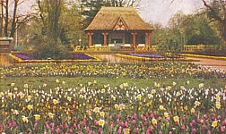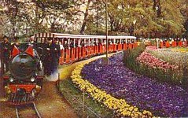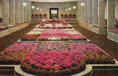

_Bilder von der Reichsgartenschau 1936: Blumenwiese - Ausstellungsbahn - große Blumenhalle_

Beim Luftangriff 1945 wurde das Ausstellungsgelände schwer getroffen und sämtliche Bauten zerstört. Der Ausstellungspalast selbst war 1946 zunächst für einen Wideraufbau vorgesehen, wurde jedoch im Sommer 1949 abgerissen. Einige Fragmente des Gebäudes sind heute in den Anlagen der Gläsernen VW-Manufaktur zu sehen. In den Folgejahren fanden die meisten Ausstellungen in der Nordhalle (heute [Militärhistorisches Museum](../../../neustadt/albertstadt/strassen_albertstadt/stauffenbergallee/militarmuseum/)) statt.

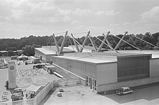1969 versuchte die Stadt Dresden, an die Tradition des Ausstellungsgeländes anzuknüpfen und errichtete zwei moderne Messehallen, welche fortan für verschiedene Ausstellungen und Veranstaltungen genutzt wurden. Die durch zwei verglaste Gänge miteinander verbundenen modernen Doppelhallen wurde von Günter Fischer und Werner Barthel entworfen und boten über 4.000 m² Ausstellungsfläche _( **Foto:** SLUB / Fotothek)_. Weitere 11.000 m² Fläche kamen im Freigelände hinzu. Bemerkenswert war das durch Pylonen getragene Dach, dass einen stützenfreien Innenraum ermöglichte. Neben den beiden Hallen gab es ein Verwaltungs- und Lagergebäude und verschiedene kleinere Bauten. Die Eröffnung des Ausstellungszentrums erfolgte am 5. Oktober 1969 mit der 1. Lehr- und Leistungsschau des Bezirkes Dresden. Ein Jahr später fand auf dem Areal der 5. Welt-Getreide- und Brot-Kongress (24. bis 29. Mai 1970) mit internationaler Fachausstellung statt.

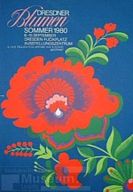Später gab es hier u.a. regelmäßige Blumenausstellungen _("Dresdner Blumensommer" 1980)_, die DDR-Kunstausstellungen 1977/78, 1982/83 und 1987/88, aber auch Hunde- und Katzenschauen, Konzerte und Silvesterbälle. Die Freiflächen am Straßburger Platz waren zudem Platz für Volksfeste und zeitweise bis 1976 auch für den Striezelmarkt. Betreiber des gesamten Komplexes war zunächst der kommunale VEB Ausstellungen der Stadt Dresden, ab 1979 der VE Veranstaltungsbetrieb.

1994 übernahm die neu gebildete Dresdner Ausstellungsgesellschaft mbH (DAG) die Bewirtschaftung des Geländes. Den neuen wirtschaftlichen Rahmenbedingungen entsprechend gab es nun wieder Fach- und Verbrauchermessen, den "Kunstmarkt Dresden" sowie die Weihnachtsschau "Dresdner Weihnacht". 1995 entstand zur Vergrößerung der Fläche eine Gruppe von Leichtbauhallen mit insgesamt 8.500 Quadratmetern. Mit der 17. Messe "Dresdner Frühjahr" und der folgenden "Deutschen Theater Messe" endete am 25. April 1999 die Messetradition am Straßburger Platz. Wenig später mussten sämtliche Gebäude dem geplanten Neubau der VW-Manufaktur weichen. Die beiden großen Messehallen waren bereits am 27. März 1999 gesprengt worden. Heute befindet sich auf dem Grundstück die ["Gläserne Manufaktur"](../../../Zentrum/Pirnaische_Vorstadt/Strassen_Pirnaische_Vorstadt/Strassburger_Platz/Gläserne_Manufaktur/gläserne_manufaktur.html) der Volkswagen AG. Als neues Messe- und Ausstellungsgelände dient seitdem der frühere [Schlachthof](../../../zentrum/friedrichstadt/ostragehege/schlachthof/) im Ostragehege.

* * *

 \[ [Home](../../../index.html)\] \[ [Nord](../../../nord/)\] \[ [Nordwest](../../../nordwest/)\] \[ [Neustadt](../../../neustadt/)\] \[ [Nordost](../../../nordost/)\] \[ [West](../../../west/)\] \[ [Zentrum](../../../zentrum/)\] \[ [Südwest](../../../sudwest/)\] \[ [Süd](../../../sud/)\] \[ [Südost](../../../sudost/)\] \[ [Ost](../../../ost/)\] \[ [Register](../../../Register/register.html)\] \[ [Kontakt](../../../Kontakt/kontakt.html)\] \[ [Impressum](../../../impressum/)\]
