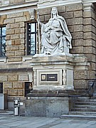
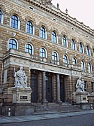
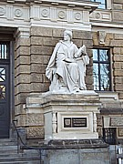
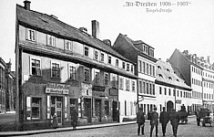

Die Amalienstraße wurde im 18. Jahrhundert angelegt und führte vom Pirnaischen Platz in Richtung Elbufer bis zum Amalienplatz (heute Rathenauplatz). Zunächst wurde sie Am Festungsgraben vor dem Pirnaischen Thore genannt und galt seit 1815 als Teil der inzwischen ausgebauten Johannisstraße. Zu Ehren von Königin Amalie (1801-1877, der Gemahlin von König Johann, erhielt sie 1840 den Namen Amalienstraße.Im Zuge des Wiederaufbaus nach 1945 und der Neugestaltung der Verkehrsachse vom Hauptbahnhof zur Carolabrücke wurde die Amalienstraße Teil der Leningrader Straße. Seit 1991 trägt dieser Straßenzug den Namen [St. Petersburger Straße](../../../Zentrum/Pirnaische_Vorstadt/Strassen_Pirnaische_Vorstadt/St_Petersburger_Strasse/st_petersburger_strasse.html).

Palais Fürstenhoff: Das Barockpalais wurde 1740 vom Festungsbaumeister Maximilian von Fürstenhoff nach eigenem Entwurf für sich selbst erbaut und hatte seinen Standort ungefähr am Beginn der späteren Amalienstraße. Fürstenhoff, ein Sohn Johann Georg II. war ab 1718 u.a. am Umbau des Weißen Tores in der Neustadt, 1740 an der Erweiterung des Pirnaischen Tores beteiligt. Außerdem arbeitete er bei der Neugestaltung des Zeughauses (Albertinum) und beim Ausbau der Festung Königstein mit. Das dreistöckige Palais besaß eine aus elf Fensterachsen bestehende Fassade und gehörte zu den größten Wohnbauten seiner Art in Dresden. Der Mittelteil war von einem Dreieckgiebel mit einer Wappenkartusche bekrönt und trug zudem eine krönende Vase. Während des Siebenjährigen Krieges brannten die Preußen im November 1758 die Pirnaische Vorstadt nieder, wobei auch das Palais Fürstenhoff zerstört wurde.

Kaiserpalast (Nr. 1): Architektonisch interessantestes Gebäude der Amalienstraße war der Kopfbau am Pirnaischen Platz _(Foto)_, bekannt als [Kaiserpalast](../../../Zentrum/Pirnaische_Vorstadt/Strassen_Pirnaische_Vorstadt/Kaiserpalast/Kaiserpalast.html). Der neobarocke Bau entstand 1896/97 nach einem Entwurf des Architektenbüros Schilling und Graebner und diente als Bürohaus, Restaurant und Varieté. Zuvor hatte auf dem Grundstück ein zweistöckiges Gebäude gestanden, welches als "Scharfe´sches Restaurant" bzw. Restaurant und Café Pirnaischer Platz bekannt war. 1896 erwarb der Apotheker Hermann Ilgen dieses Haus und ließ es für den Neubau des Kaiserpalastes abtragen.

Nr. 3: Im Anschluss an den Kaiserpalast gab es eine doppelte Häuserreihe, die die schmale Fläche zwischen Moritzallee (Moritz-Ring) und Amalienstraße einnahm. In den Hausnummern Amalienstraße 3 / Moritzallee 3 gab es um 1900 Gebauer's Hotel garni mit dem Restaurant Moritzkeller. Das auch als "Hauswalds Alte Weißbierstuben" bzw. "Dresdner Felsenkeller Bierstuben" bekannte Lokal existierte noch bis 1945. Außerdem gab es im Haus nach 1930 eine Filiale der Schokoladenfabrik Bruno Clauß. In der dritten Etage des Gebäudes besaß der Landvermesser Emil Ueberall gemeinsam mit Max Ehnert ein Vermessungbüro. Ueberall entwarf u.a. das Straßennetz in Löbtau und Cotta.

Nr. 5 - 21: Die angrenzenden Häuser dienten als Wohn- und Geschäftshäuser verschiedener Unternehmen. So gab es in der Nr. 5 das Kleidergeschäft Keller & Richter, in der Nr. 9 Weiske's Buchhandlung und die Piano- und Musikalienhandlung Hoffmann. Die Hausnummern 11/13 waren als "Rehfeldhaus" bekannt, da hier der Händler Albert Rehfeld seine große Papier u. Schreibwarenhandlung betrieb. In der Nr. 19 befand sich ab ca. 1910 das vegetarische Speisehaus von Marie Leruth _(Bild)_. Außerdem betrieb hier C. R. Richter eine Kronleuchterfabrik. Zu den bekannten Bewohnern dieser Gebäudegruppe gehörte der Königliche Hof-, Opern- und Kirchensänger Eugen Degele, nach dem die Degelequelle im [Kurpark Weißer Hirsch](../../../nordost/page10246/rathauspark/) benannt ist (Nr. 9) sowie Kreuzkantor Rudolf Mauersberger (Nr. 17).

Nr. 23: Den Abschluss zum Amalienplatz bildete das als Pendant zum Kaiserpalast anzusehende, wenn auch etwas weniger aufwendig gestaltete, Redlichhaus. Das Wohn- und Geschäftshaus entstand bereits 1871 und befand sich im Besitz der als "Privatus" bezeichneten Martha Elisabeth Redlich. Gemeinsam mit ihrem Mann, einem früheren Ziegeleibesitzer und Holzhändler, lebte sie zunächst in Neustadt/Sachsen, später in Plauen im Vogtland und vermietete das Gebäude an verschiedene Unternehmen. So gab es hier 1897 "Fuhrmann´s Kaiserpanorama" mit einem fotorealistisch gestalteten Alpenpanorama, wie es zu dieser Zeit in Mode war. Im gleichen Jahr öffnete das neu gestaltete "Restaurant zum Redlichhaus" des Thüringer Gastwirtes Ritter. Hier fanden häufig auch Versammlungen und Vereinstreffen statt. Im Januar 1900 gründeten im Redlichhaus der "Dresdner Sportklub", der "Dresdner Fußballklub von 1893" und der "Ballspielklub Sportlust" einen Verband Dresdner Ballspielvereine.
Weiterhin gab es im Haus die Firma Brecher & Co., die für ihre Wäsche-, Konfektion- und Tapisseriewaren warb.

1945 fiel die gesamte Häuserzeile dem Luftangriff zum Opfer. Zunächst blieb lediglich die ausgebrannte Ruine des Kaiserpalastes erhalten, bevor auch dieses Gebäude Anfang der 1950er Jahre beseitigt wurde. Heute befindet sich hier ein Grünstreifen, der die Fahrbahnen der St. Peteresburger Straße teilt.

Nr. 2: Auf der gegenüber liegenden Straßenseite stand an der Ecke zur Grunaer Straße das sogenannte "Bismarckhaus", in dem sich ab 1897 eine Niederlassung der Leipziger Manufaktur- und Modewarenfirma Steigerwald & Kaiser befand. Nach der Jahrhundertwende ließ der Unternehmer Carl Gustav Heinrich das Gebäude umbauen und nutzte es bis zur Zerstörung 1945 als Warenhaus. Architekt des Umbaus war Philipp Wunderlich, die Innenräume gestaltete Richard Kühn.

Auch die benachbarten Grundstücke bis zum Amalienplatz, unterbrochen von der heute nicht mehr vorhandenen Serrestraße und der Drehgasse, beherbergten in den Erdgeschossen verschiedene Geschäfte. So gab es in der Nr. 4 die Victoria-Drogerie, später Amalien-Drogerie genannt. In der Amalienstraße 18 war die Papiergroßhandlung J. C. Kayser & Co zu finden. Im Hintergebäude von Nr. 12 befanden sich zeitweise die Komet-Fahrradwerke Kirschner & Co.

**_Fotos:_** _Die Konditorei Curfürst (Amalienstraße 8) in den 1920er Jahren_

Schirmfabrik Claus & Hofmann (Nr. 12): In diesem Haus produzierte ab 1912 die Schirmfabrik Claus & Hofmann unter dem Markennamen "Claho" Regen- und Gartenschirme. 1931 verlegte man den Sitz zur Kaulbachstraße 22. Nach der Zerstörung des Gebäudes führte der Sohn des Firmengründers das Unternehmen als "Schirmhaus Henry Hofmann" bis zu seinem Tod 1963 weiter. Danach übernahmen dessen Töchter den Betrieb unter dem Namen Schirmwerkstätten Hoffmann & Bouffée. 1970 wurde das Geschäft auf die Königsbrücker Straße verlegt. 1998 übergaben die Schwestern die Leitung an einen früheren Mitarbeiter, der den Laden bis zum 30. Juni 2013 führte. Danach erfolgte ein Umzug nach Berlin.

Außerdem gab es an der Ostseite der Amalienstraße mehrere Lokale und Konditoreien. Bekannt war die Konditorei Kurfürst (Nr. 8), die sich im Besitz des Konditors Schmorl befand. Erhard Schmorl war zugleich Inhaber des Kaffee Beyer (Wilsdruffer Straße 20) und ließ sein Geschäft vom bekannten Jugendstilarchitekten Heino Otto ausgestalten. Eine weitere Konditorei gab es mit Ferger's Conditorei und Café in der Nr. 16. Später wurde diese als Wiener Cafe und Konditorei Schnötzinger fortgeführt. Dritte gastronomische Einrichtung war das Hotel [Amalien-Hof](../../../Zentrum/Pirnaische_Vorstadt/Strassen_Pirnaische_Vorstadt/Pillnitzer_Strasse/pillnitzer_strasse.html) (Nr. 24) mit der Amalienschänke im Erdgeschoss, welches gern von Geschäftsreisenden besucht wurde.

**_Fotos:_** _Werbekarte des Hotels Amalienhof und ein Blick in die Amalienschänke um 1910_

Die Blochmannstraße erhielt ihren Namen 1874 nach dem Ingenieur und Unternehmer Rudolf Sigismund Blochmann (1784-1871). Blochmann war ab 1818 Inspektor des Mathematisch-Physikalischen Salons und ließ 1828 die erste Gasbeleuchtungsanlage in Dresden installieren. 1851 vollendete er die erste städtische Röhrleitung mit steinernen Röhren, die er mit Hilfe einer von ihm entwickelten Röhrenbohrmaschine herstellen ließ. Außerdem gehörte er zu den Mitbegründern der Technischen Bildungsanstalt.

Zu den ersten Gebäuden der neu angelegten Straße im Osten der Vorstadt gehörte die 1876-77 entstandene [6\. Bürgerschule](../../../zentrum/pirnaische_vorstadt/) (11\. Volksschule) am Seidnitzer Platz. Drei Jahre später erhielt das [Ehrlichsche Gestift](../../../Zentrum/Pirnaische_Vorstadt/Strassen_Pirnaische_Vorstadt/Ehrlichsches_Gestift/ehrlichsches_gestift.html) zwischen Blochmann- und Eliasstraße (Güntzstraße) sein neues Stiftsgebäude. 1904-07 folgte die Stiftskirche. Die übrigen Flächen nahmen bis zur Zerstörung des Areals Wohn- und Geschäftshäuser ein _( **Foto links:** Blochmannstraße 20)_. In einem dieser Gebäude (Nr. 27) befand sich seit ca. 1900 mit dem "Flora-Bad" eine öffentliche Badeanstalt mit Wannen- und Brausebädern.

1945 fielen sämtliche Gebäude der Blochmannstraße dem Luftangriff zum Opfer. An ihrer Stelle errichtete man 1954/55 die Wohnzeile Blochmannstraße 1-19 _(Foto rechts)_. Gestaltet wurden die fünfgeschossigen Häuser mit ca. 400 Wohnungen nach Plänen des Architekten Wolfgang Hänsch. Dabei wählte man eine klassische Bauweise mit Sandstein-Putzfassaden und künstlerischem Schmuck in Anklang an den Dresdner Barock. Am Kopfbau zum Straßburger Platz (Nr. 1) befindet sich ein Sandsteinrelief von Magdalene Kreßner. Die 1955 fertiggestellte Arbeit zeigt spielende und musizierende Kinder in der Karnevalszeit. Die gesamte Anlage steht heute unter Denkmalschutz.

Neben neuen Wohnhäusern wurden auf der gegenüberliegenden Straßenseite auch verschiedene öffentliche Gebäude errichtet. 1950/51 entstand nach Plänen von Emil Leibold der Neubau der [Hochschule für Musik "Carl Maria von Weber"](../../../Zentrum/Pirnaische_Vorstadt/Musikhochschule/musikhochschule.html) (Blochmannstraße 2-4). Teile der früheren Stiftsgebäude bezog man dabei ein. Unter Denkmalschutz steht auch das benachbarte [Berufliche Schulzentrum Bau und Technik](../../../zentrum/pirnaische_vorstadt/strassen_pirnaische_vorstadt/strassburger_platz/), 1953 von Gottfried Kintze in traditioneller Bauweise mit Sandsteinputzfassaden gestaltet (Güntzstraße 3). Vor dem Haus steht eine von Wilhelm Landgraf geschaffene Bronzegruppe "Meister und Lehrling". Den Abschluss des Straßenzuges bildet das achtstöckige Wohn- und Atelierhaus Pillnitzer Straße 32.

Die heutige Blüherstraße war ursprünglich Teil des sogenannten Environweges, der als äußerer Umgehungsweg um die Festungsanlagen führte und dabei zugleich die Altstadt von den Vororten abgrenzte. Nach dem in der Nähe gelegenen Pirnaischen Schlag, einer Erhebungsstelle für städtische Abgaben, wurde die Straße zunächst "Vor dem Pirnaischen Schlage" genannt. 1840 erfolgte nach dem Stammvater der albertinischen Wettiner, Albrecht dem Beherzten (1443-1500), die Umbenennung in Albrechtgasse. Im Zuge des Ausbaus wurde diese ab 1874 Albrechtstraße genannt _( **Foto:** Walter Möbius - SLUB/Fotothek)_.

1931 erhielt der Abschnitt zwischen Lingnerplatz und Parkstraße zu Ehren des Dresdner Oberbürgermeisters Bernhard Blüher (1864-1938) den Namen Blüherallee. Blüher hatte 1915 das Amt von Otto Beutler übernommen und führte die Geschicke der Stadt in der schwierigen Zeit nach dem Ersten Weltkrieg. Nach seinem Ausscheiden aus dem aktiven Dienst beschlossen die Stadtverordneten im März 1931, den unter seiner Regie entstandenen Park am Hygienemuseum künftig [Blüherpark](../../../Zentrum/Pirnaische_Vorstadt/Blüherpark/bluherpark.html) zu nennen und gleichzeitig der vorbeiführenden Straße den Namen Blüherallee zu verleihen.

Diese Namensgebung existierte jedoch nur zwei Jahre. Nach dem Machtantritt der Nationalsozialisten wurde die Blüherallee 1933 in Hans-Schemm-Allee umbenannt. Schemm (1891-1935) gehörte als Abgeordneter der NSDAP dem Reichstag an und war Gründer des Nationalsozialistischen Lehrerbundes sowie bayrischer Kultusminister. 1946 wurden Albrechtstraße und Hans-Schemm-Allee vereinigt und gemeinsam in Blüherstraße umbenannt.

Nr. 1d: Zu den prominenten Bewohnern der Albrechtstraße gehörte der Rabbiner Dr. phil. Jacob Winter (Nr. 1d). Winter studierte bis 1886 Theologie und übernahm im Folgejahr das Amt des Rabbiners der jüdischen Gemeinde in Dresden. 1911 wurde er zum Professor ernannt. Auch nach Machtübernahme der Nationalsozialisten blieb er bis 1936 im Amt und starb am 30. März 1940 in Dresden. Sein Grab befindet sich auf dem [Neuen Jüdischen Friedhof](../../../zentrum/johannstadt/neuer_judischer_friedhof/).

Handelskammer (Nr. 4): Bis 1945 befand sich auf dem Grundstück der Sitz der Handelskammer. Diese war am 21. Juli 1862 als Handels- und Gewerbekammer gegründet worden. 1902 trennten sich beide Bereiche in selbstständige Abteilungen. Für die Gewerbekammer entstand ein Gebäude an der [Grunaer Straße 50](../../../Zentrum/Pirnaische_Vorstadt/Strassen_Pirnaische_Vorstadt/Grunaer_Straße/grunaer_strasse.html). Die Handelskammer ließ sich 1909-1910 ein großes Verwaltungsgebäude an der Albrechtstraße 4, unmittelbar neben dem ein Jahr zuvor fertiggestellten Künstlerhaus errichten. Nach Plänen des renommierten Architektenbüros Lossow & Kühne entstand ein zweigeschossiges Hauptgebäude mit hohem Ziegeldach und zwei niedrigeren Flügelbauten. Die Gesamtkosten des Baues betrugen 316.000 Mark _( **Fotos:** SLUB / Fotothek)_

Im Inneren gab es eine große Wandelhalle unmittelbar hinter dem Hauptportal, von der aus der Zugang in die einzelnen Räume möglich war. U.a. gab es einen großen und einen kleinen Sitzungssaal, die durch Schiebetüren miteinander verbunden waren _(Foto)_. Hinzu kamen verschiedene Kanzlei- und Büroräume sowie das Büro des Präsidenten und das Zimmer des Syndikus im Obergeschoss. Im Souterrain waren neben einer Hausmeisterwohnung Archiv und Bibliothek sowie Heizungs- und Wirtschaftsräume untergebracht. Außerdem gab es unter dem Sitzungssaal eine große Halle, die zum Abstellen von Kraftwagen bzw. als Ausstellungsraum genutzt wurde. Zur Versorgung von Mitarbeitern und Gästen stand eine Küche zur Verfügung. Bereits kurz nach Kriegsende wurde die Ruine der Handelskammer abgerissen. Später entstand hier das Wohnhochhaus Grunaer Straße 18.

Nr. 5: Gegenüber dem Gebäude der Handelskammer gab es bis zur Zerstörung 1945 eine kleine Häusergruppe (Nr. 1 bis 9), in der sich u.a.die Privatklinik von Dorothea Hänel-Dietrich (1880-1965) befand (Nr. 5). Nach ihrem Staatsexamen und Promotion 1908 in Leipzig arbeitete sie zunächst bis 1910 als Assistenzärztin an der [Kinderheilanstalt](../../../sud/plauen/strassen_plauen/chemnitzer_strasse/) und dann an der Staatlichen Frauenklinik. Nach Tätigkeiten in weiteren medizinischen Einrichtungen in Dresden, Berlin und Breslau gründete sie 1926 eine private Frauenklinik auf der Albrechtstraße. Ein Jahr später übernahm Dorothea Hänel-Dietrich den Vorsitz der Dresdner Ortsgruppe des Bundes deutscher Ärztinnen. Nach 1945 war sie bis zum Ruhestand in der Klinik Weißer Hirsch tätig. Eine weitere medizinische Einrichtung befand sich vor 1945 mit der Poliklinik des Vereins Krüppelhilfe auf der Albrechtstraße 16.

Künstlerhaus (Nr. 6): Das Gebäude wurde 1907/08 im Auftrag der [Dresdner Kunstgenossenschaft](../../../Zentrum/Pirnaische_Vorstadt/Strassen_Pirnaische_Vorstadt/Grunaer_Straße/Kunstlerhaus/kunstlerhaus.html) erbaut. Architekt des Baus war Richard Schleinitz. Neben Ausstellungs- und Atelierräumen gab es hier einen 600 Plätze umfassenden Festsaal sowie die über einen Seiteneingang an der Grunaer Straße erreichbare Gaststätte "Künstlerkeller".

Fabrik für Baubeschläge Emil Schäme (Nr. 15): Im Straßenabschnitt nördlich der Grunaer Straße gab es neben Wohnhäusern auch einige kleinere Gewerbebetriebe. So hatte in der Nr. 14 bis nach dem Ersten Weltkrieg der Kunstverlag von Johannes Wallrath seinen Sitz. Gegenüber befand sich die 1863 gegründete Fabrik für Baubeschläge von Emil Schäme (Nr. 15). Der gelernte Drechslermeister besaß zunächst seine Geschäftsräume auf der Johannesstraße 12, verlegte diese jedoch um 1880 zur Zirkusstraße 44, 1890 zur Albrechtstraße 15. Als Hersteller von Fenster- und Türgriffen, verbunden mit einer Metallgießerei, besaß die Firma verschiedene Patente für Schloss- und Verriegelungssysteme und präsentierte diese u.a. zur 3. Deutschen Kunstgewerbe-Ausstellung 1906. Ende des 19. Jahrhunderts trat der Metallwarenfabrikant Carl Süß ins Unternehmen ein und führte dieses nach Schämes Tod 1904 allein weiter.

Nach Schließung der Firma Anfang der 1920er Jahre nutzten u.a. die Dresdner Magnet- und Autolichtwerkstätten von Friedrich Kaiser, die Deutschen Orthopädischen Werke und eine Kartonagenfabrik die Räume im Hintergebäude. Auch in weiteren Häusern der Albrechtstraße gab es einst kleinere Betriebe. Erwähnt werden sollen die Fabrik für Karneval-, Kotillon- und Scherzartikel von Ludwig Philippsohn (Nr. 35) und der Dresdner Schallplatten-Vertrieb (Nr. 39).

Nr. 24: In diesem Haus lebte bis zu seinem Tod 1906 der Kunstmaler Karl Gottlob Schönherr (1824-1906). Schönherr war nach seinem Studium an der Kunstakademie ab 1852 als Historienmaler tätig und erhielt 1864 eine Professur an dieser Einrichtung. Von ihm stammte u.a. das Altarbild der 1945 zerstörten katholischen Franziskus-Xaverius-Kirche in der Neustadt, das 1890 entstandene Altarbild "Christus am Kreuz" in der [Matthäuskirche](../../../zentrum/friedrichstadt/strassen_friedrichstadt/friedrichstrasse/matthauskirche/) sowie das Altarbild der [Langebrücker Kirche](../../../nord/langebruck/langebrucker_kirche/) von 1883.

"Zum Herzog Albrecht" (Nr. 41): Das vor dem Ersten Weltkrieg zeitweise auch als "Gewerkschaftshaus" bezeichnete Lokal erhielt später in Anlehnung an den Namensgeber der Albrechtstraße seinen Namen "Herzog Albrecht" und war Vereinslokal des Dresdner Männergesangsvereins und des Gesangsvereins der Staatseisenbahn-Beamten. Für die Chöre und die übrigen Gäste standen dabei neben der Gaststätte auch ein Vereinszimmer sowie ein Gesellschaftssaal für bis zu 150 Personen zur Verfügung. Außerdem gab es eine Asphaltkegelbahn. Ab 1919 bis zur Zerstörung befand es sich im Besitz der Familie Rudolf _(Foto links)_. Eine weitere Gaststätte gab es mit dem "Seidnitzer Hof" an der Ecke Albrecht- / Seidnitzer Straße (Nr. 19).

Nach 1945 und der Zerstörung sämtlicher Gebäude wurde die in Blüherstraße umbenannte Albrechtstraße mit der Hans-Schemm-Allee vereinigt und neu nummeriert. Heute führt sie nur noch von der Bürgerwiese bis zur Grunaer Straße. Zu den wenigen bebauten Grundstücken der überwiegend von Park- und Sportanlagen geprägten Straße gehört der ursprünglich als Gärtnerei genutzte Wirtschaftshof des städtischen Grünflächenamtes (Nr. 14). 2013 entstand an dessen Stelle ein moderner Neubau mit Sozial-, Werkstatt- und Lagergebäuden für die Zentralen Technischen Dienste der Landeshauptstadt. Die die Straße säumende Rosskastanienallee steht seit 1999 als Naturdenkmal unter Schutz.

Die heute nicht mehr vorhandene Borngasse führte vor 1945 von der Johannesstraße (Teil der St. Petersburger Straße) zur ebenfalls überbauten Carusstraße. Ihren Namen erhielt sie Mitte des 16. Jahrhunderts nach einer vorbeiführenden Röhrfahrt, die das Wasser des [Heiligen Borns](../../../sudost/leubnitz-neuostra/heiliger_born/) bei Leubnitz in die Innenstadt führte. Bis 1848 wurde sie Kleine Borngasse, die Carusstraße hingegen Große Borngasse genannt. Zeitweise war auch der Name Rohrgasse üblich. Zu den Bewohnern der Borngasse gehörte der Architekt Gottlob Friedrich Thormeyer (alte Hausnummer 308). Im Haus Borngasse 1 befand sich bis 1945 die Gaststätte "Lachsschenke".

Mit Zerstörung sämtlicher Häuser beim Luftangriff 1945 und der späteren Überbauung des Areals durch die Gebäude des Kombinats Robotron wurde die Straßenbezeichnung aufgehoben.

Schlosserei Hartrampf (Nr. 3): Die Firma Hermann Hartrampf wurde im April 1836 gegründet und hatte bis 1945 ihren Sitz auf der Kleinen Borngasse 3. Die zeitweise bis zu 115 Mitarbeiter fertigten u.a. Scherengitter, Verdunklungsanlagen und Kurbelautomaten für Klappfenster an. Nach völliger Zerstörung der Firmenräume verlegte man den Sitz zunächst zur Bamberger Straße, später auf die Zwickauer Straße 130. Hier spezialisierte man sich vorrangig auf die Fertigung von Rolltoren und Wandschiebetafeln für die TU Dresden.Bei den von Hartrampf patentierten Handwandwinden war das Unternehmen Alleinhersteller in der DDR. Am 1. Juni 1978 übernahm Jürgen Lohr die Firma, die sich seit 1990 auf die Lieferung und Montage von Tortechnik und damit verbundene Reparaturen konzentriert.

Glaser & Sohn (Nr. 5): Das Unternehmen wurde 1868 durch Moritz Glaser und seinen Sohn Richard gegründet. Die Firma warb als "Dresdner Medaillenmünze" mit der Herstellung von künstlerischen Medaillen, Orden und Plaketten und belieferte vorrangig Vereine und Studentenverbindungen. 1920 übernahm Richard Römer den Betrieb und führte ihn bis zur Zerstörung des Gebäudes 1945. Im Jahr 1949 konnte die Produktion auf der Österreicher Strasse 61 wieder aufgenommen werden. 1972 wurde das Unternehmen als "VEB Dresdner Medaillenmünze" verstaatlicht und 1990, nun unter dem Namen "I. Dresdner Medaillenmünze Glaser & Sohn GmbH" reprivatisiert. Der Unternehmenssitz befindet sich seit 1996 auf der Eibauer Straße 18.

Die Carusstraße befand sich bis 1945 in der Nähe des Georgplatzes und verband die Bürgerwiese mit der Johann-Georgen-Allee. Ursprünglich war sie ein Teil der 1450 erstmals erwähnten Borngasse. Namensgeber war vermutlich der [Heilige Born](../../../sudost/leubnitz-neuostra/heiliger_born/) bei Leubnitz, dessen Wasser über eine hölzerne Röhrleitung in die Innenstadt geführt wurde. Mitte des 16. Jahrhunderts unterschied man zwischen Kleiner und Großer Borngasse. Dabei begann die Große Borngasse am Jüdenteich und führte von dort zunächst in nördliche Richtung, bevor sie in einem Winkel in Richtung Johannesstraße abknickte. Letzterer Teil wurde Kleine Borngasse genannt _( **Foto:** Albert Wiese SLUB / Fotothek)_. Zusammen bildeten beide Straßen die sogenannte "Borngassengemeinde".

Im Zuge des Ausbaus der Pirnaischen Vorstadt wurden viele Straßen ausgebaut und verlängert, so auch die Große Borngasse. Ab 1863 nannte man sie zu Ehren des Arztes und Malers Carl Gustav Carus (1789-1869), der hier einst sein Wohnhaus hatte, Carusstraße. Im gleichen Jahr verlegte die 1850 von Moritz Kloß gegründete [Turnlehrerbildungsanstalt](../../../zentrum/friedrichstadt/strassen_friedrichstadt/friedrichstrasse/) ihren Sitz von der Friedrichstraße 56 zur Carustraße 30. Ab 1925 gehörte sie als Institut für Leibesübungen zur Technischen Hochschule. Im Haus Nr. 26 gab es mit dem Ball-Etablissement Odeum eine beliebte Vergnügungsstätte des Stadtviertels. 1945 wurden sämtliche Gebäude zerstört und später abgetragen. Stattdessen entstand hier 1970 ein Komplex für das DDR-Kombinat Robotron. Teile der früheren Carusstraße sind noch erhalten, derzeit aber ohne offizielle Bezeichnung.

**_Fotos:_** _Turnlehrer-Bildungsanstalt (links) und Ballsaal des "Odeum" (rechts)_

Freundschaftliches Theater (Nr. 4): In diesem Gebäude befand sich zwischen 1787 und 1789 das "Freundschaftliche Theater", eine von einer privaten bürgerlichen Gesellschaft getragene Liebhaberbühne. Gründer waren Mitglieder des Societätstheaters und weitere Theaterliebhaber, die hier Laientheater spielten. Für die farbige Bemalung des Vorhangs konnte der bekannte Künstler Johann Ludwig Giesel gewonnen werden. Das "Freundschaftliche Theater" existierte jedoch nur zwei Jahre und vereinigte sich dann mit dem Societaetstheater an der Hauptstraße in der Neustadt.

Nr. 18/20 (Villa Cara): Das schlossartige Gebäude entstand 1736 als Wohnhaus für den sächsischen Oberlandbaumeister Johann Christoph Knöffel und wurde von ihm selbst entworfen. Knöffel hatte um 1720 mehrere Grundstücke an der Großen Borngasse und der Langen Gasse erworben, darunter auch eine von seinem Großvater betriebene Bierschänke mit Kegelbahn. Das Gebäude besaß zwei Obergeschosse mit Satteldach und hatte eine aufwändig gestaltete Gartenseite im Rokoko-Stil mit einer Freitreppe, die mit Statuen von Johann Gottfried Knöffler verziert waren.

Nach Knöffels Tod wechselten mehrfach die Besitzer, zu denen Ende des 18. Jahrhunderts die Gräfin Sophie Auguste Henriette von Schönberg, später der Oberkonsistorialpräsident Hans August Fürchtegott von Globig gehörten. 1833 erwarb der königliche Leibarzt Carl Gustav Carus (1789-1869) das Haus und lebte hier bis zu seinem Tod am 28. Juli 1869. Carus widmete sich neben seinem Beruf der Malerei und gehört zum Kreis der Dresdner Frühromantiker. In seiner Zeit wurde das von ihm "Villa Cara" getaufte Landhaus zu einem gesellschaftlich-kulturellen Mittelpunkt Dresdens, in dem u.a. Caspar David Friedrich, Clara Wieck und Wilhelmine Schröder-Devrient gehörten. Bis 1910 trug die Villa die Hausnummer Carusstraße 6/7, danach die Hausnummer 18/20 und diente bis zur Zerstörung 1945 als Wohnhaus. Ab 1936 erinnerte eine von Johannes Ernst Born entworfene Gedenktafel an Carl Gustav Carus _( **Foto rechts:** Straßenseite um 1936 SLUB / Fotothek)_.

Die heute nicht mehr vorhandene Cranachstraße befand sich im nördlichen Teil der Pirnaischen Vorstadt und wurde 1873 nach dem Maler Lukas Cranach d. Ä. (1472-1553) benannt, der Hofmaler Kurst Friedrich des Waisen war. Sie verband Pillnitzer und Holbeinstraße und wurde nach völliger Zerstörung ihrer Bebauung 1945 in der Nachkriegszeit überbaut. Seit 1971 trägt eine neu angelegte Straße in der [Johannstadt](../../../zentrum/johannstadt/strassen_johannstadt/) Cranachs Namen.

Ab 1924/25 gab es in der Cranachstraße ein Bethaus mit Religionsschule des jüdischen Vereins "Machsike Thora" (Nr. 6). Die 172 Schüler erhielten hier Unterricht in Hebräisch und jüdischer Religion. Von den Nationalsozialisten geschlossen wurde das Gebäude 1940 zum "Judenhaus", in dem jüdische Familien zwangsweise leben mussten. Auch das Wohnhaus Nr. 12 war ab 1940 ein sogenanntes "Judenhaus". Gaststätten existierten in der Nr. 4 (Holländischer Hof) und der Nr. 6 (Zur Cranachschänke). Im Eckhaus zum Holbeinplatz (Nr. 21) befand sich Postamt 10. Das Wohnhaus Cranachstraße 16 war ab 1917 kurzzeitig Wohnung des expressionistischen Dichters Rudolf Adrian Dietrich (1894-1969). Dietrich verfasste verschiedene Gedichte und Schriften und war Herausgeber einer Zeitschrift. Zu seinem Freundeskreis gehörten u.a. die Maler Otto Griebel und Conrad Felixmüller, bei dem er nach seinem Auszug Unterkunft in Loschwitz fand.

Die kleine, heute nicht mehr vorhandene Drehgasse lag vor 1945 zwischen Grunaer und Pillnitzer Straße und verband die Amalienstraße mit der Neuen Gasse. Sie entstand vermutlich im 17. Jahrhundert und ist 1622 erstmals als Drehegaßlein, 1635 als Drehgäßlein erwähnt. Der Name geht auf die ursprünglich an beiden Enden befindlichen "Drehen" für Fußgänger zurück, um das unerlaubte Passieren der schmalen Gasse mit Fuhrwerken zu verhindern. In der Nr. 2 lebte bis zu ihrem Tod die Senatorin Justine Renner (1763-1856), bekannt als "Gustel von Blasewitz". Neben Wohnhäusern gab es hier auch zwei kleine Schankwirtschaften in den Häusern Nr. 2 und Nr. 5.

Elbberg war der Name einer kleinen Gasse, die vor 1945 vom Amalienplatz (Rathenauplatz) zum Terrassenufer führte. Sie entstand Mitte des 18. Jahrhunderts und war ursprünglich Wohnsitz von Elbfischern. Erstmals ist sie in einem Stadtplan von 1755 als "Am Elb-Berge" verzeichnet. 1804 wird sie nur noch Elbberg genannt. Ab 1890 fuhr auch die Straßenbahn durch diese schmale Gasse und stellte so die Verbindung zur bereits 1922 wieder aufgegebenen Streckenführung am Terrassenufer her.

Zahlreiche der einst vorhandenen kleinen Häuser mussten 1892 dem Neubau der Carolabrücke weichen, so dass bis zum Ende des Zweiten Weltkriegs nur noch die rechte Straßenseite bebaut war _( **Foto:** SLUB / Fotothek)_. Hier gab es u.a. an der Ecke zum Elbgässchen das Gasthaus "Stadt Schandau" und in der Nr. 5 den "Thüringer Hof". 1906 errichtete man am Elbberg 3 das [Güntzbad](../../../Zentrum/Pirnaische_Vorstadt/Strassen_Pirnaische_Vorstadt/Guntzbad/guntzbad.html) als modernes Hallenbad mit Damen- und Herrenschwimmhalle. Am Ende des Elbbergs lag im 19. Jahrhundert der Böhmische Holzhof, ein Stapelplatz für Floßholz. Nach Abbruch der 1945 zerstörten Gebäude und der Neubebauung der Grundstücke wurde der Straßenname aufgehoben. Das Bild _(rechts)_ zeigte einen Blick vom Elbufer in Richtung Stadt bei einem der häufigen Hochwasser, hier im Sommer 1940.

Zu den prominenten Bewohnern des Elbbergs gehörten die Maler Ludwig Richter, der hier 1813 die Einquartierung von Soldaten erlebte, und Caspar David Friedrich. 1823 nahm Johan Christian Clausen Dahl in Friedrichs Haus Quartier. Auch der Landschaftsmaler und Kupferstecher Karl Gottfried Traugott Faber (1786-1863) wohnte einige Jahre am Elbberg (Nr. 44). Der zunächst im Atelier von Johann Christian Klengel tätige Künstler war ab 1820 Mitglied der Kunstakademie und ab 1933 an der "Galerie vaterländischer Landschaften".

Böhmischer Holzhof: Das zwischen Ziegelwiese und Elbufer gelegene Areal wurde einst zur Zwischenlagerung des Floßholzes genutzt, welches über die Elbe nach Dresden gebracht worden war. Vorgeschrieben war, dass dieses Holz drei Tage lang zum Verkauf angeboten werden musste, bevor ein Weitertransport erlaubt war. Noch bis 1850 wurde der Holzhof betrieben. Ein zweiter existierte sogar noch bis 1870 zwischen Ziegel- und Pillnitzer Straße.

Unmittelbar neben dem Elbberg lag das heute ebenfalls nicht mehr vorhandene Elbgäßchen, eine im 18. Jahrhundert als Elbgasse angelegte kleine Seitenstraße, die den Elbberg mit der Steinstraße verband. Zu den zahlreichen kleinen Gebäuden gehörte an der Ecke zum Elbberg das Gasthaus "Stadt Schandau" (Nr. 2). Im Nachbarhaus Nr. 4 befand sich die bereits um 1860 genannte Gastwirtschaft "Churfürstens Hof", seit Ende des 19. Jahrhunderts "Stadt Meerane" bzw. "Zur Stadt Meerane" genannt, in der es auch einige Fremdenzimmer gab _(Bild)_.

In den 1960er Jahren errichtete man auf dem Areal des früheren Elbgässchens zwei Wohnhochhäuser, von denen eines nach 1990 wieder abgerissen wurde. Das zweite dient bis heute als ["Hotel am Terassenufer"](../../../Zentrum/Pirnaische_Vorstadt/Strassen_Pirnaische Vorstadt/Terrassenufer/terrassenufer.html).

Nr. 8: Dieses Gebäude befand sich im Besitz des 1880 gegründeten "Vereins gegen Armennot und Bettelei". Vereinsziel war die Unterstützung bedürftiger Personen bei der Arbeitssuche, die finanzielle Unterstützung junger Männer und Mädchen bei der Berufsausbildung und die Armenspeisung. Außerdem unterhielt der Verein eine Mietzinssparkasse und Beratungsräume für Arbeitslose. Die Geschäftsstelle mit Warteräumen für Männer und Frauen befand sich im Erdgeschoss des Vorderhauses, im Seitengebäude gab es einen Sitzungssaal. Im Hinterhaus betrieb der Verein eine Holzspalterei, in der einkommenslose Fremde sich bei einfachen Holzarbeiten einige Groschen für den Lebensunterhalt erwirtschaften konnten. Die oberen Etagen waren um 1900 mit 24 Arbeiterwohnungen belegt. Später nutzte man die Räume auch als Altenheim. Mitte der 1930er Jahre wurde der Verein der NS-Wohlfahrtsorganisation "Volkswohl" angegliedert.

Die Gerichtsstraße erhielt ihren Namen 1879 nach dem drei Jahre zuvor fertig gestellten [Landgerichtsgebäude](../../../Zentrum/Pirnaische_Vorstadt/Strassen_Pirnaische_Vorstadt/Pillnitzer_Strasse/Landgericht/landgericht.html) an der Pillnitzer Straße. 1945 fiel dieses, ebenso wie alle Wohnhäuser der Gerichtsstraße, dem Luftangriff zum Opfer. Ursprünglich führte sie von der Pillnitzer Straße bis zum Terrassenufer. Der nördliche Abschnitt bildete einst die Zufahrt zur Ratsziegelei und wurde deshalb ab 1831 als Kleine Ziegelgasse bezeichnet. Zuvor war ab 1797 der Name Quergässchen üblich. 1884 wurde auch dieser Teil auf Ersuchen der Anwohner der Gerichtsstraße zugeordnet.
Heute ist nur noch der Straßenteil zwischen Pillnitzer und Ziegelstraße vorhanden.

Vor 1945 prägten Wohn- und Geschäftshäuser der Gründerzeit das Straßenbild. In den Erdgeschossräumen und Hintergebäuden befanden sich meist kleine Ladenlokale und Handwerksbetriebe. Zudem gab es mit der "Spanischen Bodega" _(Foto)_ nebst zugehörigem Variete "Andalucia" (Nr. 6) und dem Hotel "Drei Brücken" (Nr. 21) zwei gastronomische Einrichtungen. Nach 1945 wurden an ihrer Stelle Wohnblocks errichtet. An der Einmündung zur Pillnitzer Straße fand 1975 eine Gedenkstele Aufstellung, die an die frühere Haftanstalt Mathildenstraße erinnerte. Seit 2009 befindet sich das Denkmal an der Ecke Pillnitzer / Rietschelstraße.

Nr. 21 (Zu den drei Brücken): Zu den zahlreichen kleinen Lokalen des Stadtviertels gehörte die bereits vor dem Ersten Weltkrieg bestehende Gaststätte "Zu den drei Brücken". 1944 warb der Besitzer Martin Wahl mit "billigen Fremdenzimmern, guter Küche und behaglichen Vereinszimmern" für sein als "Hotel Drei Brücken" bezeichnetes Etablissement. Unter den Gästen weilte gelegentlich der Maler Otto Griebel, der in seinen Erinnerungen auch ein zugehöriges Bordell erwähnt. In den 1920er Jahren war das Hotel Unterkunftslokal der Hamburger Zimmerleute, die sich auch "Rote Freiheitsbrüder" nannten und spezielle Kleidung und Rituale pflegten

Nr. 27 (ZETGE Zimmer & Gehlich): Im Hintergebäude dieses Grundstücks befand sich zeitweise die Dresdner Zweigniederlassung der Firma Zimmer & Gehlich aus Görlitz, die unter dem Namen Zetge Fahrzeugwerke zwischen 1922 und 1926 auch Motorräder herstellte. Eine Filiale gab es auf der Moczynskystraße 7, eine Ausbesserungswerkstatt auf der Werderstraße 39 in der Südvorstadt. Zetge war ein sogenannter Motorradkonfektionär, der auf selbst gebauten Fahrgestellen zugekaufte Motoren der Marke DKW einbaute. Unter Leitung des Inhabers Knipp entstanden zuletzt unter dem Namen "Zegemo" einfache Motorräder, bevor die Produktion wegen der wachsenden Konkurrenz 1926 eingestellt werden musste.

Die Helmut-Schön-Allee bildet die Verlängerung der Hauptallee des Großen Gartens und verbindet die Lennéstraße mit dem Lingnerplatz, Vorplatz des Deutschen Hygienemuseums. Erst 1971 erhielt die zuvor unbenannte Straße ofiziell den Namen Hauptallee. Am 17. November 2010 wurde dieser Straßenabschnitt zu Ehren des früheren Fußballspielers des Dresdner SC und späteren Bundestrainers Helmut Schön in Helmut-Schön-Allee umbenannt.

Der heute nicht mehr vorhandene Holbeinplatz lag unmittelbar hinter dem zum Landgericht Pillnitzer Straße gehörenden Polizeigefängnis Mathildenstraße. An der als Grünanlage gestalteten Platzfläche begannen die Dürer- und die Holbeinstraße. Seinen Namen erhielt er 1880 nach dem Maler und Zeichner Hans Holbein d. J. (1497-1543). Bis zum Ersten Weltkrieg war der Holbeinplatz neben dem Altmarkt und dem Neustädter Markt wichtigster Marktplatz der Stadt und wurde auch später noch für den Obst- und Gemüseverkauf genutzt. Im Haus Holbeinplatz 4 gab es das schon um 1900 erwähnte Restaurant "Zum Reichskanzler". Weitere Lokale waren in den Zwanziger Jahren die Gaststätte "Zur Fichte" und das im Volksmund "Floh" genannte Café und Restaurant Teichgräber, in dem nach Otto Griebels Erinnerungen neben Anwohnern auch frühere Häftlinge und Obdachlose verkehrten.

Gerechtigkeitsbrunnen: Der Brunnen wurde Ende des 19. Jahrhunderts aus Mitteln der Tiedge-Stiftung zur Unterstützung Dresdner Künstler als Schmuckbrunnen für den neu angelegten Holbeinplatz errichtet. Da sich hier das Landgericht mit Gefängnis befand, entschied man sich für das Thema "Justiz", welches in Form einer Justitia-Figur als Verkörperung der Gerechtigkeit umgesetzt wurde. Einen ähnlichen Brunnen gab es bis 1888 am Altmarkt. Dieser musste dort jedoch aus baulichen und verkehrstechnischen Gründen abgerissen werden.

Nachdem das Komitee der Tiedge-Stiftung die Zusage zur Finanzierung gegeben hatte, lobte man 1889 einen künstlerischen Wettbewerb aus, den der Bildhauer Bruno Fischer gewann. Fischer übernahm 1890/91 auch die Realisierung der Justitiafigur, welche als Bronzeguss in der Dresdner Kunstgießerei Bierling hergestellt wurde. Zwei weitere Bronzefiguren stellten Allegorien von "Schuld" und "Unschuld" dar. Ergänzt wurde die Brunnengestaltung durch verschiedene Ornamente, Masken und eine Schale mit Konsole und Ausfluss. 1895 waren alle Teile vollendet. Die architektonische Planung des Brunnens oblag dem Baurat Weidner, der sich in Abstimmung mit Bruno Fischer für einen Sockel aus sächsischem Granit und Postamenten aus schwedischem Labradorstein entschied. Am 30. Juli 1896 wurde der Gerechtigkeitsbrunnen erstmals in Betrieb gesetzt und drei Tage später offiziell in Betrieb genommen. 1945 fiel er dem Luftangriff zum Opfer.

Die Johannesstraße war einst Teil eines außerhalb des Stadtgrabens entlang führenden Weges und wurde deshalb Ende des 18. Jahrhunderts An der Contrescarpe genannt. Der aus dem Französischen stammende Begriff "contre escarpe" bezeichnet den äußeren Grabenrand einer Festungsanlage. Der Weg verband die Äußere Rampische Gasse mit dem 1903 abgerissenen Waisenhaus. Da hier auch die 1861 abgetragene alte [Johanniskirche](../../../Zentrum/Pirnaische_Vorstadt/Johanneskirche/johanneskirche.html) stand, erhielt er 1815 die Benennung Johannisgasse. Ab 1840 galt dieser Name nur für den Abschnitt zwischen Stadtwaisenhaus und Pirnaischen Platz. 1862 wechselte der Straßenname in Johannisstraße, 1872 dann in neuer Schreibweise Johannesstraße. Nach Zerstörung der gesamten Bebauung und dem Ausbau der Nord-Süd-Verbindung wurde die Johannesstraße in den 1960er Jahren Teil der neuen Leningrader Straße (seit 1991 [St. Petersburger Straße](../../../Zentrum/Pirnaische_Vorstadt/Strassen_Pirnaische_Vorstadt/St_Petersburger_Strasse/st_petersburger_strasse.html)).

Bereits vor Niederlegung der Festungsanlagen ab 1818 gab es parallel zum Stadtgraben zahlreiche Gebäude, die zunächst "auf dem Festungsgraben" genannt und später in die Johannesstraße einbezogen wurden. An ihren Rückseiten folgte im 19. Jahrhundert zunächst die Anlage von Gärten, später die Bebauung der Ringstraße (Maximiliansring). Zu den Bewohnern der Johannesstraße gehörten im 19. Jahrhundert der Bildhauer Ernst Rietschel (1836: Johannisgasse 23b) und der Schriftsteller und Publizist Karl Gutzkow, der einige Jahre als Dramaturg an der Hofoper tätig war (1850: Johannisgasse 1). Im Erdgeschoss der Nr. 1 starb am 19. Juni 1884 der Maler Ludwig Richter, an den bis zur Zerstörung 1945 eine Gedenktafel erinnerte. Wenige Jahre zuvor war 1872 über Johannes- und Waisenhausstraße die erste Dresdner Pferdebahnlinie geführt worden. 1886 erfolgte der Durchbruch der Moritzstraße zum Johannesplatz (Johann-Georgen-Allee), für den die beiden Gebäude Johannesstraße 17 und 19 abgetragen und durch den Gründerzeit-Neubau Nr. 17 ersetzt wurden. 1930 entstand hier ein Neubau der Girozentrale Sachsen.

Die meisten Häuser wurden vor 1945 auch gewerblich bzw. durch Banken und Behörden genutzt. U.a. hatte die Sächsische Gesellschaft für Botanik und Gartenbau "Flora" hier von 1881 bis 1912 ihr Büro. Auch der Turnkreis Sachsen besaß in einem der Gebäude seine Dresdner Geschäftsstelle. Ab 1863 gab es in der Johannesstraße 11 das Geschäft von Hermann Jacob, der hier verschiedene optische und mechanische Geräte verkaufte. Johannesstraße 18 war um 1900 Domizil der [I. Bürgerschule](../../../zentrum/pirnaische_vorstadt/), nach deren Verlegung in einen Neubau am Georgplatz einer Hilfsschule und der II. Fach- und Fortbildungsschule. Zuletzt nutzte das Steueramt der Stadt Dresden das Gebäude.

Nr. 5/7: Die beiden älteren Gebäude Johannisstraße 5 und 7 wurden nach dem Ersten Weltkrieg abgerissen und durch einen modernen Neubau für die Sächsische Bodenkreditanstalt ersetzt _(Foto um 1930)_. Als einziges Haus der Johannesstraße überstand er die Zerstörungen 1945 mit einigen Schäden und wurde 1952 für die Fachschule für Vermessungswesen ausgebaut. In diesem Zusammenhang verlegte man den Eingang zur Ringstraße und gab dem Haus die Anschrift Ringstraße 50. Nach dem Auszug der Schule wurde das Gebäude Anfang der 1960er Jahre für die Anlage der St. Petersburger Straße abgetragen.

Münzen-Diller (Nr. 9): Auf der Johannesstraße 9 befand sich vor dem Ersten Weltkrieg die Münzhandlung Diller. Das Unternehmen war Ende des 19. Jahrhunderts als "Medaillen-, Münzen- und Firmen-Industrie" von Richard Diller (1851-1928) gegründet worden und gab zu besonderen Anlässen auch eigene Medaillenprägungen in Auftrag, die meist in der Nürnberger Prägeanstalt Karl Christoph Lauer umgesetzt wurden. U.a. stammt von ihm die 1893 aus Anlass des Baues der Heilig-Geist-Kirche in Blasewitz und der Fertigstellung des Blauen Wunders herausgegebe Gedenkmünze "Elbethaler", von der es seit 2018 eine Neuauflage gibt. Zudem betätigte sich Diller als Verleger und gab 1898 einen der ersten deutschen Münzkataloge heraus. Mit aufwendiger Außenwerbung am Haus und den Schaufenstern warb Diller als "Verlag des Münzenwerkes Die Deutschen Reichsmünzen" und für die von ihm angebotene Medaillenherstellung für Firmen und Vereine _(Foto rechts)_.

Nr. 12: In diesem Eckhaus zur Johann-Georgen-Allee _(Foto links)_ befand sich ab 1922 der Sitz der 1892 gegründeten Spar- und Kreditbank, einem Vorläufer der Dresdner Volksbank. Zuvor finden sich in den Adressbüchern hier u.a. die Firma von Carl Weigandt, königlicher Hoflieferant für Gummiwaren und Linoleum (1905), das Piano- und Harmoniumhaus Carl Schütze (1908) und das Möbeltransportunternehmen von Arthur Singer (1910). Im gegenüberliegenden Eckhaus Nr. 14 hatte bis 1945 die öffentliche Versicherungsanstalt der sächsischen Sparkassen ihren Sitz.

Nr. 16 (Grüne Radler): Im Erdgeschoss dieses Gebäudes befand sich vor dem Ersten Weltkrieg die Niederlassung eines der ersten Dresdner Fahrradkurier- und Botendienstes. Die "Grüne Radler" genannten Kurierfahrer übernahmen mit Lastenrädern die Beförderung von Gepäck und anderen Gütern und boten zudem einen Boten- und Lagerdienst an. Zweigstellen des Unternehmens gab es auch auf der Trompeterstraße 19, der Bautzner Straße 10 und im Kurort Weißer Hirsch.

Sporthaus Karnagel (Nr. 21): Das Sporthaus Karnagel wurde 1912 von Ernst Karnagel gegründet, dessen Eltern auf der Augsburger Straße 69 eine Bäckerei besaßen. 1912 ist das Geschäft als Sport- und Reiseartikel-Handlung erstmals im Adressbuch zu finden. Später warb der Inhaber als "Spezial-Geschäft für Berg- und Wintersport". Zugleich war hier die Geschäftstelle des Sächsischen Bergsteiger-Bundes, geleitet von Gustav Karnagel, untergebracht. Zudem gab es im Erdgeschoss zeitweise die Weinstube "Zum Rüdesheimer", nach dem Ersten Weltkrieg die Spanische Weinstube "La Vina" mit Eingängen an der Johannisstraße und der Ringstraße 66.

Mohren-Apotheke (Nr. 23): Den Abschluss der Bebauung zwischen Johannes- und Ringstraße bildete am Pirnaischen Platz das Haus der Mohrenapotheke. Errichtet wurde es um 1830 von Gottlob Friedrich Thormeyer und erlebte seitdem eine vielfältige Nutzung. Hauptmieter war die Mohren-Apotheke, die mit farbig glasierten Keramikreliefs an der Fassade für ihre Dienste warb. Zudem hatten im Haus mehrere Geschäfte ihre Räumlichkeiten. In den 1930er Jahren befand sich hier mit dem kurz "Mo-Ca" genannten Mohren-Café eines der zahlreichen Dresdner Automatenrestaurants, in dem die Gäste durch Einwurf von Münzen die gewünschten Speisen aus einem Automaten entnehmen konnten.

Die Katechetenstraße lag in der Nähe des Pirnaischen Platzes und wurde einst umgangssprachlich "Im Loche" genannt, da sie als Sackgasse nicht durchführend war. Die wenigen hier stehenden Gebäude wurden dem Johannisplatz zugerechnet. 1890 erhielt diese Straße offiziell den Namen Katechetenstraße, da sich an ihrem Ende das Haus des Diakonus der Frauenkirche befand. Zu seinen Aufgaben gehörte auch das "katechitisieren" genannte Nachbereiten der Mittagspredigt mit den Gläubigen. Noch bis 1883 diente das Gebäude als Wohnsitz des Katecheten und wurde 1898 abgetragen.

Mit Abriss des Katechetenhauses konnte die Straße durchgängig ausgebaut werden und verband nun die Pirnaische Straße mit der Johann-Georgen-Allee. Bis 1945 prägten auch hier Wohn- und Geschäftshäuser das Straßenbild. In der Nr. 7 gab es ab 1899 das Weinrestaurant "Zum deutschen Sekthaus". Nach Zerstörung aller Gebäude blieb sie zunächst unbebaut. Als um 1970 die neuen Bürogebäudes des Kombinates Robotron entstanden, wurde die Straßenbezeichnung aufgehoben und die Katechetenstraße überbaut.

Die Kaulbachstraße verlief vor 1945 parallel zur Mathilden- und Blochmannstraße und verband die Grunaer Straße mit der Pillnitzer Straße. In diesem Bereich berührte sie auch den heute ebenfalls nicht mehr vorhandenen Seidnitzer Platz. Benannt wurde sie 1874 nach dem bayrischen Maler Wilhelm von Kaulbach (1805-1874). Der vor allem als Historienmaler bekannte Künstler schuf u.a. die Wandgemälde im Treppenhaus des Neuen Museums in Berlin. Im Zuge der Neubebauung des völlig zerstörten Stadtviertels wurde die Kaulbachstraße in der Nachkriegszeit überbaut _( **Foto:** Kaulbachstraße 27)_.

Neben verschiedenen Ladengeschäften und kleinen Handwerksbetrieben gab es hier einst mehrere gastronomische Einrichtungen. Gleich im Eckhaus zur Grunaer Straße (Nr. 2) befand sich ein Hotel garni mit dem Restaurant "Albertsburg", unweit davon in der Nr. 4 die Schankwirtschaft von Hermann Reinhold Schimmrich. In der Nr. 16 folgte das Gasthaus "Zum Senefelder", Für die Kaulbachstraße 23 wird bereits 1898 der Kaulbachhof genannt, der mit seinem Saal als "Sängerheim Kaulbachhof" Vereinslokal verschiedener Chöre war _(Foto)_. Ein weiteres Lokal mit dem Namen "Zur Bastei" existierte in der Kaulbachstraße 25. In der Nr. 26 gab es vor dem Ersten Weltkrieg das Bier- und Weinrestaurant von Hermann Eckardt.

Von den zahlreichen einst hier ansässigen Firmen wurden zwei Unternehmen später weithin bekannt. Bis 1882 hatte der [Glaskünstler Leopold Blaschka](../../../nordost/hosterwitz/dresdner_strasse/) auf der Kaulbachstraße 11 seine Werkstatt, bevor er nach Hosterwitz verzog. Im Nachbarhaus Nr. 13 betrieb Heinrich Ernemann bis 1896 seine [Kamerawerke](../../../ost/striesen/strassen_striesen/schandauer_strasse/ernemann-werke/), bevor er diese in einen Neubau nach Striesen verlegte. Weitere Unternehmen befanden sich auf der Kaulbachstraße 8 (Georg Renkwitz - Fabrik aetherischer Oele) und in der Nr. 22. Hier betrieb Gustav Hermann Schwenke ein Versandgeschäft für Musikwerke und die seinerzeit populären "Ovinet-Sprechapparate". 1931 bezog die Schirmfabrik Claus & Hofmann die Räume. Zu den größeren Handelseinrichtungen der Kaulbachstraße gehörte das Konfektionshaus Reiche an der Ecke zur Pillnitzer Straße (Nr. 30) und "Oswald Machts Möbelschau", die mit Verkaufsräumen in der Nr. 28 und 31 gleich zwei Gebäude nutzte _(Werbung um 1930)_.

Nr. 3: Hier wohnte bis zu ihrem Tod 1895 die Frauenrechtlerin Marianne Caroline Menzzer (\* 1814), Mitbegründerin des Dresdner Rechtsschutzverein für Frauen und des Frauenerwerbsvereins. Gemeinsam mit Louise Otto-Peters, Auguste Schmidt und Henriette Goldschmidt setzte sie sich für Gleichberechtigung, gleiche Bezahlung und Frauenrechte ein und verfasste als eine der ersten sozialwissenschaftliche Studien zu geschlechtsspezifischen Fragen.

Nr. 7: In diesem Haus hatte ab 1912 die Geschäftstelle des Landesverbandes für christlichen Frauendienst ihren Sitz. Der Verband hatte sich im gleichen Jahr als Zusammenschluss der evangelischen Ortsvereine gebildet, die ab 1836 auf Anregung von Königin Maria Leopoldina von Sachsen zur Linderung der sozialen Not gegründet worden waren. 1916 entstand zudem die Frauenschule für christlichen Frauendienst, in der künftige Gemeindehelferinnen für Hilfs- und Wohlfahrtstätigkeiten ausgebildet wurden. 1936 musste die Einrichtung auf Druck der Nazis aufgelöst werden. Nach 1945 bezog der wiedergegründete Verband neue Räume auf der Bautzner Straße 102. Seit 1997 befand sich die Dienststelle im Haus der Kirche auf der Kreuzstraße 7. Heute hat sie in der ehemaligen Bischofsvilla Tauscherstraße 44 ihren Sitz.

Nr. 21: In diesem Gebäude lebten im 19. Jahrhundert zwei heute wenig bekannte Künstler. 1892 verzeichnet das Adressbuch im Parterre den Musikpädagogen und Pianisten Friedrich Hermann Vetter (1859-1928. Vetter studierte ab 1880 am Königlichen Konservatorium in Dresden und war ab 1895 dort als Hochschullehrer tätig. Später übernahm der 1907 zum Professor ernannte Musiker leitende Stellen im Direktorat der Einrichtung.

Zweiter war Carl Theodor von Götz (1826-1892), der in diesem Haus seine letzten Lebensjahre verbrachte. Nach seiner Pensionierung als Oberstleutnants der sächsischen Armee 1872 ließ er sich als Schlachtenmaler in Dresden nieder und gehörte ab 1882 der Königlich-Sächsischen Galeriekommission an. Götz wechselte mehrfach seine Wohnsitze und hatte zuvor u.a. am Elbberg und in der Mathildenstraße 14 gelebt.

_**Carl Theodor von Götz:** "Die Schlacht von Sedan"._

_Gefangene französische Soldaten ziehen an König Albert vorbei (Deutsches Historisches Museum)_

Nr. 28: Hier wohnte und arbeitete 1905 der königliche Hofbildhauer und Stukkateur Bernhard Kurt Roch (1847-1922). Roch, ein Schüler von Robert Diez war nach seinem Studium an der Kunstakademie als freischaffender Bildhauer tätig und hatte sich im Hintergebäude des Hauses sein Atelier eingerichtet. Ab 1890 gehörte der Bildhauer Peter Pöppelmann zu seinen Mitarbeitern. Rochs Hauptwerk waren das Deckenrelief und die vier Kandelabergruppen an der Englischen Treppe im Dresdner Schloss. Die 1945 schwer beschädigte Treppe wurde 2008 bis 2011 rekonstruiert.

Das Kohlgäßchen entstand vermutlich bereits im 18. Jahrhundert und lag in der Nähe der Einmündung der Gerichtsstraße in die Ziegelstraße. Hier befand sich bis zur Bebauung des Areals der Königliche Rampische Holzhof. Seinen Namen erhielt es nach einer vorhandenen Kohlenhandlung. 1880 wurden die beiden Gebäude des Kohlgäßchens in die Gerichtsstraße einbezogen.

Erst seit 1989 trägt die platzartige Anlage zwischen der Kreuzung Parkstraße / Lennéstraße und dem Abzweig der Gerhart-Hauptmann-Straße / Tiergartenstraße den Namen Lennéplatz. Zuvor waren die an der Südseite befindlichen, 1945 zerstörten Villen, der Parkstraße zugeordnet. Aus Anlass des 200. Geburtstages des Gartenarchitekten Peter Joseph Lenné erfolgte am 29. September 1989 die amtliche Benennung. Zeitgleich wurde hier das Lenné-Denkmal aufgestellt. Schöpfer war der Bildhauer Egmar Ponndorf (1929-2015), der das in eine Klinkermauer eingelassene Bronzerelief Lennés gestaltete. Eine weitere Bronzeplatte zeigt den Grundriss der Parkanlage nach dessen Entwurf. Ursprünglich Teil einer Straßenbahnwartehalle steht das Denkmal seit dem Umbau der Gleisanlagen als Mauerstück mit Gedenktafel frei am Rande des Großen Gartens.

_**Foto:** Das Lennédenkmal am Lennéplatz_

Die Lennéstraße ist Teil des äußeren Stadtrings ("26er Ring") und wurde 1874 angelegt. Namensgeber war der Landschafts- und Parkgestalter Peter Joseph Lenné (1789-1866). Als Generaldirektor der Königlich-Preußischen Gärten hatte er 1859 den Entwurf für die Umgestaltung der [Bürgerwiese](../../../Zentrum/Pirnaische_Vorstadt/Burgerwiese/burgerwiese.html) zur öffentlichen Parkanlage geliefert. Während die östliche Seite bis heute vom Großen Garten eingenommen wird, entstanden an der westlichen Seite [Sportanlagen](../../../Zentrum/Pirnaische_Vorstadt/Rudolf-Harbig-Stadion/Rudolf-Harbig-Stadion.html) mit der Illgen-Kampfbahn, aus der später das Rudolf-Harbig-Stadion hervorging. In der Nähe des Stübelplatzes gab es zudem einige Villenbauten.

_( **Foto:** Villa Meyer - SLUB / Fotothek)_

1970 erfolgte die Umbenennung der Lennéstraße in Dr.-Richard-Sorge-Straße. Sorge gehörte seit 1919 der KPD an und war Mitarbeiter des Büros der Kommunistischen Internationale. Ab 1925 arbeitete er für den sowjetischen Geheimdienst. Während des Zweiten Weltkriegs arbeitete er in Japan als Korrespondent mehrerer deutscher Zeitungen und baute parallel eine Aufklärungsgruppe auf. Wegen dieser Agententätigkeit nahm ihn die japanische Polizei Ende 1941 in Tokio fest. Im November 1944 erfolgte seine Hinrichtung.

Dr.-Richard-Sorge-Denkmal: An Richard Sorge erinnerte bis 1991 ein Denkmal in den Grünanlagen neben dem Dynamo-Stadion _(Foto SLUB / Fotothek)_. Das 1977 geschaffene Monument zeigte eine übergroße Bronzebüste Sorges auf einem mit seinen Lebensdaten versehenen Sockel. Dahinter befand sich eine halbrunde Betonmauer mit der Inschrift seines Namens und den Worten _"Kommunist - Internationalist - Kundschafter - Held der Sowjetunion"_ Schöpfer war der Bildhauer Gerd Jäger. Auf Beschluss des Stadtrates wurde es nach der Wende abgebaut.

Im Oktober 1991 erhielt die Lennéstraße ihren ursprünglichen Namen zurück. 2018 entstand in der Nähe des Straßburger Platzes die aus drei miteinander verbundenen Gebäuden bestehende Wohnanlage "Lenné-Terrassen" mit ca. 40 Eigentumswohnungen.

Die Lingnerallee entstand Ende des 19. Jahrhunderts und war bis 1947 nach dem sächsischen Kurfürsten Johann Georg II. (1613-1680) benannt. Ältester Abschnitt ist der Bereich zwischen Johannes- und Zinzendorfstraße, wo sich ursprünglich der alte [Johanniskirchhof](../../../Zentrum/Pirnaische_Vorstadt/Johanneskirche/johanneskirche.html) befand. Nach dessen Auflösung erhielt die Fläche 1862 den Namen Johannisplatz. Nachdem man 1886 die König-Johann-Straße als neue Verbindung zwischen Altmarkt und Pirnaischem Platz und zeitgleich auch die Moritzstraße bis zum Ring durchgebrochen hatte, entschloss man sich zum Ausbau einer großzügigen Straße bis zum Großen Garten, die 1889 den Namen Johann-Georgen-Allee bekam. Der Kurfürst hatte im 17. Jahrhundert den Park anlegen lassen.

Bis zur Zerstörung 1945 prägten repräsentative Wohn- und Geschäftshäuser das Straßenbild der in vier Baumreihen bepflanzten Allee. Viele der Gebäude waren an den Fassaden und in den Treppenaufgängen aufwendig verziert, wobei viele plastische Arbeiten vom Bildhauer Leopold Armbruster stammten. In einem dieser Häuser (Nr. 11) lebte von 1889 bis zu seinem Tod 1894 der Architekt Harald Julius von Bosse, Schöpfer der [Russisch-Orthodoxen Kirche](../../../zentrum/sudvorstadt/strassen_sudvorstadt/fritz-loffler-strasse/russische_kirche/) in der Südvorstadt. Auch der im gleichen Jahr verstorbene Kunstmaler und Akademieprofessor Leonhard Gey (1838-1894) hatte hier seine letzte Wohnung (Nr. 15).

Obwohl die Johann-Georgen-Allee im Gegensatz zu vielen Nachbarstraßen eher großbürgerlich geprägt war, gab es auch hier einige Gastwirtschaften. Im Eckhaus zur Johannesstraße ( _Nr. 1 - Foto links)_ befand sich das Restaurant Johanneshof mit Saal und Vereinszimmern, in den Eckhäusern zur Carusstraße das 1900 von Otto Limbäcker als Weinhandlung gegründete Weinrestaurant "Zum Oppenheimer" (Nr. 8) und gegenüber (Nr. 10) Moritz Bürger's Bierhalle, ab 1897 Restaurant und Cafe. Eine weitere Weinstube mit dem originellen Namen "Max und Moritz" befand sich auf der Johann-Georgen-Allee 19. Wer auf alkoholische Getränke verzichten wollte, fand sich im alkoholfreien Hospiz und Gesellschaftshaus "Zur weißen Schleife" ein _(Nr. 16 - Foto rechts)_. Betreiber des Lokals war die Ortsgruppe Dresden des Deutschen Bundes abstinenter Frauen.

Neben den genannten Lokalen und Wohnungen hatten an der Johann-Georgen-Allee bis 1945 auch mehrere Versicherungsgesellschaften, Pensionen, Firmen und Konsulate ihren Sitz. Das Haus Nr. 13 war Domizil des Piano- und Harmoniumhauses Stolzenberg. Außerdem hatte im Erdgeschoss der "Frauenklub Dresden 1910" sein Klubräume. Im zweiten Stock besaß die Heizungs- und Sanitärtechnikfirma Rietschel & Henneberg ihre Dresdner Niederlassung. Das Unternehmen war 1872 vom Sohn des Bildhauers Ernst Rietschel, dem Maschinenbauingenieur Hermann Immanuel Rietschel (1847-1914) in Berlin gegründet worden. Rietschel gilt als Begründer der Heizungs- und Klimatechnik und war Gründer und zweiter Vorsitzender des Verbandes Deutscher Ingenieure für Heiz- und gesundheitstechnische Anlagen. 1907 erhielt er für seine Verdienste die Ehrendoktorwürde der Technischen Hochschule Dresden.

In der Johann-Georgen-Allee 27 bereitete Böttichers Chemische Lehranstalt junge Männer und Frauen auf ihre künftige berufliche Tätigkeit vor und in der Nr. 33 war die Dresdner Gold- und Silberscheideanstalt ansässig. An der Ecke zur Albrechtstraße bildete das Hotel des Saxe den Abschluss der Bebauung _(Nr. 39 - Foto links)_. Um 1890 hatte ein geschäftstüchtiger Hotelier den Namen des früheren Traditionshauses am Neumarkt übernommen, um in der Pirnaischen Vorstadt dessen Geschichte fortzusetzen, allerdings ohne Erfolg. Schon 1905 diente das Gebäude nur noch als Wohnhaus. Außerdem hatte hier das Heilgymnastische Institut des Geheimen Hofrates Johan Oldevig (1843-1922) seinen Sitz. Der aus Schweden stammende Physiotherapeut gründete 1883 in Dresden eine Turnanstalt, die bis 1917 existierte und zu den ersten modernen Physiotherapieeinrichtungen der Welt gehörte. Bekannt wurde er durch seine "Oldevigska-Bandbewegungen" mit einem zu Trainingszwecken genutzten Riemen.

Die Freiflächen zwischen Albrecht- und Lennéstraße dienten hingegen als Areal für die großen Dresdner Ausstellungen, u.a. die Internationalen Hygieneausstellungen 1930 und 1931. Zuvor hatte hier der Dresdner Fußballverein "Dresdensia" seine [Spielstätte](../../../Zentrum/Pirnaische_Vorstadt/Rudolf-Harbig-Stadion/Rudolf-Harbig-Stadion.html). Zur Versorgung der Besucher hatte an der Ecke zur Lennéstraße Pfund's Molkerei einen Milchpavillon aufgestellt. In der Nähe fand 1931 auch der noch heute vorhandene Marktfrauenbrunnen Aufstellung. Die auf einer viereckigen Brunnensäule stehende Bronzeplastik wurde 2009 saniert und nimmt Bezug auf die regelmäßigen Märkte an der Allee.

Im Mai 1947 wurde die Johann-Georgen-Allee in Lingnerallee umbenannt. Pate stand hierfür wie auch beim benachbarten Lingnerplatz der Unternehmer Karl August Lingner (1861-1916), Inhaber der "Lingner-Werke" und Initiator der I. Internationalen Hygiene-Ausstellung 1911. Allerdings blieb die Lingnerallee bis heute unbebaut. In den kommenden Jahren sehen Planungen zu beiden Seiten ein völlig neues Stadtviertel vor, wobei die architektonische Gestaltung bislang noch nicht feststeht. Während die Stadt derzeit eine Kompletterschließung des gesamten Areals durch einen Generalinvestor bevorzugt, fordern Kritiker in Anlehnung an die Vorkriegszeit eine kleinteilige Bebauung mit Einzelparzellen. Ein Anziehungspunkt für die sportliche Jugend ist seit vielen Jahren die Skaterbahn mit Halfpipe. In der Nähe erinnert ein erhaltenes Torhaus an die frühere [Sekundogenitur](../../../Zentrum/Pirnaische_Vorstadt/Blüherpark/Bluherpark.html).

Am Anfang der Lingnerallee befindet sich seit 1982 die Betonplastik "Proletarischer Internationalismus" von Vinzenz Wanitschke _(Foto links)_. Die 3,80 Meter hohe Figurengruppe symbolisiert das Motto der kommunistischen Arbeiterbewegung "Proletarier aller Länder, vereinigt euch" und stellt ein typisches Zeugnis der sozialistischen Kunstauffassung dieser Zeit in der DDR dar.

Wochenmarkt: Am 20. Juli 1990 fand auf dem Vorplatz des Hygienemuseums und an der Lingnerallee der erste Wochenmarkt statt. Organisiert wurde dieser von der DDR-Bürgerrechtsbewegung "Neues Forum" als "Verkaufsdemo" gegen die zunehmende Verdrängung ostdeutscher Unternehmen vom Markt Zugleich sollte dem illegalen Handel in der Innenstadt begegnet werden. Regionale Betriebe, Handwerker und Händler erhielten so die Möglichkeit, ihre Waren, meist Lebensmittel, Kleidung und Haushaltartikel anzubieten. 1991 plante die Stadt, den Markt zu schließen und durch einen "Dresdner Jahrmarkt" zu ersetzen. Nach heftigen Protesten einigten sich "Neues Forum" und Stadtverwaltung auf ein gemeinsames Konzept. Seit Dezember 1992 wird die jetzt "Sachsenmarkt" genannte Verkaufsveranstaltung jeden Freitag durchgeführt und ist seitdem größter Wochenmarkt der Stadt.

Marktfrauenbrunnen: Der kleine Brunnen an der Lingnerallee _(Foto rechts)_ entstand vermutlich um 1931 und wurde von einem unbekannten Künstler geschaffen. Ursprünglich diente er als Schmuckbrunnen der hier gelegenen Tennisplätze. Die Bronzefigur verschwand später und wurde vermutlich im Zweiten Weltkrieg eingeschmolzen. 2009 wurde sie durch eine Kopie ersetzt. Schöpfer der Nachbildung war der Bildhauer Matthias Jackisch, gegossen wurde sie in der Kunstgießerei Ihle.

Cockerwiese: An der Lingnerallee / Ecke Blüherstraße wurde nach dem Abschluss der Enttrümmerung in den 1950er Jahren eine Grünfläche angelegt, die den Namen Blüherwiese erhielt und gelegentlich für Veranstaltungen genutzt wurde. Am 2. Juni 1988 fand hier vor 85.000 Zuschauern ein Open-Air-Konzert des US-amerikanischen Sängers Joe Cocker statt. Im Volksmund ist das Areal seitdem als "Cockerwiese" bekannt. Auf Initiative des bis 1945 in Dresden wohnenden Amerikaners Ulrich Lange wurde im Mai 2015 eine Gedenktafel an das legendäre Konzert aufgestellt. Neben einer kurzen Erläuterung trägt diese Tafel die Inschrift "Danke, Joe! - "Unchain My Heart" nach einem seiner bekanntesten Titel.

Der Lingnerplatz entstand 1927 als Vorplatz des [Deutschen Hygiene-Museums](../../../Zentrum/Pirnaische_Vorstadt/Strassen_Pirnaische_Vorstadt/Hygienemuseum/hygienemuseum.html) und wurde nach dessen Initiator Karl August Lingner (1861-1916) benannt. Lingner hatte sich aus einfachen Verhältnissen zu einem der erfolgreichsten Industriellen hochgearbeitet und war Besitzer der ["Lingner-Werke"](../../../zentrum/sudvorstadt/strassen_sudvorstadt/zwickauer_strasse/lingner-werke/), in denen er das von ihm entwickelte Mundwasser "Odol" herstellte. Als Sozialreformer und Mäzen finanzierte er 1911 die I. Internationale Hygieneausstellung und gründete nach deren Abschluss das [Hygienemuseum](../../../Zentrum/Pirnaische_Vorstadt/Strassen_Pirnaische_Vorstadt/Hygienemuseum/hygienemuseum.html). Der markante Museumsbau wurde 1927-1930 nach Entwürfen von Wilhelm Kreis errichtet und dient seitdem als Ausstellungsgebäude mit Veranstaltungssaal.

Ballwerfer: Auf dem Vorplatz des Museums steht seit 1983 die Plastik "Ballwerfer" _(Foto links)_. Die 4,50 Meter hohe Bronzefigur wurde 1907 von Richard Daniel Fabricius, einem Schüler von Robert Diez, geschaffen und befand sich ursprünglich in den Sportanlagen an der Lennéstraße. 1911 wurde sie zur Gestaltung des Freigeländes der I. Internationalen Hygieneausstellung umgesetzt. Als im Jahr 1922 die neue Illgen-Kampfbahn (Dynamo-Stadion) eingeweiht wurde, zog der "Ballwerfer" erneut um und stand nun auf dem Güntzplatz zwischen Stadion und dem Georg-Arnhold-Bad. Das Kunstwerk überstand dort den Zweiten Weltkrieg, wurde jedoch beschädigt und deshalb in der Nachkriegszeit demontiert. Im September 1983 erhielt es nach umfassender Restaurierung seinen heutigen Platz.

## Lothringer Straße

Die heute als Lothringer Straße in den Stadtplänen verzeichnete Straße an der Westseite des Sachsenplatzes war ursprünglich ein Fahrweg vom Ziegelschlag nach dem städtischen Steinröhrenbohrwerk. Im Volksmund wurde dieser Weg Steinweg genannt, erhielt jedoch 1862 den Namen Bohrwerkstraße. 1839 war hier ein Bohrwerk zur Herstellung steinerner Wasserröhren gegründet worden, welches 1888 dem Bau des Amtsgerichtes weichen musste. Am nördlichen Ende befand sich bis zur Übergabe der Albertbrücke eine Anlegestelle für eine Elbfähre. In Erinnerung an die im Deutsch-Französischen Krieg 1870/71 eroberten Gebiete wurde die Bohrwerkstraße 1880 in Lothringer Straße umbenannt.

Zwischen 1888 und 1892 entstand an der Westseite der Lothringer Straße nach Plänen von Arwed Roßbach das Gebäude des Amtsgerichts. Die gegenüberliegende und seit 1945 nicht mehr vorhandene Straßenseite nahmen mehrgeschossige Wohn- und Geschäftshäuser ein. Im Eckhaus zum Güntzplatz (Nr. 1) befand sich die Elias- Apotheke, im Haus Nr. 8 die Gaststätte Lothringer Hof.

Amtsgericht: Das ehemalige Königlich-Sächsische Amtsgericht wurde 1888 bis 1892 nach Plänen des Leipziger Architekten Arwed Rossbach erbaut. Der dreigeschossige Vierflügelbau nahm das gesamte Areal zwischen Lothringer Straße, Marschallstraße und Ziegelstraße ein und erhielt eine Fassade im Stil eines Florentiner Renaissancepalastes. Am Hauptportal befinden sich die von Johannes Schilling geschaffenen Figurengruppen “Gesetz” und “Rechtspruch” aus französischem Kalkstein. Im Gegensatz zur klassischen Justitia trägt das "Gesetz" keine Augenbinde und hält statt der Waage einen Gesetzesstab in der Hand, während der "Rechtspruch" mit Buch und Schreibfeder dargestellt ist. Weiterer plastischer Schmuck am Gebäude wurde von Heinrich Bäumer geschaffen, u.a. zwei Köpfe von Minerva und Herkules an den Eckrisaliten, Weisheit und Stärke der Rechtssprechung symbolisierend. Im Inneren besitzt das Haus mehrere über eine zentrale Halle zugängliche Verhandlungssäle, Büro- und Verwaltungsräume. Auch bei dieser Lösung orientierte sich Roßbach am Vorbild italienischer Stadtpaläste.

Als einer der wenigen Bauten in diesem Bereich überstand das Amtsgericht mit Ausnahme des hinteren vierten Flügels den Zweiten Weltkrieg ohne größere Schäden. Nach Abbruch der zerstörten Wohnhäuser auf der gegenüberliegenden Straßenseite wurde der Bau in den [Sachsenplatz](../../../zentrum/johannstadt/strassen_johannstadt/sachsenplatz/) einbezogen und ab 1952 vom Bezirksgericht Dresden, zwischen 1993 und 1999 auch vom Oberlandesgericht genutzt. Heute befindet sich hier der Sitz des Landgerichtes Dresden. 2011/12 entstand an Stelle des zerstörten Flügels ein moderner siebengeschossiger Anbau mit Büroräumen und zehn zusätzlichen Verhandlungssälen für das Amtsgericht. Entworfen wurde er vom Dresdner Büro Pussert + Kosch.

**_Fotos:_** _Haupteingang des Landgerichtes Lothringer Straße mit den Figuren von Johannes Schilling_

Die Mathildenstraße erhielt ihren Namen 1863 nach der gerade geborenen Prinzessin Mathilde (1863-1933), Tochter des späteren Königs Georg. Obwohl sie hoch gebildet und künstlerisch begabt war, blieb Mathilde Zeit ihres Lebens beim Volk unbeliebt und galt als tyrannisch und launisch. Ihr Grab befindet sich in der Hofkirche. Im Februar 1956 wurde die Mathildenstraße nach dem deutschen Schriftsteller Erich Weinert (1890-1953) in Erich-Weinert-Straße umbenannt. Weinert gehörte seit 1929 der KPD an und war Mitbegründer des Bundes proletarisch-revolutionärer Schriftsteller und zeitweise Präsident des Nationalkomitees "Freies Deutschland". Im Oktober 1991 erfolgte die Rückbenennung in Mathildenstraße.

Wie fast überall in diesem Teil der Stadt gab es auch auf der Mathildenstraße vor 1945 viele kleine Läden, Gaststätten und Handwerksbetriebe. Gleich im Eckhaus zur Grunaer Straße _(Nr. 2 - Foto links)_ war um 1910 eine Gaststätte. Später verkaufte der Möbelhändler Max Wabnik in den Räumen seine Produkte. Im Obergeschoss wohnte Ende des 19. Jahrhunderts der Maler und Akademieprofessor Leon Pohle (1841-1908), Mitglied des Sächsischen Altertumsvereins. Weitere Gaststätten befanden sich in der Nr. 12 (Schankwirtschaft von Hirsch) und in der Nr. 40 (Restaurant Stadt Döbeln). Auf der Mathildenstraße 27 befand sich 1902 die Polizeiwache des V. Bezirks. Zu den Bewohnern der Straße gehörte vor dem Ersten Weltkrieg auch der Bildhauer Georg Gröne (1864-1935). Gröne, ein Schüler von Oskar Rassau und Ernst Hähnel, hatte von 1878 bis 1885 an der Kunstakademie studiert und schuf u.a. die Altäre der Martin-Luther-Kirche und der [Lukaskirche](../../../zentrum/sudvorstadt/strassen_sudvorstadt/lukaskirche/) sowie den Körner-Gedenkstein am [Rathaus Klotzsche](../../../nord/klotzsche/).

Zu den zahlreichen Ladengeschäften der Mathildenstraße gehörte die Konditorei Kunze in der Nr. 17 _(Foto rechts)_ sowie die Apotheke "Zum Storch" im Eckhaus zur Pillnitzer Straße (Nr. 43). Schräg gegenüber besaß der Waaren-Einkaufs-Verein zu Görlitz eine seiner zahlreichen Niederlassungen. Im gleichen Gebäude verkaufte 1941 Adelheid Abraham Schokolade und Süßwaren. Das andere Eckhaus (Mathildenstraße 46) diente als Verkaufsstelle von Pfunds Molkerei. Romantisch im Hinterhof des dicht besiedelten Viertels lag um 1900 "Paul Krauses Weingarten" mit angeschlossener Weinhandlung (Nr. 50).

Nach völliger Zerstörung der Vorkriegsbebauung und Beseitigung der Ruinen entstanden an der Mathildenstraße Anfang der 1950er Jahre neue Wohnblocks in klassischen Architekturformen. Im Gegensatz zur Grunaer Straße sind die Fassaden hier zurückhaltender gestaltet, erinnern jedoch trotzdem an Dresdner Bautraditionen. Zum Neubaukomplex gehörte auch ein Kindergarten (Nr. 15). Nach 1990 schloss diese Einrichtung und dient seit 1998 als Unterkunft für obdachlose Jugendliche. Initiiert wurde diese von den Darstellern der ZDF-Fernsehrserie "Lindenstraße" und wird deshalb "Lindenhaus" genannt _(Foto)_. Betreiber war zunächst die Dresdner Tafel, ab 1. Januar 2015 die Heilsarmee in Dresden. Heute wird das Haus als Übergangswohnheims mit elf Betten für junge obdachlose Männer von 18 bis 29 Jahren genutzt. Außerdem gibt es einen Tagestreff für bedürftige Personen, die im näheren Umfeld leben.

Untersuchungshaftanstalt: Zwischen 1875 und 1879 entstand auf dem Areal zwischen Pillnitzer Straße, Gerichtsstraße und Mathildenstraße das Gebäude des [Oberlandesgerichts](../../../Zentrum/Pirnaische_Vorstadt/Strassen_Pirnaische_Vorstadt/Pillnitzer_Strasse/Landgericht/Landgericht.html) mit angeschlossener Haftanstalt _(Foto rechts um 1935)_. Im Volksmund wurde das offiziell "Dresdner Gefangenenanstalt II" bezeichnete Gefängnis "Mathildenschlösschen" bzw. kurz "Mathilde" genannt.

Nach dem Ersten Weltkrieg aus hygienischen Gründen geschlossen, ließen die Nazis hier im April 1933 die Untersuchungshaftanstalt Dresden II einrichten und das Gebäude bis 1945 als "Schutzhaftlager" vor allem für politische Gefangene nutzen. 1933/34 war es Zwischenstation für Gefangene, die von hier aus ins Konzentrationslager Hohnstein deportiert wurden. Danach diente es vorwiegend als Untersuchungsgefängnis. Viele der zuletzt ca. 800 Häftlinge kamen beim Luftangriff im Februar 1945 uns Leben. An sie erinnert seit 1975 ein Denkmal an der Ecke Pillnitzer/Gerichtsstraße. Es besteht aus einer dreikantigen Sandsteinstele mit dem Symbol der FIR (Internationale Förderation der Widerstandskämpfer) sowie Schrifttafeln aus Beton und wurde von Johannes Peschel geschaffen _(Foto links)_. 2009 wurde die Stele zur Rietschelstraße versetzt.

Die Neue Gasse verband vor dem Zweiten Weltkrieg die Pirnaische mit der Pillnitzer Straße und bildete zugleich die Verlängerung der Zinzendorfstraße in Richtung Elbe. Sie gehörte zu den ältesten Straßen der Pirnaischen Vorstadt und wurde bereits 1530 als "Newgasse" erwähnt. Später war auch der Name Lange Gasse üblich. Weitere schon im 16. Jahrhundert nachweisbare Bezeichnungen waren "lange Newgasse" (1574) und "newe Langegasse" (1577). Auch die Namen "Naw Sorge" und "Naue Ziegelgasse" finden sich in städtischen Unterlagen dieser Zeit. Seit dem 17. Jahrhundert war nur noch der Name Neue Gasse für den Abschnitt zwischen Pirnaischer und Pillnitzer Straße üblich. Mit Zerstörung sämtlicher Gebäude und der Überbauung durch die Robotron-Gebäude verschwand die Neue Gasse aus dem Stadtbild.

Ende des 18. Jahrhundert war die Neue Gasse bevorzugter Wohnort von Studenten der Kunstakademie. 1797 wohnten in den Häusern Nr. 171 bis 173 u.a. der Inspektor der Gipsantikengalerie Johann Gottlob Matthäi und Christian Gottfried Morasch (1749-1815). Nr. 176 war zeitweise Wohnsitz der kurfürstlichen Musiker Bartolomeo Campagnoli sowie Johann Friedrich Uhlig.

Bis zur Zerstörung 1945 prägten vorrangig kleinere Wohn- und Geschäftshäuser, ergänzt durch größere Gründerzeitwohnhäuser das Straßenbild. Wie in den meisten Straßen der Pirnaischen Vorstadt gab es auch hier kleine Läden, Handwerksbetriebe und Gastwirtschaften. Erwähnt werden sollen die Königlich-sächsischen Hofgürtler Wilhelm Oskar und Oscar Matusch jun. (Nr. 6), die bereits 1862 als Seifen- und Putzmittelgroßhandlung gegründete Fabrik C. A. Albert (Nr. 11), die Buchdruckerei Albin Rache (Nr. 21), die Firma Kurz und Eschte _(Nr. 28 - Foto SLUB/Fotothek)_ und die Chemikaliengroßhandlung Becker & Kirsten (Nr. 34). Weltbekannt wurden die 1867 von Carl Eschebach als Klempnerwerkstatt auf der Neuen Gasse 14 gegründeten [Eschebach-Werke](../../../nordwest/pieschen/eschebach-werke/). Auch die bekannte graphische Kunstanstalt [Römmler & Jonas](../../../zentrum/johannstadt/strassen_johannstadt/blasewitzer_strasse/rommler___jonas/) hatte einige Jahre (1873-79) ihren Sitz auf der Neuen Gasse 28.

Herberge "Zur Heimat" (Nr. 15): Die evangelische Herberge entstand 1873 und wurde von E. Kluge als Hausvater geführt. Ihre Gründung stand mit den Zielen der Inneren Mission in Verbindung, die mit solchen Hospizen umherziehenden Handwerksburschen, arbeitslosen Gesellen und bedürftigen Wohnungslosen preiswert Kost und Logis gewähren wollte. 1910 bot die im Besitz des Evangelischen Vereins für die Gesellenherberge zu Dresden stehende Einrichtung Einzelzimmer mit einem Bett für 1 bis 1,50 Mark, Zimmer mit zwei Betten für 3 Mark an. Hinzu kam "gute und billige Verpflegung" und Zentralheizung. Geöffnet war bis 11 Uhr abends, danach auf vorherige Anmeldung. Eine weitere kirchliche Einrichtung gab es auf dem Grundstück Neue Gasse. Hier nutzte die Evangelische Gemeinschaft einige Räume für die kirchliche Arbeit, im Hintergebäude befand sich die Zionskirche.

Nr. 22 (Josephinenbad): Das um 1900 genannte Josephinenbad war eines von einst zahlreichen Dusch- und Wannenbädern der Stadt, da viele Wohnungen damals noch keine Bäder besaßen. Hier konnte man für wenige Groschen Kabinen zur Körperpflege mieten.

Zentral-Herberge (Nr. 23-25): Eine weitere Herberge für Handwerkergesellen befand sich mit der "Zentralherberge" von Richard Fritsch auf der Neuen Gasse 23-25. Ursprünglich war auch diese hauptsächlich als Übernachtungsmöglichkeit reisender Gesellen gedacht, entwickelte sich später jedoch zu einem berühmt-berüchtigten Treff von Bettlern, Obdachlosen und Kleinkriminellen. Das im Volksmund "Zentner" genannte Lokal mit angeschlossener Bierstube stand immer wieder im Brennpunkt und sollte nach den Vorstellungen der "Interessengemeinschaft der Geschäftsinhaber und Anwohner der Neuen Gasse in Dresden" wegen seiner unhaltbaren Zustände sogar verlegt werden, was jedoch bis 1945 nicht zustande kam.

Neben der Zentralherberge gab es auf der Neuen Gasse weitere einfache Lokale wie die Gaststätte "Zur deutschen Marine" (Nr. 4), den "Mainzer Hof" (auch "Stadt Altenburg") (Nr. 27) und Baarmann's Restaurant (Nr. 38). In den Räumen der früheren Gebirgsschenke (Nr. 44) befand sich später die Geschäftstelle der Fleischversorgungsanstalt für Dresden und Umgegend.

Nr. 32: In diesem Grundstück hatte Ende des 19. Jahrhunderts die Kunstdruck- und Lithografieanstalt Müller & Lohse ihren Sitz. Um 1900 firmierte der Betrieb als Kunstdruck u. Verlagsanstalt AG vorm. Müller & Lohse und vereinigte sich 1911 mit der 1878 gegründeten lithografischen Anstalt von Adolf May. Zum Produktionsprogramm gehörten Farb- und Kunstdrucke sowie illustrierte Bücher. Ein weiterer Nutzer der Gebäude war die Firma Adolf Bauer, die als Vertrieb für Apothekenbedarf auch Kartonnagen herstellte. Während des Zweiten Weltkriegs waren hier neben Kriegsgefangenen zwangsverpflichtete Dresdner Juden tätig, unter ihnen der bekannte Romanist Victor Klemperer _(Werbekarte von 1925)_.

Ebenfalls unter dieser Adresse befand sich in einem Seitengebäude bis 1945 eine Zweigiederlassung der Bunt- und Luxuspapierfabrik Goldbach. Das Unternehmen war 1872 von dem in Dresden wohnhaften Kaufmann Hermann Otto Richard Gmeiner (1841-1911) in Goldbach bei Bischofswerda gegründet worden und gehörte später zu den größten Luxuspapierfabriken Europas. Verkaufsniederlassungen gab es u.a. am Neumarkt 7 und ab 1888 auf der König-Johann-Straße 21. Gmeiner, der sich später Gmeiner-Benndorf nannte, besaß mehrere Patente für Spezialpapiere und wurde 1909 zum königlich-sächsischen Kommerzienrat ernannt.

Die Parkstraße erhielt ihren Namen 1866, da sie an den Grünanlagen der 1863 angelegten Bürgerwiese und am Großen Garten vorbeiführte. Auf der gegenüberliegenden Straßenseite, die bereits zur Seevorstadt gehört, prägten bis 1945 repräsentative Villen das Straßenbild. Der östliche Abschnitt jenseits der Lennéstraße erhielt 1989 aus Anlass des 200. Geburtstages von Peter Joseph Lenné (1789-1866) den Namen Lennéplatz.

Die Pestalozzistraße erhielt ihren Namen 1872 nach dem Pädagogen Johann Heinrich Pestalozzi (1746-1827), da sie an der 1. und 18. Volksschule sowie der Mädchen-Gewerbeschule vorbeiführte _(im Bild ganz links)_. Zuvor befand sich hier der Ehrlichsche Gestiftsgarten. Ab 1907 gab es am Ende der Straße einen Eingang zum [Eliasfriedhof](../../../Zentrum/Pirnaische_Vorstadt/Eliasfriedhof/Eliasfriedhof.html), für den sogar eine Erbbegräbnisstätte aufgelöst werden musste. Die Särge kamen daraufhin zum Inneren Neustädter Friedhof. Aus Sicherheitsgründen wurde das Tor 1924 wieder geschlossen und der Fußweg gesperrt. Obwohl die Gebäude der Pestalozzistraße 1945 komplett den Bomben zum Opfer fielen, blieb sie im Gegensatz zu vielen Nachbarstraßen in ihrem Verlauf bis heute erhalten.

Wie auf den benachbarten Straßen gab es auch auf der Pestalozzistraße einst verschiedene Geschäfte, u.a. für fotografische Artikel und Papierwaren. Zu den Bewohnern der Häuser gehörten der Kunstmaler und Otto-Dix-Schüler Lothar Adler (1898-1996) (Nr. 19) und der Bildhauer Johannes Gerold (Nr. 27). Die gegenüberliegende Straßenseite wurde von der [Johanniskirche](../../../Zentrum/Pirnaische_Vorstadt/Johanneskirche/johanneskirche.html) an der Ecke zur Pillnitzer Straße und dem [Schulkomplex](../../../zentrum/pirnaische_vorstadt/) der beiden Volksschulen eingenommen. Heute steht auf diesem Grundstück das St.-Benno-Gymnasium. Auf der anderen Straßenseite wurden an Stelle der zerstörten Vorkriegsbebauung Anfang der 1960er Jahre Wohnblocks errichtet _(Foto rechts)_.

Der Rathenauplatz entstand im Zusammenhang mit dem Bau der Carolabrücke um 1895 an Stelle der einstigen Bastion Mars der Stadtbefestigung. Nach deren Niederlegung gab es an dieser Stelle den Militärbauhof sowie ein Gartengrundstück, nach seinem Besitzer Jädickes Garten genannt. Während die Nordseite als Brückenauffahrt diente und von den zum Elbufer hinabführenden Gassen Hasenberg und Elbberg flankiert wurde, zweigten im Osten Marschall-, Ziegel-, und Pillnitzer Straße ab. Im Süden stellten die Amalienstraße und der Moritzring die Verbindung zum Pirnaischen Platz her _(Foto links)_.

Ab 1898 wurde der neu entstandene Platz nach Amalia Auguste von Bayern (1801-1871), der Gattin von König Johann, Amalienplatz benannt. 1922 änderte man seinen Namen in Erinnerung an den ermordeten Außenminister der Weimarer Republik in Rathenauplatz. Walter Rathenau (1867-1922) hatte kurz vor seinem Tod den Rapallo-Vertrag mit der Sowjetunion abgeschlossen. Der von den Nazis als "Verräter" betrachtete Sozialdemokrat war Anlass, den Platz 1933 in Schlageterplatz umzubenennen. Albert Leo Schlageter (1894-1923) war ein deutscher Freikorpskämpfer und galt nach seiner Hinrichtung wegen eines Sprengstoffanschlags im besetzten Ruhrgebiet als Märtyrer der NS-Bewegung. Bereits am 24. Juli 1945 erfolgte die Rückbenennung in Rathenauplatz, bevor diese Bezeichnung 1971 wegen der fehlenden Bebauung aufgehoben wurde. Seit Oktober 1990 heißt er wieder Rathenauplatz.

Eine planmäßige Bebauung gab es um den Rathenauplatz nicht. Lediglich das Eckhaus Marschall- / Pillnitzer Straße stand mit dieser Anschrift (Nr. 1) im Adressbuch. Die übrigen Häuser waren den angrenzenden Straßen zugeordnet. Markant war das sogenannte "Redlichhaus" an der Südseite, welches zugleich den Abschluss der Blockbebauung zwischen Moritzring und Amalienstraße bildete und als Wohn- und Geschäftshaus mit gleichnamiger Gaststätte genutzt wurde.

Die Rietschelstraße war ursprünglich ein Teil der Mathildenstraße und wurde deshalb zunächst Untere Mathildenstraße genannt. 1874 erhielt sie nach dem Bildhauer Ernst Rietschel (1804-1861) ihren Namen, der sich jedoch bis 1945 nur auf den Abschnitt vom Terrassenufer bis zur Dürerstraße bezog. Nach den Zerstörungen 1945 wurde sie im Zuge der Umgestaltung der Pirnaischen Vorstadt bis zur Pillnitzer Straße verlängert.

Das Straßenbild prägten bis zur Zerstörung 1945 mehrstöckige Wohn- und Geschäftshäuser im Stil der Gründerzeit _( **Foto:** Rietschelstr. 5)_. In den Erdgeschosszonen gab es meist kleinere Läden und Gastwirtschaften. So war in der Nr. 4 ab 1910 die Schankwirtschaft von Hugo Taupitz, in der Nr. 19 der Rietschelhof zu finden. Von den kleinen Firmen, die hier einst ihren Sitz hatten, sollen die Elfenbeindrechslerei und Stockfabrik Starke & Weinrebe in der Rietschelstraße 16 und die Buchdruckerei Kurt Bethig in der Nr. 23 erwähnt werden. Wegen der Nähe zur Kunsthochschule und den recht günstigen Mieten war die Pirnaische Vorstadt auch als Wohnviertel für Kunststudenten und junge Künstler beliebt. So besaß der Maler Otto Griebel im Eckhaus zur Ziegelstraße 1918/19 ein möbliertes Zimmer. Im gleichen Haus hatten auch Conrad Felixmüller und die unter dem Künstlernamen "Laus" (Nikolaus Wächtler) arbeitende Malerin Elfriede Lohse-Wächtler zeitweise Ateliers.

Nr. 13: In diesem Haus an der Kreuzung mit der Marschallstraße befand sich ab 1904 im 1. Obergeschoss ein israelitischer Kinderhort. Betreiber war die jüdische Fraternitas-Loge. Gleichzeitig gab es hier das Restaurant "Marschallhof". 1923 wurde in den Gasträumen auf Anregung von Siegfried Pionkowski das "Speiselokal der Mittelstandsküche der jüdischen Gemeinde zu Dresden" gegründet, eine Einrichtung zur Versorgung armer Juden mit nach rituellen Vorschriften bereiteten Speisen.

Nr. 17: In diesem Haus wohnte Ende des 19. Jahrhunderts die Ärztin, Naturheilkundlerin und Lebensreformerin Anna Clara Fischer-Dückelmann (1856-1917) zusammen mit ihrem Mann, dem Philosophen Arnold Fischer. Nach ihrem Medizinstudium von 1890 bis 1896 in Zürich verzog sie nach Dresden und war zunächst im Bilz-Sanatorium in Radebeul-Oberlößnitz tätig. 1906 eröffnete sie in der [Villa Artushof](../../../nordost/loschwitz/strassen_loschwitz/malerstrasse/) in Loschwitz als erste Frau in Dresden eine Naturheilkundepraxis. Neben ihrer medizinischen Tätigkeit verfasste Anna Fischer-Dückelmann auch mehrere in hohen Auflagen gedruckte Bücher, u.a. "Das Geschlechtsleben des Weibes" und "Die Frau als Hausärztin".

Der Röhrweg war ein kleiner Verbindungsweg zwischen Georgplatz und Maximiliansallee, der noch 1849 im Stadtplan von O. Hessler verzeichnet war. Der Name erinnerte an den hier unterirdisch verlaufenden Kaitzbach. Um 1860 wurde die kleine Gasse durch die Wohnhäuser [Georgplatz 1-3](../../../Zentrum/Pirnaische_Vorstadt/Strassen_Pirnaische_Vorstadt/Georgplatz/georgplatz.html) überbaut.

Als Roßbachstraße wird seit 2012 das verbliebene Reststück der [Marschallstraße](../../../zentrum/pirnaische_vorstadt/strassen_pirnaische_vorstadt/marschallstrasse/) zwischen Sachsenplatz und Rietschelstraße bezeichnet. Zuvor war diese ab 1. Juli 1946 zunächst Rathenaustraße benannt und 1971 in die Florian-Geyer-Straße einbezogen worden. Der auf Beschluss des Stadtrats vom 19. Januar 2012 vergebene Name erinnert an den Leipziger Architekten Arwed Roßbach (1844-1902), nach dessen Entwürfen das angrenzende Gebäude des Amtsgerichts errichtet wurde.

Die Schulgutstraße erinnert an das früher hier gelegene Schulgut, ein Vorwerk im Nordosten der Pirnaischen Vorstadt. Das Gut gehörte dem Ratsherren Johann George Ehrlich (1676-1743), der es nach seinem Tod seiner drei Jahre zuvor errichteten [Schul- und Armenstiftung](../../../Zentrum/Pirnaische_Vorstadt/Strassen_Pirnaische_Vorstadt/Ehrlichsches_Gestift/ehrlichsches_gestift.html) übertrug. Das Hauptgebäude des Gutes diente noch bis 1872 als Gastwirtschaft "Zum Stadt-Schulgut" und wurde dann zugunsten der Neubebauung mit Mietshäusern abgerissen. Sein Standort befand sich ungefähr in der Nähe der heutigen Ziegelstraße 16. Bereits 1864 hatte die Schulgutstraße ihren Namen erhalten und führte ursprünglich vom Terrassenufer bis zum Holbeinplatz.

_**Bild:** Das alte Schulgut auf einer Lithografie von 18620 (Sammlung Theodor Bienert / Kupferstichkabinett)_

Im letzten Drittel des 19. Jahrhunderts entstanden an der Schulgutstraße mehrgeschossige Wohnhäuser im Stil der Gründerzeit. Im Eckhaus zum Holbeinplatz (Nr. 1) befand sich die Gaststätte "Zur Holbeinschänke". Weitere Gaststätten existierten in der Nr. 7 (Schankwirtschaft "Zur Kameradschaft"), Nr. 12 ("Zur Tulpe") und Nr. 19 (Restaurant San Remo). Außerdem gab es einige kleinere Gewerbebetriebe und in der Nr. 16 die Geschäftsstelle des Augenkranken-Heilvereins, der mittellosen Augenkranken ärztliche Behandlung und Brillen sicherte. Im Eckhaus zur Marschallstraße (Nr. 18) war um 1900 das Kurbad Taupitz zu finden _(Foto rechts)_. Das Wohnhaus Schulgutstraße 15 diente ab 1940 als eines von mehreren "Judenhäusern" der Pirnaischen Vorstadt, in denen jüdische Dresdner zwangsweise wohnen mussten. Beim Luftangriff sank es mit der kompletten Bebauung in Trümmer. Im Nachbarhaus Nr. 17 hatte der Bildhauer Oskar Aurich (1877-1968) seine Wohnung. Von Aurich stammte u.a. die Plastik "Wehmut" im [Fichtepark](../../../sud/plauen/fichtepark/) in Plauen.

Der heute nicht mehr vorhandene Seidnitzer Platz erhielt 1877 seinen Namen nach seiner Lage am östlichen Ausgang der Seidnitzer Straße. Begrenzt wurde er von der Kaulbach- und der Blochmannstraße. Von den zahlreichen Gebäuden rund um den Platz, u.a. die 11. Volksschule an der Blochmannstraße und das Dresdner [Konservatorium](../../../Zentrum/Pirnaische_Vorstadt/Musikhochschule/musikhochschule.html) (Nr. 6), überstand keines den Zweiten Weltkrieg. Beim Wiederaufbau in den 1950er Jahren wurde das Areal überbaut.

Wie auch der Seidnitzer Platz erhielt die Seidnitzer Straße ihren Namen nach dem Ort Seidnitz, seit 1903 Stadtteil von Dresden. Offiziell benannt wurde sie 1866. Bis 1945 führte sie von der Zirkusstraße bis zur Blochmannstraße. Der anschließende Abschnitt zur Güntzstraße gehörte ursprünglich zur Comeniusstraße, wurde jedoch am 20. April 1995 der Seidnitzer Straße zugeordnet.

So wie auch in den benachbarten Straßen wurden hier im letzten Drittel des 19. Jahrhunderts mehrgeschossige Wohn- und Geschäftshäuser errichtet. In den Wohnhäusern Nr. 6 ("Zur Augustusburg") und Nr. 18 ("Albrechtshof") gab es bis 1945 Gastwirtschaften. Das Bild zeigt einen Blick vom Seidnitzer Platz in die Seidnitzer Straße um ca. 1910.

Nr. 9 (Dr. Zeidler's Realschule): Die private Unterrichts- und Erziehungsanstalt wurde 1858 von Adolph Robert Albani gegründet, der zuvor als Gymnasiallehrer an der Kreuzschule tätig war. Die Eröffnung erfolgte am 12. April 1858 in gemieteten Räumen am Schützenplatz 8 in der Nähe der Ostra-Allee. Zu diesem Zeitpunkt bot sie ca. 75 Schülern in Gymnasial-, Real- und Elementarklassen Privatunterricht, für den neben dem Schulgeld (zwischen 24 und 84 Talern) auch ein jährliches Pensionsgeld in Höhe von 300 Talern zu zahlen war. 1873 wechselte Albani als Oberlehrer an das Gymnasium in Freiberg und übergab seine Schule an Dr. Phil. Ernst Alexander Zeidler, der sie zunächst zur Seidnitzer Straße 5, wenig später zur Seidnitzer Straße 9 verlegte _(Foto)_. Hier existierte sie, zuletzt unter der Leitung von Gerhard Größel, bis Mitte der 1930er Jahre.

Im Hintergebäude des Grundstücks hatte 1905 die Dresdner Kunstanstalt AG ihren Sitz. Nach dem Ersten Weltkrieg firmierte der Betrieb als Kunstanstalt H. B. Schulze und druckte für Auftraggeber bzw. den hauseigenen Verlag Zeitschriften, Broschüren, Speisekarten, Bücher u.a.

**_Fotos:_** _Die DREWAG-Station an der Seidnitzer Straße erinnert_

_an den Bildhauer Johannes Schilling und seine Dresdner Werke._

Die Serrestraße erhielt ihren Namen im Jahr 1874, da sie durch das ehemals im Besitz der Majors Friedrich Anton Serre (1789-1863) befindliche Grundstück führte. Serre hatte 1859 die Schillerlotterie gegründet, deren Erlös zu zwei Dritteln an die Deutsche Schillerstiftung und im übrigen an die Tiedgestiftung ging. Bis 1945 führte die Straße von der Amalienstraße zur Neuen Gasse. Mit Zerstörung der Gebäude 1945 und dem später hier errichteten Hochhaus am Pirnaischen Platz wurde sie überbaut. Seit 2010 folgt eine neu geschaffene Zufahrt zu einem Supermarkt ihrem früheren Verlauf.

Auch in dieser Straße gab es bis 1945 verschiedene kleinere Lokale, Läden und Handwerksbetriebe. Gleich im Eckhaus zur Amalienstraße (Nr. 2) existierte mit dem vegetarischen Restaurant und Café "Daheim" eines von mehreren vegetarischen Restaurants des Viertels. Ein weiteres Speisehaus betrieb der Verein Volksheim in der Nr. 12. Das Gebäude Serrestraße 5 war Sitz der bekannten Lampenfabrik [Kretzschmar, Bösenberg & Co.](../../../Zentrum/Pirnaische_Vorstadt/Strassen_Pirnaische_Vorstadt/Kretschmar_Bosenberg/Kretschmar_bosenberg.html), die hier auch ihr "Lampenmuseum" mit zahlreichen historischen Leuchten betrieb _(Foto rechts)_. Im gleichen Haus befand sich bis Mitte der 1920er Jahre der Sitz der [Kamerawerkstätten Guthe & Thorsch](../../../ost/niedersedlitz/strassen_niedersedlitz/), bevor diese zunächst nach Striesen, 1938 zur Bismarckstraße nach Niedersedlitz umzog _(Werbung links)_.

Zum Krokodil (Nr. 11): Am Ende der Serrestraße, Ecke Neue Gasse (Nr. 11) gab es das urige Lokal "Zum Krokodil". Mit der Übernahme durch Liesbeth Hempel 1938 entwickelte sich das "Krokodil" zu einem beliebten Künstlertreff und wurde von einigen Stammgästen mit Wandbildern und Karikaturen ausgestaltet. Im Vereinszimmer traf sich regelmäßig eine Gruppe junger, dem NS-Regime gegenüber kritisch eingestellter Künstler, zu denen u.a. Otto Griebel gehörte. Er erlebte hier am Abend des 13. Februar 1945 den ersten Luftangriff und schildert seine Erinnerungen daran in seiner Autobiographie "Ich war ein Sohn der Straße".

Die Steinstraße erhielt ihren Namen 1871, da sich an ihrem Ausgang zur Elbe früher der Ausladeplatz für gebrochenen Sandstein befand. Neben Wohnungen und kleineren Geschäften gab es hier auch mehrere Gastwirtschaften, u.a. das bereits 1890 erwähnte Lokal "Zum Jägerhof" (Nr. 2) und ab ca. 1900 das Restaurant "Rudelsburg" an der Ecke zur [Marschallstraße](../../../zentrum/pirnaische_vorstadt/strassen_pirnaische_vorstadt/marschallstrasse/) (Marschallstraße 15). Die Gebäude der Straße wurden 1945 sämtlich zerstört. An ihrer Stelle entstanden in der Nachkriegszeit Wohnblocks sowie eine 1969 eingeweihte Schwimmhalle.

Eldorado (Nr. 15): Zu den bekanntesten Gaststätten der Pirnaischen Vorstadt gehörte das ab 1886 von der Familie Fritzsche geführte Ball- und Gesellschaftshaus "Eldorado" an der Einmündung des Elbgässchens. Besonders unter Führung von Gustav Fritzsche entwickelte sich das Lokal zum beliebten Tanz- und Vergnügungsort mit mehreren Sälen. Fritzsche war auch Initiator des 1903 entstandenen „Vereins der Saalinhaber Dresden und Umgebung“, der mit seinen bis zu 2000 Mitgliedern die wirtschaftlichen Interessen der Dresdner Gastronomen vertrat. Regelmäßig fanden im "Eldorado" aber auch politische Versammlungen statt. U.a. war das Haus Treffpunkt der "Roten Gewerkschafts-Opposition" unter Führung des kommunistischen Stadtrates Paul Gruner. Wegen ihres politischen Engagements musste die Familie das Ballhaus 1933 aufgeben und an neue Betreiber verpachten. 1945 versank es mit dem ganzen Stadtviertel in Trümmern.

Schwimmhalle Steinstraße: Die Volksschwimmhalle an der Steinstraße entstand 1969 und diente als Ersatz für das bis 1945 ganz in der Nähe befindliche zerstörte Güntzbad. Sie besaß ein 25-Meter-Becken und diente vorrangig der Bevölkerung und dem Volkssport. Architektonisch interessant war vor allem die Dachkonstruktion mit vorgefertigten Betonteilen, sogenannten VT-Falten.

Wegen Baufälligkeit musste die Halle 2001 geschlossen werden und diente danach als Lager des Serumwerkes. Derzeit steht sie leer, ein Abriss des Gebäudes ist geplant.

Die Ziegelstraße wurde um 1370 erstmals als "platea laterum", dann um 1400 als Czigelgasse urkundlich erwähnt. Diese Namensgebung wurde gewählt, da sie zur Ziegelwiese mit der [Ratsziegelscheune](../../../Zentrum/Pirnaische_Vorstadt/Strassen_Pirnaische_Vorstadt/Ratsziegelei/ratsziegelei.html) führte. Seit dem Mittelalter wurden dort im Auftrag des städtischen Rates Ziegelsteine hergestellt. Ab 1831 unterschied man zwischen der Kleinen Ziegelgasse (später Gerichtsstraße) und der Großen Ziegelgasse. 1868 wechselte der Name in Große Ziegelstraße, 1884 in Ziegelstraße.

1945 wurden sämtliche Wohnhäuser zerstört und deren Ruinen in der Nachkriegszeit abgerissen. Allerdings blieb die Ziegelstraße in ihrem Verlauf auch beim Wiederaufbau weitgehend unverändert. An ihrem östlichen Ende stehen als Zeugen der Vergangenheit noch das Amtsgericht Lothringer Straße und gegenüber die Umfassungsmauer und die Ruine des Friedhofsmeisterhauses des [Eliasfriedhofs](../../../Zentrum/Pirnaische_Vorstadt/Eliasfriedhof/eliasfriedhof.html).

Wie in vielen Straßen der Pirnaischen Vorstadt prägten auch in der Ziegelstraße bis zur Zerstörung kleine und größere Läden, Gaststätten und Kneipen das Straßenbild. So gab es in der Nr. 7 die Gaststätte "Zur Eule", in der Nr. 25 die Schankwirtschaft "Striesener Hof" und in der Nr. 45 (Ecke Gerichtsstraße) die rustikale "Bauernschänke", nach dem Ersten Weltkrieg "Zum Roland" genannt. Um 1910 warb das Lokal mit einem "Dorfidyll in 10 Abteilungen", wobei die Gasträume als Bauernstube, Kuhstall, Gänse- und Entenstall und Dorfschmiede eingerichtet waren _(Foto links)_. Weitere Lokale befanden sich in den Häusern Ziegelstraße 40, 49 ("Pudopphs Restaurant") und 56 ("Zum Schulgut"). Benannt war letzteres nach dem zum Ehrlichschen Gestift gehörenden Schulgut, welches sich einst an dieser Stelle befand. Bereits 1823 ist die Schänke unter der Adresse Große Ziegelstraße 31b im Adressbuch erwähnt. Ganz in der Nähe, an der Ecke zur Schulgutstraße war der "Rosenhof", um 1900 "Eliashof" genannt. Zuletzt befand sich in den Räumen bis zur Zerstörung eine Weinstube.

Von den vielen kleineren und größeren Geschäften sollen das ganz am Beginn der Straße gelegene Möbelhaus Wolf (Nr. 1) und Otto Friebels "Haus der Musik" erwähnt werden. Friebel hatte 1902 im Eckhaus zur Steinstraße (Nr. 13) seine "Fortephon Sprechmaschinenwerke" gegründet und verkaufte hier Musikautomaten, Grammophone, Schallplatten und verschiedene Musikinstrumente. Eine weitere Musikinstrumentenhandlung befand sich auf der Ziegelstraße 56 (Musikwaren Schwenke). In der Nr. 16 gab es um 1900 "Fleischmann's Waarenhaus". In diesem Gebäude wohnte bis 1945 auch der Bildhauer und Zeichner Richard Georg Schnauder (1886-1956), der u.a. die Knabengruppe auf der Balustrade des Schauspielhauses schuf.

Zu den Bewohnern der Ziegelstraße gehörten vor dem Zweiten Weltkrieg zahlreiche ärmere Juden, die ihren Lebensunterhalt oft als Kleinhändler und in ähnlichen Gewerben verdienten. Zu diesen gehörte u.a. Moses Dankner (Nr. 11), dessen Sohn Hans eng mit dem Maler Hans Grundig befreundet war. Dankner engagierte sich nach 1933 im Widerstand gegen das NS-Regime, wurde verhaftet und in Auschwitz ermordet. An ihn erinnert die Hans-Dankner-Straße in der Seevorstadt.

Jüdische Einrichtungen gab es auch in den Häusern Nr. 9 und 20 mit koscheren Fleischereien. Im Hinterhaus der Nr. 54 wurde 1923 in den Räumen des früheren Wilhelms-Bades ein jüdisches Ritualbad (Mikwe) eingerichtet, das nach den strengen jüdischen Regeln mit Regenwasser betrieben wurde. Betreiber war bis zur zwangsweisen Schließung 1938 der orthodoxe Verein Schomre Hadas (Hüter des Gesetzes).

Nr. 2 (Papierhandlung Leonhardt): Das Eckgebäude zur Pillnitzer Straße beherbergte bis zu seiner Zerstörung 1945 die Papierwaren- und Ansichtskartenhandlung Leonhardt, größtes Spezialgeschäft seiner Art in Dresden. Die Geschichte des Unternehmens begann 1830, als der aus armen Verhältnisen stammende Ernst Moritz Leonhardt die Firma gründete. Leonhardt war gemeinsam mit seinem Bruder bei der als Förderin von Kunst und Kultur bekannt gewordenen Elisa von der Recke aufgewachsen und hatte eine Buchbilderlehre absolviert. Die Gräfin ermöglichte ihm schließlich den Erwerb einer Werkstatt. Diese blieb über mehrere Generationen in Familienbesitz. 1893 kaufte Johannes Felix Leonhardt ein Papiergeschäft auf der Ziegelstraße 9. 1905 wurden Buchbinderei und Laden in das Eckhaus zur Pillnitzer Straße verlegt.

Der engagierte und kreative Unternehmer baute sein Geschäft nun weiter aus. Neben der Schreibwarenhandlung im Erdgeschoss richtete er in der oberen Etage das Dresdner Fröbelhaus" ein, eine Verkaufsausstellung mit Beschäftigungskarten für Kindergärten, die seine Firma überregional bekannt machte. Außerdem widmete er sich dem Vertrieb von Ansichtspostkarten aus aller Welt und legte eine der größten Postkartensammlungen seiner Zeit an. Ergänzt wurde das Konzept durch einen eigenen Ansichtskartenverlag, in dem u.a. Motivserien mit Lokomotiven, zu aktuellen Ereignissen und Werbekarten für Gaststätten erschienen.

Nr. 30 (bis 1864 Große Ziegelgasse 41): Das Gebäude befand sich ab 1861 im Besitz von Johann Traugott Zille, dem Vater des Zeichners Heinrich Zille. Zille hatte es erworben, um in Dresden das Bürgerrecht zu erhalten und verdiente seinen Lebensunterhalt als Uhrmacher und Pfandleiher. Wenig später verzog die Familie zur Großen Ziegelgasse 1 und wechselte danach mehrfach die Wohnungen (1866: Wilsdruffer Str. 12), bevor sie um 1866/67 die Stadt verließen. In unmittelbarer Nachbarschaft befand sich das noch aus der Frühzeit der Vorstadt stammende Gehöft Ziegelstraße 32 _(Foto)_, welches auf zahlreichen historischen Ansichtskarten dokumentiert wurde.

[Pirnaische Vorstadt auf OpenStreetMap](https://www.openstreetmap.org/search?query=Dresden+Pirnaische+Vorstadt)

* * *

 \[ [Home](../../../index.html)\] \[ [Nord](../../../nord/)\] \[ [Nordwest](../../../nordwest/)\] \[ [Neustadt](../../../neustadt/)\] \[ [Nordost](../../../nordost/)\] \[ [West](../../../west/)\] \[ [Zentrum](../../../zentrum/)\] \[ [Südwest](../../../sudwest/)\] \[ [Süd](../../../sud/)\] \[ [Südost](../../../sudost/)\] \[ [Ost](../../../ost/)\] \[ [Register](../../../Register/register.html)\] \[ [Kontakt](../../../Kontakt/kontakt.html)\] \[ [Impressum](../../../impressum/)\]
