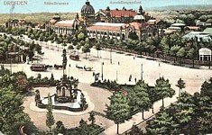
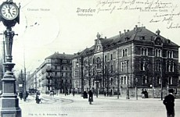
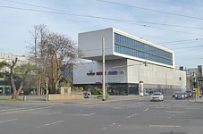
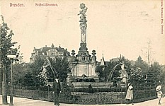
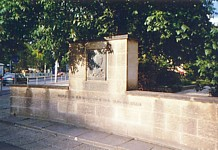
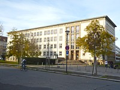
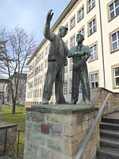
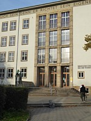
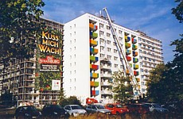

* * *

* * *

Der heute als Straßburger Platz bekannte Verkehrsknotenpunkt an der Grenze zwischen Pirnaischer Vorstadt, Johannstadt und Großem Garten entstand um 1880 beim Durchbruch der Grunaer Straße und erhielt 1898 den Namen Stübelplatz. Namensgeber war der Kommunalpolitiker Dr. Paul Alfred Stübel (1827-1895), der von 1877 bis zu seinem Tod Dresdner Oberbürgermeister war. 1891 wurde ihm für seine Verdienste um die Stadt die Ehrenbürgerwürde verliehen. Bereits zu Lebzeiten Stübels hatte der Rat der Stadt Dresden die Einrichtung einer Stübel-Stiftung zur Unterstützung bedürftiger städtischer Beamter im Krankheitsfalle beschlossen und zugleich die Benennung von Stübelplatz und [Stübelallee](../../../../zentrum/johannstadt/strassen_johannstadt/stubelallee/) nach dem verdienstvollen Kommunalpolitiker angeregt.

Um den Stübelplatz standen bis zur Zerstörung 1945 verschiedene markante Gebäude, von denen keines den Zweiten Weltkrieg überstand. So gab es an der Ecke Grunaer Straße / Blochmannstraße ab 1880 das [Ehrlichsche Gestift](../../../../Zentrum/Pirnaische_Vorstadt/Strassen_Pirnaische_Vorstadt/Ehrlichsches_Gestift/ehrlichsches_gestift.html) mit Schul-und Internatsbauten und einer Stiftskirche. An der schräg gegenüberliegenden Ecke am Eingang zum Großen Garten befand sich ab 1896 der später mehrfach erweiterte städtische [Ausstellungspalast](../../../../zentrum/pirnaische_vorstadt/ausstellungsgelande/). Weitere Grundstücke an der Stübelallee und der [Lennestraße](../../../../zentrum/pirnaische_vorstadt/strassen_pirnaische_vorstadt/) waren mit villenartigen Wohngebäuden bebaut.

1951 wurde der Stübelplatz nach dem tschechoslowakischen Journalisten und Kulturpolitiker Julius Fucik (1903-1943) in Fucikplatz umbenannt. Fucik war als Widerstandskämpfer gegen das nationalsozialistische Regime 1943 im
Zuchthaus Berlin-Plötzensee hingerichtet worden. Ihm zu Ehren errichtete man am Standort des ehemaligen Stübelbrunnens 1963 ein Denkmal mit Bronzerelief. Die Ehrlichsche Gestiftskirche wurde 1950 gesprengt, obwohl ein Wiederaufbau und eine Nutzung als Konzertsaal möglich gewesen wäre. Als einziger Bau des Schulkomplexes blieb ein Haus an der Blochmannstraße erhalten, das nach seinem Ausbau 1950/1951 durch Emil Leibold Domizil der [Musikhochschule](../../../../Zentrum/Pirnaische_Vorstadt/Musikhochschule/musikhochschule.html) wurde.

1952 begann die aus Anlass des DDR-Pioniertreffens entstandene Dresdner Pioniereisenbahn den Fahrbetrieb. Ihre Gleisschleife mit dem Bahnhof "Frohe Zukunft" lag an Stelle des 1949 abgerissenen Ausstellungspalastes. Das angrenzende Gelände diente regelmäßig als Volksfestareal, bis 1977 auch für den Striezelmarkt. An der gegenüberliegenden Platzseite entstanden ab 1977 zehngeschossige Wohnhochhäuser.

1991 erfolgte eine erneute Namensänderung des Platzes. Aus Anlass der kurz zuvor unterzeichneten Städtepartnerschaft mit der französischen Stadt Strasbourg wurde der Fucikplatz in Straßburger Platz umbenannt. Aus dieser Zeit stammen auch die Planungen für eine Neubebauung des Areals des früheren Ausstellungspalastes. U.a. war hier der Bau eines "Euro-Trade-Centers" mit 5000 m² Ausstellungsfläche, Büros, Gaststätten und Veranstaltungssälen geplant. Andere Ideen sahen die Errichtung eines neuen Ausstellungszentrums (Dresden Ausstellungs- und Congreß-Center) mit einem 45 Meter hohen Turm vor. Letztlich wurden diese jedoch nicht umgesetzt und das Areal stattdessen 1998 an den VW-Konzern verkauft. Ein Jahr später erfolgte die Grundsteinlegung für die ["Gläserne Manufaktur"](../../../../Zentrum/Pirnaische_Vorstadt/Strassen_Pirnaische_Vorstadt/Strassburger_Platz/Gläserne_Manufaktur/gläserne_manufaktur.html) des Autoherstellers. Weitere Gebäude entstanden mit dem Einkaufszentrum "SP1" an der Nordostecke _(Foto links)_, den Neubauten des BSZ Bau und Technik an der Güntz- und Blochmannstraße 2017/17 sowie einigen Wohnhäusern 2018 an der Lennéstraße. 2019 kamen ein 14-stöckiges Wohnhochhaus an der Nordostseite des Platzes und der Campus der Akademie für Berufsbildung hinzu.

Einzelne Bauten:

Stübelbrunnen: Der Brunnen entstand 1901 nach einem Entwurf des Architekten Alfred Hauschild und wurde vom Bildhauer Hans
Hartmann-MacLean künstlerisch gestaltet. Mit der Aufstellung sollte der langjährige Dresdner Oberbürgermeister Alfred Stübel (1827-1895) geehrt werden. Als Standort wählte man die Nordostecke des nach ihm benannten Platzes. Die
Finanzierung in Höhe von 100.000 Mark übernahm die Güntzsche Stiftung.

Das monumentale Brunnendenkmal entstand im Neobarockstil und besaß als Basis ein dreieckiges Wasserbecken, an dessen Ecken allegorische Figuren die heilende, dienstbare und zerstörerische Wirkung des Wassers darstellten. In der Mitte des Beckens stand ein dreiseitiger Sockel mit zwei Nischen, in denen Delphine als Wasserspeier fungierten. Am Schaft des Denkmals war ein vergoldetes Medaillon mit dem Porträt Stübels und den Jahren seiner Amtszeit angebracht. Dieses blieb als einziger Rest des Stübelbrunnens bis heute erhalten und befindet sich im Lapidarium in der Zionskirche. Weitere Plastiken am Brunnen zeigten u.a. eine Maske als Personifizierung des Quellgottes, Putten und verschiedene Jugendstilelemente. Trotz seiner handwerklich sauberen Ausführung war der Brunnen von Anfang an umstritten und wurde von Teilen der Künstlerschaft als "überladen" abgelehnt.

Die Brunnenanlage wurde beim Luftangriff 1945 beschädigt und ihre Reste 1960 abgerissen. An ihrem Standort wurde 1963 das Denkmal des tschechischen Widerstandskämpfers Julius Fucik aufgestellt. Ein Konzept für die Wiederherstellung des Stübelbrunnens entstand 2004, kam jedoch aus finanziellen Gründen bislang nicht zur Umsetzung.

Fucik-Denkmal: Aus Anlass des 20. Todestages von Julius Fucik entstand 1963 ein Denkmal zu Ehren des tschechoslowakischen Widerstandskämpfers. Der 1903 geborene Fucik arbeitete als Journalist für die Zeitung "Rude Pravo" und ab 1934 als Korrespondent in Moskau. Wegen seiner Betätigung im Widerstand gegen die deutsche Besatzung wurde er im April 1942 in Prag verhaftet und am 8. September 1943 in Berlin-Plötzensee wegen Hochverrats hingerichtet.

Das am 13. September 1963 enthüllte Denkmal besteht aus einer ca. 80 cm hohen Sandsteinmauer, an der ein Bronzerelief mit dem Porträt Fuciks angebracht ist. Darunter befinden sich die mahnenden letzten Worte seiner "Reportage unter dem Strang geschrieben": "Menschen, ich hatte euch lieb, seid wachsam!".

Berufsschule für Bauwesen: Das heute als "Haus I" des Berufsschulzentrums Bau und Technik bezeichnete Gebäude entstand 1952/53 nach Entwürfen des Architekten Gottfried Kintzer auf dem Grundstück des früheren Ehrlichschen Gestifts (Güntzstraße 3-5). Der viergeschossige Bau besitzt eine Sandstein-Putzfassade und ist mit großen Treppenhausfenstern, einer Uhr und kleineren Klassenzimmerfenstern gegliedert. Am Eingang befindet sich neben der Freitreppe seit 1961 eine Bronzeplastik von Wilhelm Landgraf ("Meister und Lehrling"). Dargestellt sind ein Bauarbeiter in Arbeitskleidung, der seinen Lehrling in seine Aufgaben einweist _(Foto rechts)_. Unterhalb des Dachgesimses ist die Schriftzeile „WO DAS ARBEITENDE VOLK DER BAUHERR IST KANN DER BAUENDE GLÜCKLICH SEIN DENN ER RICHTET SEIN EIGENES HAUS AUF“ zu lesen. Beide erinnern an die ursprüngliche Nutzung des Hauses als Ausbildungsstätte für Lehrlinge in den Bauberufen. Das denkmalgeschützte Gebäude _(Fotos links)_ wurde zwischen 2003 bis 2005 saniert.

1972/73 entstand unmittelbar an das bestehende Gebäude angrenzend ein Erweiterungsbau in Großplattenbauweise. Die Pläne für diesen stammten von Wolfgang Klossek und Sybille Kriesche, die sich zur Auflockerung der Fassade für farblich gestaltete Brüstungsfelder mit Meißner Keramikplatten entschieden. Auch dieses Haus wird heute vom Berufsschulzentrum genutzt.

Nach 1990 kam es im Berufsschulwesen zu einer Neugliederung der Ausbildung. Aus drei früheren Betriebsberufsschulen entstanden die BSZ „George Bähr“, „Hans Erlwein“ und Technik Dresden. Zudem gab es eine Außenstelle in Reick. Nach der Vereinigung gehören heute sowohl eine Berufsschule als auch eine Fachoberschule und eine Fachschule zur Institution. Ausgebildet werden u.a. Maler und Lackierer, Vermessungstechniker, Drucker und Mediengestalter sowie Augenoptiker. Außerdem kann die allgemeinen Fachhochschulreife erworben und die Weiterbildung zum Staatlich geprüften Techniker absolviert werden. Für das Berufsschulzentrum wurde der Komplex unter Einbeziehung der bereits bestehenden Gebäude 2016/17 um einen modernen Neubau campusartig erweitert. Hier befinden sich Seminarräume, Hörsäle und eine Mensa. Für den Neubau musste eine von Hans Konrad entworfene schmiedeeiserne Sonnenuhr von 1975/1976 beseitigt werden. Ihre Neuaufstellung ist geplant.

Wohnhäuser an der Nord- und Ostseite: Die zehngeschossigen Wohnblocks wurden 1977 und 1978 nach städtebaulichen Planungen der Architekten Heinz Michalk und Jörg Bösche als Plattenbauten errichtet und nehmen das Areal zwischen Fucikplatz und Comeniusstraße in Anspruch. In den Plattenbauten des Typs IW 67 befanden sich ursprünglich 535 Wohnungen. Im Jahr 2002 begann die Umgestaltung der Wohnanlage, die in diesem Zusammenhang bis 2005 eine auffällige farbige Fassadengestaltung erhielt und heute unter dem Namen "StraßBURG" vermietet wird _(Foto)_. Der zum Straßburger Platz gelegene Südteil der Gebäude (Marschnerstraße 7-13) wurde 2004 abgerissen, die Häuser Nr. 3 bis 5 folgten im Frühjahr 2005.

Die dadurch entstandene Freifläche nutzte danach bis zur Neubebauung durch ein Einkaufszentrum die Dinner-Varieté-Show Trocadero des Zirkus Sarrasani. Eine in den 1970er Jahren errichtete HO-Kaufhalle im östlichen Teil des Areals diente zeitweise als Unterkunft für die Tiger des Magiers. An ihrer Stelle begann 2017 der Neubau eines 14-stöckigen Wohnhochhauses, erster Hochhausneubau nach 1990 in Dresden. Der durch zwei kleinere Anbauten mit begrünter Dachterrasse optisch aufgelockerte Bau wurde vom Freitaler Architekturbüro Hardy Wolf gestaltet und 2020 bezogen.

Einkaufszentrum SP1: Das nach seiner postalischen Anschrift Straßburger Platz 1 benannte Nahversorgungszentrum entstand 2015-16 und wurde am 12. Mai 2016 eröffnet. Im Inneren befinden sich zwei Supermärkte, verschiedene Geschäfte, ein Parkhaus und zwei Büroetagen an der Südseite. Bauherr war die aus Hessen stammende Dietz AG.

* * *

 \[ [Home](../../../../index.html)\] \[ [Nord](../../../../nord/)\] \[ [Nordwest](../../../../nordwest/)\] \[ [Neustadt](../../../../neustadt/)\] \[ [Nordost](../../../../nordost/)\] \[ [West](../../../../west/)\] \[ [Zentrum](../../../../zentrum/)\] \[ [Südwest](../../../../sudwest/)\] \[ [Süd](../../../../sud/)\] \[ [Südost](../../../../sudost/)\] \[ [Ost](../../../../ost/)\] \[ [Register](../../../../Register/register.html)\] \[ [Kontakt](../../../../Kontakt/kontakt.html)\] \[ [Impressum](../../../../impressum/)\]
