* * *

* * *

* * *

**Bildungseinrichtungen in der Südvorstadt:**

[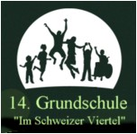](http://cms.sn.schule.de/14gsdd/schule)

[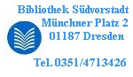](http://www.bibo-dresden.de)

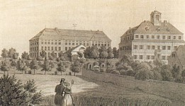Das Areal der späteren Südvorstadt war bis zur Mitte des 19. Jahrhundert
kaum besiedelt und wurde vor allem landwirtschaftlich genutzt. Im Mittelalter gab es hier die beiden Dörfer [Auswik und Boskau](../../zentrum/sudvorstadt/auswik/), welche
jedoch nach 1400 zu Wüstungen wurden. Von Bedeutung war der am Fuße des Anstiegs der südlichen Elbtalhänge verlaufende Zellesche Weg, der das Kloster Altzella mit dem Leubnitzer [Klosterhof](../../sudost/leubnitz-neuostra/klosterhof/) verband. Heute erinnern noch die Straßennamen [Zellescher Weg](../../sud/zschertnitz/strassen_zschertnitz/zellescher_weg/) und [Altenzeller Straße](../../zentrum/sudvorstadt/strassen_sudvorstadt/altenzeller_strasse/) an diese Zusammenhänge. Zu den wenigen vorhandenen Gebäuden gehörte neben einigen Mühlen am [Weißeritzmühlgraben](../../sudwest/lobtau/weisseritzmuhlgraben/) ein einzelnes Gehöft in der Nähe des Hahneberges, welches sich im 18. Jahrhundert zur Ausflugsgaststätte [“Feldschlößchen”](../../zentrum/sudvorstadt/strassen_sudvorstadt/feldschlosschenbrauerei/) entwickelte _(Bild)_.

Während der Napoleonischen Kriege war die heutige Südvorstadt Schauplatz von Kampfhandlungen. Schanzen und Befestigungen entstanden u.a. am Hahneberg, wo Napoleon einen heftig umkämpften Beobachtungsposten einrichtete.
Das dabei schwer beschädigte Vorwerk Feldschlößchen konnte 1819 wieder aufgebaut werden und war 1846 Keimzelle der Feldschlößchenbrauerei. Bereits zuvor waren weitere Einzelbauten entstanden, u.a. die 1836 eröffnete
Blindenanstalt an der [Chemnitzer Straße](../../sud/plauen/strassen_plauen/chemnitzer_strasse/), der ein Jahr später eine Gehörlosenschule folgte. Hier befindet sich an der
Flurgrenze zu Plauen seit 1848 auch der [Alte Annenfriedhof](../../sud/plauen/strassen_plauen/chemnitzer_strasse/alter_annenfriedhof/)

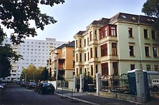Unweit der Chemnitzer Straße lag einst die Gaststätte “Schweizerhäuschen”,
die Namensgeber für das ab 1851 entstehende “Schweizer Viertel” war. Hier dominierten bis 1945 großbürgerliche Villenbauten, von denen einige noch bis
zur Gegenwart erhalten geblieben sind. Bewohner waren meist wohlhabende Fabrikanten, Rentiers und Professoren. Aber auch Pensionen, Mädchenpensionate, Rechtsanwälte und Privatkliniken siedelten sich hier an.
Architektonisch bemerkenswerte Gebäude sind  u.a. an der [Bergstraße](../../zentrum/sudvorstadt/strassen_sudvorstadt/bergstrasse/), der [Hohen Straße](../../zentrum/sudvorstadt/strassen_sudvorstadt/hohe_strasse/) und der [Leubnitzer Straße](../../zentrum/sudvorstadt/strassen_sudvorstadt/leubnitzer_strasse/) zu finden und wurden in den letzten
Jahren liebevoll saniert.

**_Foto:_** _Blick in die Eisenstuckstraße, im Hintergrund die Wohnzeile Budapester Straße_

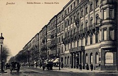Einschneidende Veränderungen für die Südvorstadt ergaben sich durch die
1848 eröffnete Eisenbahnstrecke nach Böhmen, welche das Territorium der Südvorstadt von der Innenstadt abtrennte. Hier lag auch der damals noch im Grünen gelegene erste Böhmische Bahnhof, welcher 1864 erweitert und 1898
durch den Hauptbahnhof ersetzt wurde. Als Zufahrt diente die 1851 angelegte Prager Straße. Ihre Verlängerung nach Süden wurde 1868/71 ausgebaut und erhielt den Namen Reichsstraße (heute [Fritz-Löffler-Straße](../../zentrum/sudvorstadt/strassen_sudvorstadt/fritz-loffler-strasse/)) _(Foto um 1910)_.
Diese Straße entwickelte sich nicht nur zur Hauptgeschäftsstraße des neuen Stadtviertels, sondern bildete zugleich die Grenze zwischen dem westlich
gelegenen großbürgerlichen “Schweizer Viertel” und dem dichtbebauten “amerikanischen Viertel” im östlichen Teil der Vorstadt.

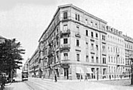Letztgenanntes war nach Verabschiedung eines neuen Bauregulativs 1867 planmäßig mit rechtwinkligen Straßenzügen angelegt und innerhalb weniger Jahre
mit mehrstöckigen Mietshäusern bebaut worden **_(Foto:_** _Strehlener Straße)_. In diesem Gebiet zwischen Bahnlinie, Franklin-, Reichenbach- und
Winckelmannstraße siedelten sich vorrangig Arbeiterfamilien, Bahnbeamte, Künstler und kleine Handwerker an, die in den Hinterhöfen ihre Werkstätten einrichteten. Hinzu kamen zahlreiche Hotels und Pensionen rund um den
Hauptbahnhof. Da in diesem Stadtteil auch zahlreiche Ausländer lebten, entstanden ab 1875 mehrere Ausländerkirchen. Als einziges dieser Gotteshäuser blieb die [Russisch-Orthodoxe Kirche](../../zentrum/sudvorstadt/strassen_sudvorstadt/fritz-loffler-strasse/russische_kirche/) bis heute erhalten, während die [Amerikanische Kirche](../../zentrum/sudvorstadt/strassen_sudvorstadt/bergstrasse/amerikanische_kirche/) an der Bergstraße und die
Englische Kirche an der Wiener Straße 1945 zerstört wurden. Die [Schottische Kirche](../../zentrum/sudvorstadt/strassen_sudvorstadt/bernhardstrasse/) an der Bernhardstraße war
bereits in den 1920er Jahren wieder geschlossen worden.

Zu den wichtigen öffentlichen Gebäuden gehörte auch das 1875 entstandene neue Hauptgebäude der Technischen Hochschule am heutigen [Friedrich-List-Platz](../../zentrum/sudvorstadt/strassen_sudvorstadt/friedrich-list-platz/). 1890 erhielt dieser neue Stadtteil gemeinsam mit dem “Schweizer Viertel”,
dem Areal um den Nürnberger Platz und den angrenzenden Gebieten offiziell den Namen Südvorstadt. Im gleichen Jahr
nahm die Deutsche Straßenbahngesellschaft den elektrischen Betrieb bis zur Gastwirtschaft “Bergkeller” auf. Wenig
später folgten weitere Strecken durch die Strehlener Straße, zum Münchner Platz und über die Bergstraße nach Räcknitz.

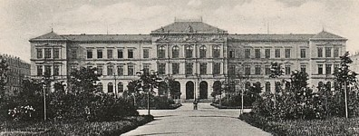

_Foto: Hauptgebäude des Polytechnikums am Bismarckplatz (Friedrich-List-Platz)_

Auch die Dresdner Baugesellschaft hatte bereits 1871 große Flächen bis zur Flurgrenze nach Plauen erworben, um diese zu erschließen und Gewinn
bringend weiterzuveräußern. Zunächst blieb das Areal jedoch unbebaut und wurde gärtnerisch genutzt. Erst 1899 verabschiedete der Dresdner Stadtrat einen Bebauungsplan, welcher auch in diesem Teil der Südvorstadt meist
geschlossene Bebauung vorsah. Trotz Einwendungen der Bewohner des Schweizer Viertels und des Bezirksvereins Süd entstanden nun innerhalb weniger Jahre repräsentative Mietshäuser mit zahlreichen Geschäften. Wegen
der ovalen Platzanlage im Zentrum der neuangelegten Nürnberger Straße bürgerte sich für dieses Gebiet der Name “Nürnberger Ei” ein. Zeitweise sprach man auch vom “Bayrischen Viertel”, da
die neuen Straßen meist nach Städten in Bayern benannt wurde.

Nach der Jahrhundertwende entstanden in der Südvorstadt weitere öffentliche Gebäude. So errichtete Oskar Kramer
zwischen 1902 und 1907 den Gebäudekomplex des [Landgerichts](../../zentrum/sudvorstadt/strassen_sudvorstadt/munchner_platz/landgericht/) am [Münchner Platz](../../zentrum/sudvorstadt/strassen_sudvorstadt/munchner_platz/). Unweit davon begann wenig später die Erschließung des ausgedehnten Geländes für die Neubauten der [Technische Hochschule](../../zentrum/sudvorstadt/technische_universitat/). Auch zwei neue Kirchen wurden errichtet: 1903 konnte die [Lukaskirche](../../zentrum/sudvorstadt/strassen_sudvorstadt/lukaskirche/), 1912 die [Zionskirche](../../zentrum/sudvorstadt/strassen_sudvorstadt/zionskirche/) eingeweiht werden. Ein Jahr später ließ
die Stadt das noch unbebaute Gelände des Bornbergs zu einer öffentlichen Grünanlage umgestalten (heute [Beutlerpark](../../zentrum/sudvorstadt/beutlerpark/)).

In den Jahren nach dem Ersten Weltkrieg ließen private Bauherren weitere Wohnhäuser südlich der Reichenbachstraße
und um den Beutlerpark erbauen. Meist entstanden hier schlichte Ein- und Zweifamilienhäuser, umgeben von kleinen
Gärten. Eine weitere Wohnsiedlung wurde südlich des Münchner Platzes bis zur Nöthnitzer Straße angelegt. 1925 weihte die [katholische Gemeinde “St. Paulus”](../../zentrum/sudvorstadt/strassen_sudvorstadt/bernhardstrasse/st__paulus-kirche/) ihr Gotteshaus auf der Bernhardstraße. Am 13./14. Februar 1945 gehörte
die Südvorstadt zu den am schwersten getroffenen Stadtteilen. Vor allem im “Amerikanischen Viertel” zwischen Bahngleisen und Reichenbachstraße vernichteten die Bomben fast die komplette Bebauung. Schwere Schäden
entstanden aber auch im Bereich Nürnberger Straße und am Nürnberger Platz sowie im “Schweizer Viertel”.

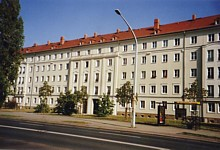Bereits Anfang der 1950er Jahre wurde die westliche Südvorstadt zu einem der ersten großflächigen Wiederaufbauviertel Dresdens erklärt. Nach Beseitigung der
Ruinen entstanden im Rahmen eines Sonderbauprogramms 1953/54 zwischen Nürnberger und Altenzeller Straße Neubauten in klassischer Bauweise _(Foto)_. Bevorzugt wurden diese Wohnungen an Bergleute der SDAG “Wismut”
vergeben. Unter Einbeziehung der verbliebenen Gründerzeithäuser entwickelte sich das “Nürnberger Ei” zu einem neuen Stadtteilzentrum mit Geschäften und einer gleichnamigen Wohngebietsgaststätte.
Arbeiterwohnungsbaugenossenschaften komplettierten das Viertel zwischen 1955 und 1957 um weitere Wohnblocks und gesellschaftliche Einrichtungen. Auch Wohnheime der Technischen Universität
und einige Erweiterungsbauten für den Lehrbetrieb wurden errichtet. Am Friedrich-List-Platz befand sich ab 1952 der Sitz der neugegründeten [Hochschule für Verkehrswesen](../../zentrum/sudvorstadt/strassen_sudvorstadt/friedrich-list-platz/hochschule_fur_verkehrswesen/).

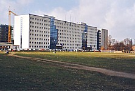Komplizierter gestaltete sich die Situation im völlig zerstörten “Amerikanischen
Viertel”. Zwar waren die meisten Ruinen bis Ende der 1950er Jahre beseitigt worden, doch fehlte es an einem grundlegenden Konzept für dieses Gebiet. Lediglich an der Reichenbachstraße und am [Strehlener Platz](../../sudost/strehlen/strassen_strehlen/strehlener_platz/) konnten einige Häuser wiederhergestellt bzw. neu gebaut werden. Plattenbauten folgten in den
70er und 80er Jahren an der Uhlandstraße und der heutigen Fritz-Löffler-Straße. Hinzu kamen Bürohäuser für verschiedene Institute und volkseigene Betriebe und
ein heute vom Finanzamt genutztes Verwaltungsgebäude an der Rabenerstraße. Große Flächen, vor allem im Bereich Strehlener Straße, liegen jedoch bis heute brach und warten auf eine neue Nutzung.

Nach 1990 konnte mit der Schließung einiger Baulücken begonnen werden. Private Investoren errichteten Neubauten an
der Reichenbachstraße, im Gebiet um die Lukaskirche (“Lukas-Areal”) und auf Einzelgrundstücken rund um den Beutlerpark. Als städtisches Bauvorhaben
folgte 2011/12 der Bau einer modernen Feuerwache an der Strehlener Straße.

Schulen in der Südvorstadt:

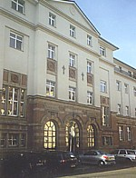8\. Bürgerschule: Das Gebäude an der Gutzkowstraße 30 entstand kurz vor der Jahrhundertwende und wurde zunächst von der 8. Bürgerschule genutzt. Nach dem Ersten Weltkrieg befand sich hier bis zur Zerstörung 1945 die 50. Volksschule.

Als eines der wenigen Häuser im “Amerikanischen Viertel” überstand die Ruine die Großflächenenttrümmerung der 1950er Jahre und wurde als Lager einer Papierfabrik notdürftig wiederhergestellt. 1999 ließ das privatisierte Unternehmen die Schule unter Einbezug der verbliebenen Bausubstanz wieder aufbauen. Details an der Fassade _(Foto)_ des heute als Bürohaus genutzten Gebäudes erinnern noch an dessen einstige Funktion _(Foto)_.

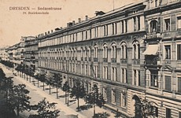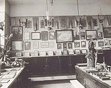19\. Bezirksschule: Die Schule entstand Ende des 19. Jahrhunderts an der damaligen Sedanstraße 19-21 _(Foto links)_. Ab 1904 bzw. 1906 war hier auch das Schulmuseum des Sächsischen Lehrerverbandes sowie das Heimatkundliche Schulmuseum des Dresdner Lehrervereins untergebracht _(Foto rechts)_. Neben historischen Sachzeugen zur Schulgeschichte besaßen die beiden Museen eine bedeutende Lehrmittelsammlung von Karten, naturkundlichen Exponaten und Modellen. Nach dem Ersten Weltkrieg wurde die 19. Bezirks- zur 19. Volksschule. Außerdem war im Gebäudekomplex eine Mädchenberufsschule für Stenotypistinnen sowie die 10. Volksbibliothek untergebracht. 1945 fiel das Schulhaus den Bomben zum Opfer. Heute werden Teile des Grundstücks von der Mensa der Hochschule für Technik und Wirtschaft (ehem. Hochschule für Verkehrswesen) eingenommen.

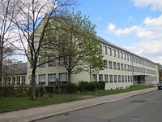14\. Grundschule: Das Gebäude an der Schweizer Straße 7 entstand 1961 für die 14. Polytechnische Oberschule. Zu DDR-Zeiten trug diese den Namen des Schauspielers und KPD-Mitglieds Heinrich Greif, der ab 1945 bis zu seinem Tod dem Ensemble des Deutschen Theaters in Berlin angehörte. Heute wird es von der 14. Grundschule „Im Schweizer Viertel“ genutzt. Außerdem befindet sich hier die „Robinsonschule“ für geistig behinderte Kinder. Die vor dem Haus aufgestellte Bronzeplastik einer Turnerin stammt von Herbert Burschik.

46\. Oberschule: Das aus zwei Flügeln bestehende Plattenbau-Schulgebäude vom Typ "Dresden Atrium" wurde 1974 an der Leubnitzer Straße 14 errichtet und am 2. September 1974 als 46. Polytechnische Oberschule eingeweiht. Es bot Platz für 25 Klassen und bot als eine der wenigen Schulen in Dresden bereits ab der 3. Klasse Russischunterricht an. Benannt war die Schule nach der sowjetischen Partisanin Soja Kosmodemjanskaja, die während des Zweiten Weltkriegs den Vormarsch der deutschen Wehrmacht sabotierte und deshalb 1941 hingerichtet wurde. An die junge Russin erinnerte auch ein Gedenkstein auf dem Gelände.

1991 wurde aus der 46. POS die 46. Mittelschule (jetzt 46. Oberschule). 2017 ist jedoch die Schließung und ein Abriss des Gebäudes geplant, da auf dem Grundstück ein Neubau einer Turnhalle für das Gymnasium Süd-West entstehen soll.

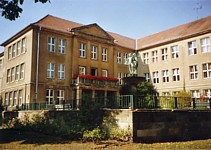Fritz-Löffler-Gymnasium: Das Gebäude des heutigen Fritz-Löffler-Gymnasiums
wurde 1956 als erster Dresdner Schulneubau der Nachkriegszeit errichtet und am 1.September eingeweiht. Da das zunächst von der 3. Mittelschule genutzte Schulhaus _(Foto)_ an der Bernhardstraße schon wenige Jahre später zu klein war, entstand 1963 ein Ergänzungsflügel. 1970 folgte die bereits in den Ursprungsplänen vorgesehene Turnhalle. Die später als 3. POS bezeichnete Schule auf der Ho-Chi-Minh-Straße (heute Bernhardstraße) 18 erhielt 1981 den Namen des antifaschistischen Widerstandskämpfers Georg Schumann verliehen, welcher 1945 im Hof des Landgerichtes am Münchner Platz hingerichtet worden war.

Im Zuge der Umstrukturierung der Dresdner Schullandschaft nach 1990 wandelte man die Schule zum Gymnasium Dresden-Südvorstadt um. 1993 bekam dieses den Namen des verdienstvollen Denkmalpflegers Fritz Löffler, wurde jedoch im Sommer 2007 geschlossen und im Anschluss als Interimsquartier des Vitzthum-Gymnasiums genutzt. Die seit 1999 unter Denkmalschutz stehenden Gebäude sollen ab 2016 saniert und um moderne Erweiterungsbauten ergänzt werden. Außerdem ist der Bau einer neuen Vierfeldsporthalle geplant. Künftiger Nutzer wird das Gymnasium Süd-West. Die Brunnenplastik “Junge Naturforscher” vor dem Schulgebäude stammt von Walter Reinhold.

[_Weiterführende Literatur und Quellen_](../../impressum/quellenverzeichnis/)

 \[ [Home](../../index.html)\] \[ [Nord](../../nord/)\] \[ [Nordwest](../../nordwest/)\] \[ [Neustadt](../../neustadt/)\] \[ [Nordost](../../nordost/)\] \[ [West](../../west/)\] \[ [Zentrum](../../zentrum/)\] \[ [Südwest](../../sudwest/)\] \[ [Süd](../../sud/)\]
 \[ [Südost](../../sudost/)\] \[ [Ost](../../ost/)\] \[ [Register](../../Register/register.html)\] \[ [Kontakt](../../Kontakt/kontakt.html)\] \[ [Impressum](../../impressum/)\]
