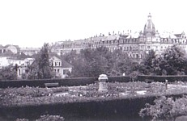
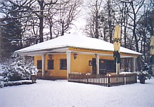

* * *

* * *

* * *

Der heutige Beutlerpark befindet sich auf dem Areal des Bornbergs, einer kleinen
Erhebung im Süden der Stadt. In seiner Nähe lag im Mittelalter der Anfang des 15. Jahrhunderts untergegangene Ort [Boskau](../../../zentrum/sudvorstadt/auswik/). Im Preußisch-Österreichischen
Krieg 1866 nutzten preußische Soldaten diese Anhöhe zur Anlage einer Schanze, welche jedoch nie militärische Bedeutung erlangte. Später wurden hier Obstbäume gepflanzt und Mietergärten für die Bewohner des nahegelegenen
Wohnviertels geschaffen.

1913 entschloss sich die Stadt, auf dem Gelände einen Volkspark anzulegen. Unter Einbeziehung der vorhandenen Schanzanlagen entstand eine ca. 2,5 Hektar große Grünanlage mit Ruhebänken,
einem Spielplatz sowie einem von der Molkerei Gebrüder Pfund betriebenen ”Milchhäuschen”. Im Zentrum des Parks befand sich ein fast 25.000 m² großer Rosengarten mit über 5000 Pflanzen _(Foto um 1915)_
. Außerdem gab es einen kleinen Teich für Wasserrosen. Die zunächst als Schanzenpark bezeichnete Anlage erhielt nach dem Tod des
verdienstvollen Dresdner Oberbürgermeisters Gustav Otto Beutler am 14. Oktober 1926 den offiziellen Namen Beutlerpark. Gleichzeitig wurde auch die angrenzende Straße in Am Beutlerpark umbenannt. Lediglich eine an der
Rabener / Ecke Gutzkowstraße gelegene Gastwirtschaft behielt noch bis zur Zerstörung 1945 die Bezeichnung “Zum Schanzenpark” bei.

Kriegs- und Nachkriegszeit trugen zur Verwilderung des Beutlerparks bei.
Nachdem Pläne, die Parkanlage auf einige umliegende Ruinengrundstücke bis zum Zelleschen Weg auszudehnen aufgegeben waren, begann 1957 die schrittweise
Neugestaltung. Wege und Grünflächen wurden erneuert und einige Neupflanzungen vorgenommen. Dabei verschwand auch der frühere Rosenteich. In den sechziger
Jahren folgte ein Kinderspielplatz auf der Fläche vor dem ehemaligen Milchhäuschen. Dieses diente zeitweise als Jugendklub der Dresdner Handwerkskammer und konnte erst nach 1990 wieder als “Café im Beutlerpark”
eröffnet werden _(Foto)_. Seit 1974 steht der Beutlerpark als Natur- und Kulturdenkmal unter Schutz. Zu den hier vorkommenden Gehölzen gehören amerikanische Blutbuchen, eine Hängebuche,
Linden und Kastanien sowie Eiben, Aralien und ein seltener Trompetenbaum.

* * *

 \[ [Nord](../../../nord/)\] \[ [Nordwest](../../../nordwest/)\] \[ [Neustadt](../../../neustadt/)\] \[ [Nordost](../../../nordost/)\]
 \[ [West](../../../west/)\] \[ [Zentrum](../../../zentrum/)\] \[ [Südwest](../../../sudwest/)\] \[ [Süd](../../../sud/)\] \[ [Südost](../../../sudost/)\] \[ [Ost](../../../ost/)\] \[ [Register](../../../Register/register.html)\] \[ [Kontakt](../../../Kontakt/kontakt.html)\] \[ [Impressum](../../../impressum/)\]
