* * *

Die Ende des 19. Jahrhunderts angelegte Ackermannstraße verbindet den Strehlener Platz mit dem Stadtteil Zschertnitz. Ab
1902 verkehrte hier auch die Straßenbahn bis zur Räcknitzhöhe. Die meisten Gebäude entstanden noch vor dem Ersten Weltkrieg. Teile der Bebauung fielen jedoch 1945 dem Luftangriff zum Opfer und wurden später durch Neubauten ersetzt.

Ihren Namen erhielt die Ackermannstraße aus Anlass der Feier seines 50-jährigen Bürgerrechtsjubiläums am 31. August 1899
nach dem Politiker Karl Gustav Ackermann (1820-1901). Der studierte Jurist war ab 1849 beim sächsischen Finanzministerium
als Finanzprokurator angestellt und gehörte ab 1853 dem Stadtverordneten-Kollegium an. Für seine Verdienste als langjähriger Stadtverordnetenvorsteher erhielt Ackermann 1878 die Ehrenbürgerwürde der Stadt Dresden verliehen.

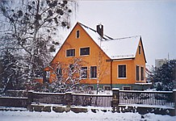Die Straße Am Beutlerpark wurde 1913 im Zusammenhang mit der Anlage des [Beutlerparks](../../../zentrum/sudvorstadt/beutlerpark/) geschaffen und trug wie dieser bis 1926 die Bezeichnung Am Schanzenpark. In den Zwanziger Jahren entstanden hier Einfamilienhäuser, von denen
einige 1945 jedoch zerstört wurden. Auf dem Ruinengrundstück Am Beutlerpark 6 wurde in den 1970er Jahren die Kinderkrippe der Technischen Universität errichtet. Im
Eckhaus zur Patrice-Lumumba-Straße (Nr. 7) wohnte viele Jahre der frühere Dresdner Oberbürgermeister Walter Weidauer. Nicht mehr vorhanden ist das frühere Wohnhaus des Architekten Max Kühne (1874-1942), Teilhaber des Architektenbüros Lossow & Kühne (Nr. 8).

Die heute nicht mehr vorhandene Straße An der Falkenbrücke verband einst die die Bahngleise überspannende Falkenbrücke
mit der Chemnitzer Straße. Zu den wenigen Gebäuden gehörte das Wohnhaus Nr. 2a mit dem Restaurant “3 Falken”. Alle
Häuser wurden 1945 zerstört, die Straße selbst in den 1960er Jahren aufgegeben. Heute verläuft in der Nähe die Hochstraße
(Budapester Straße), weitere Grundstücke werden von zwei Studentenwohnheimen aus den 1960er Jahren eingenommen.

_Fotos: Wohn- und Geschäftshaus An der Falkenbrücke 2a (links),_

_rechts ein Blick über die Falkenbrücke in Richtung Innenstadt_

Falkenbrücke: Neben der Hohen Brücke und der Brücke Chemnitzer Straße gehörte die Falkenbrücke zu den drei
Straßenüberführungen, die westlich des Hauptbahnhofes das Überqueren der Bahnanlagen ermöglichten. Die Falkenbrücke
entstand 1895 als Stahlbogenbrücke und verband die Falkenstraße in der Wilsdruffer Vorstadt mit der Chemnitzer Straße im
Schweizer Viertel. Bis 1945 nutzte auch die aus der Annenstraße kommende Straßenbahn nach Plauen diese Brücke. Das
Bauwerk wurde beim Luftangriff 1945 beschädigt und in den 1960er Jahren abgetragen. Als Ersatz entstand die neue Brücke im
als Teil des Verkehrszuges Budapester Straße. An die Falkenbrücke erinnern jedoch noch die erhaltenen Brückenwiderlager und eine hier über die Gleise führende Rohrleitung.

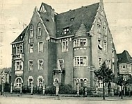Die 1873 angelegte und nach dem preußischen General August von Werder (1808-1887) Werderstraße genannte heutige Andreas-Schubert-Straße erhielt ihren Namen 1946 nach dem Techniker und Hochschullehrer Johann Andreas Schubert (1808-1870). Schubert war ab 1828 Lehrer an der Technischen Bildungsanstalt und von 1836 bis 1839 Technischer Direktor der [Maschinenbauanstalt Übigau](../../../nordwest/ubigau/schloss_ubigau/schiffswerft_ubigau/). Bekannt wurde er als Konstrukteur des ersten Elbdampfers “Königin Maria” (1836) und der ersten deutschen Lokomotive “Saxonia” (1837). Außerdem entwarf Schubert 1845 die Gölzschtalbrücke, bis heute größte Ziegelsteinbrücke der Welt.

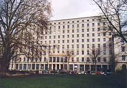Bis 1945 prägten vor allem mehrgeschossige Mietshäuser im Stil des Historismus das Straßenbild. Wegen der Nähe zum Hauptbahnhof entstanden hier zahlreiche Pensionen. Im oberen Teil südich der Reichenbachstraße gab es auch Einzelhäuser, darunter das unmittelbar am Lukasplatz stehende “Haus Avalon”, welches bis zur Zerstörung als Töchterheim genutzt wurde (Nr. 44 - _Foto oben links_). Auf der Werderstraße 25 lebte ab 1906 der aus Böhmen stammende Unternehmer Edmund Kussi, der hier einen "Alleinvertrieb des Staubsaugeapparates ‚Atom' für Sachsen und Thüringen" führte. Kussi gründete im August 1911 gemeinsam mit den Brüdern Johann und Friedrich Cruse die Firma ["RHEOSTAT"](../../../neustadt/leipziger_vorstadt/leipziger_strasse/) mit Sitz auf der Freiberger Straße 75. Später verlegte er den Firmensitz nach Pieschen, wo der Betrieb seinen Sitz ab 1911 auf der Leipziger Straße 31, ab 1920 auf der Großenhainer Straße 130/132 hatte.

Nach vollständiger Zerstörung der vorhandenen Bebauung vom Ende des 19. Jahrhunderts entstanden 1954 bis 1960 an der Andreas-Schubert-Straße Neubauten für die [Hochschule für Verkehrswesen](../../../zentrum/sudvorstadt/strassen_sudvorstadt/friedrich-list-platz/hochschule_fur_verkehrswesen/) _(Foto rechts)_. Heute wird der Gebäudekomplex von der Fachhochschule für Technik und Wirtschaft (HTW) genutzt. Weitere Baulücken konnten
nach 1990 geschlossen werden. 2006 wurde ein moderner Bibliotheksneubau der Hochschule eingeweiht.

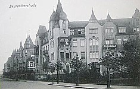
Die Bayreuther Straße entstand um 1900 bei der Erweiterung der Südvorstadt in Richtung Plauen und wurde nach der durch Richard Wagner bekannten Festspielstadt
Bayreuth benannt. Wegen der Häufung “bayrischer” Straßennamen wurde dieses Gebiet früher auch umgangssprachlich “Bayrisches Viertel” genannt. Im Gegensatz zu
den Hauptstraßen dominierten an der Bayreuther Straße Villen und mehrgeschossige Gruppenhäuser in unterschiedlichen Stilformen. Bewohner waren neben Fabrikanten
und höheren Beamten auch Professoren der TU, Diplomaten und wohlhabende Pensionäre. Von den erhaltenen Gebäuden stehen das Doppelhaus Nr. 2/4 _(Foto vor 1945)_ sowie mehrere Villen unter Denkmalschutz.

Zahlreiche Gebäude der Bayreuther Straße fielen 1945 den Bomben zum Opfer. An ihre Stelle traten Wohnblocks und
Baracken der Technischen Universität. 1982 wurde mit Unterstützung schwedischer Christen ein Neubau für die kriegszerstörte [Zionskirche](../../../zentrum/sudvorstadt/strassen_sudvorstadt/zionskirche/) eingeweiht.

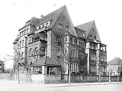Nr. 17: In diesem 1945 zerstörten Haus an der Ecke zur Kaitzer Straße _(Foto)_ lebte bis 1940 die Frauenrechtlerin Julie Salinger (1863-1942), welche 1918 als eine der ersten
weiblichen Abgeordneten in den sächsischen Landtag gewählt worden war. Als Jüdin musste sie 1940 in ein “Judenhaus” umziehen, wurde nach Theresienstadt deportiert und starb dort
im September 1942. An Julie Salinger erinnert seit  2012 ein Stolperstein vor dem Haus Nr. 14, in dem ihr Neffe bis 1932 eine Arztpraxis besaß. Auf dem Grundstück Nr. 17 steht
heute ein in den 1950er Jahren errichteter Wohnblock.

Nr. 32:
Von 1927 bis zu seiner Suspendierung vom Hochschuldienst 1933 besaß der Maler Otto Dix im Haus Bayreuther Straße 32  (Ecke Liebigstraße) eine Wohnung. Sein Atelier befand sich in Löbtau auf der [Kesselsdorfer Straße](../../../sudwest/lobtau/strassen_lobtau/kesselsdorfer_strasse/)
.  Zu den Mietern des Hauses gehörte ab 1939 auch der TU-Professor  Enno Heidebroek (1876-1955).

Die Bayrische Straße wurde als Bismarckstraße parallel zur 1848 eröffneten Strecke der Sächsisch-Böhmischen Eisenbahn angelegt und war auch Standort des zunächst nur aus einer einfachen Halle bestehenden
Böhmischen Bahnhofes. Nachdem dieser bereits wenige Jahre später nicht mehr den Anforderungen genügte, entstand 1864 ein größerer Neubau im
Neorenaissancestil. 1898 wurde dieser schließlich durch den Hauptbahnhof ersetzt, dessen ausgedehnte Gleisanlagen bis heute
die gesamte Nordseite der Straße einnehmen. Nach Zerstörung sämtlicher Gebäude benannte man die frühere Bismarckstraße in der Nachkriegszeit in Bayrische Straße um.

Bedingt durch die Bahnhofsnähe gab es an der Bismarckstraße einst zahlreiche Hotels und Pensionen. Bekanntestes war das Hotel “Continental”, welches in der
Gebäudegruppe Bismarckstraße 16-18 untergebracht war. Weitere Hotels befanden sich in der Nr. 10 (Hotel Austria), Nr. 12 (Hotel Viktoria) und Nr. 14 (Hotel Hoeritzsch). Auch im Haus Nr. 20 existierte mit dem “Regina- Hotel” eine
Übernachtungsstätte. 1908 errichteten die Firma Gebr. Heinrich auf dem Grundstück Nr. 8 einen Neubau für das Kaiserliche Postamt _(Foto)_. Ab 1914 wurde dieses als
Postamt Dresden A 24, ab 1964 als Dresden 8024 bezeichnet. Zur Verladung der hier eingelieferten Brief- und Paketsendungen gab es früher sogar eine unterirdische
Verbindung zum Hauptbahnhof. In dem 1945 beschädigten, jedoch wiederaufgebauten Gebäude ist heute die Großannahmestelle Brief der Deutsche Post AG untergebracht.

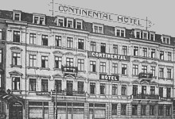Hotel Continental: Renommierteste und vornehmste Übernachtungsmöglichkeit hinter dem
Hauptbahnhof war das Ende des 19. Jahrhunderts an der damaligen Bismarckstraße 16/18 errichtete Hotel “Continental”. Das Haus wurde 1897 eröffnet und besaß bei seiner
Eröffnung 90 Zimmer, ein “Grand Restaurant 1. Klasse” sowie einen Wintergarten. Erster Besitzer war Max Otto. Nach seinem Tod übernahm 1908 dessen Witwe Therese den
Betrieb und ließ das “Continental” auf 150 Hotelzimmer erweitern. Hinzu kamen ein Rauchzimmer, ein Lesesaal, ein Damen- und Musiksalon sowie ein Schreibzimmer. Im
Innenhof gab es einen großzügig gestalteten Gästegarten, welcher in den Sommermonaten auch als Konzertplatz genutzt wurde. Das zu den Hotels ersten Ranges gehörende
“Continental” wurde Anfang der 1930er Jahre noch einmal modernisiert, wenige Jahre später jedoch geschlossen.

**_Fotos:_** _Aufnahmen aus dem “Continental” aus dem 1920er Jahren:_

_links, das Vestibül, in der Mitte der Garten, rechts der Speisesaal_

Nach der Schließung richtete Hitlers Geheimpolizei Gestapo 1937 hier ihr Dresdner Hauptquartier ein und baute das Hotel dafür
zum Verwaltungsgebäude um. Gleichzeitig hatte hier die Dresdner Außenstelle des Sicherheitsdienstes (SD) ihren Sitz. Hunderte
Menschen wurden in dem Gebäude während der Nazizeit bei Verhören mißhandelt und ermordet. Auch die Deportation der jüdischen Einwohner Dresdens bereitete man in diesem Haus vor. Unter Leitung des SS-Untersturmführers Henry Schmidt
organisierte das Gestapo-Referat IV B 4 die Zwangsmaßnahmen gegen Dresdner Juden und deren Transport in die Vernichtunglager. 1945 wurde das Gebäude zerstört. An seiner Stelle befindet sich heute ein Geschäfts- und Bürohaus.

Die Budapester Straße entstand in ihrer heutigen Form als Hauptverkehrsmagistrale erst nach dem Zweiten Weltkrieg. In ihrem
Verlauf folgt sie im wesentlichen der alten Plauenschen Chaussee, welche Mitte des 19. Jahrhunderts ausgebaut und nach der
Stadt Chemnitz benannt wurde. Zu den ersten Gebäuden gehörten die 1836 eröffnete Blindenanstalt sowie die zwei Jahre später entstandene Taubstummenanstalt. Der Dresdner Generalbebauungsplan von 1859 erlaubte zwischen [Chemnitzer Straße](../../../sud/plauen/strassen_plauen/chemnitzer_strasse/) und [Albertbahn](../../../sud/plauen/plauenscher_grund/albertbahn/) die Ansiedlung von gewerblichen Unternehmen, was in den Folgejahren zur Gründung zahlreicher Betriebe (u. a. [Feldschlößchenbrauerei](../../../zentrum/sudvorstadt/strassen_sudvorstadt/feldschlosschenbrauerei/) (Nr. 6), Zigarettenfabrik “Sulima” (Nr. 4b), [Lingnerwerke](../../../zentrum/sudvorstadt/strassen_sudvorstadt/zwickauer_strasse/lingner-werke/)) führte.

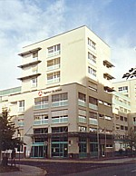1945 fiel fast die komplette Bebauung der Chemnitzer Straße bis nach Plauen den Bomben zum
Opfer. 1963 entschloss man sich, diese Verbindung bis zur Nossener Brücke mit geteilten Fahrbahnen vierspurig auszubauen. Als Ersatz für die Falken-, Chemnitzer und Hohe Brücke entstand
eine 850 Meter lange Hochstraße über die Bahnanlagen, welche auf 22 Pfeilern ruht und am 28. Dezember 1967 dem Verkehr übergeben wurde. Treppen verbinden diese Straße mit den darunter
befindlichen Straßenbahnhaltestellen. Architekt des Bauwerks war Eckhardt Thürmer. Ein Jahr später wurde sie in Budapester Straße umbenannt.

Als Abschluss des Wiederaufbaus der Südvorstadt entstand 1973-74 parallel zur Budapester Straße eine aus mehreren Gebäuden bestehende Wohnzeile mit ca. 1000 Wohnungen. An der Giebelfront
des elfgeschossigen Kopfbaus erinnerte bis zur Sanierung der Häuser nach 1990 ein Wandbild an das 25. Jubiläum der DDR-Gründung. In unmittelbarer Nähe befindet sich an der Bushaltestelle seit 2012 ein Stolperstein für Else
Auguste Seifert. An dieser Stelle stand einst das Wohnhaus ihrer Eltern (Nr. 69), die hier einen kleinen Laden besaßen. Else
Seifert musste sich 1928 wegen einer psychischen Erkrankung in ärztliche Behandlung begeben und lebte ab 1930 in der Heil-
und Pflegeanstalt Arnsdorf. 1940 wurde sie in Pirna-Sonnenstein Opfer des nationalsozialistischen Euthanasieprogramms.

“Margon”-Haus: Zu den markantesten Gebäuden gehört das 1960 für den damaligen Wirtschaftsrat des Bezirkes Dresden errichtete Bürohochhaus Budapester Straße 5, welches wegen seiner Leuchtwerbung auch als “Margon”-Haus bekannt ist. Architekten des Gebäudes waren Gerhard Müller und Hans-Georg-Bedrich, die städtebauliche Leitung oblag Hans Konrad. Die Leuchtreklame befand sich ursprünglich am Hotel “Excelsior” auf der Prager Straße und wurde nach dessen Abriss 1967 umgesetzt. Nach 1990 hatte hier zeitweise das sächsische Wirtschaftsministerium seinen Sitz. 1999 erfolgte eine umfassende Sanierung des Gebäudes, wobei auch die unter Denkmalschutz stehende ”Margon”- Werbung erneuert wurde. Im Haus haben heute verschiedene Firmen ihre Büros.

Die heute nicht mehr vorhandene Diesterwegstraße entstand 1910 und führte südlich des Lehrerbildungsseminars am damaligen
Reichenbachplatz (heute Weberplatz) zur Teplitzer Straße. Wie auch die benachbarte Wigardstraße wurde sie nach einem Pädagogen benannt.
Friedrich Adolph Diesterweg (1790-1866) setzte sich für eine Verbesserung des Volksschulwesens ein und forderte im Geiste Pestalozzis eine bessere Lehrerbildung und sozialpolitische Reformen zugunsten der ärmeren Schichten.
Ursprünglich war diese Straße Teil eines Bebauungsplanes für das Viertel zwischen Teplitzer Straße und Zelleschem Weg, der
jedoch nicht realisiert wurde. Die Diesterwegstraße blieb somit unbebaut und ist letztmals im Adressbuch von 1930 verzeichnet.
Wenig später wurde sie im Zusammenhang mit einer Erweiterung des Pädagogischen Institutes eingezogen und überbaut.

Die Egon-Erwin-Kisch-Straße entstand 1922 im Wohnviertel zwischen Beutlerpark und Lukasplatz und wurde bis Mitte der
Dreißiger Jahre mit Einfamilienhäusern bebaut. Ursprünglich war sie nach dem deutschen Großkaufmann Adolph Woermann (1947-1911)
benannt, der um 1890 an der Kolonialisierung Deutsch-Südwestafrikas (heute Namibia) beteiligt war. Nach 1945 erhielt die Woermannstraße ihren heutigen Namen. Der Journalist Egon Erwin Kisch (1885-1948) gilt als Begründer der
literarischen Reportage und wurde als “rasender Reporter” international bekannt.

Die Einsteinstraße im südöstlichen Teil der Südvorstadt wurde kurz nach Beginn des 20. Jahrhunderts als zunächst namenloser
Weg angelegt und hieß zwischen 1913 und 1945 Radetzkystraße. Joseph Graf von Radetzky (1766-1858) stand als Feldmarschall in den Diensten des österreichischen Kaisers und war u. a. an der Niederschlagung der Revolution von 1848/49
in Italien beteiligt. Bereits 1946 erfolgte wegen des “militaristischen Namens” die Umbenennung in Einsteinstraße. Albert Einstein
(1879-1955) ist vor allem als Begründer der Relativitätstheorie bekannt und erhielt für seine Verdienste um die Quantenphysik
1921 den Nobelpreis. Nach Überbauung des südlich des Zelleschen Weges gelegenen Straßenabschnitts ist heute nur noch der nördliche Teil der Straße vorhanden.

Das Straßenbild prägen in den Zwanziger Jahren errichtete Einfamilienhäuser. Einige dieser Bauten, u.a. die Villen Nr. 3, 5 (Villa
Soli deo Gloria), 7 und 9 stehen unter Denkmalschutz. Außerdem befindet sich das 1935 errichtete Gemeindehaus der evangelischen [Lukaskirchgemeinde](../../../zentrum/sudvorstadt/strassen_sudvorstadt/lukaskirche/) (Nr. 2) an der Einsteinstraße. Das 1945 ausgebrannte Gebäude wurde zunächst in der
Nachkriegszeit notdürftig nutzbar gemacht und 2007 nach historischem Vorbild wiederaufgebaut.

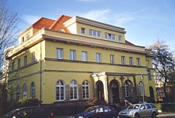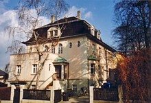

**_Fotos:_** _Gemeindehaus der Lukaskirchgemeinde (links) - Villa Einsteinstraße 3 (rechts)_

Die Erlweinstraße entstand nach dem Ersten Weltkrieg im Zusammenhang mit dem Bau von Siedlungshäusern zwischen Reichenbachstraße und Zelleschem Weg. Der 1929 erstmals im Adressbuch aufgeführte Name erinnert an den Dresdner
Stadtbaurat Hans Erlwein (1872-1914). Neben Schulen und anderen öffentlichen Gebäuden entwarf Erlwein auch das [Gasometer](../../../sudost/reick/gaswerk_reick/) in Reick sowie das Italienische Dörfchen. Noch heute sind zahlreiche Bauwerke seiner Hand in verschiedenen
Stadteilen erhalten geblieben.

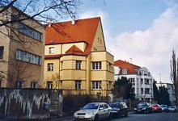

**_Foto:_** _Blick in die Erlweinstraße_

Als Fabrikstraße wird die Verlängerung der Plauener Hofmühlenstraße bezeichnet, die parallel zum früheren Weißeritzmühlgraben durch ein vorwiegend gewerblich genutztes Gebiet im äußersten Westen der Südvorstadt führt. 1862
erhielt sie mit Bezugnahme auf die hier befindlichen Fabriken ihren Namen. Im Haus Nr. 6 in der Nähe der Einmündung der
Freiberger Straße befand sich ab 1902 die “Öffentliche Zentralstelle für Desinfektion”. Die Einrichtung entstand auf Anregung von Karl August Lingner und gehörte zu seinem umfassenden Konzept zur Verbesserung der Gesundheits- und
Hygienevorsorge.

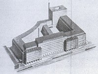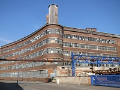Betriebszentrale des Konsumvereins (Nr. 13): Markantestes Gebäude an der Fabrikstraße ist die zwischen 1927 und 1930 errichtete Betriebszentrale des Konsumvereins “Vorwärts”, eines der wichtigsten Zeugnisse der Industriearchitektur dieser Zeit (Nr. 13). Architekt des sechsgeschossigen Gebäudes mit konkaver Fassade zur Straßenseite, einem nachts beleuchteten Glasturm und Klinkerverkleidung war Kurt Bärbig (1889-1968). Ursprünglich war das Gebäude als Auftakt zu einem Großkomplex mit Bäckerei, Brauerei und Brennerei, Lager- und Verwaltungsräumen geplant _(Bild links)_, der jedoch bedingt durch die Weltwirtschaftskrise nur in Teilen realisiert wurde. Das als Fleischverarbeitungsbetrieb genutzte Hauptgebäude besteht aus zwei im stumpfen Winkel zueinander stehenden Flügeln, die mit lang gezogenen Fensterbändern gegliedert sind.

1930 errichtete Karl Schmidt die zugehörige Großgarage mit Stellplätzen und Wartungshalle für die Fahrzeuge des Betriebes. Die Garage war durch einen unterirdischen Tunnel mit dem Hauptgebäude verbunden. Trotz einiger Kriegsschäden wurde der 1978 unter Denkmalschutz gestellte Industriebau noch bis 1991 von der Konsum-Genossenschaft genutzt und steht seitdem leer. Die frühere Wagenhalle wird heute als Go-Kart-Bahn genutzt.

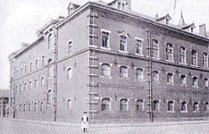Die 1866 angelegte und zunächst Kurze Straße genannte Feldschlößchenstraße erhielt
1874 ihren heutigen Namen nach der nahegelegenen [Feldschlößchenbrauerei](../../../zentrum/sudvorstadt/strassen_sudvorstadt/feldschlosschenbrauerei/). In
diesem Areal entlang der Bahnlinie siedelten sich nach 1870 zahlreiche gewerbliche Unternehmen an. Außerdem gab es einige Wohnhäuser und Gastwirtschaften sowie an
der Ecke zur Kunadstraße (Feldschlösschenstraße 40) die Posthalterei mit Stallungen und Büro- und Unterkunftsräumen für das Personal. Das Gebäude befand sich im
Besitz der Reichspost und wurde zur Unterstellung von Pferden und Lastwagen, als Lager und Versandort genutzt. In den 1920er Jahren hatte hier auch die Dresdner
Motorwagen Gesellschaft m.b.H. von Georg Oswald Hofmann ihren Sitz. Unter dem Namen  “Hofmanns Rund- und Vergnügungsfahrten” war sie einer der ersten Anbieter von Stadtrundfahrten in Dresden. Als
einziger Bau der Vorkriegszeit überstand die frühere Posthalterei die Zerstörungen des Zweiten Weltkriegs und wird bis heute gewerblich genutzt.

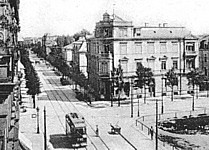Die 1873 nach dem amerikanischen Politiker und Schriftsteller Benjamin Franklin
(1706-1790) benannte Franklinstraße wurde Ende des 19. Jahrhunderts angelegt und bis 1900 mit Mehrfamilienhäusern bebaut. Zugleich bildete sie den östlichen Abschluss des
dichtbebauten “Amerikanischen Viertels”. Wie auch an den benachbarten Straßenzügen prägten an der Westseite viergeschossige Wohn- und Geschäftshäuser das Straßenbild. Auf
der gegenüberliegenden Seite gab es in Richtung Strehlen hingegen Villen und Einzelhäuser. Während sich in den oberen Etagen überwiegend Wohnungen befanden, nutzen die
Erdgeschossräume oft kleine Läden und Gaststätten. Bis 1921 verkehrte auch eine Straßenbahnlinie von der Gellertstraße kommend durch die Franklinstraße und bog dann in
die Schnorrstraße ab. Das Foto zeigt die Kreuzung Strehlener Straße / Franklinstraße um ca. 1905.

Zu den Bewohnern der Franklinstraße (Nr. 4) gehörte von 1893 bis 1896 der Kunsthistoriker und Denkmalpfleger Cornelius
Gurlitt (1850-1938), bevor er seine Villa an der [Kaitzer Straße](../../../zentrum/sudvorstadt/strassen_sudvorstadt/kaitzer_strasse/) 26 bezog. Im Haus Nr. 36 wohnte zeitweise der Architekt und
Designer Carl Ludwig Theodor Graff (1844-1906). Graff lebte ab 1874 in Dresden und war erster Direktor der Dresdner [Kunstgewerbeschule](../../../zentrum/johannstadt/strassen_johannstadt/kunstgewerbeschule/) und Gründer des Kunstgewerbemuseums. Später verzog er in die Villa Parkstraße 1. Sein Grab befindet
sich auf dem [Waldfriedhof Weißer Hirsch](../../../nordost/page10246/waldfriedhof_weisser_hirsch/).

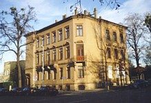Fast alle Gebäude der Franklinstraße wurden 1945 zerstört und später abgerissen. Im
erhaltenen Eckhaus zur Reichenbachstraße (Nr. 25), welches heute unter Denkmalschutz steht, befand sich bis in die 1970er Jahre eine Postfiliale _(Foto)_. Weitere
Ruinengrundstücke wurden in den 1970er und 1980er Jahren mit Bürohäusern und Gewerbeanlagen überbaut. 2013 wurde an der Einmündung der Schnorrstraße mit dem
Bau eines Wohnparkes begonnen. Außerdem entstand 2012/13 auf dem Eckgrundstück Franklin- /Strehlener Straße die neue Feuerwache Dresden-Altstadt.

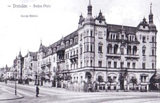Der von 1894 bis 1946 Sedanplatz genannte Verkehrsknotenpunkt an der Kreuzung
Bergstraße / Zellescher Weg erhielt seinen heutigen Namen Fritz-Foerster-Platz nach einem an der Technischen Hochschule tätigen Professor. Fritz Foerster (1866-1932)
war ab 1898 außerordentlicher Professor für Elektrochemie und übernahm 1917 das Amt des Rektors der TH. Sein Forschungslabor an der Schnorrstraße, in den Zwanziger Jahren Zentrum der elektrochemischen Lehre und Forschung in
Deutschland, wurde 1945 zerstört. Nach Foerster ist auch der 1926 eingeweihte Bau des Chemischen Instituts der TU benannt.

Markantestes Gebäude am Fritz-Foerster-Platz ist der 1913 von Martin Dülfer für die [Technische Hochschule](../../../zentrum/sudvorstadt/technische_universitat/) errichtete
Beyer-Bau mit seinem Observatoriumsturm. Ursprünglich sollte das Gebäude Teil eines größeren Lehrkomplexes sein, welcher
jedoch bedingt durch den Ersten Weltkrieg nicht fertiggestellt werden konnte. Lediglich das Bauingenieurs-Gebäude wurde von
Dülfer bis Kriegsbeginn vollendet. 1921 nahm man die Bauarbeiten wieder auf, entschloss sich jedoch aus wirtschaftlichen
Gründen für eine deutliche Reduzierung der Pläne. Gegenüber stand einst eine Wohnhausgruppe mit Geschäften im Erdgeschoss _(Foto rechts)._

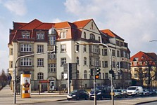Nach Abbruch der kriegszerstörten übrigen Bebauung entstanden am Fritz-Foerster-
Platz verschiedene Neubauten, darunter an Stelle kriegszerstörter Wohnhäuser ein Hörsaal- und Seminarkomplex für die Hochschule für Verkehrswesen. Dieser wird heute
als Potthoff-Bau von der Fakultät Verkehrswissenschaften genutzt. Die Planungen für das Gebäude stammen von Walter Henn, der in den 1950er Jahren mehrere Neubauten der
Hochschule projektierte. Weitere Ruinengrundstücke an der Nordseite des Platzes wurden in den 1970er Jahren mit siebzehngeschossigen Studentenwohnheimen bebaut.
Als einziger Vorkriegsbau neben dem Beyer-Bau blieb das Verwaltungsgebäude Fritz-Foerster-Platz 2 von 1910 erhalten _(Foto)_. Hier hatte viele Jahre der Rat des
Stadtbezirkes Dresden-Süd seinen Sitz. Heute dient das Haus als Sitz der Firma Saxonia Systems AG und wurde 2007/08 denkmalgerecht saniert.

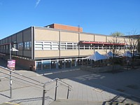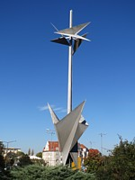Neue Mensa: 1978 öffnete an der Ecke Zellescher Weg / Bergstraße die Neue Mensa der TU _(rechts)_. Der zu den
bedeutendsten Werken der Moderne in Dresden gehörende Bau entstand ab 1974 nach Plänen des Architekten Ulf Zimmermann und besitzt eine künstlerisch interessante Innenausstattung. Die
Fassade des Flachbaus ist durch Fensterbänder und Betonplatten gegliedert. Im Inneren gibt es neben Küchen- und Serviceräumen mehrere Speisesäle sowie eine Cafeteria mit insgesamt ca. 1000
Plätzen. Außerdem entstand eine separat zugängliche Bierstube. Regelmäßig fanden auch verschiedene Veranstaltungen des Klubs “Neue Mensa” e.V. statt. Die
Freifläche vor dem Gebäude schmückt ein von Hermann Glöckner gestalteter “Stahlmast mit Faltungen” (links). Wegen seiner künstlerischen Qualität steht das Gebäude seit 2008 unter Denkmalschutz.

Bauliche Mängel und Brandschutzforderungen führten ab August 2014 zu einer schrittweisen Schließung der Mensa. Diese wurde daraufhin
in einen Interimsbau an der Nürnberger Straße verlegt. Zeitweise war aus Kostengründen sogar ein Abriss des Mensagebäudes geplant, bevor man sich nach heftigen Protesten für eine Sanierung entschied. Der Baubeginn steht jedoch noch
nicht fest.

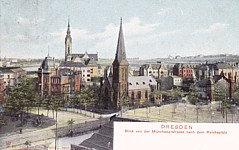
Der heutige Fritz-Löffler-Platz an der Kreuzung Münchner Straße - Bergstraße - Reichsstraße (Fritz-Löffler-Straße) entstand um 1890 und wurde ab 1891 Reichsplatz genannt. Hier stand bis zur Zerstörung 1945 die [Amerikanische Kirche](../../../zentrum/sudvorstadt/strassen_sudvorstadt/bergstrasse/amerikanische_kirche/). An der Ecke zur [Bergstraße](../../../zentrum/sudvorstadt/strassen_sudvorstadt/bergstrasse/) gab es das bekannte Lokal Bergkeller mit großer Aussichtsterrasse, welches jedoch bereits 1914 zugunsten von Wohnhäusern abgerissen wurde. 1945
fielen sämtliche Gebäude am Reichsplatz den Bomben zum Opfer. Nachdem die Stadtverordneten 1961 die Umbenennung der früheren Reichsstraße in Juri-Gagarin-
Straße beschlossen hatten, erhielt auch der Reichsplatz den Namen des sowjetischen Kosmonauten Juri Alexejewitsch Gagarin, der am 12. April 1961 als erster Mensch ins
Weltall geflogen war. Eine erneute Umbenennung von Platz und Straße erfolgte 1993 zur Erinnerung an den Kunsthistoriker und Denkmalpfleger Fritz Löffler.

Die im Zusammenhang mit dem Bau des Schweizer Viertels 1856 angelegte Gartenstraße verlief bis 1945 parallel zur
Bergstraße und verband Kaitzer und Bernhardstraße. Ihren Namen erhielt sie nach dem hier gelegenen Sommerlokal “Meinertscher Milchgarten”. Die nach 1945 in Offenbachstraße umbenannte Straße wurde nach dem Abbruch der Ruinen
überbaut und ist heute nicht mehr vorhanden. Seit 1940 befand sich in der Gartenstraße 4 das Gemeindehaus der Reformierten Kirche mit einer Hausorgel der Firma Jehmlich. Das Grundstück blieb auch nach 1945 zunächst im Besitz der
Religionsgemeinschaft und wurde erst 1960 gegen das noch heute genutzte Hofgärtnerhaus an der Brühlschen Terrasse getauscht.

Die um 1900 angelegte und nach dem Ersten Weltkrieg verlängerte Geinitzstraße verdankt ihren Namen dem Geologen Hans Bruno Geinitz (1814-1900). Geinitz verfasste zahlreiche Schriften zur Mineralogie und Geologie und war ab 1857 Leiter des Mineralogischen Museums. Zuletzt wohnte er auf der Lindenaustraße in der Südvorstadt. Sein Grab befindet sich auf dem Alten Annenfriedhof.

Als erstes Gebäude der Geinitzstraße entstand 1904 die Villa Nr. 5 im Jugendstil. In den 1920er und 1930er Jahren folgten weitere Wohnhäuser, von denen einige 1945 dem Luftangriff zum Opfer fielen. Die entstandenen Baulücken wurden später wieder geschlossen, meist durch Ein- und Zweifamilienhäuser. Seit 1979 lädt auf der Geinitzstraße 16 das Eiscafé Jähnig zum Besuch ein. Das Café befindet sich Erdgeschoss eines dieser Einfamilienhäuser und besitzt einen schönen Kaffeegarten.

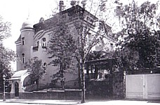Nr. 5: Zu den Bewohnern der Geinitzstraße gehörte ab 1904 der Bergbauexperte und Unternehmer Richard Baldauf (1848- 1931). Baldauf war durch seine Tätigkeit im böhmischen Braunkohlebergbau zu erheblichem Wohlstand gekommen und ließ sich 1904 in Dresden nieder, wo er mit seiner Frau Rosalie die Villa Geinitzstraße 5 bezog. Hier widmete er sich geologischen Forschungen und legte eine umfangreiche Mineraliensammlung an, die ab 1916 auch der Öffentlichkeit zugänglich war. Nach seinem Tod verkauften seine Erben 1939 das Haus und veräußerten die Sammlung an das Museum für Mineralogie und Geologie, wo sie noch heute existiert. Die Villa wurde 1945 zerstört und in den 1970er Jahren durch ein Einfamilienhaus ersetzt.

Nr. 10: Im Wohnhaus Geinitzstraße 10 wohnte viele Jahre der Chemiker und Universitätsprofessor Kurt Schwabe (1905-1983). Ab 1949 als Direktor des Institutes für Elektrochemie und Physikalische Chemie an der Technischen Hochschule tätig, leitete er zwischen 1959 und 1969 auch das Institut für Radiochemie im [Kernforschungszentrum Rossendorf](../../../nordost/schonfeld-weissig/rossendorf/kernforschungszentrum/). 1961 bis 1965 war zudem Rektor der TU.

Die George-Bähr-Straße entstand kurz nach 1900 und verbindet den Münchner Platz
mit dem Fritz-Förster-Platz. Ihren Namen erhielt sie nach dem Dresdner Ratszimmermeister und Erbauer der Frauenkirche George Bähr (1666-1738).  Neben dem 1902-07 errichteten [Landgericht](../../../zentrum/sudvorstadt/strassen_sudvorstadt/munchner_platz/landgericht/) prägen vor allem Lehrgebäude der TU das
Straßenbild. Außerdem entstanden hier einige Mietshäuser. Erhalten blieb u.a. das 1900 fertiggestellte Gebäude George-Bähr-Straße 20, errichtet vom Architektenbüro
Sommerschuh & Rumpel, mit historisierender Jugendstilfassade. Auch die Wohnhäuser Nr. 18 und 12 bis 14 blieben fast unverändert erhalten. Weitere Gebäude  fielen 1945
den Bomben zum Opfer. Im Haus George-Bähr-Straße 4 wohnte in den Zwanziger Jahren der deutsch-jüdische Politiker Peter Blachstein. Blachstein gehörte nach 1945 der SPD-Bundestagsfraktion an und war
zeitweise deutscher Botschafter in Jugoslawien. Eine enge Freundschaft verband ihn mit Willy Brandt.

Die Georg-Schumann-Straße entstand Ende des 19. Jahrhunderts, blieb jedoch zunächst namenlos und unbebaut. Als erstes Gebäude entstand zwischen 1902 und 1907 der Monumentalbau des [Landgerichts am Münchner Platz](../../../zentrum/sudvorstadt/strassen_sudvorstadt/munchner_platz/landgericht/), welches heute als Georg-Schumann-Bau von der Technischen Universität genutzt wird. Aus der gleichen Zeit stammt der ursprüngliche Name Abekenstraße, der 1907 erstmals
nachweisbar ist. Christian Wilhelm Ludwig von Abeken (1826-1890) war von 1871 bis 1890 sächsischer Justizminister und enger Vertrauter Bismarcks. Nach dem Ersten Weltkrieg wurden die Wohnblocks Nr. 2 bis 28 durch den Bauverein
Gartenheim e.G.m.b.H. errichtet. Die Häuser waren Teil einer geplanten, jedoch nur teilweise realisierten Wohnanlage zwischen Münchner Platz, Münchner und Nöthnitzer Straße _(Foto um 1935)_
. Heute gehören sie zur WG “Glückauf Süd”. Die Freiflächen gegenüber den Wohnbauten wurden als Sportplätze von verschiedenen Vereinen genutzt. Erst nach 1950 entstanden hier Gebäude der Technischen Universität.

In der Nachkriegszeit erfolgte die Umbenennung der Abekenstraße in Georg-Schumann-Straße. Georg Schumann (1886-1945)
gehörte zunächst dem Spartakusbund, später der KPD an und war bis 1933 Abgeordneter der Partei im Reichstag. Während der NS-Zeit baute er eine der größten Widerstandsgruppen im sächsischen Raum auf, wurde 1944 verhaftet, zum Tode
verurteilt und am 11. Januar 1945 im Innenhof des nahegelegenen Landgerichts mit dem Fallbeil hingerichtet. Nach ihm ist auch der Georg-Schuhmann-Bau der TU im ehemaligen Landgerichtsgebäude benannt.

Als Georg-Wrba-Straße wird seit 1994 der östliche Teil der Schnorrstraße bezeichnet, der in den 1950er Jahren beim Bau
eines Studentenwohnheims vom übrigen Straßenabschnitt getrennt worden war. Georg Wrba (1872-1939), Bildhauer und Professor der Kunstakademie, schuf u. a. den “Rathausesel” am Ratskellereingang, den [Aphroditebrunnen](../../../zentrum/sudvorstadt/strassen_sudvorstadt/friedrich-list-platz/) am Friedrich-List-Platz und den [Europabrunnen](../../../ost/blasewitz/strassen_blasewitz/konigsheimplatz/) in Blasewitz.

Die Glauchauer Straße erhielt ihren Namen erst nach 1990 nach der westsächsischen Stadt Glauchau. Ursprünglich gehörte dieser Straßenzug zur [Eisenstuckstraße](../../../zentrum/sudvorstadt/strassen_sudvorstadt/eisenstuckstrasse/). Da die durchgängige Straßenführung jedoch um 1970 mit Anlage der Budapester Straße und einer Wohnzeile unterbrochen worden war, entschied man sich zur besseren Orientierung für eine eigene Namensgebung des kurzen Abschnitts.

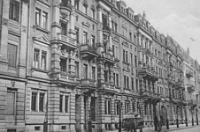Die Gutzkowstraße im “Amerikanischen Viertel” wurde Ende des 19. Jahrhunderts angelegt und 1881 nach dem deutschen Schriftsteller und Journalisten Karl Gutzkow (1811-1878) benannt. Gutzkow lebte zwischen 1847 und 1861 in Dresden und gehörte der “Montagsgesellschaft”, einem Freundeskreis von Künstlern und Intellektuellen, an. Neben seiner Tätigkeit als Dramaturg des Hoftheaters verfasste er zahlreiche Dramen und Romane und war ab 1852 Herausgeber der Zeitschrift “Unterhaltungen am häuslichen Herd”.

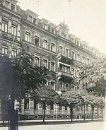Ebenso wie die meisten Straßen der Umgebung wurde auch die Gutzkowstraße bis zur Jahrhundertwende mit mehrgeschossigen Wohnhäusern bebaut. In den Hinterhöfen gab es zahlreiche kleinere Gewerbebetriebe. U.a. hatte hier ab 1886 die Zigarettenfabrik Hugo Zietz ihren Stammsitz. Das Unternehmen befand sich auf dem Grundstück Gutzkowstraße 27 und wurde aus Platzgründen 1909 in die neu errichtete [“Yenidze”](../../../zentrum/friedrichstadt/strassen_friedrichstadt/weisseritzstrasse/yenidze/) verlegt. Hinzu kamen kleinere Läden, die Gastwirtschaft "Rabenerhof" im Eckhaus Nr. 16 sowie in der Nr. 19 die private Knabenschule “Worcester House” mit englischer Unterrichtssprache. Im Nachbarhaus wohnte vor dem Ersten Weltkrieg der Musikpädagoge Hermann Vetter (1859-1928). Vetter war ab 1883 Klavierlehrer am Konservatorium und wurde 1911 zum Professor und zweiten Direktor der Einrichtung berufen. Im Haus Gutzkowstraße 9 besaß ab 1898 der Maler Paul Pötzsch (1858-1936), ein Schüler von Leon Pohle und Ferdinand Pauwels, seinen Wohnsitz. Zuvor hatte er im "Künstlerviertel" der nahe gelegenen Ostbahnstraße gewohnt. Pötzschs Atelier befand sich auf der heutigen Andreas-Schubert-Straße 3.

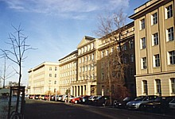Von den Wohnhäusern der Gutzkowstraße überstand keines die Zerstörungen des Zweiten Weltkrieges. Erhalten blieb lediglich die Ruine der 1898 eröffneten [8\. Bürgerschule](../../../zentrum/sudvorstadt/) (ab 1919 50. Volksschule). Das Gebäude wurde in der Nachkriegszeit notdürftig repariert und diente seitdem als Lager einer Papierfabrik. 1999 erfolgte unter Einbeziehung der verbliebenen Bausubstanz ein Umbau für gewerbliche Zwecke. Gegenüber entstand in den 1950er Jahren ein Wohnheim für Studenten der TU _(Foto)_. Hier befindet sich mit dem “Gutzkow-Club” Dresdens ältester Studentenclub. Der Klub wurde 1964 von Studenten der Hochschule für Verkehrswesen gegründet und bietet bis heute regelmäßige Veranstaltungen für Studenten und Gäste an.

Die Bezeichnung Hahnebergstraße erinnert an eine heute kaum noch wahrnehmbare Erhebung in der Nähe der Kreuzung Schweizer/ Budapester Straße. Der Name dieses Höhenzuges hat nichts mit dem Geflügel zu tun, sondern ist von “Hayn” (Hainberg) abgeleitet. Hier entwickelte sich bereits um 1450 ein kleines Gewerbegebiet, zu dem u.a. eine 1491 erwähnte Gießerei gehörte. Unweit davon befand sich eine Windmühle, welche jedoch bereits 1571 demontiert und per Schiff nach Torgau verbracht wurde. Nach dem Eisenbahnbau siedelten sich an der Hahnebergstraße verschiedene Unternehmen an. Ihren amtlichen Namen erhielt sie 1876.

Die Hauffstraße, eine kleine Nebenstraße der Reichenbachstraße in der Nähe der Lukaskirche, wurde in den 1930er Jahren im Zusammenhang mit dem Bau einer Eigenheimsiedlung angelegt. Ihren Namen erhielt sie 1938 nach dem Märchendichter Wilhelm Hauff (1802-1827).

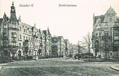Die Helmholtzstraße im “Universitätsviertel” am Münchner Platz entstand 1899. Mit der Namensgebung soll an den Physiker Hermann von Helmholtz (1821-1894) erinnert werden, der u. a. das Gesetz von der Erhaltung der Energie entdeckte. Helmholtz befasste sich auch mit Fragen der Optik und Akustik und erfand den Augenspiegel. In den Jahren bis zum Ersten Weltkrieg entstanden hier zunächst einige Mietshäuser. Die Pläne stammten von bekannten Dresdner Architekten, u.a. vom Büro Sommerschuh & Rumpel. Im Eckhaus zur Münchner Straße (Nr. 2) befand sich vor dem Zweiten Weltkrieg das Lokal "Versöhnungsheim", später "Münchner Hof" genannt.

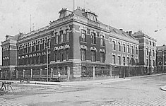Zwischen George-Bähr- und Mommsenstraße folgten 1900-1905 die von Karl Weißbach projektierten Hochschulbauten des Institutes für Elektrotechnik und Maschinenbau _(Nr. 5 - Foto)_ sowie der Mechanisch-Technischen Versuchsanstalt (Nr. 7). Seit 1928 bzw. 1953 tragen diese den Namen Zeuner-Bau bzw. Berndt-Bau. Weitere Enrichtungen der Technischen Universität entstanden in den 1950er und 1960er Jahren sowie nach 1990, 1999 außerdem ein Neubaukomplex für das Leibniz-Institut für Festkörper- und Werkstoffforschung.

Nr. 3b: In diesem Gründerzeitwohnhaus an der Ecke zur George-Bähr-Straße wohnte bis 1940 der ehemalige Musikdirektor des Dresdner Schauspielhauses Dr. Arthur Chitz. Chitz, der 1908 nach Dresden gekommen war und hier 1911 Dipl-Ingenieur der Chemie wurde, übernahm nach dem Ersten Weltkrieg das Amt des Musikalischen Leiters und wurde 1920 zum Musikdirektor berufen. Als Komponist und Dirigent wirkte er bis 1933 an zahlreichen Aufführungen mit, wurde dann jedoch wegen seiner jüdischen Herkunft entlassen. 1940 musste er mit seiner Familie seine Wohnung verlassen und in das “Judenhaus” Lothringer Weg 2 umziehen. 1942 deportierte man das Ehepaar in das Ghetto Riga, wo Chitz vermutlich 1944 verstarb. Vor dem Haus erinnert heute ein Stolperstein an den Musikwissenschaftler.

Die Henriette-Heber-Straße am Neubau des Dresdner Arbeitsamtes wurde erst 1998 angelegt. Mit der Namensgebung wird an die frühere Leiterin der Armen-Arbeits-Anstalt Henriette Heber (1795-1869) erinnert. Sie gründete 1840 den “Verein für Arbeit und Arbeiternachweisung” und führte damit die erste öffentliche Arbeitsvermittlung in Dresden ein.

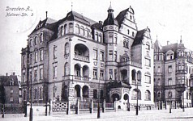Auch die Hettnerstraße wurde kurz nach 1900 beim Ausbau der Südvorstadt und des neuen Hochschulviertels angelegt und verbindet den Nürnberger Platz mit der George-Bähr-Straße. Ihren Namen erhielt sie nach dem Kunsthistoriker Hermann Hettner (1821-1882), der ab 1854 als Direktor der Antikensammlung in Dresden tätig war. 1868 übernahm er zugleich die Leitung der Rüstkammer und war ab 1869 Inhaber des Lehrstuhls für Kunstgeschichte am Polytechnikum. Hettners Grab auf dem Alten Annenfriedhof blieb bis heute erhalten und wurde 1983 zu einer Gedenkstätte für bedeutende Wissenschaftler der TH umgestaltet.

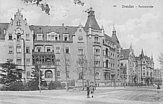Wie im gesamten Viertel um den Nürnberger Platz errichtete man auch hier repräsentative Wohnhäuser mit aufwendig gestalteten Fassaden. In einem dieser Häuser (Nr. 4) wohnte viele Jahre der Schriftleiter der "Dresdner Neuesten Nachrichten" Karl Laux (1896-1978). Im Nachbarhaus (Nr. 6) hatte die "Litterarische Gesellschaft" ihre Geschäftsräume. Die Vereinigung war 1886 zur Förderung moderner Literatur gegründet worden und war eng mit dem "Dresdner Anzeiger" verbunden. Im gleichen Haus befand sich mit der Georg Holz GmbH ein Spezialgeschäft für Treibriemen, Gummi- und Asbestfabrikate der Papierindustrie. Das Eckhaus zur George-Bähr-Straße (Nr. 8) war in den 1920er Jahren Sitz des griechischen Vizekonsulats. Ab 1931 wohnte hier nach seiner Pensionierung der langjährige Präsident der Reichsbahndirektion Dresden Richard Kluge (1866-1945). Für seine Verdienste um das sächsische Eisenbahnwesen erhielt er 1928 die Ehrendoktorwürde der Technischen Hochschule. Das historische Bild _(rechts)_ zeigt diese bis heute zum Teil erhalten gebliebene Häusergruppe an der Einmündung Hettner-/George-Bähr-Straße.

Während die Wohnhäuser Nr. 4 und 6 den Bombenangriff 1945 überstanden, fiel die gesamte Bebauung der gegenüberliegenden Straßenseite in Trümmer. Nach Abbruch der Ruinen errichtete man hier nach einem Plan des Architekten Walter Henn einen Neubaukomplex für die geplante [Fakultät Verkehrswissenschaften](../../../zentrum/sudvorstadt/strassen_sudvorstadt/friedrich-list-platz/hochschule_fur_verkehrswesen/) der TH. Die Grundsteinlegung erfolgte am 20. April 1951, die Übergabe ab 1952. 1955 wurde im Treppenhaus des Audimax am Fritz-Foerster-Platz ein Fresko von Alfred Hesse und Erich Gerlach enthüllt, das den Besuch des Staatspräsidenten Wilhelm Pieck in Dresden zeigt. In den Gebäuden befinden sich ein großer Hörsaal mit 500 Plätzen, Seminar- und Büroräume. Bis 2010 war hier auch die Bibliothek der Fakultät untergebracht. Seit 1993 trägt der Bau nach einem Professor für Betriebstechnik der Verkehrsmittel den Namen Gerhart-Potthoff-Bau.

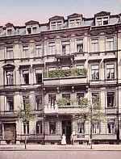Die heutige Hochschulstraße entstand 1871 im Zusammenhang mit dem Bau des “Amerikanischen Viertels” und erhielt in Erinnerung an die Schlacht von Sedan im Deutsch-Französischen Krieg 1870/71 den Namen Sedanstraße. Ursprünglich verlief in diesem Gebiet die alte Landstraße nach Dippoldiswalde, die nach dem Bau der [Bergstraße](../../../zentrum/sudvorstadt/strassen_sudvorstadt/bergstrasse/) 1840 und der [Reichsstraße](../../../zentrum/sudvorstadt/strassen_sudvorstadt/fritz-loffler-strasse/) ihre Verkehrsbedeutung verlor. An der Kreuzung Hochschul- / Schnorrstraße befand sich noch bis 1870 Schreibers Gärtnerei mit ihrem Rosengarten. Diese musste ebenso wie der einst in diesem Bereich verlaufende Landgraben der Neubebauung weichen.

Im Gegensatz zum westlich dieser Straßen gelegenen “Schweizer Viertel” erfolgte an der Sedanstraße eine geschlossene Bebauung mit meist viergeschossigen Mietshäusern. Die Fassaden wurden mit Sandsteinornamenten in historischen Baustilen verziert, um das Repräsentationsbedürfnis der Bauherren zu unterstreichen. Im Haus Nr. 4 wohnte zwischen 1891 und 1894 der spätere Dresdner Oberbürgermeister Otto Beutler. Zu den Bewohnern der Sedanstraße gehörten auch der Maler und Professor für Historienmalerei an der Kunstakademie Ferdinand Pauwels (1830-1904) (Nr. 2), der Bildhauer Arthur Lange (1875-1929), Schöpfer des Ehrenmals für die Gefallenen der Technischen Hochschule und des [Gardereiter-Denkmals](../../../neustadt/albertstadt/strassen_albertstadt/stauffenbergallee/) an der Stauffenbergallee, (Nr. 14) und der Architekt Hans Richter (1882-1971), der im Haus Sedanstraße 24 bis 1945 sein Büro hatte.

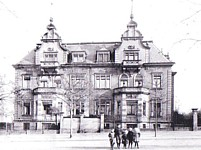Im oberen Teil südlich der Reichenbachstraße bis zum Sedanplatz prägten hingegen bis 1945 villenartige Einzel- und Doppelhäuser das Straßenbild. Architektonisch interessant waren u.a. das Wohnhaus Nr. 20 (um 1890) sowie das Doppelhaus Nr. 33/35 an der Ostseite _(Foto rechts)_. An ihrer Stelle entstanden 1995 neue Wohn- und Bürogebäude sowie 2008 der Kindergarten der Lukaskirche.

Neben Wohnhäusern gab es an der Sedanstraße bis zur Zerstörung 1945 mehrere Fremdenheime und Pensionen sowie öffentliche Gebäude, unter anderem die [19\. Volksschule](../../../zentrum/sudvorstadt/). In der Häusergruppe Sedanstraße 7-9 befand sich das renommierte Hotel Savoy-Albertshof mit seinem Konzert- und Tanzsaal. Eine weitere Gaststätte existierte an der Ecke zur Schnorrstraße mit der Schankwirtschaft "Zum Sport" (Nr. 15). Gegenüber befand sich bis nach dem Ersten Weltkrieg Dr. med. Nahmacher's Privatklinik für chirurgische- u. Frauenkrankheiten _(Nr. 17 - Foto oben links_). Später verlegte Nahmmacher seine Klinik zur [Altenzeller Straße](../../../zentrum/sudvorstadt//strassen_sudvorstadt/altenzeller_strasse/) 35\. Sämtliche Bauten wurden 1945 zerstört.

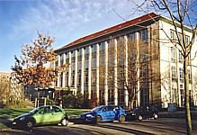Mit Beginn der Flächenenttrümmerung in der Südvorstadt entstand 1951 an der Sedanstraße ein Lokschuppen für die Trümmerbahn, welche den Schutt der zerstörten Gebäude in ehemalige Ziegeleigruben nach Gostritz und Prohlis verbrachte. Ab 1954 wurden hier Neubauten für die neu gegründete [Hochschule für Verkehrswesen](../../../zentrum/sudvorstadt/strassen_sudvorstadt/friedrich-list-platz/hochschule_fur_verkehrswesen/) errichtet. Dominierend ist das neungeschossige Hauptgebäude am Friedrich-List-Platz mit angrenzenden Seminarflügel. Für dessen bauliche Gestaltung wählte der Architekt Richard Paulik nach sowjetischem Vorbild neobarocke Formen. Sachlicheren Vorbildern folgte die 1958 fertiggestellte Mensa der Hochschule an der Einmündung Reichenbachstraße _(Foto)_, die von einem Architektenkollektiv um Helmut Bräuer und Horst Möhlenhoff entworfen wurde. In Zusammenhang mit diesen Bauten erfolgte die Umbenennung der Sedanstraße in Hochschulstraße. Zwischen 1981 und 1983 entstanden auf den verbliebenen Freiflächen mehrgeschossige Plattenbauten sowie drei Studentenwohnheime (Nr. 46, 48 und 50). Eines dieser Wohnheime (Nr. 50) wird seit 2006 als Internationales Gästehaus des Studentenwerkes genutzt. Im Erdgeschoss befindet sich seit 2008 der Kindergarten "Campusnest". 2010 folgte auf dem Grundstück Hochschulstraße 33/35 ein Kindergarten-Neubau der Lukaskirchgemeinde.

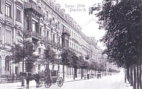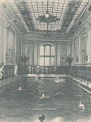Hotel Savoy-Albertshof: Das Hotel entstand 1895 im Gebäude Sedanstraße 7-9 als “Bad und Kurhaus Albertshof”. Als eines der ersten Hotels überhaupt besaß es in einem Gebäude auf der Gartenseite ein hauseigenes Schwimmbad mit Gesundheits- und Erholungsbereich, wobei die Kurgäste sogar von einem angestellten Stabsarzt betreut wurden. Zur Unterhaltung fanden außerdem regelmäßige Frühkonzerte statt. Nach Einbeziehung des Nachbarhauses wurde es am 1. Januar 1898 unter dem Namen “Savoy-Albertshof” neu eröffnet. Neben den Restauranträumen gab es nun zwei große Säle für Gesellschaften, das Café "Alt-Wien" sowie über 80 Hotelzimmer. Mit seiner modernen und repräsentativen Ausstattung, durchgehend elektrischer Beleuchtung, Fahrstuhl und Badezimmern für fast alle Gäste gehörte es zu den renommiertesten Gästehäusern der Stadt und wurde in Reiseführern als “Haus
allerersten Ranges” geführt.

Mit Ausbruch des Ersten Weltkrieges wurde der Hotelbetrieb eingestellt und das Haus zum Lazarett umgewandelt. Im “Genesungsheim des Roten Kreuzes Savoy-Hotel Kurbad Albertshof” fanden nun bis zum Kriegsende verwundete Soldaten
Aufnahme. 1919 versuchte man, an die Tradition der Vorkriegszeit anzuknüpfen, allerdings ohne Erfolg. Deshalb wurden die Hotelzimmer wenig später in Büroräume umgewandelt. Das Restaurant im Erdgeschoss existierte noch bis Mitte der Dreißiger Jahre und war mit seiner “Tanz-Diele” ein beliebtes Vergnügungslokal. 1945 fiel das frühere Savoy-Hotel den Bomben zum Opfer.

Die 1883 entstandene Hübnerstraße im Schweizer Viertels verdankt ihren Namen dem Historien- und Porträtmaler Julius Hübner (1806-1882), der ab 1839 an der Dresdner Kunstakademie tätig war. 1871 übernahm er auch das Amt des Direktors der Gemäldegalerie. Nach dem Beschluss zum weiteren Ausbau der Südvorstadt in Richtung Plauen und Räcknitz wurde die Hübnerstraße um 1900 bis zum Münchner Platz verlängert.

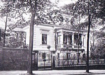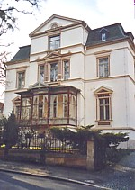Das Straßenbild der Hübnerstraße prägten bis 1945 vorwiegend großbürgerliche Villen und Mietshäuser, von denen einige bis heute erhalten blieben. Zu diesen Gebäuden gehören die Villen Hübnerstraße 1 (1880 von Max Gutmann), 2 und 4. In der 1885/86 als schlichtes Wohnhaus errichteten und später umgebauten Villa Nr. 2 _(Foto links)_ wohnte der Architekt Ernst Traugott Sommerschuh (1844-1905), Teilhaber des Architektenbüros Sommerschuh & Rumpel. Das Nachbarhaus Nr. 4 _(Foto rechts)_ wurde 1885 von Ludwig Wilhelm Lippold entworfen und 1898 nach Plänen des Büros Carl & Rönitz erweitert. Bemerkenswert ist auch die 1886 ebenfalls von Ludwig Wilhelm Lippold an der Ecke zur Altenzeller Straße errichtete Villa Hübnerstraße 6. Das aufwendig gestaltete Haus besitzt eine reich gegliederte Klinker-Sandstein-Fassade im Stil der deutschen Renaissance. Bei der Sanierung 2010 wurden die 1945 zerstörten Ziergiebel wieder ergänzt. Das Haus dient seit 1957 als Kindertagesstätte "Spatzenvilla". Gegenüber im 1945 zerstörten Haus Nr. 5 wohnte um die Jahrhundertwende der Kunsthistoriker Karl Woermann, Direktor der Dresdner Gemäldegalerie.

Nicht mehr vorhanden ist das gegenüber der Einmündung der Leubnitzer Straße gelegene Haus Hübnerstraße 1b. Hier befand sich eine Niederlassung der Dresdner Pianoforte-Fabrik Kaps mit Stammsitz auf der Seminarstraße. Ernst Karl Wilhelm Kaps (1826-1887) hatte das Unternehmen 1858 in Dresden gegründet und wurde später zum königlich-sächsischen Hofpianofortefabrikanten ernannt. Weitere Filialen gab es am Altmarkt (Nr. 13) und in der Schloßstraße (Nr. 18), aber auch in Paris, Irkutsk, St. Petersburg und London. Das 1922 zur Kaps-Kuhse-AG fusionierte Unternehmen erlosch 1938 aus wirtschaftlichen Gründen. Im gleichen Haus wohnte einige Jahre auch der Pianist und Musiklehrer Eugen Krantz. 1890 erwarb er das Dresdner Konservatorium und führte dieses als Direktor bis zu seinem Tod 1898.

1897/98 wurde nach Plänen von Rudolf Hayn (1835-1916) das Wohnhaus Hübnerstraße 8 errichtet. Bauherr und erster Bewohner war der Unternehmer und Konsul Gustav Richard Tiedemann, Inhaber einer Lack- und Farbenfabrik in Brockwitz (heute Ortsteil von Coswig). 1930 verkauften Tiedemanns Erben die Villa an den Generaldirektor der Radeberger Exportbierbrauerei Mathias Ernst. Das jüdische Ehepaar Mathias und Margarete Ernst wohnten hier bis 1942. In diesem Jahr verhaftete die Gestapo Ernst wegen des Besitzes illegaler Schriften und verbrachte ihn ins Polizeigefängnis an der Schießgasse, wo er zwei Tage später Selbstmord beginn. Die daraufhin enteignete Villa diente daraufhin als Wohnsitz des Dresdner SA-Stabschefs Wilhelm Schepmann. Schepmann hatte zuvor als NSDAP-Mitglied Karriere als Stadtverordneter, Reichstagsabgeordneter und Polizeipräsident von Dortmund gemacht. 1945 floh er nach Niedersachsen. Das Haus diente später als Kinderkrippe der Stadt Dresden und wurde 1998 als rechtswidrig enteigneter jüdischer Besitz an die Conference on Jewish Material Claims Against Germany rückübertragen und wenig später verkauft.

Auch die Villa Hübnerstraße 12 überstand die Zerstörung ohne größere Schäden. Hier lebte nach 1945 der Komponist Willy Kehrer (1902-1976), der gelegentliche Hauskonzerte gab und als Klavierlehrer tätig war. Nach seinem Tod befand sich in den Räumen bis 2004 das Willy-Kehrer-Archiv mit dem umfangreichen Nachlass des Künstlers. Außerdem gibt es auf der Hübnerstraße gleich drei Einkehrstätten: das libanesische Restaurant “Sindbad” im Haus Nr. 13, die im Keller des gleichen Gebäudes befindliche Szenekneipe “Campus” und das italienische Restaurant "La Cantinella (ehem. “Hübner´s”) an der Ecke zur Nürnberger Straße.

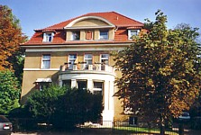Jugendherberge Rudi Arndt (Nr. 11): Dresdens älteste noch bestehende Jugendherberge befindet sich in der 1914 von Otto Förster erbauten Jugendstilvilla Hübnerstraße 11. Nach seinem Bauherrn wurde das Gebäude einst Haus Luther genannt. Besitzer war der Ingenieur und Unternehmer Dr. Ing. Gerhard Luther, Mitglied im Vorstand der Mühlenbauanstalt und Maschinenfabrik vorm. Gebrüder Seck in Dresden. In den 1930er Jahren nutzte das Reichsluftfahrtministerium das Haus, bevor 1952 eine Jugendherberge eingerichtet wurde. Benannt wurde sie nach dem Widerstandskämpfer und Leiter des Kommunistischen Jugendverbandes Rudi Arndt (1909-1940). Der wegen seiner politischen Tätigkeit verhaftete Funktionär wurde 1940 im KZ Buchenwald ermordet. Gegenwärtig stehen hier ca. 70 Betten in Ein- bis Sechs-Bett-Zimmern zur Verfügung.

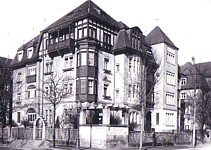Erst nach 1900 erfolgte eine Verlängerung der Hübnerstraße über die Nürnberger Straße hinweg bis zum Münchner Platz. Im Gegensatz zum unteren Abschnitt entstanden hier repräsentative Mietshäuser mit aufwendigen Sandsteinfassaden, plastischem Schmuck und Erkern. In einem dieser Gebäude (Nr. 18) befand sich bis in die 1930er Jahre der Sitz des Israelitischen Frauenvereins. Leiterin war die im gleichen Haus lebende Elli Lesser. Ihr Ehemann Max fungierte ab 1932 als geschäftsführender Vorsitzender der jüdischen Gemeinde. Keines dieser Häuser überstand den Zweiten Weltkrieg. Teilweise wurden die Ruinengrundstücke in den 1960er Jahren mit Wohnblocks überbaut. Das gegenüber liegende Areal zwischen Hübner-, Nürnberger und Bayreuther Straße blieb jedoch bis heute Brachfläche. Eine Neubebauung ist geplant.

Die Kellstraße wurde 1896 im Zusammenhang mit dem Bau des Zentralgüterbahnhof Altstadt angelegt und nach dem Geheimen
Finanzrat Karl Hermann Kell (1820-1888) benannt. Kell war als leitender Ingenieur beim Bau der Elstertal- und der Gölzschtalbrücke beteiligt und gehörte ab 1885 dem sächsischen Finanzministerium an.

Die Kunadstraße, eine kurze Querstraße zwischen Zwickauer Straße und Bahnanlagen, erinnert an die früher hier gelegene Kunadmühle. Diese wurde vom [Weißeritzmühlgraben](../../../sudwest/lobtau/weisseritzmuhlgraben/) angetrieben und um 1570 als “Lorentz Kunadts Müll”, später als “Kunatin
Mühl” bezeichnet. Ab 1569 befand sie sich im Besitz von Kurfürst August. Später wechselte die Kunadmühle mehrfach ihre
Besitzer und verfiel 1894 dem Abbruch. An ihrer Stelle errichtete man Verwaltungsgebäude der Staatsbahn sowie die “Posthalterei”, das spätere Dresdner Bahnpostamt.

Die Leonhard-Frank-Straße wurde Ende der Zwanziger Jahre angelegt und bis zum Kriegsbeginn mit Ein- und Zweifamilienhäusern bebaut. In einem dieser Häuser wohnte der als Dokumentarist des alten Dresdens bekannt gewordene
Fotograf Walter Hahn. Beim letzten Angriff auf die Stadt am 17. April 1945 wurde sein Haus von einer Brandbombe getroffen.
Hahn konnte sich jedoch retten und später auch Teile seiner wertvollen Negativsammlung aus den Trümmern bergen.

Bis in die Nachkriegszeit trug die Straße den Namen Godeffroystraße. Benannt wurde sie nach dem Hamburger Großkaufmann Godeffroy, der Ende des 19. Jahrhunderts an der deutschen Kolonialisierung im Pazifikraum beteiligt war.
1962 erhielt sie den Namen des Schriftstellers Leonhard Frank (1882-1961), welcher verschiedene Novellen und Romane schrieb.

Der nach dem Reformpolitiker und früheren sächsischen Minister Bernhard von Lindenau (1779-1854) benannte Lindenauplatz
entstand nach Verabschiedung eines Bebauungsplanes für das Areal südlich der Bahnlinie und sollte das dichtbebaute Wohnviertel auflockern. Um den Platz
standen mehrgeschossige Mietshäuser, die die mit Ruhebänken und Rabatten gestaltete Grünfläche umgaben. Sämtliche Gebäude fielen 1945 den Bomben zum Opfer. In den Jahren zwischen 1951-53 befand sich
hier ein zentraler Stützpunkt der Trümmerbahnen, welche nicht mehr verwendungsfähiges Material zur Trümmerkippe nach
Gostritz bzw. Prohlis verbrachten. Der Lindenauplatz selbst wurde 1974/76 mit den Neubaublocks der Uhlandstraße überbaut und ist heute nicht mehr in den Stadtplänen verzeichnet.

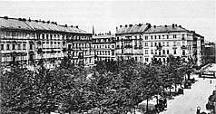

**_Foto:_** _Wohnhäuser am Lindenauplatz um 1910_

Auch die Lindenaustraße, welche vor dem Zweiten Weltkrieg bis zur Uhlandstraße führte, erhielt ihren Namen nach Bernhard
von Lindenau (1779-1854). Der an der Erarbeitung der ersten liberalen Verfassung Sachsens beteiligte Politiker übernahm
1831 den Vorsitz des Gesamtministeriums und war viele Jahre auch als Generaldirektor der königlichen Sammlungen in Dresden
tätig. 1848 gehörte er der Deutschen Nationalversammlung an. Ende des 19. Jahrhunderts entstanden an der Lindenaustraße
Villen und Mietshäuser, die sämtlich im Zweiten Weltkrieg zerstört wurden. Im Haus Lindenaustraße 23 wohnte zeitweise der Maler Ernst Ludwig Kirchner, Mitglied der Künstlergruppe “Brücke”.

Die Ende der Zwanziger Jahre angelegte Ludwig-Ermold-Straße, eine kurze Verbindung zwischen Zelleschem Weg und
Beutlerpark, trug vor 1945 den Namen Wißmannstraße. Herrmann von Wißmann war als Reichskommissar und Gouverneur von Deutsch-Ostafrika (Tansania) an der Kolonialisierung der Region beteiligt und ließ 1888/89 einen Aufstand gewaltsam
niederschlagen. In der Nachkriegszeit wurde die Straße nach dem Opernsänger Ludwig Ermold (1883-1949) benannt. Ermold
gehörte einige Jahre dem Ensemble der Hofoper an und wirkte 1911 als “Baron Ochs auf Lerchenau” in der Uraufführung des “Rosenkavaliers” mit.

Die Lukasstraße sowie der angrenzende Lukasplatz wurden kurz vor 1900 im Zusammenhang mit dem Bau der [Lukaskirche](../../../zentrum/sudvorstadt/strassen_sudvorstadt/lukaskirche/) angelegt und entsprechend benannt. Hier befand sich auch das zur Kirche gehörende Gemeindehaus mit Pfarramt, welches nach dem Bombenangriff von 1945 nur noch als Ruine erhalten blieb. In den letzten Jahren erfolgte der Wiederaufbau zu einem Seniorenheim. Weitere Grundstücke wurden mit modernen Wohnhäusern und einem Ärztehaus bebaut. An der östlichen Seite
der Lukaskirche ist ein mittelalterliches Sühnekreuz zu sehen. Dieses befand sich bis 1880 an der alten Landstraße nach Dippoldiswalde und wurde nach seiner Bergung aus einer Baugrube 1904 an die Kirche umgesetzt. Eine denkmalgerechte Restaurierung erfolgte 2011/12.

Nr. 3: In diesem Gebäude wohnte und praktizierte bis 1933 der Zahnarzt Dr. Friedrich Berlowitz, der enge Kontakte zu Dresdner Intellektuellen und Künstlern unterhielt. Die jüdische Familie floh 1936 nach Palästina und rettete so ihr Leben. Tochter Ruth Berlowitz arbeitete später als Dolmetscherin und wurde durch ihren Einsatz im Prozess gegen Adolf Eichmann international bekannt. An die Familie erinnern seit Mai 2016 drei Stolpersteine vor dem 1945 zerstörten Wohnhaus. Heute befindet sich auf dem Grundstück ein Ärztehaus.

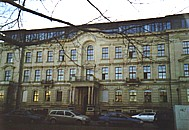Landeskirchenamt (Nr. 6): Bemerkenswert ist der 1897 nach Entwürfen von Ludwig Wilhelm Lippold entstandene Bau Lukasstraße 6, welcher einst die Kaiserlich-Russische Gesandtschaft in Sachsen beherbergte. Das ursprünglich als Mietshaus konzipierte Gebäude _(Foto)_ besitzt eine aufwendig gestaltete Sandsteinfassade im Neobarockstil und gehört zu den repräsentativsten Bauwerken der Südvorstadt. 1926 erwarb das Landeskonsistorium Sachsen der evangelischen Kirche das Gebäude und nutzte es ab 1933 als Landeskirchenamt. Als einer der wenigen Bauten in diesem Stadtviertel überstand das Haus den Zweiten Weltkrieg und konnte bereits kurz nach Kriegsende wieder ausgebaut und nutzbar gemacht werden. An Stelle des 1945 zerstörten Daches erhielt das Gebäude 1999 ein modern gestaltetes zusätzliches Obergeschoss sowie einen Anbau auf der Gartenseite. Die Planungen für den Umbau stammen von Ulf Zimmermann. Im Inneren befinden sich Diensträume der Landeskirche.

Die Max-Liebermann-Straße in der Nähe des Beutlerparks erinnert an den deutschen Maler und Grafiker Max Liebermann
(1847-1935), der durch seine vom Impressionismus beeinflussten Bilder mit Alltagsszenen und Darstellungen des Arbeitslebens bekannt wurde. Zwischen 1920 und 1933 war er Präsident der Preußischen Akademie der Künste.

Vor 1945 wurde die Straße Lüderitzstraße genannt. Der Bremer Kaufmann Adolf Lüderitz hatte 1883 an der Küste Südwestafrikas einen Landstreifen erworben, der ab 1884 unter dem Namen Deutsch-Südwestafrika erste Kolonie des
Deutschen Reiches wurde. Das Gebiet um die nach ihm benannte Stadt Lüderitz (heute Namibia) ist vor allem als Diamantenfundort von Bedeutung.

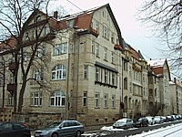Die Münchner Straße entstand 1899 als zweite große Hauptachse der Südvorstadt. Entgegen ursprünglichen Planungen entschloss man sich zu einem großzügen Ausbau mit geteilten Fahrbahnen, separater Gleistrasse der Straßenbahn und einem gärtnerisch gestaltenen Mittelstreifen. Zu beiden Seiten errichtete die Dresdner Baugesellschaft Wohn- und Geschäftshäuser, zum Teil in geschlossener Bebauung, teilweise auch als “Gruppenhäuser” _(Foto)_. Nach dem Ersten Weltkrieg wurden bis 1930 die noch verbliebenen Freiflächen bis zur Nöthnitzer Straße mit einer genossenschaftlichen Siedlung des Bauvereins Gartenheim bebaut. Architekt dieser Wohnanlage zwischen Münchner-, Georg-Schumann- und Regensburger Straße war Paul Beck.

Im Haus Münchner Straße 18 besaß bis 1945 der Dresdner Kunstprofessor Paul Rößler sein Atelier. Von Rößler stammen zahlreiche Innenraumgestaltungen, u.a. für die Striesener [Versöhnungskirche](../../../ost/striesen/versohnungskirche/), den Ratskeller und das “Italienische Dörfchen”. Auch die letzte große Restaurierung der Frauenkirche vor der Zerstörung 1945 erfolgte unter seiner Leitung.

Obwohl zahlreiche Gebäude, vor allem im unteren Teil der Münchner Straße, im Zweiten Weltkrieg zerstört wurden, lassen die verbliebenen Wohnhäuser bis heute die künstlerisch anspruchsvolle Gestaltung der Entstehungszeit erkennen. Viele Fassaden weisen Schmuckformen im Jugendstil auf. Einige Baulücken wurden nach 1960 geschlossen.

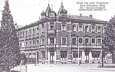Am südlichen Ende öffnet sich die Münchner Straße in einer platzartigen Anlage, umgeben von Wohnhäusern aus der Gründerzeit. Hier zweigen die Nöthnitzer und die Bienertstraße in Richtung Plauen ab. Im Eckhaus zur Bienertstraße befand sich viele Jahre die Gaststätte “Münchner Krug”. Nach 1990 bezog ein griechisches Lokal die Räume. Unmittelbar vor der Einmündung der Bernhardstraße lag ab 1900 der Endpunkt der Straßenbahn, bevor neun Jahre später eine Verlängerung bis zum Plauener Rathaus erfolgte. Die Zerstörungen des Zweiten Weltkriegs führten 1945 zur Einstellung dieser Strecke. 1953 wurde stattdessen die noch heute vorhandene Gleisschleife angelegt. Seit 1999 verkehren die Bahnen über eine neu angelegte Direktverbindung bis nach Coschütz.

Die Nossener Straße wurde in Verlängerung der Nürnberger Straße angelegt und stellte über die 1889 errichtete
Hohenzollernbrücke die Verbindung in Richtung Löbtau her. Beiderseits der Straße befanden sich bis 1945 gewerbliche Anlagen, darunter auch die Gebäude der [Lingner-Werke](../../../zentrum/sudvorstadt/strassen_sudvorstadt/zwickauer_strasse/lingner-werke/). 1960/64 wurde die Straße deutlich verbreitert und in die neue
“Brücke der Jugend” einbezogen. Seit 1991 wird diese Brücke ebenso wie der angrenzende Straßenabschnitt amtlich als [Nossener Brücke](../../../sudwest/lobtau/strassen_lobtau/lobtauer_brucken/) bezeichnet. Wenig später entstand an der Südseite das Bürogebäude “Drei-Brücken-Haus”.

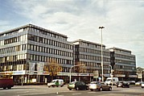

_Foto: Das “Drei-Brücken-Haus” an der Nossener / Ecke Chemnitzer Straße_

Der Nürnberger Platz wurde 1899 als Zentrum eines neuen Stadtviertels angelegt und in Reverenz an die fränkische Metropole
Nürnberg benannt. Um den kreisförmigen Platz entstanden repräsentative Wohn- und Geschäftshäuser, welche oft
Jugendstilformen aufwiesen.  Hier trafen auch die Straßenbahnlinien nach Plauen (Münchner Platz) und zum “Nürnberger Ei” aufeinander. Im Haus Nr. 5 hatte ab 1927 der Verein jüdischer Studenten in Dresden seinen Sitz.

1945 fiel die gesamte Bebauung des Nürnberger Platzes den Bomben zum Opfer. Lediglich das Areal an der Rugestraße wurde bis heute wieder bebaut. Hier befinden sich
die Helmholtz-Apotheke sowie die Buchhandlung der Technischen Universität.

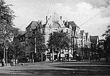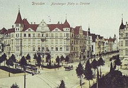

**_Fotos:_** _Der Nürnberger Platz vor 1945 - beide Eckhäuser wurden zerstört._

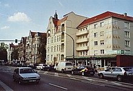Zeitgleich mit dem Nürnberger Platz entstand die Nürnberger Straße, welche zwischen
1900 und 1905 durch die Dresdner Baugesellschaft mit großbürgerlichen Wohnhäusern bebaut wurde. Ursprünglich war hier auch der Bau einer Kirche vorgesehen, weshalb die
Nürnberger Straße in Höhe Liebigstraße zu einem ovalen Platz erweitert wurde. Obwohl man sich wenig später für einen anderen Standort entschied, blieb die Platzanlage in ihrer
Form erhalten und veranlasste den Volksmund zur Bezeichnung “Nürnberger Ei”. Hier befindet sich auch die Gleisschleife der Straßenbahn.

Nach Zerstörung eines Großteils der Gebäude begann 1953/54 der Wiederaufbau unter
Leitung des Dresdner Architekten Herbert Schneider. Die in Anlehnung an Dresdner Bautraditionen mit Erkern und Sandsteinsockeln gestalteten Neubauten wurden in den ersten Jahren vorrangig an Bergleute der Wismut vermietet. Ende der
1950er Jahre setzten sich auch hier sachlichere Formen für die Neubauten durch. Einige erhaltene Vorkriegsbauten konnten in
die Neubebauung einbezogen werden und erinnern noch ein wenig an das frühere Aussehen dieses Stadtteils. Wegen der
vorhandenen Geschäfte und öffentlichen Einrichtungen (u.a. Bibliothek mit Plastik “Lesendes Mädchen”) bildet das “Nürnberger
Ei” heute das eigentliche Zentrum der Südvorstadt. Im Haus Nr. 28a fbefand sich ab 26. Januar 1979 das zweite Dresdner “Delikat”-Spezialgeschäft, in denen Fleisch, Wurst und Konserven westlicher Herkunft erworben werden konnten.

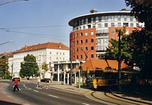“Nürnberger Ei”:
Im Zuge des Wiederaufbaus entstand an der Ecke Nürnberger / Bernhardstraße ein pavillonartiger Neubau mit Wohngebietsgaststätte. Architekten des Gebäudes waren Hans Konrad und Bruno Kandler, die sich für einen eiförmigen
Grundriss des eingeschossigen Baus entschieden. Das Lokal öffnete am 1. Oktober 1958 seine Pforten und erhielt in Anlehnung an den volkstümlichen Namen des angrenzenden
Platzes den Namen “Nürnberger Ei”. 1992 wurde die bis zuletzt gut besuchte Gaststätte geschlossen und abgerissen. 1994 errichtete man an ihrer Stelle ein modernes Büro- und Geschäftshauses _(Foto)_
. Originell ist die gewählte Grundrissform dieses Gebäudes in Form eines Eis. Der Entwurf stammt von den Architekten Rauert & Porsch und Dähne & Burggraf. Im Erd- und 1. Obergeschoss befinden sich verschiedene Geschäfte.

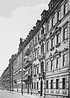
Die heute nicht mehr in den Stadtplänen verzeichnete Ostbahnstraße _(Foto)_ führte bis 1945 parallel zum Hochgleisdamm der Eisenbahn und war an ihrer Südseite mit mehrgeschossigen Mietshäusern
bebaut. Hier lebten zahlreiche Künstler, die der Straße einen besonderen Charakter gaben. U.a. besaßen der Maler Otto Griebel sowie das Künsterehepaar Hans und Lea Grundig ihre Ateliers an der
Ostbahnstraße. Außerdem gab es mehrere Gaststätten, darunter die “Sängerhalle” an der Ecke zur Uhlandstraße sowie die als Künstlerkneipe beliebte Schankwirtschaft von Max Balke. Sämtliche
Bauten fielen 1945 den Bomben zum Opfer. Die Straße selbst bezog man in der Nachkriegszeit in das Betriebsgelände des Betonwerkes Strehlener Straße ein.

Die Straße wurde in den Zwanziger Jahren als Nachtigalstraße angelegt und mit Ein- und Mehrfamilienhäusern bebaut. Mit der Namensgebung sollte der deutsche Militärarzt und Reichskommissar
im Kolonialamt Gustav Nachtigal geehrt werden, der 1884 die Inbesitznahme Deutsch-Südwestafrikas (heute Namibia), Kameruns und Togos vertraglich besiegelte und damit den Grundstein für den deutschen Kolonialbesitz in Afrika legte.

1961 erfolgte die Umbenennung in Patrice-Lumumba-Straße. Am 17. Januar 1961 war der wenige Tage zuvor bei einem Militärputsch gestürzte erste Ministerpräsident des Kongo ermordet worden. Lumumba galt als einer der engagiertesten
Vertreter der afrikanischen Unabhängigkeitsbewegung und wird bis heute als Held der schwarzafrikanischen Befreiung verehrt.

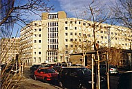
Die in vielen Stadtplänen oft fälschlich als Rabener Straße bezeichnete Straße wurde Ende des 19. Jahrhunderts angelegt und mit Mehrfamilienhäusern bebaut. Ihren Namen erhielt sie 1881
nach dem deutschen Satiriker Gottlieb Wilhelm Rabener (1714-1771). Rabener lebte ab 1755 als Steuerbeamter in Dresden und verfasste zahlreiche volkstümliche Satiren, in denen er vor allem den bürgerlichen Mittelstand attackierte.

Von den einst vorhandenen Gebäuden überstand lediglich das Wohnhaus Rabenerstraße 6 den Luftangriff. 1986 wurde dieses Haus für einen Neubau des Wohnungsbaukombinates Dresden
gesprengt. Heute hat in dem erst kurz vor der Wende fertiggestellten Gebäude das Dresdner Finanzamt seinen Sitz _(Foto)_.
2011/12 erfolgte eine umfassende Sanierung. In diesem Zusammenhang wurde an der Fassade das überdimensionale Wandbild
“Barcode” des Chemnitzer Künstlers Jörg Steinbach angebracht. Weitere Neubauten werden von der Hochschule für Technik und Wirtschaft genutzt.

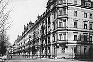Die Reichenbachstraße bildet den südlichen Abschluss des sogenannten “Amerikanischen
Viertels” und war bis um 1930 zugleich Bebauungsgrenze dieses geschlossenen Viertels mit rechtwinkligen Straßen. An der Nordseite _(Foto)_ befanden sich bis zur Zerstörung 1945
mehrgeschossige Wohn- und Geschäftshäuser, zum Teil mit prächtigen Jugendstilfassaden. In einem dieser Gebäude lebte zwischen 1901 und 1921 der Dresdner Oberbürgermeister Otto
Beutler (Nr 7), in der Nr. 4 zeitweise Dr. Wilhelm Külz. Ihren Namen erhielt die Straße nach dem Botaniker Heinrich Gottlieb Ludwig Reichenbach (1793-1879), Leiter des Dresdner
Naturalienkabinetts und Gründer des Botanischen Gartens. In den Dreißiger Jahren begann die Bebauung der bis dahin freien Südseite bis zum Zelleschen Weg mit Ein- und Zweifamilienhäusern. Während sämtliche
Gebäude der Nordseite den Bomben des 13. Februars 1945 zum Opfer fielen, blieben diese Bauten bis heute meist erhalten.

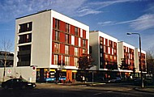1950 wurde mit dem Bau des Wohnblock Reichenbachstraße 34-48 der Wiederaufbau in
diesem Teil der Südvorstadt begonnen. Nach 1990 entstanden auf weiteren Grundstücken moderne Einfamilien- und Reihenhäuser. 2001/05 folgte zwischen Reichenbach- und Andreas-
Schubert-Straße das architektonisch interessante “Lukasareal” mit mehrgeschossigen Wohnhäusern und Geschäften _(Foto)_. Bemerkenswert ist auch der 1999 vollendete Neubau des Gemeindezentrums der [Christengemeinschaft](../../../zentrum/sudvorstadt/strassen_sudvorstadt/christengemeinschaft/) sowie die 2006 begonnene Atrium- und
Atelierhaussiedlung südlich des Beutlerparks. Architekt dieser am Bauhausstil orientierten Gebäude ist Siegbert Langner von Hatzfeld.

Carolahaus (Nr. 71/73):
Das Gebäude gegenüber dem Beutlerpark entstand ursprünglich als Alten- und Pflegeheim der Carola-Stiftung. 1933 eröffnete hier der Albertverein ein neues Krankenhaus, welches die Tradition des kurz zuvor geschlossenen [Carolahauses](../../../zentrum/johannstadt/carolahaus/) in der Johannstadt fortsetzte. Für die Patienten standen insgesamt 40 Betten zur Verfügung, die
vorrangig von ambulant tätigen Ärzten belegt wurden, um kleinere Operationen vorzunehmen. Außerdem nutzte der Albertverin
die Einrichtung als Ausbildungsstätte für sein Pflegepersonal. Während des Zweiten Weltkrieges war in der Klinik ein Lazarett
untergebracht. Beim Luftangriff 1945 wurde das Haus schwer beschädigt. In der Nachkriegszeit erfolgte der Wiederaufbau als Sitz des Hygiene-Institutes.

Die vom Lukasplatz in östlicher Richtung abgehende Renkstraße entstand in den Dreißiger Jahren und verdankt ihren Namen
dem Chemiker Friedrich Georg Renk (1850-1928), der viele Jahre an der Technischen Hochschule als Professor tätig war. Architektonisch interessant ist das Wohnhaus an der Ecke zur Erlweinstraße (Renkstraße 1), auch “
Haus Garten” genannt. Das unter Denkmalschutz stehende Gebäude wurde 1929 von Hans Richter (1882–1971) im Stil der Neuen Sachlichkeit entworfen

**_Fotos:_** _Blick in die Renkstraße zur Lukaskirche (links) und die Rohlfsstraße (rechts)_

Die kurz vor Beginn des Zweiten Weltkriegs angelegte Rohlfsstraße in der Nähe der Lukaskirche erhielt ihren Namen nach dem Afrikaforscher Gerhard Rohlfs (1831-1896). Rohlfs hatte nach seinem Medizinstudium viele Jahre beim Militär, u.a. in der Fremdenlegion in Europa und Nordafrika gedient und nahm ab 1865 an mehreren Afrika-Expeditionen teil. Als einem der ersten Europäer gelang ihm die Durchquerung der Sahara. 1879 gelang es ihm als ersten, die Kufra-Oasen im Südosten von Libyen zu erreichen. Seine Erlebnisse präsentierte er später in zahlreichen Büchern und Vorträgen. Erstmals ist die Rohlfsstraße im Adressbuch von 1941 aufgeführt.

Die heutige Rugestraße entstand Ende des 19. Jahrhunderts und wurde vor 1945 Bendemannstraße genannt. Eduard Bendemann (1811-1889) war ab 1839 Professor der Dresdner Kunstakademie und schuf neben Wandmalereien und Porträts
auch zahlreiche Buchillustrationen. Außerdem war er an der Ausgestaltung des Residenzschlosses beteiligt.

Nach 1945 erfolgte eine Umbenennung der Bendemannstraße in Rugestraße. Mit dieser Namensgebung wird an den
Geographen Sophus Ruge (1831-1903) erinnert, der nach seiner Tätigkeit als Lehrer an der Handelslehranstalt und der Annenschule 1874 den Lehrstuhl für Geographie und Ethnographie am Polytechnikum übernahm. Ruge gehörte zu den
Mitbegründern des Vereins für Erdkunde und des Gebirgsvereins für die Sächsische Schweiz. Seine letzten Lebensjahre verbrachte er in Klotzsche, wo sich auf dem Alten Friedhof auch sein Grab befindet.

Von den ursprünglich vorhandenen Villenbauten der Rugestraße sind heute nur noch wenige erhalten. An Stelle zerstörter Wohn
gebäude entstand 1965 ein modernes Wohnhochhaus (Nr. 13). Im Erdgeschoss befindet sich die 1947 aus der früheren
Hofapotheke hervorgegangene Helmholtzapotheke, die zuvor provisorisch in den Räumen einer ehemaligen Gaststätte auf der Helmholtzstraße 2 untergebracht war.

Die Schnorrstraße wurde um 1875 als eine der Hauptstraßen des neuen “Amerikanischen Viertels” angelegt und verlief als
schnurgerade Verbindung zwischen Winckelmann- und Ackermannstraße. Ihren Namen verdankt sie dem Kunstmaler Julius
Schnorr von Carolsfeld (1794-1872), der bis zu seinem Tod als Professor für Historienmalerei an der Dresdner Kunstakademie wirkte und auch die Leitung der Gemäldegalerie innehatte.

Bis zur Zerstörung 1945 befanden sich an der Schnorrstraße mehrgeschossige Wohnhäuser mit Läden und kleinen Handwerksbetrieben. In einem dieser Häuser (Nr. 16) lebte zeitweise der “Brücke”-Maler Ernst Ludwig Kirchner während
seiner Studentenzeit. Nr. 82 beherbergte das “Südsanatorium” Dr. Denkers. Unweit davon lud mit dem “Südcasino” eine von
zahlreichen Gaststätten in diesem Viertel zum Besuch ein. Zwischen Reichs- und Sedanstraße stand seit 1875 das im Zusammenhang mit dem Polytechnikum errichtete Chemische Laboratorium der [Technischen Hochschule](../../../zentrum/sudvorstadt/technische_universitat/).

Fast alle Gebäude fielen 1945 den Bomben zum Opfer. Mitte der 50er Jahre begann mit der Errichtung von Studentenwohnheimen an der Gutzkow- und der Semperstraße der
Wiederaufbau. In diesem Zusammenhang wurde die Schnorrstraße teilweise überbaut und dadurch unterbrochen. Während der längere Abschnitt noch heute seinen ursprünglichen
Namen trägt, erfolgte 1994 die Umbenennung des östlich der Semperstraße gelegenen Straßenteils in Georg-Wrba-Straße. Heute befinden sich hier verschiedene Gebäude der
Hochschule für Technik und Wirtschaft sowie Bürohäuser. Außerdem entstanden in den letzten Jahren moderne Wohnhäuser _(Foto)_.

Die Semperstraße entstand Ende des 19. Jahrhunderts und wurde nach dem bedeutenden
Architekten Gottfried Semper (1803-1879) benannt, der in Dresden u. a. das Galeriegebäude am Zwinger und das Opernhaus entwarf. Die meisten der  ab 1890 an der Straße entstandenen Villen
wurden 1945 zerstört. Zu den wenigen erhaltenen historischen Bauten gehörte die Villa “San Remo” (Semperstraße 4) von 1896. Das im italienischen Landhausstil gestaltete Gebäude _(Foto)_ wurde
1973 zugunsten eines Bürohauses des Instituts für Stahlbeton abgetragen. In einem weiteren Bürogebäude befand sich bis 1999 das Dresdner Arbeitsamt.

Ebenfalls aus der Nachkriegszeit stammen die an der Straße stehenden Studentenwohnheime. Auf dem Dach eines dieser
Häuser wurde 2008 Deutschlands größtes Luftbild angebracht. Das nur aus einem Flugzeug bzw. Heißluftballon sichtbare Bild
zeigt die ersten Takte von Vivaldis Komposition “Die Vier Jahreszeiten” und wurde vom Dresdner Künstler Siegfried Haas
geschaffen. 2008 entstand auf einer Brachfläche an der Semperstraße eine kleine Reihenhaussiedlung. Weitere Grundstücke wurden nach dem Abbruch von Gewerbehallen wenig später ebenfalls mit Wohnhäusern bebaut.

Die heutige Strehlener Straße gehört zu den ältesten Verkehrswegen auf dem Gebiet der heutigen Südvorstadt. Da man diesen
Weg einst als Viehtreibe nutzte, wurde er bis zum 19. Jahrhundert Kälberweg genannt. Hier mündeten auch die von Süden
kommenden Marktwege nach Räcknitz und Zschertnitz. Mit dem Bau der Sächsisch-Böhmischen Eisenbahn wurde dieser Weg teilweise überbaut und etwas nach Süden verlegt. 1868 erfolgte der Ausbau zur Straße und die Namensgebung nach dem
benachbarten Stadtteil Strehlen. In der Folge entstanden hier Wohn- und Geschäftshäuser, überwiegend in geschlossener
Bauweise. In einem dieser Gebäude (Nr. 21) hatte bis 1945 der konstruktivistische Künstler Hermann Glöckner sein Atelier.

Das Straßenbild prägen nach Zerstörung der kompletten Vorkriegsbebauung moderne Büro- und Geschäftshäuser, die von verschiedenen Unternehmen genutzt werden. Die Flächen zwischen Strehlener Straße und Bahngelände, welche
bis 1990 zum Teil von einem Betonwerk eingenommen wurden, liegen derzeit noch brach. 2010-12 entstand  nach einem Entwurf des
Architektenbüros Schulz & Schulz eine moderne City-Feuerwache mit Leitstelle, Einsatz- und Katastrophenlagezentrum und
Stellplätzen für Feuerwehr und Rettungsdienst. Der 150 Meter lange und im klassischen feuerwehrrot gestaltete Neubau wurde im Oktober 2012 eingeweiht und beherbergt auch ein Brandschutzerziehungszentrum

Die Uhlandstraße wurde als eine der ersten Straßenzüge im Zuge des Ausbaus des Wohnviertels hinter
dem Hauptbahnhof angelegt und folgt in ihrem Verlauf teilweise dem alten Räcknitzer Marktweg, über den die Bauern einst ihre Ware zum Dresdner Markt transportierten. Die Flurstücke zu beiden Seiten der
Straße nahmen einst die Felder der Baumschule und Gärtnerei Rölke ein, bevor diese nach 1880 der vordringenden Bebauung weichen musste. Namensgeber der 1874 offiziell benannten Straße ist der
romantische Dichter Ludwig Uhland (1787-1862), der als Abgeordneter dem ersten deutschen Parlament in der Frankfurter Paulskirche angehörte.

Im Eckhaus zum Lindenauplatz (Uhlandstraße 2) befand sich bis 1945 die Gaststätte “Uhlandeck”, unweit davon das Postamt A 14. Lediglich ein Mietshaus überstand die Bomben des Zweiten Weltkriegs und blieb bis heute erhalten _(Uhlandstraße 30 - Foto)_. Im gegenüberliegenden Wohnhaus Nr. 33 lebte bis zu seiner Verhaftung 1935 der Bezirksleiter des Deutschen Metallarbeiterverbandes Richard Teichgräber. Teichgräber wurde während der NS-Zeit
inhaftiert und verstarb am 25. Februar 1945 in einem Außenlager des KZ Mauthausen. Seit 2014 erinnert an ihn ein Mahndepot auf dem Gehweg vor dem Grundstück.

An Stelle der 1945 zerstörten Bebauung entstanden 1973 Wohnblocks sowie 2010 eine moderne Fahrzeughalle für die Versuchsfahrzeuge der Hochschule für Technik und Wirtschaft. Außerdem wurde an der Uhlandstraße 34 eine neue Kita
erbaut.

Die Wielandstraße entstand 1851 als eine der ersten Straßen des “Schweizer Viertels” und wurde in der Folgezeit mit Villen bebaut. Da sie direkt zur 1836 gegründeten [Blindenanstalt](../../../sud/plauen/strassen_plauen/chemnitzer_strasse/) führte, nannte man sie zunächst Blindenstraße. Wenig später erfolgte die Umbenennung nach dem deutschen
Dichter Christoph Martin Wieland (1733-1813), einem der Mitbegründer der “Weimarer Klassik”.

Von den einst vorhandenen Villen hat keine die Zerstörungen des Zweiten Weltkrieges überstanden. Bemerkenswert waren das
1858 für den Dresdner Buchhändler Kuntze errichtete neogotische Wohnhaus an der Ecke zur Hohen Straße sowie die im klassischen Stil gestaltete Villa Wielandstraße 4 _(Foto)_ von 1873.

Staatsanstalt für Krankengymnastik: Die Einrichtung auf der Wielandstraße 2 wurde 1919 gegründet und von Willem Ernst Smitt
(1862-1922) geleitet. Smitt hatte bereits 1904 ein privates Institut für Heilgymnastik ins Leben gerufen und gilt als einer der
Wegbereiter der Physiotherapie. Die Staatsanstalt für Krankengymnastik und Massage behandelte auf wissenschaftlich-
medizinischer Grundlage Patienten mit unterschiedlichen Krankheitsbildern und bildete zugleich Krankengymnasten aus. Nach dem Tod Smitts wurde sie 1922 ins Taschenbergpalais verlegt und 1941 aufgelöst.

Die erstmals im Adressbuch von 1910 verzeichnete Wigardstraße erhielt ihren Namen nach dem sächsischen Politiker Franz
Jacob Wigard (1807-1885). Wigard gehörte 1848/49 der Nationalversammlung an und war später auch Mitglied des sächsischen Landtags und des deutschen Reichstags. Bekannt wurde er jedoch vor allem als Förderer der Stenographie und
Gründer des Sächsischen Stenographischen Institutes. Die heute nicht mehr vorhandene Straße zweigte am Südrand des Weberplatzes ab und war Teil eines hier geplanten Straßennetzes zur Verbindung mit dem Zelleschen Weg. Da sie jedoch
unbebaut blieb, erfolgte im Zusammenhang mit einem Erweiterungsbau des Pädagogischen Institutes um 1930 die Einziehung.

Die um 1850 angelegte Winckelmannstraße erinnert an den bedeutenden Altertumsforscher und Bibliothekar Johann Joachim Winckelmann (1717-1768), der als Begründer der modernen
Archäologie gilt. Winckelmann war ab 1748 als Bibliothekar Heinrich von Bünaus in Nöthnitz (heute Ortsteil von Bannewitz) angestellt und verfasste als Hauptwerk die “Geschichte der Kunst
des Altertums”, welche 1764 in Dresden veröffentlicht wurde.

Von den einst vorhandenen Villen und Mehrfamilienhäusern überstand lediglich das frühere
“Reichsbad” (Nr. 6) den Luftangriff. Seit einigen Jahren befindet sich in den Räumen das Hotel Kipping _(Foto)_. Das Nachbargrundstück Nr. 4 war zwischen 1890 und 1903 Standort der [Interimskirche](../../../zentrum/sudvorstadt/strassen_sudvorstadt/lukaskirche/) der Lukasgemeinde, bevor diese ihr Gotteshaus am Lukasplatz beziehen konnte.

Zu den 1945 zerstörten Gebäuden gehört auch das Wohnhaus Winckelmannstraße 39. Dieses befand sich ab 1902 im Besitz
des Rechtsanwaltes Dr. Bernhard Eibes (1886-1942), welcher sein Büro auf der Prager Straße 10 hatte. Eibes, 1911 zum Justizrat ernannt, war am Landgericht tätig und vertrat nach 1918 die Wettiner im Rechtsstreit um die Regelung der
Vermögensfragen mit dem Freistaat Sachsen. Er erarbeitete dabei den 1924 unterzeichneten “Auseinandersetzungsvertrag” zur Abfindung der Königsfamilie und ihrer Nachkommen.

* * *

 \[ [Home](../../../index.html)\] \[ [Nord](../../../nord/)\] \[ [Nordwest](../../../nordwest/)\] \[ [Neustadt](../../../neustadt/)\] \[ [Nordost](../../../nordost/)\] \[ [West](../../../west/)\] \[ [Zentrum](../../../zentrum/)\] \[ [Südwest](../../../sudwest/)\] \[ [Süd](../../../sud/)\] \[ [Südost](../../../sudost/)\] \[ [Ost](../../../ost/)\] \[ [Register](../../../Register/register.html)\] \[ [Kontakt](../../../Kontakt/kontakt.html)\] \[ [Impressum](../../../impressum/)\]
