* * *

* * *

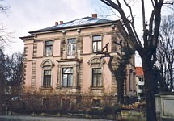Der Name Altenzeller Straße erinnert an einen bereits im Mittelalter vorhandenen
Fahrweg am Fuße der südlichen Elbtalhänge. Da dieser Weg von den Mönchen des Klosters Altzella auf ihrem Weg zum Leubnitzer Klosterhof benutzt wurde, bürgerte sich der Name [Zellescher Weg](../../../../sud/zschertnitz/strassen_zschertnitz/zellescher_weg/) ein. Während der Straßenabschnitt zwischen
Fritz-Förster-Platz und Teplitzer Straße noch heute diesen Namen trägt, benannte man den in der Südvorstadt gelegenen Straßenteil nach seinem Ausbau 1883 in
Zellesche Straße, nach dem Ersten Weltkrieg in Altenzeller Straße um. Bereits 1851 hatte eine städtische Kommission Bebauungspläne für das Areal zwischen Bahnlinie und Zellescher Straße ausgearbeitet _(Foto: Altenzeller Straße 37)._

In der Folge entstanden an der Altenzeller Straße repräsentative Villen und Landhäuser in unterschiedlichen Stilformen
Meist dienten diese als Wohnhäuser für wohlhabende Fabrikanten, höhere Beamte, Professoren und Pensionäre. Aber
auch Diplomaten, Privatkliniken und Mädchenpensionate siedelten sich hier an. Stellvertretend erwähnt werden sollen das
Töchterpensionat Bodemann (Nr. 28) und die Chirurgische Privatklinik Dr. Nahmacher (Nr. 35). Auch im Haus Nr. 23
befand sich zeitweise ein Mädchenpensionat. Ab 1928 wohnte hier der Arzt Dr. Fromme, Chefchirurg des Städtischen
Krankenhauses Friedrichstadt. Auf dem Grundstück der 1945 zerstörten Villa entstand nach 1950 eine Schulturnhalle.

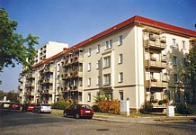
1955 erfolgte an der Altenzeller Straße die Grundsteinlegung für den Wiederaufbau der Südvorstadt. An Stelle ausgebrannter und vollständig zerstörter Villen
entstanden nun Wohnblocks für die Wohnungsgenossenschaft (AWG) “Glückauf”, die sich 1961 mit der AWG Süd vereinigte _(Foto)_. In den Anfangsjahren wohnten
hier hauptsächlich Bergleute der “Wismut” und Aktivisten aus volkseigenen Dresdner Betrieben. Neben diesen Wohnhäusern blieben jedoch auch einige Villen
erhalten, die noch heute an die frühere Bebauung des “Schweizer Viertels” erinnern. Da die Altenzeller Straße 1976 durch den Bau der Wohnzeile an der Budapester
Straße unterbrochen wurde, erhielt das kurze westliche Reststück nach 1990 den Namen Werdauer Straße. Hier hatten sich bereits vor 1945 hauptsächlich Gewerbebetriebe angesiedelt  Weitere Teile
dieses kurzen Straßenabschnitts waren mit Nebengebäuden der [Kinderheilanstalt](../../../../sud/plauen/strassen_plauen/chemnitzer_strasse/) bebaut.

Einzelne Gebäude:

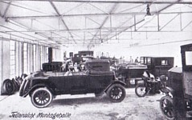
Nr. 3-5: Das Fabrikgelände westlich der Chemnitzer Straße war bis 1945 Standort der Autoreparaturwerkstatt Graumüller. Inhaber war der Ingenieur
August Graumüller, der zuvor für August Horch gearbeitet hatte und auch als Rennfahrer aktiv war. Graumüller lebte seit 1920 mit seiner Familie in der Villa [Westendstraße 21](../../../../sud/plauen/strassen_plauen/) in Plauen. Seine Tochter Lilo startete in den 1930er Jahren
als eine der ersten weiblichen Rennfahrerinnen bei verschiedenen Wettkämpfen, u.a. beim Hohnsteiner Bergring-Rennen. Auf dem Grundstück befindet sich heute ein 1995 erbauter Bürokomplex (Werdauer Straße 1-3).

Nr. 7: Auf diesem Grundstück westlich der heutigen Budapester Straße, welches heute zur Werdauer Straße gehört, befand sich ab 1873 der Sitz der [Mühenbauanstalt und Maschinenfabrik der Gebrüder Seck](../../../../ost/grosszschachwitz/strassen_grosszschachwitz/). Das Unternehmen, das
zunächst mit dem Vertrieb, später mit dem Bau  kompletter Mühlentechnik beschäftigt war, verlegte seinen Sitz nach 1900
nach Großzschachwitz. In unmittelbarer Nachbarschaft befand sich die Dampfmaschinen- Fabrik Otto Türcke.

Nr. 11:
Das zweigeschossige Landhaus entstand 1863 nach Entwürfen des Architekten Edmund Hanefeldt. Die nach dem
Vorbild der Semper-Nicolai-Schule im Neorenaissancestil gestaltete Villa überstand den Zweiten Weltkrieg unbeschadet, wurde jedoch 1975 zugunsten der Neubebauung der Budapester Straße abgerissen.

Nr. 20: In diesem Haus wohnte in den 1920er Jahren die Psychologin Charlotte Bühler (1892-1974), die als
Privatdozentin an der Technischen Hochschule tätig war. Nach Machtübernahme der Nazis musste sie als Jüdin in die
USA emigrieren, kehrte jedoch später nach Deutschland zurück. An sie erinnert die Charlotte-Bühler-Straße in der Albertstadt.

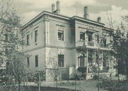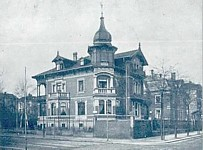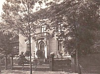

**_Fotos:_** _zerstörte Villen an der Altenzeller Straße: Pensionat Richter-Kunte (Nr. 4 - links),_

_Villa Sohm (Nr. 14 - Mitte) und das Wohnhaus von Elisabeth Pick (Nr. 26 - rechts)_

Nr. 26:
Diese 1895 erbaute und 1945 zerstörte Villa befand sich in den Dreißiger Jahren im Besitz der Fabrikantenwitwe
Elisabeth Pick. Die Christin jüdischer Herkunft nahm 1935 ihre vier Enkelkinder in Pflege, nachdem deren Eltern
verstorben waren. Enkeltocher Hildegard Hamm-Brücher wurde später als Spitzenpolitikerin der FDP bekannt. 1942
vergiftete sich Elisabeth Pick mit Tabletten, um der drohenden Einlieferung ins Vernichtungslager zu entkommen.

Nr. 28:
Das Ende des 19. Jahrhunderts errichtete Gebäude, auch Villa Margeritha genannt, diente bis zur Zerstörung 1945 als Töchterpensionat Grumbt, später Bodemann. Mädchen und junge Frauen aus wohlhabenden Familien erhielten
hier Privatunterricht in Musik, Sprachen und Handarbeiten und wurden zudem an ihre künftige gesellschaftliche Rolle als
Ehefrau und Hausherrin herangeführt. Das Pensionat  war eines von mehreren derartigen im “Schweizer Viertel”.

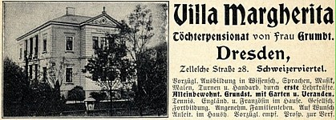

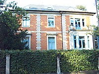Nr. 29:
Das Gebäude _(Foto)_ wurde 1880 von Rudolf Heyn für den Fabrikanten Lewicki errichtet. Heyn war auch für die Gestaltung des Polytechnikums am
Bismarckplatz zuständig und übte 1893/94 als Professor für Baukonstruktionslehre das Amt des Rektors der Technischen Hochschule aus. Später lebte in der Villa bis zu
seinem Tod 1907 der Professor für Maschinenbau Johann Leonidas Lewicki mit seiner Frau Louise.

Nr. 32: Das Haus gehörte bis in die Dreißiger Jahre der wohlhabenden jüdischen
Familie Cohn. Ab 1940 richteten die Nazis hier - ebenso wie in der benachbarten Villa des Seidenwarenhändlers Moritz
Jacobi (Nr. 41) - ein “Judenhaus” ein, in welches jüdische Bürger zwangsweise einziehen mussten. 1942 wurden die
verbliebenen Bewohner nach Theresienstadt deportiert. Verantwortlich für die Betreuung der Dresdner Judenhäuser war
der jüdische Arzt Dr. Gellert, der auf der Altenzeller Straße 4 seine Wohnung und Praxisräume besaß. Beide Gebäude wurden 1945 zerstört.

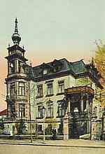Nr. 35: Die Ende des 19. Jahrhunderts erbaute schlossartige Villa _(Foto)_ wurde von einem unbekannten Architekten im Stil der deutschen Renaissance erbaut und besaß ursprünglich einen markanten Turm. Hier befand sich um 1915 die Privatklinik von Dr. med Hübner. Später übernahm der Arzt Dr. Nahmmacher die Leitung und führte die Klinik bis zur Zerstörung 1945 als Institut für Radium- und Röntgentherapie sowie Entbindungsheim.

Nahmmacher war ab 1928 Ehrensenator der Technischen Hochschule. Von 1931 bis 1931 wirkte Dr. med. Georg Ernst als Chefarzt an dieser Klinik. Ernst gehörte nach 1945 zu den führenden Medizinern beim Wiederaufbau des Dresdner Gesundheitswesens und war zeitweise Leiter des [Krankenhauses Loschwitz](../../../../nordost/loschwitz/strassen_loschwitz/mollers_sanatorium/). In den 1930er Jahren wurde das Gebäude zur Schaffung zusätzlicher Patientenzimmer um ein weiteres Geschoss erhöht und verlor dabei seinen Turm.

Nr. 39: Wie die meisten Nachbargebäude orientierte sich auch diese 1885 von August Seifert
errichtete Villa an den Traditionen der Semper-Nicolai-Schule. Der zweigeschossige Putzbau mit Sandsteingliederung und seinem markanten Vorbau ist bis auf geringfügige Veränderungen bis heute erhalten geblieben.

Nr. 41:
In diesem Haus wohnte bis 1935 der Kommunalpolitiker Dr. Eduard Bührer, welcher ab 1927 Zweiter Bürgermeister und Stellvertreter von Oberbürgermeister Dr. Wilhelm Külz war. Bührer, der 1932 der NSDAP
beigetreten war, übernahm im März 1933 kommissarisch das Amt des von den Nationalsozialisten zwangsweise
beurlaubten Külz und leitete bis zur Einsetzung seines Nachfolgers Ernst Zörner die Geschicke der Stadt. 1935 verzog er nach Berlin.

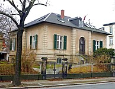Nr. 44:
Das Gebäude an der Ecke zur Hübnerstraße entstand beim Ausbau des Schweizer Viertels und gehörte bis 1916 Walther Hempel (1851-1916), der als
Professor für Chemie an der Technischen Hochschule tätig war und zeitweise auch das Amt des Rektors inne hatte. Auch sein Sohn Eberhard (1886-1967) gehörte als
Professor für Kunstgeschichte und Geschichte der Baukunst der Einrichtung an. 1945 wurde die Villa durch Brandbomben schwer beschädigt und in der Nachkriegszeit
vereinfacht und um ein Stockwerk reduziert wieder aufgebaut. Zu DDR-Zeiten war im Gebäude eine Außenstelle des Zentralinstitutes für Arbeitsschutz untergebracht. Seit
1998 nutzt die  Turnerschaft Germania des Coburger Convents das Haus

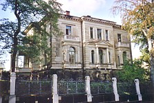Nr. 50:
Das Haus an der Einmündung zur Rugestraße wurde 1883/84 nach Plänen des renommierten Architekturbüros Giese & Weidner erbaut und nach seinem
ersten Besitzer, dem Rechtsanwalt  Erwin Wolf, Villa Wolf genannt. Das zu den größten Villenbauten des “Schweizer Viertels” gehörende Gebäude im Stil der italienischen Neorenaissance überstand den Zweiten Weltkrieg und die Nachkriegszeit unbeschadet und besitzt in einigen Räumen eine noch gut erhaltene Innenausstattung. Heute hat hier eine Immobilienfirma ihren Sitz.

* * *

 \[ [Home](../../../../index.html)\] \[ [Nord](../../../../nord/)\] \[ [Nordwest](../../../../nordwest/)\] \[ [Neustadt](../../../../neustadt/)\] \[ [Nordost](../../../../nordost/)\] \[ [West](../../../../west/)\] \[ [Zentrum](../../../../zentrum/)\] \[ [Südwest](../../../../sudwest/)\] \[ [Süd](../../../../sud/)\] \[ [Südost](../../../../sudost/)\] \[ [Ost](../../../../ost/)\] \[ [Register](../../../../Register/register.html)\] \[ [Kontakt](../../../../Kontakt/kontakt.html)\] \[ [Impressum](../../../../impressum/)\]
