* * *

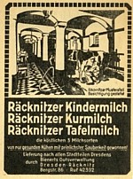

Historische Werbeanzeige für keimfreie Räcknitzer Milch aus dem Bienert-Gut

Die Bergstraße geht in ihren Grundzügen auf eine alte, zum Erzgebirgskamm führende Straße zurück, welche bis 1855 als Dippoldiswaldaer Chaussee bezeichnet wurde. Im Mittelalter befand sich in der Nähe des
heutigen Fritz-Förster- Platzes das im Besitz des städtischen Rates befindliche Vorwerk [Auswik](../../../../zentrum/sudvorstadt/auswik/). Von dort steigt die Straße bis zur Südhöhe steil an und
berührt dabei die Fluren der 1903 eingemeindeten Vorstadt [Räcknitz](../../../../sud/racknitz/). Noch bis zum Ende des 19. Jahrhunderts prägten Felder und Gärtnereien das Straßenbild. Die letzten
Betriebe im oberen Abschnitt verschwanden erst im Zuge des Ausbaus des Hochschulviertels nach 1950.

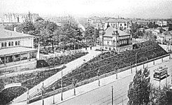
1840 begann der Ausbau der Bergstraße, welche in ihrem nordwestlichen Abschnitt bis zur Reichsstraße ( [Fritz-Löffler- Straße](../../../../zentrum/sudvorstadt/strassen_sudvorstadt/fritz-loffler-strasse/)) mit Villen bebaut wurde.
Oberhalb des Reichsplatzes lag das beliebte Ausflugslokal “Bergkeller” mit großer Gartenterrasse _(Foto)_. Gegenüber entstand 1884 die 1945 zerstörte [Amerikanische Kirche](../../../../zentrum/sudvorstadt/strassen_sudvorstadt/bergstrasse/amerikanische_kirche/). Ab 1901 fuhr auch die über die heute nicht mehr vorhandene Hohe Brücke kommende Straßenbahn durch die Bergstraße zum
Endpunkt am “Bergkeller”. 1909 verlängerte man diese Strecke bis zum Gasthof “Elysium” in Räcknitz. Im Zuge der neuen Straßenbahntrasse über die Reichsstraße zum Münchner Platz wurde die Linie jedoch 1933 wieder
eingestellt.

Während der NS-Zeit trug die Bergstraße ab 1935 den Namen Langemarckstraße. Damit sollte an ein Gefecht während
des Ersten Weltkrieges am 10. November 1914 in der Nähe des Ortes Langemarck in Belgien erinnert werden. Als
„Mythos von Langemarck“ wurden die Ereignisse später ideologisch verklärt und im nationalistischen Sinne missbraucht. Nach dem Zweiten Weltkrieg erhielt die Straße ihren ursprünglichen Namen zurück.

1945 wurden zahlreiche Gebäude an der Bergstraße zerstört bzw. schwer beschädigt. An deren Stelle errichtete man in der
Nachkriegszeit mehrgeschossige Wohnblocks, welche heute zur WGS “Glückauf Süd” gehören. Dazwischen finden sich noch Reste der früheren Villenbebauung. Jenseits des Fritz-Förster Platzes dominieren Bauten der [Technischen Universität](../../../../zentrum/sudvorstadt/technische_universitat/)
das Bild. Bemerkenswert sind die 1978 fertiggestellte Neue Mensa sowie die erst nach 1990 errichteten Neubauten der
Juristischen Fakultät und das gegenüberliegende Hörsaalzentrum. Da die Bergstraße seit 2004 Zubringer zur Autobahn A 17 nach Prag ist, erleichtert hier eine Fußgängerbrücke das Überqueren der Straße.

Pensionen an der Bergstraße:

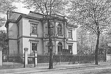

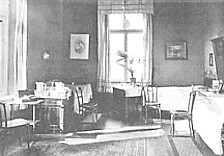

Ebenso wie in vielen anderen Straßen des Schweizer Viertels existierten auch an der Bergstraße vor 1945 mehrere Pensionen, die von der ruhigen und
trotzdem verkehrsgünstigen Lage und der Nähe des Hauptbahnhofes profitierten. Im Gegensatz zu den großen Hotels boten sie in privat-familiärer
Atmosphäre Räume für den kürzeren oder auch längeren Aufenthalt in Dresden an.  **_Fotos_** _: Bergstraße 25 (Pension Schönberg / Scharstein)_

Pension Schönberg

Nr. 19

Pension Schöpffer

Nr. 22

Töchter-Pensionat Wallerstein

Nr. 24

Pension Schönberg (später Scharstein)

Nr. 25

Pension Rüdiger

Nr. 26

Pension Baumann-Riesel

Nr. 33

Pension Klein

Nr. 34

Weitere Gebäude in der Südvorstadt

Nr. 2:
An Stelle eines kriegszerstörten Vorgängerbaus, welcher bereits vor 1945 Sitz der Dresdner Niederlassung des Baukonzerns Philipp Holzmann war, entstand 1994/95 das neue Philipp-Holzmann-Haus. Das moderne Bürohaus wurde
von der Offenburger Architekten-Gruppe um Prof. Fritz Novotny entworfen und ist heute Domizil mehrerer Firmen.

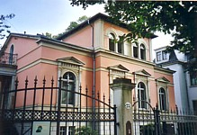Nr. 23:
Die kleine spätklassizistische Villa wurde 1867 als “Villa Olga” von einem unbekannt gebliebenen Architekten errichtet und blieb bis heute fast unverändert
erhalten. Das Gebäude gehörte zu den ersten Villenbauten in diesem Stadtteil. Zunächst befand es sich im Besitz von Dr. Lohse, bevor 1873 der Textilkaufmann
Bernhardt Otto Eisenstuck das Haus erwarb und erweitern ließ. 1898 wurde es umgebaut und erhielt in diesem Zusammenhang u.a. eine moderne WC-Anlage. Im
Keller befanden sich Geschäftsräume, die der Unternehmer Victor Wünschek für seine Likörfabrikation nutzte. Inhaber des Hauses war zu dieser Zeit Dr. Georg Moritz Calberla.

Nach mehrfachem Besitzerwechsel kaufte 1924 der kunstsinnige Dresdner Rechtsanwalt Dr. Fritz Glaser die Villa. Zum
Freundeskreis Glasers gehörten u. a. der Maler Otto Dix, die Tänzerin Mary Wigman, der Dichter Joachim Ringelnatz  und
der Sprachwissenschaftler Viktor Klemperer. Wegen seiner jüdischen Herkunft musste Fritz Glaser 1933 seine
Anwaltstätigkeit aufgeben und war zahllosen Schikanen seitens der Nazis ausgesetzt. Dank seiner deutschen Ehefrau
entging er der Deportation und erlebte das Kriegsende 1945 in seinem unzerstört gebliebenen Haus. Allerdings waren die
Glasers gezwungen, fast alle Kunstwerke ihrer bedeutenden Sammlung zu verkaufen. Nach Fritz Glasers Tod 1956 wurde
die Villa vermietet. Zeitweise nutzte das Komitee “Freies Griechenland” einige Räume. Glasers Erben bekamen ihr Eigentum nach der Wende zurück und ließen die Villa 1996/97 denkmalgerecht sanieren.

Nr. 25: Im diesem Haus befand sich vor dem Zweiten Weltkrieg die Töchterpension der Freiin von Bibra, eines von
mehreren Internaten für Töchter aus “gehobenen Ständen” in der Südvorstadt. Zeitweise wurde die Ende des 19.
Jahrhunderts errichtete Villa auch als Pension bzw. als Wohnsitz des pensionierten Majors a. D. Conrad von Einsiedel genutzt. Sie blieb bis zur Gegenwart erhalten.

Nr. 26:
Die heute nicht mehr vorhandene Villa war um 1900 Wohnsitz des Architekten und Baumeisters Hermann Arnold. Später nutzte die Pension Rüdiger das Gebäude. Nach Zerstörung der Vorkriegsbebauung zwischen Liebig- und
Hübnerstraße entstand hier 1958 ein Wohnblock.

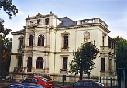Nr. 31: Die prachtvolle Neorenaissancevilla entstand 1871/73 für den Königlich- Bayrischen Rittmeister Ritter von Zwackhausen und dessen Gemahlin. Bereits drei
Jahre später verkaufte das Paar das Haus an Arnold Schulte-Herkendorf, der an der Seestraße ein Modewarengeschäft besaß. Im Auftrag der neuen Eigentümer erhielt
die Villa eine aufwendige Innenraumgestaltung, die sich am Vorbild der kurz zuvor fertiggestellten Semperoper orientierte. Bemerkenswert sind u. a. ein antikes
Marmormosaik im Foyer und Deckenmalereien mit Ornament-Schmuck. Nach 1945 nutzten das DDR-Verkehrsministerium und die Reichsbahndirektion Dresden die Villa, welche 1995 saniert wurde. Heute befinden sich hier Büroräume.

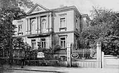Nr. 34:
Auch dieses schlichte Gebäude von 1872, zeitweise als Fremdenheim Haus Klein genutzt _(Foto rechts)_,  überstand die Bombardierung Dresdens und
kündet so noch heute vom einstigen Glanz des “Schweizer Viertels”. Eine einst zum Garten führende Terrasse wurde nach 1945 beseitigt. Leider gingen auch
Teile des Fassadenzierrats und die im Giebelfeld vorhandene Schmuckrosette verloren.

Nr. 36 (Gärtnerei Mietzsch): Die Gärtnerei wurde 1867 an der damals noch
unbebauten Bergstraße eröffnet und befand sich im Besitz des Gärtnermeisters C. W. Mietzsch. Neben dem Spargel- und Gemüseanbau widmete sich Mietzsch auch der Zierpflanzenzucht. Bemerkenswert
war seine gemeinsam mit Obergärtner Ernst Hempel aufgebaute Rosenschule, die als eine der bedeutendsten in
Deutschland galt und sich auf die Teerosenzucht spezialisierte. 1899 musste die Gärtnerei dem Bau neuer Villen weichen
und zog nach Niedersedlitz um. Die zugehörige Baumschule im Kreischaer Ortsteil Theisewitz existierte noch bis nach dem
Ersten Weltkrieg. Die 1899 auf dem Grundstück Bergstraße 36 errichtete Villa fiel 1945 den Bomben zum Opfer und wurde nach 1990 durch einen Neubau ersetzt.

Nr. 40:
Die landhausartige zweigeschossige Villa wurde 1874 erbaut und besitzt neben einer Veranda eine sparsame
Fassadengliederung im Stil der Semper-Nicolai-Schule. Im Gegensatz zum Baugeschehen der Jahrhundertwende orientierte
man sich in der Anfangszeit der Entstehung der Südvorstadt an Vorbildern der italienischen Renaissance und verzichtete auf
eine übermäßig prunkvolle Fassadengestaltung. Bis heute ist diese Villa weitgehend unverändert erhalten geblieben.

Nr. 42:
In diesem 1945 zerstörten Haus wohnte Elfriede Maria Scholz (1903-1943), Schwester des bekannten Schriftstellers Erich Maria Remarque. Die als Damenschneiderin tätige Frau wurde 1943 wegen regimekritischer
Äußerungen zu den Zuständen im Dritten Reich von einer Kundin denunziert und verhaftet. Der Volksgerichtshof verurteilte
sie wegen “Wehrkraftzersetzung” zum Tode und ließ sie am 16. Dezember 1943 in Berlin-Plötzensee hinrichten. An Elfriede Scholz erinnert seit September 2013 ein Stolperstein am früheren Standort des Gebäudes.

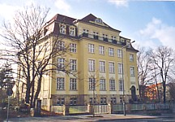Bergkeller (Nr. 54): Das Gasthaus “Bergkeller” entstand 1848 an Stelle des bereits im Mittelalter aufgegebenen Vorwerks [Auswik](../../../../zentrum/sudvorstadt/auswik/) und gehörte schon bald zu den beliebtesten Ausflugsgaststätten im Süden der Stadt. Zum Zeitpunkt seiner Entstehung lag das Haus noch mitten im Grünen und besaß einen großen Biergarten, drei Ballsäle und mehrere Gesellschaftszimmer. Regelmäßig fanden hier Militärkonzerte, Frühlings- und Herbstfeste und andere Vergnügungen statt. Inhaber war ab 1879 der Gastronom Edmund Dreßler. Obwohl der “Bergkeller” nach dem Bau der Straßenbahn noch einmal einen Aufschwung erlebte, machte sich die zunehmende Bebauung der Umgebung negativ bemerkbar. 1910 wurde das Lokal geschlossen und 1912 zugunsten der heute nicht mehr vorhandenen Wohnhäuser Münchner Straße 1 und 3-5 sowie des des Postamtes A 32 _(Bergstraße 56 - Foto)_ abgerissen.

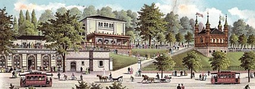

**_Foto:_** _Historische Lithographie des “Bergkellers” um 1900_

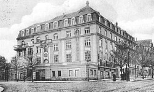Nach dem Abbruch des alten "Bergkellers" und seiner Nebenanlagen entstanden im Winkel zwischen Bergstraße und Münchner Straße Wohn- und Geschäftshäuser. Aufwendig gestaltet war das Eckhaus Münchner Straße 1 mit vorgelagerter Terrasse _(Foto)_, in dem ab 1912 ein neues Lokal gleichen Namens die Tradition des "Bergkellers" fortsetzte. Die Wohnhausgruppe Münchner Straße 3-5 erhielt im Erdgeschoss mehrere Ladenlokale, während der dritte Neubau an der Bergstraße 56 ab 1920 bis 2002 Sitz des Postamtes Dresden A 32 war. Im Haus Münchner Straße 5 ludt bis 1945 das Familiencafé "Corsica" zum Besuch ein. Mit Ausnahme des Postgebäudes wurden die Häuser 1945 zerstört. In den zum Teil ausgebauten Erdgeschosszonen der Gebäude gab es noch bis ca. 1970 einige Geschäfte. Später entstand hier eine nach 1990 geschlossene und inzwischen abgerissene Minol-Tankstelle.

Gebäude in Räcknitz:

Nr. 49:
In diesem Gebäude oberhalb des heutigen Fritz-Förster-Platzes befand sich früher die zunächst von Alois Pier,
später von Richard John bewirtschaftete “Sedanschänke”. Seinen Namen hatte das Lokal nach dem Sedanplatz erhalten,
wie der Fritz-Förster-Platz vor 1945 hieß. Das Gebäude überstand den zweiten Weltkrieg, diente danach noch als Wohnhaus und wurde erst mit dem Bau der Neuen Mensa in den 1970er Jahren abgerissen.

Nr. 64 (Gärtnerei Quaasdorf): Der 1911 von Louis Quaasdorf gegründete Gartenbaubetrieb war einer von einst drei
Gärtnereien auf Räcknitzer Flur. Während die Gärtnerei Meurer (Bergstraße 51) bereits vor dem Zweiten Weltkrieg
aufgegeben wurde, existierten Quaasdorfs Gärtnerei sowie der 1921 gegründete Gartenbaubetrieb Eugen Fiedler noch bis
1951\. Nach Kündigung des Pachtvertrages wurden die Flächen der Technischen Universität zugeschlagen, welche hier
zunächst Baracken für die Fakultät Bauingenieurwesen errichtete. Heute steht auf dem Grundstück das Hörsaalzentrum der TU.

Nr. 68: Das Wohnhaus wurde 1903 als Auftakt zu einer aus mehreren Gebäuden bestehenden Häusergruppe zwischen Bergstraße, Zeuner- und Mommsenstraße erbaut (“Professorenhäuser”). Bauherr war der Architekt und TH-Professor für Konstruktion landwirtschaftlicher Bauten Ernst Kühn, der das mit Jugendstilelementen gestaltete Gebäude selbst entwarf. Seine Tochter Margarete studierte von 1907 bis 1911 an der Kunstgewerbeschule und lernte dabei ihre Freundin Margarete Wendt kennen, die ebenfalls im Haus wohnte. Beide gründeten 1915 den durch seine Weihnachtsengel bekannten Kunsthandwerksbetrieb Wendt & Kühn in Grünhainichen.

Die individuell gestalteten Reihenhäuser mit Erkern und Dachaufbauten wurden früher bevorzugt an Professoren der nahegelegenen Technischen Hochschule vermietet. Trotz einiger Kriegsschäden ist bis heute auch die historische Innenausstattung teilweise erhalten geblieben. 2016 wurde das Gebäude saniert. Im Sockelgeschoss befindet sich seit einigen Jahren die vor allem bei Studenten beliebte Gaststätte "Firat".

Gasthof “Elysium”: Das Ausflugs- und Tanzlokal “Elysium” entwickelte sich aus dem alten Räcknitzer Gasthof und befand sich an der Einmündung zur Räcknitzhöhe. Um 1890 entstand ein Ballsaal. Nachdem die Dresdner Straßenbahn 1905 ihre Strecke bis zu diesem Endpunkt in Betrieb genommen hatte, nahm das ”Elysium” einen großen Aufschwung. Vor allem die Studenten der nahegelegenen Technischen Universität verbrachten hier gern ihre Freizeit. Später diente das Haus als Lager und Turnhalle und wurde 1945 zerstört. Heute befindet sich hier ein Autohaus.

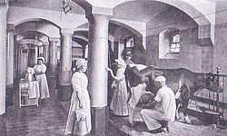Nr. 86: Der historische Dreiseithof entstand vermutlich an Stelle eines älteren Anwesens Anfang des 19. Jahrhunderts. Um 1900 erwarb der Plauener Mühlenbesitzer und Großindustrielle Theodor Bienert den Hof und ließ hier ab 1908 als erster in Dresden keimfreie Milch produzieren und verkaufen. Die sogenannte "Kurmilchanstalt" erhielt dafür in den Gutsgebäuden eine moderne Dampfsterilisieranlage für Milchflaschen sowie eine Tiefkühlanlage. Hinzu kamen Stallungen und Freilaufstände für die Kühe. Nach dem Tod Bienerts wurden die Räume seit Mitte der 1930er Jahre als Wohnungen bzw. an verschiedene Gewerbetreibende vermietet. Der aus zwei Wohnhäusern, den beiden ehemaligen Stallgebäuden, Scheune und Toranlage bestehende Gebäudekomplex steht unter Denkmalschutz und wird heute als Autohaus genutzt.

Chausseehaus Räcknitz: Zur Erhebung der bis 1886 an den großen Ausfallstraßen üblichen Wegegelder entstand 1847 an
der Kreuzung Bergstraße / Kohlenstraße ein Chausseehaus. Nach Abschaffung dieser Gebühren wurde das Gebäude in ein
Gasthaus umgewandelt. Nach 1945 diente es als Wohnhaus und Schulungsstätte der Gewerkschaft. Zuletzt befand es sich
in Verwaltung der Fakultät Landtechnik der Technischen Universität. Da das historische Gebäude jedoch zunehmend den Verkehr behinderte, wurde es 1981 abgerissen.

* * *

 \[ [Home](../../../../index.html)\] \[ [Nord](../../../../nord/)\] \[ [Nordwest](../../../../nordwest/)\] \[ [Neustadt](../../../../neustadt/)\] \[ [Nordost](../../../../nordost/)\] \[ [West](../../../../west/)\] \[ [Zentrum](../../../../zentrum/)\] \[ [Südwest](../../../../sudwest/)\] \[ [Süd](../../../../sud/)\] \[ [Südost](../../../../sudost/)\] \[ [Ost](../../../../ost/)\] \[ [Register](../../../../Register/register.html)\] \[ [Kontakt](../../../../Kontakt/kontakt.html)\] \[ [Impressum](../../../../impressum/)\]
