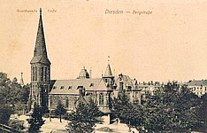

* * *

* * *

* * *

* * *

* * *

* * *

Die Amerikanische Kirche wurde 1883 im Auftrag der Stiftung “American
Church of  St. John in the City of  Dresden” am Reichsplatz errichtet und ein Jahr später am Ersten Weihnachtsfeiertag eingeweiht. Diese Stiftung war am
Ostersonntag 1869 gegründet worden, um für die zahlreichen in Dresden lebenden Amerikaner eine Andachtsstätte zu schaffen. Zunächst fanden die Gottesdienste der zur Protestantischen Episcopalkirche der USA gehörenden
Gemeinde in der alten Waisenhauskirche statt. Architekt des neogotischen Baus war Friedrich Wilhelm Dögel. Die Glasfenster stammten von Anton Dietrich und
wurden vom Dresdner Glasgestalter Bruno Urban hergestellt. Die Kirche bestand aus einem dreischiffigen Langhaus, einem kleineren Querschiff und dem angrenzenden Chor sowie einem vorgesetzten
Turm. Unmittelbar neben der Kirche befand sich das Gemeindehaus.

1945 wurde die Amerikanische Kirche schwer beschädigt und brannte aus. Erhalten blieb neben den Außenmauern auch der Turm, weshalb man 1953 den Wiederaufbau der Ruine für
die Evangelisch-Reformierte Gemeinde plante. Nachdem diese jedoch neue Räume in der früheren Hofgärtnerei an der Brühlschen Terrasse bezogen hatte, wurde ein Ausbau für die
Studentengemeinde erwogen. Gegen diese Planungen legte das Stadtplanungsamt unter Hans Bronder Widerspruch ein, da sich mit der [Russischen Kirche](../../../../../zentrum/sudvorstadt/strassen_sudvorstadt/fritz-loffler-strasse/russische_kirche/) und der [Lukaskirche](../../../../../zentrum/sudvorstadt/strassen_sudvorstadt/lukaskirche/) bereits zwei Gotteshäuser in unmittelbarer Nähe befanden und man in der Nähe der Technischen
Universität keine weiteren kirchlichen Bauten wünschte. Die gut erhaltene Ruine der Amerikanischen Kirche wurde daraufhin Ende 1959 gesprengt. Das Grundstück sollte später
für das geplante Auditorium Maximum bzw. einen Bibliotheksneubau der TU genutzt werden, blieb jedoch bis heute unbebaut.

* * *

 \[ [Home](../../../../../index.html)\] \[ [Nord](../../../../../nord/)\] \[ [Nordwest](../../../../../nordwest/)\] \[ [Neustadt](../../../../../neustadt/)\]
 \[ [Nordost](../../../../../nordost/)\] \[ [West](../../../../../west/)\] \[ [Zentrum](../../../../../zentrum/)\] \[ [Südwest](../../../../../sudwest/)\]
 \[ [Süd](../../../../../sud/)\] \[ [Südost](../../../../../sudost/)\] \[ [Ost](../../../../../ost/)\] \[ [Register](../../../../../Register/register.html)\] \[ [Kontakt](../../../../../Kontakt/kontakt.html)\] \[ [Impressum](../../../../../impressum/)\]
