* * *

* * *

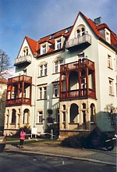Die Bernhardstraße wurde im Zusammenhang mit dem Bau des Schweizer Viertels planmäßig
angelegt und im nördlichen Teil zunächst mit Villen bebaut _(Foto: Bernhardstraße 29)_. Ihren Namen erhielt sie, ebenso wie die benachbarte [Lindenaustraße](../../../../zentrum/sudvorstadt/strassen_sudvorstadt/), nach dem sächsischen Reformpolitiker Bernhard von Lindenau (1779-1854). Lindenau hatte maßgeblichen Anteil an
der Erarbeitung der sächsischen Verfassung und der Allgemeinen Städteordnung von 1831. Für seine Verdienste verlieh ihm die Stadt Dresden 1843 die Ehrenbürgerwürde. 1970 benannte
man die Bernhardstraße nach dem kommunistischen Staatschef der Volksrepublik Vietnam in Ho-Chi-Minh-Straße um. Diese Namensgebung wurde 1991 jedoch wieder aufgehoben.

Nachdem die Dresdner Baugesellschaft 1871 größere Flächen erworben hatte und ein gültiger Bebauungsplan existierte, konnte nach 1900 mit dem weiteren Ausbau der Bernhardstraße in
Richtung Plauen und Coschütz begonnen werden. An Stelle von Kartoffeläckern und eines militärischen Übungsgeländes traten Mietshäuser für den gehobenen Mittelstand. Zahlreiche
Gebäude, vor allem im unteren Teil der Bernhardstraße, wurden 1945 teilweise zerstört und 1955/57 durch Wohnblocks ersetzt. Zeitgleich entstand hier der ab 1992 vom Fritz-Löffler-Gymnasium genutzte erste [Schulneubau](../../../../zentrum/sudvorstadt/) der Nachkriegszeit. Von der verbliebenen historischen Bausubstanz sind einige Villen aus der Zeit vor dem Ersten Weltkrieg und die 1925
entstandene katholische [Kirche St. Paulus](../../../../zentrum/sudvorstadt/strassen_sudvorstadt/bernhardstrasse/st__paulus-kirche/) bemerkenswert.

Einzelne Gebäude:

Hotel “Westminster”: Das exklusive Hotel auf der Bernhardstraße 1 entstand um 1885 und besaß eine großzügige
Gartenanlage, Autogaragen und Salonräume. Zum Hotel gehörte auch die benachbarte Villa “Astoria” (Nr. 3), in der
ebenfalls Pensionsräume untergebracht waren. Besitzer war um 1918 Fritz Kühn. Wie die meisten Villen des Schweizer
Viertels wurden diese beiden Gebäude 1945 zerstört und in der Nachkriegszeit abgerissen. 1955 errichte auf dem Areal das Deutsche Rote Kreuz einen noch heute vorhandenen Neubau.

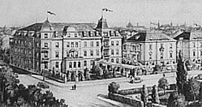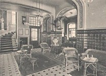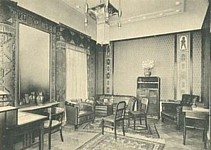

_Fotos: Hotel Westminuster mit Villa Astoria (links), in der Mitte das Vestibül, rechts der Rauchsalon im Hotel_

Schottische Kirche:
In einer Villa an der Ecke zur Bayrischen Straße (Bernhardstraße 2) befand sich zwischen 1884 bis zum Ersten Weltkrieg der Gemeindesaal der Schottisch-Presbyterianischen Kirche. Der turmlose Bau war dritte von einst
vier “Ausländerkirchen” rund um den Hauptbahnhof und wurde bis 1914 von der Gemeinde genutzt. Zuvor besaß diese lediglich provisorische Beträume auf der Seestraße 10.

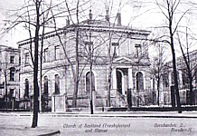Das villenartige Gebäude _(Foto)_
war im von Semper beeinflussten Stil der Neorenaissance gestaltet von außen nur durch seine Glasfenster als Gotteshaus erkennbar. Der eigentliche Gemeindesaal mit ca. 200 Plätzen befand sich im
Erdgeschoss, das Obergeschoss diente Verwaltungszwecken. Nachdem viele Mitglieder, bedingt durch den Ersten Weltkrieg, die Stadt verlassen hatten, vermietete die formal weiterbestehende Gemeinde das Gebäude an die
“Siebenten-Tags-Adventisten”. Am 13. Februar 1945 brannte die Schottische Kirche aus und wurde in der Nachkriegszeit abgerissen.

Nr. 7:
In diesem heute nicht mehr vorhandenen Wohnhaus lebte 1909/10 der Schriftsteller und Verleger Otto Julius Bierbaum (1865-1910). Bierbaum gehörte zu den produktivsten Autoren seiner Zeit und verfasste zahlreiche Romane,
Theaterstücke, Gedichte und Essays und war darüber hinaus Herausgeber mehrere Kunstzeitschriften sowie Verfasser des
ersten Autoreisebuches der Literaturgeschichte, in welchem er seine Italientour im “Adler-Phaeton” 1902 beschrieb. Ab 1914 diente die Villa als Kinderheim der Lukaskirchgemeinde.

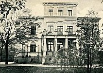Nr. 13: Das auch “Ilsenhof” genannte Haus im neoklassizistischen Stil _(Foto)_ wurde
bis zur Zerstörung 1945 als Pension Brandt genutzt und war eine von zahlreichen derartigen Einrichtungen im Schweizer Viertel. Die ruhige und dennoch zentrumsnahe
Lage machte die westliche Südvorstadt vor dem Zweiten Weltkrieg zum bevorzugten Standort von Pensionen, Mädchenpensionaten und Privatkliniken

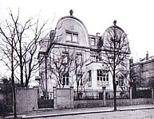Nr. 19: Das um 1900 erbaute Haus war vor dem
Ersten Weltkrieg Sitz der Privatklinik von Dr. med. Hermann Meyer. In den Zwanziger Jahren praktizierte hier der  Facharzt für innere und Röntgenkunde Dr. Erich Gäbert und führte hier seine Klinik für Magen-,
Darm- und Stoffwechselkrankheiten. Während die meisten Ruinengrundstücke bereits in den 1950er und 1960er Jahren mit Wohnblocks bebaut wurden, blieb das
unterstörte Gebäude zunächst erhalten und wurde erst nach 1990 zugunsten eines Wohnhausneubaus abgerissen. Erhalten blieben beim Neubau die Reste der früheren Grundstückseinfriedung.

Nr. 28:
Das 1945 zerstörte Gebäude war bis 1918 Wohnhaus des Nationalökonomen Gustav Stresemann (1878-1929), der in Dresden als Syndikus des Verbandes der deutschen Schokoladenfabrikanten und Vorsitzender des Bundes
Sächsischer Industrieller tätig war. Sein Büro besaß er auf der Ferdinandstraße in der Innenstadt. Stresemann wechselte
nach dem Ersten Weltkrieg nach Berlin, gründete die Deutsche Volkspartei und war ab 1923 Reichskanzler und
Außenminister der Weimarer Republik. In dieser Funktion gelang ihm die Aussöhnung mit Kriegsgegner Frankreich und die Beendigung der internationalen Isolation Deutschlands, wofür er 1926 den Friedensnobelpreis erhielt.

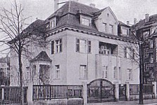Nr. 35:
Das vor dem Ersten Weltkrieg entstandene und 1945 zerstörte villenartige Gebäude diente im Gegensatz zu den meisten Nachbarhäusern nicht als Wohnhaus, sondern als Verwaltungsgebäude. Hier hatte der “Schutzverband
Deutscher Glasfabriken” sein Verbandshaus. Die Interessenvertretung der Glasfabrikanten war 1907 in Görlitz gegründet worden, verlegte ihren Sitz jedoch
später nach Dresden. Hauptsächlich widmete sich der Verband, dem zeitweise ca. 150 Unternehmen angehörten, Tarifverhandlungen mit den Gewerkschaften. Erst 1990 wurde die Baulücke wieder mit einem Neubau geschlossen.

Nr. 62: Die 1905 errichtete Villa ist in ihrer baulichen Gestaltung bereits der Reformarchitektur zuzurechnen und wurde
entsprechend nur sparsam dekoriert. Das als Wohnhaus konzipierte Gebäude diente später Verwaltungszwecken. In der Zeit des Nationalsozialismus hatte hier 1933/34 die Dienststelle des SS-Oberabschnitts Elbe, danach des
SS-Oberabschnitts Mitte ihren Sitz. Heute wird das Haus vom Kraftfahrt-Bundesamt - Außenstelle Dresden genutzt.

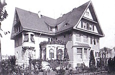Nr. 65: Das 1945 zerstörte Haus _(Foto)_
, welches sich baulich am Landhausstil orientierte, entstand 1912 als Wohnhaus des Brauereibesitzers Josef Traube. Außerdem wohnte im Obergeschoss der Baumeister Emil Heinrich, der hier
zugleich das Konsulat von Nikaragua unterhielt. Der heutige Wohnhausneubau entstand 1998.

Nr. 66: In Anlehnung an die Ideen Richard Riemerschmids und Hans Erlweins
entstand um 1910 dieses Doppelhaus. Das Gebäude blieb bis zur Gegenwart fast unverändert erhalten.

Nr. 67:
Die mit Erkern, Säulen und Jugendstilelementen verzierte Villa wurde 1905 als Mietsvilla erbaut und überstand die Zerstörungen 1945 ohne größere Schäden.

Nr.69:
Das heute als Wohnhaus genutzte Gebäude beherbergte einst das Töchterpensionat Schellberg, ein Internat für Mädchen aus höheren Schichten, die hier “gediegene Erziehung und Ausbildung, vorzüglichen Unterricht in
Wissenschaften, Musik, Malen, Hand- und Kunstarbeiten” erhielten und so auf die für sie vorgesehene gesellschaftliche
Rolle vorbereitet wurden. Derartige Pensionate konzentrirten sich vor 1945 in Dresden vor allem in den Villenvierteln der Südvorstadt und Plauens.

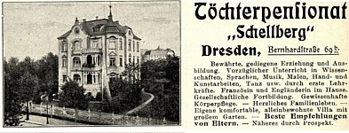

Nr. 71: Dieses Haus an der Kreuzung mit der Würzburger Straße entstand 1912 und erhielt eine repräsentative
Fassadengestaltung im Neobarockstil mit Jugendstilelementen. Bemerkenswert ist der Runderker mit vielfältigen Rauten-,
Frucht- und Wellenmotiven. Nach 1945 nutzte die Deutsche Post das Gebäude als Lehrlingswohnheim. Nach mehrjährigem Leerstand wurde die Villa 2006 saniert

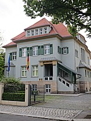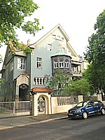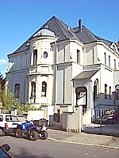

**_Fotos:_** _Villen auf der Bernhardstraße: links Nr. 62, in der Mitte Nr. 67, rechts Nr. 71_

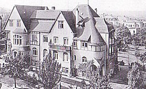Nr. 92/94:
Das Doppelhaus wurde 1904 als private Frauenklinik von Dr. Peters erbaut _(Foto)_. Die architektonische Gestaltung orientierte sich am Landhausstil mit verschiedenen Erkern, Balkonen und Fachwerkelementen.
Zum Haus gehörte auch eine hofseitig gelegene großzügige Gartenanlage. Bis 1935 leitete der Dresdner Stadt-Obermedizinalrat Prof. Dr. Walter Nikolaus
Albert die Klinik, die nach seinem Tod bis zum Ende des Zweiten Weltkriegs als Dauerheim für Damen genutzt wurde. 1945 richteten Bombentreffer erhebliche Schäden an Dach und Fassade an, welche zunächst nur notdürftig
behoben werden konnten. Bis 1990 befand sich hier das Lager einee Großhandelsfirma für Drogeriebedarf. 1995 begann eine umfassende Sanierung des Gebäudes. In diesem Zusammenhang wurde im Garten ein moderner Büroneubau
errichtet.

Nr. 98: Das auch als “Villa Grübler” bezeichnete Wohnhaus von 1903 gehört zu den architektonisch anspruchsvollsten
Gebäuden der Bernhardstraße. Entworfen wurde die Villa vom renommierten Architekten Prof. Fritz Schuhmacher, der
Elemente des englischen Landhausstils mit modernen funktionalen Merkmalen kombinierte und damit Maßstäbe für den
Wohnhausbau nach Ausklang des Historismus setzte. Erster Besitzer war der sächsische Hofrat Dr. Martin Grübler.

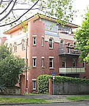Nr. 116: Das um 1890 erbaute Mehrfamilienhaus gehört mit seinen Ecktürmchen und dem Kuppeldach zu den bemerkenswertesten Gebäuden im oberen Straßenabschnitt _(Foto)_. Im Inneren erschließt ein kreisrundes Treppenhaus die einzelnen Etagen. 1930 erfolgte ein Umbau des Dachgeschosses, welches bei der jüngsten Sanierung 1994 durch ein zusätzliches Staffelgeschoss ersetzt wurde.

Bis 1942 lebte in diesem Gebäude der deutsch-jüdische Komponist und Dirigent Arthur Chitz. Chitz hatte in Prag u.a. bei Antonin Dvorák studiert und war ab 1918 Kapellmeister am
Dresdner Schauspielhaus. Wegen seiner jüdischen Abstammung wurde er am 7. März 1933 von den Nazis aus dem Amt gedrängt und 1934 offiziell entlassen. 1940 musste er mit seiner
Frau in das “Judenhaus” Lothringer Weg 2 umziehen und wurde zwei Jahre später nach Riga deportiert. Hier kam das Ehepaar Chitz, vermutlich 1944, ums Leben.

* * *

 \[ [Home](../../../../index.html)\] \[ [Nord](../../../../nord/)\] \[ [Nordwest](../../../../nordwest/)\] \[ [Neustadt](../../../../neustadt/)\] \[ [Nordost](../../../../nordost/)\] \[ [West](../../../../west/)\] \[ [Zentrum](../../../../zentrum/)\] \[ [Südwest](../../../../sudwest/)\] \[ [Süd](../../../../sud/)\] \[ [Südost](../../../../sudost/)\] \[ [Ost](../../../../ost/)\] \[ [Register](../../../../Register/register.html)\] \[ [Kontakt](../../../../Kontakt/kontakt.html)\] \[ [Impressum](../../../../impressum/)\]
