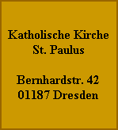
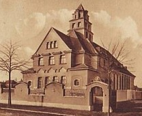
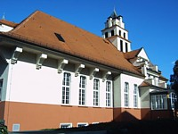

* * *

* * *

Die Geschichte der katholischen Gemeinde der Südvorstadt reicht bis ins Jahr 1909 zurück. Damals bildete sich im “Schweizer Viertel” ein “Verein der Katholiken von Dresden-Plauen und Süd”. Da zunächst kein eigenes Gotteshaus zur Verfügung stand, nutzte man ab 1921 das Haus [Eisenstuckstraße 27](../../../../../zentrum/sudvorstadt/strassen_sudvorstadt/eisenstuckstrasse/) für die Gemeindearbeit. Die Predigten übernahm die “Kongregation der Oblaten der makellosen Jungfrau Maria”, welche bis 1984 eine Niederlassung in Dresden unterhielt. Der katholische Orden mit
Stammsitz in Hünfeld bei Fulda hatte sich nach einer Gesetzesänderung 1919 als erster katholischer Orden nach der Reformation wieder in Sachsen niedergelassen mit dem Ziel, hier ein Kloster zu gründen. 1922 erwarb der zur Hofkirche gehörende Verein das Grundstück Bernhardstraße 42 und ließ dort eine Kirche mit ca. 200 Plätzen und einem kleinen Turm errichten. An den Planungen waren die Architekten Robert Witte und Rudolf Zacek beteiligt. Die Finanzierung wurde zum Großteil von den Mitgliedern übernommen. Neben der eigentlichen Kirche sollten ursprünglich noch ein Wohntrakt für die Ordensmitglieder und weitere Nebengebäude entstehen, was jedoch nicht zustande kam. Als Wohnhaus diente stattdessen ein heute als Pfarrei genutzter Anbau.

Am 6. Dezember 1925 konnte die neue Kirche eingeweiht werden. Wenige Tage später, am 1. Januar 1926, erhielt die Pfarrei St. Paulus ihre kirchliche Selbständigkeit. Ab 1935 wirkte hier der bekannte Pater Franz Bänsch, dem auch die Seelsorge für die Inhaftierten der Dresdner Haftanstalten oblag. Mit großem persönlichen Einsatz unterstützte Bänsch zahlreiche Häftlinge des NS-Regimes und begleitete über 1.000 von ihnen auf ihrem letzten Weg zur Hinrichtung im Hof des Gerichtsgebäudes am Münchner Platz. Seit 2006 erinnert eine Straße in Mockritz an den Pater.

Die 1945 teilweise beschädigte St.-Paulus-Kirche wurde bis 1953 im ursprünglichen Stil wieder aufgebaut. Der Innenraum erhielt 1970 eine moderne Neugestaltung durch die Künstler Egon Körner und Lothar Gonschor. Zur Ausstattung gehören ein um 1700 geschaffenes schlichtes Kruzifix, sowie eine Jehmlich-Orgel von 1946. Die hölzerne Christusplastik des Kruzifixes stammt aus Südtirol und war ursprünglich Bestandteil eines Wegkreuzes. Weitere Holzfiguren zeigen u.a. den Namenspatron der Kirche, den Heiligen Paulus sowie Maria mit dem Jesusknaben auf einer Mondsichel, Das Original dieser spätgotischen Arbeit befindet sich in Amsterdam. Bemerkenswert ist auch eine Kreuzigungsgruppe unter der Empore, 1955 geschaffen von Friedrich Press. Bis 1992 befand sich diese Plastik in der Maria-Hilf-Kapelle in Kleinnaundorf. Die kleine Kapelle hatte Pater Bänsch zur Mahnung an die nach 1933 unschuldig Hingerichteten gestiftet.

Die drei Bronzeglocken im Turm stammen aus den 1950er Jahren und wurden in Apolda gegossen. Ende der 1990er Jahre wurde die St.-Paulus-Kirche saniert. Im Garten des Grundstücks mahnt ein Denkmal an fünf während der NS-Zeit am Münchner Platz hingerichtete polnische katholische Jugendliche und einen Ordensbruder der Steyler Mission, welche 1999 als Märtyrer durch Papst Johannes Paul II. selig gesprochen wurden. Außerdem erinnert eine Gedenkstätte an die Opfer des Bombenangriffs auf Dresden.

* * *

 \[ [Home](../../../../../index.html)\] \[ [Nord](../../../../../nord/)\] \[ [Nordwest](../../../../../nordwest/)\] \[ [Neustadt](../../../../../neustadt/)\]
 \[ [Nordost](../../../../../nordost/)\] \[ [West](../../../../../west/)\] \[ [Zentrum](../../../../../zentrum/)\] \[ [Südwest](../../../../../sudwest/)\]
 \[ [Süd](../../../../../sud/)\] \[ [Südost](../../../../../sudost/)\] \[ [Ost](../../../../../ost/)\] \[ [Register](../../../../../Register/register.html)\] \[ [Kontakt](../../../../../Kontakt/kontakt.html)\] \[ [Impressum](../../../../../impressum/)\]
