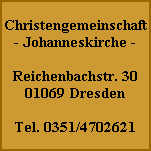
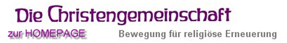

* * *

* * *

* * *

* * *

* * *

* * *

Die Christengemeinschaft wurde 1922 von Friedrich Rittelmeyer in Stuttgart gegründet und ist heute in zahlreichen Ländern Europas, Nord- und Südamerikas sowie in Australien und Neuseeland verbreitet. Die
Glaubensgemeinschaft gründet ihre Religion auf die Bibel und bezieht sich zugleich auf die Lehren des Anthroposophen Rudolf Steiner, insbesondere auf dessen Glauben an die Wiedergeburt. Im Gegensatz zur katholischen
Kirche können auch Frauen Priester werden, ein Zölibat gibt es nicht.

Bereits vor dem Zweiten Weltkrieg besaß die Dresdner Christengemeinschaft ab 1936 ein eigenes Gotteshaus (Johanneskirche) auf der
Reichenbachstraße 30, musste dieses jedoch 1941 nach dem Verbot durch die Nazis verkaufen. 1945 wurde das Gebäude zerstört. Später nutzte man ab 1953 eine Villa auf der Goetheallee 8, bevor 1986 die
Michaelskapelle in einem Anbau des zur Christengemeinschaft gehörenden Rochwitzer Altersheims geweiht werden konnte. Am 1. Juni 1998 erfolgte schließlich die Grundsteinlegung für ein neues Gemeindezentrum am alten
Standort auf der Reichenbachstraße. Die Entwürfe für den ein Jahr später vollendeten modernen Neubau stammen von den Architekten Buck und Rex aus Dresden. Das Zentrum besteht aus einer Kirche mit 200 Plätzen sowie einem
baulich mit dieser verbundenen Gemeindehaus, welches auch für öffentliche Veranstaltungen und Konzerte genutzt wird. Gegenwärtig gehören der Dresdner Christengemeinschaft ca. 1000 Mitglieder an.

* * *

 \[ [Home](../../../../index.html)\] \[ [Nord](../../../../nord/)\] \[ [Nordwest](../../../../nordwest/)\] \[ [Neustadt](../../../../neustadt/)\] \[ [Nordost](../../../../nordost/)\] \[ [West](../../../../west/)\] \[ [Zentrum](../../../../zentrum/)\] \[ [Südwest](../../../../sudwest/)\] \[ [Süd](../../../../sud/)\] \[ [Südost](../../../../sudost/)\] \[ [Ost](../../../../ost/)\] \[ [Register](../../../../Register/register.html)\] \[ [Kontakt](../../../../Kontakt/kontakt.html)\] \[ [Impressum](../../../../impressum/)\]
