* * *

* * *

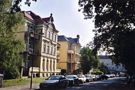Die Eisenstuckstraße entstand im letzten Drittel des 19. Jahrhunderts und bildete
viele Jahre die südliche Grenze der Südvorstadt. Ihren Namen erhielt sie 1887 nach dem Juristen und Dresdner Kommunalpolitiker Christian Gottlob Theophil
Eisenstuck (1773-1853). Eisenstuck war an der Umsetzung der Staatsreformen von 1830/32 beteiligt und hatte zwischen 1832 und 1837 den Vorsitz der Kommunrepräsentanten, einem Vorläufer der Stadtverordneten-Versammlung,
inne.

Während nördlich der Straße die Villen des “Schweizer Viertels” das Bild prägten, blieb der in Richtung Plauen gelegene Teil der Südvorstadt zunächst unbebaut und wurde als Garten- und Ackerland
genutzt. Erst nach Verabschiedung eines Bebauungplanes im April 1899 begann man auch hier mit der Errichtung von
Einzelhäusern, die meist von Fabrikanten, höheren Beamten bzw. Universitätsprofessoren bewohnt wurden. Hinzu kamen Privatkliniken, Fremdenheime und Mädchenpensionate für die Angehörigen der wohlhabenden Oberschichte.

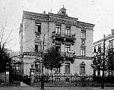Von der erhaltenen Vorkriegsbebauung _( **Foto:** Privatklinik Dr. Großmann, Nr. 40)_ sind u. a. das 1898 von Friedrich Otto Richter erbaute Wohnhaus Nr. 5 sowie die von Wilhelm Seifert entworfenen Mietshäuser Nr. 25 und 44 (1897) bemerkenswert. Seifert
war auch Architekt der heute von der Burschenschaft “Cheruscia” genutzten Villa an der Ecke zur Rugestraße.  Im Gegensatz zur frühen Villenbebauung weisen diese Gebäude
aufwendigere Fassadengestaltungen mit neogotischen und neobarocken Elementen auf. In einer Rundbogennische an der Eisenstuckstraße 25 stand einst eine nach 1945
entfernte Bismarck-Statue. Zwischen 1921 und 1925 nutzte die katholische Gemeinde einige Räume im Nachbarhaus (Nr. 27), bevor die [St.-Paulus-Kirche](../../../../zentrum/sudvorstadt/strassen_sudvorstadt/bernhardstrasse/st__paulus-kirche/) auf der Bernhardstraße eingeweiht werden konnte.

An Stelle der 1945 zerstörten Häuser entstanden 1955/58 Wohnhäuser im Rahmen eines Sonderprogramms für Bergleute der SDAG Wismut. Fassadenreliefs, Schlußsteine und Erker knüpfen an Dresdner Bautraditionen an. Durch
den Bau der Wohnzeile Budapester Straße wurde der westliche Straßenteil von der Eisenstuckstraße abgeschnitten. Nach 1990 erhielt dieser Abschnitt den Namen Glauchauer Straße.

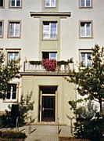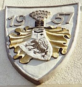

**_Fotos:_** _architektonische Details aus den Wiederaufbaujahren nach 1945_

Einzelne Gebäude:

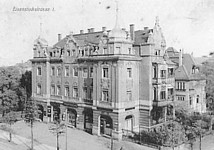Nr. 1:
Das Wohn- und Geschäftshaus entstand um 1900 und stand bis zur Zerstörung 1945 an der Ecke Eisenstuck-/ Chemnitzer Straße. Architekten des mit
Jugendstilelementen verzierten Baus waren Carl Poppe und Heino Otto. Während die oberen Geschosse Wohnzwecken bzw. als Arztpraxen dienten, befanden sich
im Erdgeschoss verschiedene Läden. U.a. gab es hier die “Schweizer-Apotheke” des Apothekers Max von Treufels, einen Friseursalon und eine Niederlassung der
Großmolkerei Drema. Nach Zerstörung des Gebäudes wurde die Fläche um 1970 mit einem zehngeschossigen Wohnblock (Budapester Straße 59-69) überbaut.

Nr. 3:
Auch dieses villenartige Einzelhaus, um 1900 erbaut, ist heute nicht mehr vorhanden. Der Bau besaß eine betont
horizontal gegliederte Sandsteinfassade, ein ausgebautes Mansardgeschoss sowie einen seitlich angebauten Wintergarten,
wie er für viele Häuser des “Schweizer Viertels” üblich war. Nutzer war vor dem Ersten Weltkrieg das Töchterpensionat Hauschild. Später befanden sich hier Wohnungen.

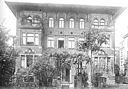Nr. 6:
Das mit einem weit auskragenden Dachgeschoss versehene Mietshaus gehörte zu den architektonisch auffälligsten Gebäude der Straße _(Foto)_. Der
dreigeschossige Bau war mit hölzernen Dachträgern, Wintergärten und Balkons verziert und besaß einen pergolaartigen Eingang. Ähnliche Bauformen wies das
nahegelegene Haus Nr. 12 auf. Während diese beiden Gebäude den zweiten Weltkrieg nicht überstanden, blieben die Nachbarhäuser Nr. 5, 7 und 10 erhalten und stehen als Baudenkmale unter Denkmalschutz.

Nr. 9/11: Zu den jüngeren Gebäuden der Eisenstuckstraße gehörte das um 1910 entstandene Doppelhaus Nr. 9/11,
welches bereits im Stil der Neuen Sachlichkeit gestaltet war. Auch dieses Haus ist heute nicht mehr vorhanden. Beim
Wiederaufbau der Südvorstadt entstand an dieser Stelle der Wohnblock Hohe Straße 41-47, den die Eisenstuckstraße mit einerm Durchfahrt unterquert.

Nr. 27:
Diese Mietvilla überstand, ebenso wie das Nachbarhaus Nr. 25, den Luftangriff und steht heute unter Denkmalschutz. Errichtet wurde das Gebäude 1897 vom Architekten Wilhelm Seifert. Ab 1921 nutzte zeitweise die
katholische Gemeinde der Südvorstadt einige Räume im Haus, bevor sie 1925 die [St.-Paulus-Kirche](../../../../zentrum/sudvorstadt/strassen_sudvorstadt/bernhardstrasse/st__paulus-kirche/) an der
Bernhardstraße beziehen konnte.

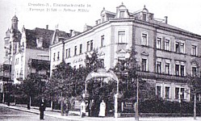
Nr. 34 (Restaurant “Zur Wilhelmshöhe”): Das um 1895 erbaute Eckhaus zur Liebigstraße beherbergte im Erdgeschoss das Restaurant “Zur Wilhelmshöhe”
mit einem baumbestandenen Vorgarten. Das Gebäude fiel, ebenso wie die gegenüberliegenden Eckhäuser Nr. 29 und 36, den Bomben des Zweiten Weltkriegs zum Opfer. Während die meisten Grundstücke bereits in den
1950er Jahren wieder bebaut wurden, blieb das Eckgrundstück Eisenstuckstraße 29 noch bis nach 1990 eine Freifläche, bevor man hier ein modernes Mehrfamilienhaus errichtete.

Nr. 39:
Das Haus Eisenstuckstraße 39 entstand 1924 als Wohnhaus für Curt Herfurth (1880-1942), der nach seinem
Architekturstudium an der  Kunstakademie ab 1910 als freischaffender Architekt in Dresden tätig war. Vorrangig entwarf er Wohnhäuser in verschiedenen Stadtteilen, u.a. Teile der [Briesnitzer Siedlung](../../../../west/briesnitz/) sowie die Wohnanlagen an der [Hansa-](../../../../neustadt/leipziger_vorstadt/strassen_leipziger_vorstadt/hansastrasse/)
und Conradstraße. In den 1920er Jahren entstanden von ihm gestaltete Wohnblocks u.a. an der [Malterstraße](../../../../sudwest/lobtau/strassen_lobtau/) und der
Frankenbergstraße in Löbtau und im Bereich [Teplitzer / Mockritzer Straße](../../../../sudost/strehlen/strassen_strehlen/) in Strehlen. Hinzu kamen verschiedene
Einzelbauten, Kirchen, Schulen und Verwaltungsgebäude. 1945 wurde das Haus schwer beschädigt. 1965 entstand an
seiner Stelle ein noch heute erhaltener Neubau, an dem das noch erhaltene Eingangsportal an den Vorgängerbau erinnert.

Nr. 40:
Das 1895  zwischen Liebig- und Hübnerstraße errichtete Wohngebäude, nach seinem Bauherrn auch “Villa
Seidel” genannt , blieb bis heute erhalten. Während des Ersten Weltkriegs befand sich hier ein Behelfslazarett. In den 1920er Jahren diente es als Privatklinik Dr. Großmann. Eine umfassende Sanierung erfolgte nach 1990.

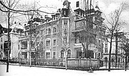Nr. 42:
Das bis heute weitgehend unveränderte repräsentative Mietshaus entstand 1897 nach Plänen des Architekten Matthias Frederick Mebius. Mebius wohnte selbst auf der Eisenstuckstraße (Nr. 8) und schuf mehrere
Wohnhäuser in Dresden. Wie die meisten Gebäude des Schweizer Viertels erhielt auch dieses Haus Wohnungen gehobenen Standards, welche bevorzugt von höheren Beamten, Unternehmern oder Professoren der
nahen Technischen Hochschule angemietet wurden. Um 1930 ist das Haus  als  “Haus der Gutsbeamten” erwähnt. In diesem Teil der Eisenstuckstraße
überstanden mehrere Häuser die Bombennacht und stehen heute unter Denkmalschutz.

Nr. 43:
Im Hintergebäude dieses 1945 zerstörten Hauses besaß bis 1945 die Bildhauerin Etha Richter (1883-1977) ihr
Atelier. Als erste Frau überhaupt besuchte sie den Anatomieunterricht an der Tierärztlichen Hochschule, um hier Studien
für ihre Werke zu betreiben. Bekannt wurde sie als “Tierbildhauerin” mit zahlreichen Plastiken. Nach 1945 gab sie als
Dozentin für Zeichnen und Plastik Unterricht an der Volkshochschule und für private Interessenten. 1968 wurde sie zum  Ehrenmitglied des Verbandes Bildender Künstler ernannt.

Nr. 44:
Die 1897 errichtete Villa Helene an der Ecke zur Hübnerstraße weist Elemente der Neogotik und Neorenaissance auf, wie sie für viele Villenbauten dieser Zeit typisch war. Stilbildend für diese Bauten war u.a. die 1896
veranstaltete Ausstellung “Die alte Stadt” am Stübelplatz, bei der für einen Sommer mit temporären Bauten das Idealbild
der “mittelalterlichen Stadt” nachgestaltet wurde. In den 1920er Jahren befand sich in der Nr. 44 mit dem “Pensionat
Willrich” eines von zahlreichen Fremdenheimen der westlichen Südvorstadt. Das Haus überstand alle Wirren der Zeit und steht unter Denkmalschutz.

Nr. 45:
Auch diese Villa, die sich stilistisch ähnlich präsentierte, beherbergte bis zur Zerstörung 1945 ein Pensionat.
(Töchterheim Wauer). Sie entstand 1894 und gehörte damit zu den ältesten Gebäuden der Eisenstuckstraße. Da in
diesem Abschnitt zwischen Ruge- und Münchner Straße keines der Häuser den Bombenangriff überstand, prägen hier heute zwischen 1954 und 1967 für die AWG Dresden Süd errichtete Wohnblocks das Straßenbild.

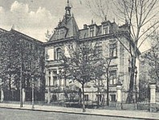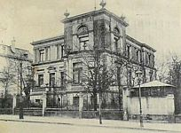

**_Fotos:_** _1945 zerstörte Villenbauten an der Eisenstuckstraße - Nr. 45 (links) und Nr. 47 (rechts)_

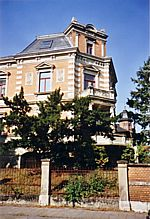Nr. 50:
Die mit einer Klinkerfassade versehene Villa an der Ecke zur Bendemannstraße (Rugestraße) entstand 1897 nach Plänen von Wilhelm Seifert. Bauherr war der Rechtsanwalt
Johannes Wolf, weshalb das Gebäude in den ersten Jahren auch Villa Wolf genannt wurde. 1919 erwarb die 1861 in Dresden gegründete Burschenschaft “Cheruscia” die Villa und nutzte
sie bis 1935 als Versammlungshaus. Nach dem Verbot aller Studentenverbindungen diente die Villa in der Nazizeit als “Kameradschaftsheim” der Studentenschaft der Technischen
Hochschule, nach 1945 als Wohn- und Bürohaus. 2001 bezog die 1991 wiederentstandene Aachen - Dresdner Burschenschaft Cheruscia wieder ihr früheres Domizil. Die aus Aachener,
Dresdner und Freiberger Studenten bestehende Verbindung gehört zu den wenigen “schlagenden”, d. h. traditionelle Fechtduelle austragenden Verbindungen in Dresden.

* * *

 \[ [Home](../../../../index.html)\] \[ [Nord](../../../../nord/)\] \[ [Nordwest](../../../../nordwest/)\] \[ [Neustadt](../../../../neustadt/)\] \[ [Nordost](../../../../nordost/)\] \[ [West](../../../../west/)\] \[ [Zentrum](../../../../zentrum/)\] \[ [Südwest](../../../../sudwest/)\] \[ [Süd](../../../../sud/)\] \[ [Südost](../../../../sudost/)\] \[ [Ost](../../../../ost/)\] \[ [Register](../../../../Register/register.html)\] \[ [Kontakt](../../../../Kontakt/kontakt.html)\] \[ [Impressum](../../../../impressum/)\]
