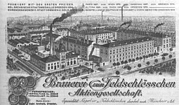
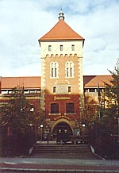
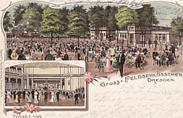
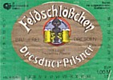
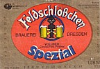
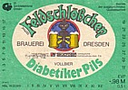
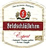
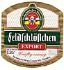

* * *

* * *

* * *

* * *

* * *

* * *

_“in Anbetracht der treuen und nützlichen Dienste, die er dem durchlauchtigsten Kur- haus zu gnädigstem Ge- fallen und seinem guten Ruhme geraume Zeit und_
_sogar mit Zuset- zung seiner Leibes- gesundheit geleistet_

_hat, wird ihm und allen künftigen Besitzern zu ewigen Zeiten die Befugnis erteilt, eine Schenke außerhalb des Hofes auf dem dazu-_
_gehörigen und an der Straße gelegenen Feld zu bauen.”_

**Aus der Verleihungs- urkunde Johann Georg III. an Dietrich von Bose vom**

**4\. Januar 1684**

* * *

Die spätere Feldschlösschenbrauerei geht auf ein abseits der Stadt in der Nähe
des Hahneberges gelegenes Bauerngut zurück, welches sich 1644 im Besitz einer Anna Nehlin befand. In diesem Jahr gewährte Kurfürst Johann Georg I. dem Anwesen die Schankgerechtigkeit, womit die Entwicklung zum Gasthof
eingeleitet wurde. 1684 erwarb der Geheime Kriegsrat Christoph Dietrich von Bose das Gut und ließ es mit Genehmigung des sächsischen Hof deutlich erweitern. Bald entstand inmitten von weiten Feldern ein schlossartiges
Gebäude, welches als “Feldschlößchen” zu den größten Ausflugs- und Vergnügungslokalen im Dresdner Umland gehörte. Anziehungspunkte waren
neben dem ausgedehnten Gästegarten auch ein großer Tanzsaal, mehrere Restaurationsräume und eine Kegelbahn.

1813
war das strategisch günstig gelegene Schankgut stark umkämpft, da Napoleon den nahegelegenen Hahneberg als Beobachtungspunkt ausgewählt und mit Schanzgräben versehen hatte. Nach Eroberung des Feldschlößchens durch die
Österreicher plünderten Soldaten die Vorratskeller und begannen von hier aus die Beschießung der Stadt. Bei der darauf
folgenden Rückeroberung durch napoleonische Truppen wurde das Gebäude stark beschädigt und brannte nieder.

Erst 1819 konnte ein Nachfolgebau eingeweiht werden, der jedoch wirtschaftlich keinen großen Ertrag brachte und deshalb bereits zehn Jahre später der Zwangsversteigerung oblag.
Für insgesamt 24.200 Taler erwarben der Dresdner Fleischermeister Bär und der Ratssteuereinnehmer Schelcher Vorwerk und Gasthaus. Doch erst dem Bayern Albert
Leonhard Meisl, Pächter des Bayrischen Brauhauses in der Friedrichstadt, gelang es, das Feldschlößchen wieder zu einem stadtbekannten Ausflugslokal zu machen. Trotz Einsprüchen
der alteingesessenen Brauerinnung gelang es Meisl, 1846 das Braurecht für sein 1838 erworbenes Anwesen zu erhalten und hier eine Brauerei “nach bayrischer Art” einzurichten.
Am 7. Juli 1858 wandelten seine Söhne das Unternehmen in eine Aktiengesellschaft um und verkauften den Betrieb wenig später an neue Eigentümer. Bis zum Ende des 19. Jahrhunderts
entwickelte sich die Feldschlößchenbrauerei zu einem der größten sächsischen Bierhersteller. Nach der Jahrhundertwende schloss man sich mit der Radeberger Exportbierbrauerei zu einer
Interessengemeinschaft zusammen, wodurch die Absatzmärkte nochmals erweitert werden konnten. Eine Fusion beider Unternehmen erfolgte im Jahr 1920.

Neben der Brauerei gab es auch weiterhin das Lokal “Zum Feldschlößchen”,
welches 1875 umgebaut und um einen neuen großen Bier- und Konzertgarten erweitert wurde. Leider fiel dieser später dem Bau der Zigarettenfabrik “Sulima”
zum Opfer, während die Gaststätte selbst noch bis zur Zerstörung 1945 existierte. Auch die Brauerei selbst wurde schwer in Mitleidenschaft gezogen, konnte die
Produktion jedoch Ende 1945 wieder aufnehmen. 1960 schloss sich die Feldschlösschen- Brauerei mit anderen Betrieben der Branche zum VEB Dresdner Brauereien zusammen. Bis 1990 stellte der zuletzt zum VEB Getränkekombinat
Dresden gehörende Betrieb an der Budapester Straße 32 (ehem. Chemnitzer Straße 6) neben “Feldschlößchen-Pilsner” auch Fassbrause und andere alkoholfreie Getränke her. Wenig später wurde die
Produktion nach Coschütz verlegt und die meisten Gebäude abgerissen. An ihrer Stelle befinden sich heute Bürohäuser, ein
Hotel und das Dresdner Arbeitsamt. Erhalten blieb das frühere Maschinenhaus, welches denkmalgerecht saniert und zur
Gaststätte umgebaut wurde. Seit 1998 lädt hier das “Stammhaus Feldschlößchen” zum Bier in rustikalem Anbiente ein. Im Obergeschoss informiert ein kleines Museum über die Geschichte des Dresdner Brauwesens.

_Etiketten der Feldschlösschenbrauerei aus den Jahren 1970 - 1990_

* * *

 \[ [Home](../../../../index.html)\] \[ [Nord](../../../../nord/)\] \[ [Nordwest](../../../../nordwest/)\] \[ [Neustadt](../../../../neustadt/)\] \[ [Nordost](../../../../nordost/)\] \[ [West](../../../../west/)\] \[ [Zentrum](../../../../zentrum/)\] \[ [Südwest](../../../../sudwest/)\] \[ [Süd](../../../../sud/)\] \[ [Südost](../../../../sudost/)\] \[ [Ost](../../../../ost/)\] \[ [Register](../../../../Register/register.html)\] \[ [Kontakt](../../../../Kontakt/kontakt.html)\] \[ [Impressum](../../../../impressum/)\]
