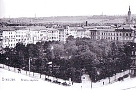
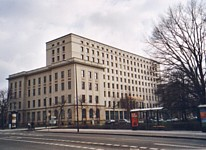
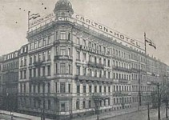
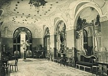
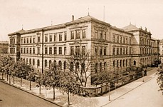
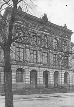
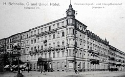
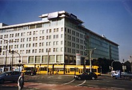
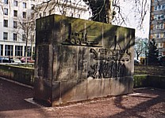
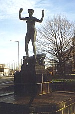

* * *

* * *

Der heutige Friedrich-List-Platz wurde in der zweiten Hälfte des 19. Jahrhunderts
als Prager Platz angelegt und nach der Reichsgründung 1871 nach dem deutschen Reichskanzler Otto von Bismarck (1815-1898) in Bismarckplatz umbenannt. Ab 1870 entstanden hier Hotels und Pensionen _(im Bild links)_
, an der Südseite zwischen Reichs- und Sedanstraße 1875 das neue Hauptgebäude der Technischen Hochschule _(ganz rechts)_. Die gesamte Nordseite nimmt der in
heutiger Form 1901 vollendete Hauptbahnhof mit seinen Gleisanlagen ein. Zur Auflockerung des Platzes wurde dieser gärtnerisch gestaltet. Seit 1911 schmückt ein von Georg Wrba geschaffener Brunnen die Anlage.

Sämtliche Gebäude um den Bismarckplatz fielen 1945 den Bomben zum Opfer.1946
wurde der Platz in Anlehnung an die hier abgehende Bayrische Straße hinter dem Hauptbahnhof  in Bayrischer Platz umbenannt. Nach Abbruch der Ruinen begann 1954 an der Ostseite der Bau der [Hochschule für Verkehrswesen](../../../../zentrum/sudvorstadt/strassen_sudvorstadt/friedrich-list-platz/hochschule_fur_verkehrswesen/). 1962 erhielt diese
den Namen “Friedrich List” verliehen, was die Dresdner Stadtverordnetenversammlung am 3. September 1962  zur Umbenennung des
Bayrischen Platzes in Friedrich-List-Platz veranlasste. Friedrich List (1789-1846) setzte sich als Schöpfer der Nationalökonomie für eine Liberalisierung der Wirtschaft
ein und gilt als einer der Mitinitiatoren des deutschen Zollvereins. Außerdem erarbeitete er ein Konzept für den Eisenbahnbau in Deutschland. Gleichzeitig mit der Umbenennung entstand ein Denkmal
für den Eisenbahnpionier. Heute hat der Friedrich-List-Platz vor allem als Verkehrsknotenpunkt Bedeutung. Hier befinden
sich auch die Abfahrtsstellen für die Regional- und Fernreisebusse in die Dresdner Umgebung und zu weiter entfernten Zielen.

Einzelne Gebäude:

Carlton-Hotel (Nr. 1):
Das Gebäude an der Ecke Bismarckplatz / Strehlener Straße gehörte zu den zahlreichen Hotels in der Umgebung des Hauptbahnhofs und warb in
zeitgenössischen Inseraten mit “ruhigster, vornehmster Lage vis-a-vis vom Hauptbahnhof” und dem “modernsten Komfort der Neuzeit”, zu dem um 1900
elektrisches Licht, Zentralheizung, Lift und eigene Bäder gehörten. Besitzer war der der Hotelier Gustav Härtig, weshalb das Haus auch als “Härtigs Carlton- Hotel”
inserierte. Nach dem Ersten Weltkrieg nutzten verschiedene Behörden, zuletzt die Kriegsamtsstelle, das Gebäude für Verwaltungszwecke. An Stelle des 1945
zerstörten Hauses steht heute das Hauptgebäude der Hochschule für Technik und Wirtschaft.

Hotel “Bristol” (Nr. 5-9):
Nur wenige Schritte vom “Carlton” entfernt wurde um 1900 am Bismarckplatz Nr. 5-9 das Hotel “Bristol” eröffnet, das zu den luxuriösesten Herbergen in der Südvorstadt gehörte. Neben modernen, mit
Zentralheizung, elektrischem Licht und fließendem warmen und kalten Wasser ausgestatten Zimmern besaß das Haus auch einen Sitzungs- und Festsaal sowie eine repräsentative Empfangshalle _(Foto)_
. In den Zwanziger Jahren war an dieser Stelle ein mehrgeschossiges Großhotel geplant, welches Stadtbaurat Hans Poelzig entworfen hatte. Bedingt durch die wirtschaftliche Situation und die Inflation
konnten diese Planungen jedoch nicht umgesetzt werden. Stattdessen diente das Haus ab 1933 als Verwaltungsgebäude
und war u.a. Sitz der Bauleitung für die Reichsautobahn, 1945 fiel das frühere Hotel “Bristol” den Bomben zum Opfer.

Nr. 9-13:
Der an das Hotel “Bristol anschließende Gebäudekomplex bis zur Einmündung zur Lindenaustraße beherbergte
neben Wohnungen auch verschiedene gewerbliche Einrichtungen. So gab es im Erdgeschoss von Haus Nr. 9 zeitweise die
Bismarckgaragen. Hier konnten sich wohlhabende Hotelgäste Kraftfahrzeuge mit Chauffeur mieten. Im Eckhaus zur Lindenaustraße befand sich eine Filiale des stadtbekannten Fischhändlers Paschky sowie eine Niederlassung der
Molkereigesellschaft DREMA. Außerdem nutzte zeitweise das Postamt Dresden A 14 einige Räume.

Polytechnikum: Der mächtige Vierflügelbau des Polytechnikums entstand 1872/75 im Neorenaissancestil und nahm die gesamte Südseite des Platzes zwischen Reichs- und Sedanstraße ein. Das von Rudolf Heyn entworfene Gebäude war Sitz der 1828 als Technische Bildungsanstalt gegründeten [Technischen Hochschule](../../../../zentrum/sudvorstadt/technische_universitat/). Neben Studien- und Seminarräumen gab es hier mehrere Hörsäle
sowie eine zwanzig Meter lange und elf Meter hohe zweigeschossige Aula, die mit Szenen aus der Prometheussage (von Anton Dietrich) und viel plastischem Stuck ausgestaltet war. Allegorische Frauenfiguren an der Hauptfassade zum Bismarckplatz symbolisierten die seinerzeit unterrichteten Fachrichtungen Mathematik, mechanische Technik, Architektur, Ingenieurwesen, Chemie und Literatur. Diese Plastiken sowie die Ausgestaltung des Treppenhauses stammten von Friedrich Rentsch. Für Studienzwecke beherbergte das Polytechnikum umfangreiche Sammlungen von technischen Geräten und Modellen sowie eine 30.000 Bände umfassende Bibliothek. Die offizielle Einweihung erfolgte am 4. November 1875.

Zunächst als Neues Polytechnikum bezeichnet, setzte sich ab 1890 die Bezeichnung “Alte Hochschule” durch. Mit zunehmenden Studentenzahlen machten sich umfangreiche Ergänzungsbauten erforderlich, welche ab 1905 im Süden der Südvorstadt und auf Räcknitzer und Plauener Flur entstanden. Während diese Gebäude den Zweiten Weltkrieg meist überstanden, wurde das Polytechnikum am Bismarckplatz 1945 völlig zerstört. Nach der
Machtübernahme der Nazis hatten Studenten der Hochschule am 3. Mai 1933 vor dem Haus einen “Schandpfahl” errichten lassen, an dem regimekritische Gegner durch Schmähschriften
öffentlich diffamiert wurden. Nach Abbruch der Ruinen legte man in der Nachkriegszeit zunächst eine Grünfläche an, bevor in den 1980er Jahren mehrgeschossige Wohnhäuser errichtet wurden.

Grand Union Hotel (Nr. 2-6): Das exklusive Hotel entstand 1873 an der Ecke Reichsstraße / Bismarckstraße und wurde vom Vorstand der Dresdner
Lohndiener Schladitz bewirtschaftet. Das Haus besaß 80 Zimmer und gehörte bis zum Ersten Weltkrieg zu den vornehmsten Übernachtungsstätten der Südvorstadt. Als eines der ersten Hotels in Dresden besaß es für seine
internationalen Gäste sogar Garagen für die Unterstellung von Automobilen. Im Inneren waren Speise- und Lesezimmer, Salons und Suiten aufwendig gestaltet
und möbliert. 1912 übernahm der Hotelier Curt Arthur Becker.Landry das Haus und führte es bis in die Zwanziger Jahre. In der Zeit nach dem Ersten
Weltkrieg gerieten die Betreiber jedoch in wirtschaftliche Schwierigkeiten und mussten das Hotel 1923 schließen.
Daraufhin übernahm die Aktiengesellschaft Sächsische Werke, ein Zusammenschluss sächsischer Energieversorger, das
Gebäude und richtete hier ihre Verwaltungsräume ein. 1945 fiel das ehemalige Grand Hotel den Bomben zum Opfer.

Das nur teilzerstörte Hintergebäude des Hotels konnte bereits 1947
wiederhergestellt und vom verstaatlichten Nachfolgebetrieb genutzt werden. Ab 1980 befand sich hier der Sitz des Energiekombinates Ost. Im Zusammenhang
mit Strukturveränderungen in der Energiewirtschaft nach 1990 ging aus diesem Kombinat die Energieversorgung Sachsen Ost AG (ESAG) hervor, die die mehrfach um provisorische Anbauten ergänzten Gebäude abbrechen und durch
einen modernen Neubau ersetzen ließ. 1996 konnte das Haus als “CC City Center” eingeweiht werden _(Foto)_. Heute hat hier u.a. die Hauptverwaltung des
ESAG-Nachfolgers ENSO ihren Sitz. Im Erdgeschoss befindet sich eine Ladenpassage mit verschiedenen Geschäften
und Restaurants. Der Entwurf stammt vom Stuttgarter Architekturbüro Wischer & Partner in Kooperation mit Prof. Rassaerts und Heinle.

Friedrich-List-Denkmal:
Das aus mehreren Sandsteinblöcken zusammengesetzte Denkmal in den Parkanlagen vor der Hochschule erinnert an den Namenspatron des Platzes. Reliefzeichnungen zeigen eine Lokomotive, einen Raddampfer, Flugzeug und
Rakete und verdeutlichen so die Bedeutung des modernen Verkehrswesens. Es wurde aus Anlass der Namensgebung der Hochschule für Verkehrswesen 1962 aufgestellt.

Eine Inschrift weist auf Lists Verdienste für dessen Entwicklung hin:

_“Sein Wirken für ein modernes Verkehrswesen in Deutschland, die produktiven Kräfte und die_

_Reichtümer der Nation werden durch ein vollkommenes Transportsystem in außerordentlicher_

_und mannigfaltiger Weise vermehrt werden.”_

Marie-Heinze-Gey-Brunnen:
Der Brunnen entstand 1910 im Auftrag des Arztes Dr. Paul Heinze in Erinnerung an seine kurz zuvor durch Selbstmord verstorbene Frau Marie. Marie
Heinze-Gey war um 1900 eine der ersten weiblichen Kunststudenten der Akademie und Schülerin des Malers Otto Fischer. Für die Gestaltung des Brunnens wählte Georg Wrba die
Figur der Aphrodite, die auf einer Muschelschale balanciert und von vier Putten begleitet wird. Für die Brunnenplastik stand die Frau des Dresdner Malers Otto Westphal Modell.
Am Becken befinden sich Hunde- und Vogeltränken. An der Rückseite der 1911 eingeweihten Brunnenanlage erinnert ein Porträtmedaillon an Marie Heinze-Gey. Alle
Bronzefiguren entstanden in der Dresdner Kunstgießerei Milde & Co. Der Brunnen überstand die Zerstörung seiner Umgebung 1945, wurde jedoch in der Nachkriegszeit
beschädigt. Nach Reparatur steht er seit 1952 wieder an seinem Platz.

* * *

 \[ [Home](../../../../index.html)\] \[ [Nord](../../../../nord/)\] \[ [Nordwest](../../../../nordwest/)\] \[ [Neustadt](../../../../neustadt/)\] \[ [Nordost](../../../../nordost/)\] \[ [West](../../../../west/)\] \[ [Zentrum](../../../../zentrum/)\] \[ [Südwest](../../../../sudwest/)\] \[ [Süd](../../../../sud/)\] \[ [Südost](../../../../sudost/)\] \[ [Ost](../../../../ost/)\] \[ [Register](../../../../Register/register.html)\] \[ [Kontakt](../../../../Kontakt/kontakt.html)\] \[ [Impressum](../../../../impressum/)\]
