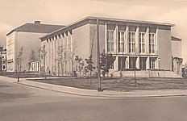
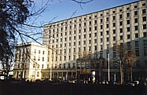

* * *

Die Hochschule für Verkehrswesen wurde 1950 als verkehrswissenschaftliche Fakultät der Technischen Hochschule gegründet und zwei Jahre später am 8. September 1952 in eine selbständige Hochschule umgewandelt. Als Standort wählte man die Ostseite des Bayrischen Platzes (heute [Friedrich-List-Platz](../../../../../zentrum/sudvorstadt/strassen_sudvorstadt/friedrich-list-platz/)). Ein weiterer Teil befand sich am [Fritz-Foerster-Platz](../../../../../zentrum/sudvorstadt/strassen_sudvorstadt/) und der Hettnerstraße.

Die ersten Gebäude der zunächst als Fakultät für Verkehrswissenschaften der Technischen Hochschule geplanten Einrichtung entstanden ab 1951 an Stelle der kriegszerstörten Wohnbebauung zwischen Fritz-Foerster-Platz, Nürnberger Straße und Hettnerstraße. Der Grundstein für diesen Gebäudeteil wurde am 20. April 1951 gelegt. Ein Jahr später konnte der erste Bauabschnitt übergeben werden. Neben Seminarräumen befand sich hier auch die hochschuleigene Bibliothek. Später folgten weitere Lehrgebäude sowie das 1956 eingeweihte Audimax mit 500 Hörsaalplätzen _(Foto)_. Im Treppenhaus befindet sich ein von Alfred Hesse und Erich Gerlach geschaffenes Wandbild, das den Besuch des DDR-Präsidenten Wilhelm Pieck in Dresden zeigt. Die Gesamtleitung für den Bau des Hochschulkomplexes Hettnerstraße oblag den Architekten Walter Henn, Horst Grabner und Hellmuth Francke.

Nach dem Abbruch der zerstörten Vorgängerbauten an der Ostseite des Friedrich-List-Platzes, darunter des Hotels “Bristol”, begann am 8. April 1954 auch der Bau eines neuen Hauptgebäudes des Verkehrshochschule. Nach Plänen des Architekten Prof. Richard Paulick entstand ein neungeschossiges Gebäude mit einem Seiten- und zwei Quergebäuden. Die Architektur orientierte sich ganz im Stil der damaligen Zeit an sowjetischen Vorbildern, was später als “Zuckerbäckerstil” kritisiert wurde. Die Sockel sind mit Sandstein verblendet, die Fassade selbst mit Meißner Keramik gestaltet.

Nutzer des 1960 fertiggestellten Komplexes war die Hochschule für Verkehrswesen, in der das wissenschaftliche und leitende Personal für die Deutsche Reichsbahn und andere Betriebe des Transport- und Nachrichtenwesens ausgebildet wurde. Unter ihrem ersten Rektor Hans Reingruber entwickelte sich die in Europa einzigartige Bildungseinrichtung zu einem anerkannten Ausbildungsort für Techniker und Verkehrsökonomen. Am 3. September 1962 erhielt sie den Namen “Friedrich List” verliehen. Neben dem Hauptgebäude nutzte man auch weiterhin die Bauten an der Hettnerstraße und der Hochschulstraße. Auch das Verkehrsmuseum war zeitweise der Verkehrshochschule unterstellt. Ab 1971 gab es zudem eine Sektion Militärisches Transport- und Nachrichtenwesen für die Ausbildung von Militärspezialisten, die hier aufbauend auf ihren Abschluss an der Offiziershochschule zu Diplomingenieuren ausgebildet wurden.

Trotz Protesten von Professoren, Studenten und Vertretern der Wirtschaft beschloss der sächsische Landtag am 20.April 1992 die Auflösung der Hochschule. Nach deren Anschluss als verkehrswissenschaftliche Fakultät “Friedrich List” an die Technische Universität bezog 1992 die neugegründete Fachhochschule für Technik und Wirtschaft (HTW) das Gebäude am Friedrich-List-Platz. Den Lehr- und Hörsaalkomplex an der Hettnerstraße übernahm die neu gebildetete Fakultät für Verkehrswissenschaften der TU. Seit 1993 trägt dieser den Namen Gerhart-Potthoff-Bau. Gerhart Potthoff war Professor für Betriebstechnik der Verkehrsmittel und gehörte in den 1950er Jahren zu den Initiatoren der Gründung der Hochschule für Verkehrswesen.

Bibliothek: 2006 erhielt die Fachhochschule für Technik und Wirtschaft einen Bibliotheksneubau. Das Gebäude
entstand nach Plänen des Architektenbüros Reimar-Herbst.Architekten aus Berlin  unmittelbar angrenzend an die
Hochschule an der Andreas-Schubert-Straße. Gemeinsam mit dem Seminargebäude und dem Labor schließt es den Komplex ab. Die Fassadengestaltung mit versetzten Fenstern in den Obergeschossen soll an die Buchregale im
Inneren erinnern. Die Fenster bestehen zum Teil aus halbdurchlässigen Marmorscheiben und sorgen so für eine optimale Klimatisierung und Beleuchtung der Bibliotheksräume. Für die Umsetzung des Bauvorhabens erhielt das
ausführende Büro 2007 eine Anerkennung beim Architekturpreis Sachsen. Insgesamt stehen den Studenten ca. 125.000 Bücher, davon 60.000 frei zugängliche, zur Verfügung.

* * *

 \[ [Home](../../../../../index.html)\] \[ [Nord](../../../../../nord/)\] \[ [Nordwest](../../../../../nordwest/)\] \[ [Neustadt](../../../../../neustadt/)\]
 \[ [Nordost](../../../../../nordost/)\] \[ [West](../../../../../west/)\] \[ [Zentrum](../../../../../zentrum/)\] \[ [Südwest](../../../../../sudwest/)\]
 \[ [Süd](../../../../../sud/)\] \[ [Südost](../../../../../sudost/)\] \[ [Ost](../../../../../ost/)\] \[ [Register](../../../../../Register/register.html)\] \[ [Kontakt](../../../../../Kontakt/kontakt.html)\] \[ [Impressum](../../../../../impressum/)\]
