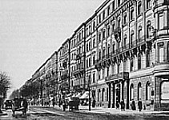
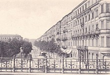
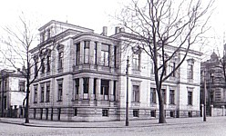
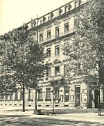
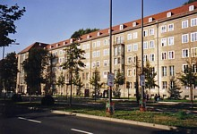
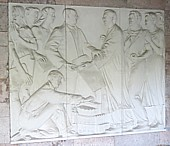
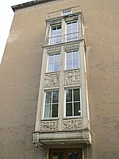

Die heutige Fritz-Löffler-Straße wurde 1868 als Verlängerung der Prager Straße angelegt und stellte die Verbindung zwischen Innenstadt und den sich entwickelnden südlichen Vorstädten her. 1871 erhielt sie den Namen Reichsstraße und blieb bis zur Zerstörung 1945 Hauptgeschäftsstraße der Südvorstadt. Das Straßenbild prägten mehrgeschossige Wohn- und Geschäftshäuser, Hotels und Verwaltungsgebäude _(Foto),_ im südlichen Teil auch Villen. Am Reichsplatz errichtete 1883/84 die amerikanische Gemeinde “St. John” die 1945 zerstörte [Amerikanische Kirche](../../../../zentrum/sudvorstadt/strassen_sudvorstadt/bergstrasse/amerikanische_kirche/).

Ab 1883 verkehrte die Pferdebahn über die Reichsstraße bis zur Reichenbachstraße, bevor 1896 auf elektrischen Betrieb umgestellt wurde. Eine Besonderheit war in den Anfangsjahren der Antrieb über eine
unterirdische Stromzuführung ohne Oberleitung, um die empfindlichen technischen Geräte der Technischen Hochschule am [Bismarckplatz](../../../../zentrum/sudvorstadt/strassen_sudvorstadt/friedrich-list-platz/) nicht zu stören. Zwei Jahre später verschwand am Nordende der Reichsstraße der Bahnübergang, nachdem im Zusammenhang mit dem Bau des Hauptbahnhofes der Eisenbahnverkehr auf Hochgleise verlegt worden war.

**_Fotos:_** _Blick vom Hauptbahnhof in die Reichsstraße vor 1945, rechts die Villa Nr. 15 (Ecke Reichenbachstraße)_

In den repräsentativen Gebäuden der Reichsstraße befanden sich bis 1945 neben Wohnungen und Geschäften zahlreiche Pensionen, die sich wegen der Nähe zum Hauptbahnhof bevorzugt in diesem Teil der Südvorstadt angesiedelt hatten. So gab es in der Nr. 2 ab 1896 die Pension Weidmann, im Nachbarhaus Nr. 4 die Pension Edelmann, in der Nr. 14 die überwiegend von Ärzten bewohnte Pension von Boeckmann, in der Nr. 18 die Pension "Trautes Heim" sowie in der Nr. 20 die "Internationale Familienpension" der Gattin des Ingenieurs Gotthardt. Auf der Reichsstraße 26 _(Foto)_ gab es die Pension von Oertzen. Hinzu kamen Antiquitätengeschäfte, eine Buchbinderei, eine Niederlassung von Pfunds Molkerei sowie im Haus Reichsstraße 12 die Schankwirtschaft "Zum Reichskeller". In der Nr. 30 hatte in der Nähe des Reichsplatzes nach der Jahrhundertwende die Polizeiwache des 10. Bezirks ihr Domizil.

1945 wurde die komplette Bebauung der Reichsstraße - mit Ausnahme der Russisch-Orthodoxen Kirche - vollständig zerstört. Während die Ostseite nach der Enttrümmerung zunächst unbebaut blieb, entstanden auf der gegenüber liegenden Straßenseite 1953/55 Studentenwohnheime für die Technische Universität (Architekt Prof. Wolfgang Rauda - _Fotos_). Interessant ist der an den Fassaden zu findende plastische Schmuck im Stil der damaligen Zeit. Unmittelbar neben dem Haupteingang findet sich, im Vorraum hinter einem Ziergitter, das Reliefbild "Kunstdiskussion" von Friedrich Press _(Bild rechts)_, welches die Problematik des Dresdner Wiederaufbaus thematisiert. Die am Risalit des Haupteingangs dargestellten Reliefs von Wolfgang Hempel stellen die vier Elemente dar, während an den Erkern des Hauses Szenen aus dem Alltagsleben zu sehen sind. Diese wurden von Reinhold Langner (Volkskunst), Otto Rost (Mußestunden nach der Arbeit), Max Lachnit (Wissenschaftler und Künstler) und Rudolf Wittig (Leben auf dem Bau) geschaffen.

1966/68 folgte ein deutlich moderner gestalteter Neubau vorrangig für ausländische Studierende (Nr. 12-14). Auch dieses Gebäude wurde künstlerisch gestaltet. Drei Betonreliefs über den Eingängen stellen die Wissenschaftsbereiche der Physik (Bauphysik, Kernphysik und Astrophysik) dar. Schöpfer war Siegfried Schade. 1983 errichtete man auf der gegenüberliegenden Straßenseite zehngeschossige Wohnhochhäuser.

Bereits in den 1960er Jahren war die frühere Reichsstraße in Juri-Gagarin-Straße umbenannt worden. Mit dieser Namensgebung sollte an den Fliegerkosmonauten Juri Gagarin (1934-1968) erinnert werden, der am 12. April 1961 als erster Mensch ins Weltall startete. 1993 erhielt die Straße ihren jetzigen Namen. Fritz Löffler (1899-1988) verfasste als Kunsthistoriker zahlreiche Werke zur Dresdner Kunst- und Architekturgeschichte und erwarb sich als Bewahrer der historischen Bausubstanz der Stadt bleibende Verdienste. Auch der an der Kreuzung mit der Bergstraße gelegene ehemalige Reichsplatz trägt heute seinen Namen.
