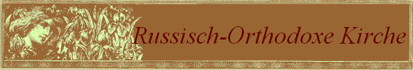
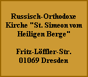
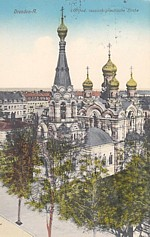
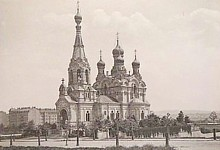
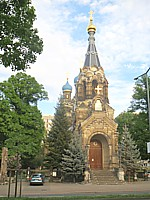
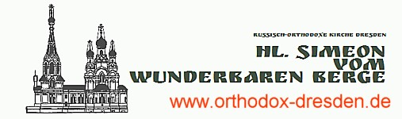

* * *

* * *

* * *

* * *

* * *

* * *

Die Russisch-Orthodoxe Kirche entstand als eine von mehreren “Ausländerkirchen” der
Südvorstadt. Nachdem sich auf Grund der guten wirtschaftlichen und kulturellen Beziehungen zwischen Sachsen und Rußland zahlreiche Russen in Dresden niedergelassen hatten, gründeten
diese 1861 eine eigene Gemeinde. Zuvor hatte es bereits 1813 im Brühlschen Palais, Sitz des russischen Gouverneurs Repnin-Wolkonski, eine orthodoxe Kapelle gegeben. Eine weitere
derartige Kapelle befand sich im Palais des Prinzen Maximilian an der Ostra-Allee.

Die Gottesdienste fanden zunächst in privaten Räumen auf der Sidonien- und der Beuststraße
statt, bevor man sich zum Bau eines eigenen Gotteshauses entschloss. Die Finanzierung des Vorhabens erfolgte durch Spenden wohlhabender Bürger russischer Abstammung. Neben
Alexander von Wollner, der der Gemeinde kostenlos das Grundstück zur Verfügung stellte, gehörten auch der Kaiserlich-Russische Staatsrat Simeon von Wikulin, der russische Gesandte
Wassili Kotzebue und selbst Zar Alexander II. zu den Förderern des Kirchenbaus. Bekannte Gemeindemitglieder waren der Dichter Fjodor Dostojewski und der Dirigent und Komponist Sergej Rachmaninow.

Unter Leitung des Baumeisters Karl Robert Weißbach begann man 1872 mit der
Errichtung einer Kirche im altrussischen Stil. Das Gebäude entstand nach Plänen des deutschen Hofarchitekten des Zaren Harald Julius von Bosse und erhielt fünf
Türme, bekrönt von den typischen Zwiebeltürmchen und einen 40 Meter hohen Glockenturm. Am 6. Juni 1874 erfolgte die offzielle Weihe des Gotteshauses.
Benannt wurde sie nach dem Schutzpatron des Stifters Simeon von Wikulin in “Kirche des Heiligen Simeon vom wunderbaren Berge”. Im Inneren befindet sich
nach Durchqueren der Vorhalle der eigentliche Kirchenraum, der durch eine Ikonenwand von den Heiligen Räumen getrennt ist, die nur von Priestern betreten
werden dürfen. Die meisten Ikonen und das Deckenplafond wurden von James Marshall (1838-1902) geschaffen. Bemerkenswert ist auch die vergoldete Königspforte mit den Bildnissen der vier Evangelisten und der Verkündigung
Marias.

Bis zum Ersten Weltkrieg entwickelte sich ein ungestörtes Gemeindeleben, nachdem auch der sächsische Staat die Russisch-Orthodoxe
Kirche als gleichberechtigte christliche Konfession anerkannt hatte. Zeitweise gehörten in Dresden über 1100 Gemeindemitglieder dieser Kirche an. Mit Kriegseintritt Russlands wurde die Russisch-Orthodoxe Kirche
jedoch geschlossen, da man eine “feindliche Beeinflussung” der Bevölkerung durch die in russischer Sprache gehaltenen
Gottesdienste befürchtete. Außerdem mussten 1917 die acht Glocken für die Rüstungsindustrie abgegeben werden.

Ab 1921 durften die in Dresden verbliebenen Gemeindemitglieder ihre Kirche wieder nutzen. Eine Dresdner Besonderheit war, dass trotz des Zuzugs zahlreicher Flüchtlinge aus dem
sowjetisch regierten Russlands die Gemeinde auch weiterhin dem Moskauer Patriarchat angehörte und sich nicht der oppositionellen “Auslandskirche” anschloss. Erst durch die
Nationalsozialisten wurde dieser Zustand beendet und das Kirchengrundstück 1939 enteignet und der “Russisch-Orthodoxen Auslandskirche” übertragen. Aus dieser Situation entwickelte
sich nach der Wende ein Rechtsstreit, der erst Mitte der 1990er Jahre beendet werden konnte.

Den Luftangriff auf Dresden überstand die Kirche mit einigen Schäden, konnte jedoch in ihrer
Substanz gerettet werden. Bis 1952 gelang es, die meisten Kriegsschäden an Dach und Türmen zu beseitigen. Um das Gotteshaus auch in den Wintermonaten nutzen zu können,
richtete man 1964 eine dem heiligen Nikolaus geweihte Winterkirche im Untergeschoss ein. 1976 wurde das frühere
Geläut durch vier provisorische Neugüsse ersetzt. Nicht zuletzt durch den Zuzug zahlreicher Spätaussiedler und Emigranten gehören der Gemeinde heute wieder über 1.200 Gläubige aus dem gesamten ostsächsischen Raum an.
1991/94 erfolgten umfangreiche Restaurierungsarbeiten. 2006 konnten die von Fred Krönke geschaffenen neuen Glasfenster eingebaut werden. 2010 wurden acht nach historischem Vorbild in Donezk (Ukraine) gegossene
Bronzeglocken erworben, welche seitdem wieder im Glockenturm läuten.

* * *

 \[ [Home](../../../../../index.html)\] \[ [Nord](../../../../../nord/)\] \[ [Nordwest](../../../../../nordwest/)\] \[ [Neustadt](../../../../../neustadt/)\]
 \[ [Nordost](../../../../../nordost/)\] \[ [West](../../../../../west/)\] \[ [Zentrum](../../../../../zentrum/)\] \[ [Südwest](../../../../../sudwest/)\]
 \[ [Süd](../../../../../sud/)\] \[ [Südost](../../../../../sudost/)\] \[ [Ost](../../../../../ost/)\] \[ [Register](../../../../../Register/register.html)\] \[ [Kontakt](../../../../../Kontakt/kontakt.html)\] \[ [Impressum](../../../../../impressum/)\]
