* * *

* * *

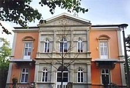Die Hohe Straße wurde 1852 auf dem Kamm des heute kaum noch wahrnehmbaren Hahneberges angelegt und verläuft von der Bayrischen Straße hinter dem Hauptbahnhof durch die Südvorstadt bis nach Plauen. 1855 erhielt sie offiziell ihren Namen. Der südlich der Bamberger Straße auf Plauener Flur gelegene Abschnitt wurde 1873 ebenfalls Hohe Straße benannt. 1904 folgte die Einbeziehung der früheren Südstraße zwischen Nöthnitzer und Coschützer Straße. Kurz nach der Anlage der Straße entstanden im unteren Abschnitt im sogenannten "Schweizer Viertel" die ersten Villen, denen später großbürgerliche Mietshäuser folgten. Im Zusammenhang mit dem Bau des Hauptbahnhofes wurde 1898 die heute nicht mehr vorhandene Hohe Brücke über die Bahngleise gebaut, welche die Verbindung zur Innenstadt herstellte.

Von der ursprünglichen Bebauung der Hohen Straße hinter dem Bahnhof sind durch die Zerstörungen 1945 und Abrisse in der Nachkriegszeit nur noch wenige Gebäude erhalten geblieben _( **Foto:** Hohe Str. 27)_. Stattdessen entstanden ab 1955 mehrgeschossige Wohnblocks der Wohnungsgenossenschaften “Glückauf” und “Süd”. Im oberen Teil auf  Plauener Flur prägen hingegen bis heute Wohnhäuser aus der Zeit um 1900 das Bild.

Einzelne Gebäude:

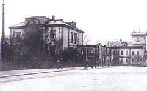Nr. 2: Den Auftakt zur Villenbebauung der Hohen Straße bildete die 1945 zerstörte Villa Nr. 2 mit Turm im toscanischen Landhausstil, die ihren Standort unmittelbar oberhalb der Bahnanlagen hatte _(im Bild hinten rechts)_. Unmittelbar neben dem Haus überspannte früher die Hohe Brücke die Gleise, deren südliches Widerlager heute noch durch zwei kleine Brückentürmchen sichtbar ist. An Stelle der Villa entstand nach 1960 ein Garagenkomplex.

Nr. 4: Im Gartenhaus dieser 1945 zerstörten Villa befand sich ab 1876 der Sitz der Kunsthandlung Franz Meyer. Meyer hatte zuvor gemeinsam mit dem Sohn Ludwig Richters, Johannes Heinrich Richter (1830-1890), ab 1873 die Meyer & Richter Verlags- und Kunsthandlung betrieben, widmete sich später jedoch wieder allein dem Handel mit Kunst und Antiquitäten. Ab 1920 absolvierte hier der nicht mit dem Firmengründer verwandte Kunsthändler und -sammler Joachim Meyer (1900-1981) ein Praktikum. Ab 1925 war er Prokurist, später auch Teilhaber des Unternehmens und übernahm die Firma nach 1945 ganz. Seine reichhaltige Sammlung von historischen Stichen befindet sich heute im Kupferstichkabinett.

Die Villa Hohe Straße 4 war zwischen 1907 und 1913 Wohnsitz des expressionistischen Kunstmalers Robert Sterl. Ab 1913 bis 1919 lebte er im Haus Hohe Straße 16. Später verzog er nach Naundorf in der Sächsischen Schweiz, wo noch heute eine Gedenkstätte an ihn erinnert.

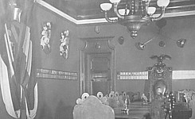Nr. 6: Die um 1870 errichtete Villa wurde in den 1920er Jahren von der Studentenverbindung “Corps Albingia” als Korporationshaus genutzt. Das Corps war am 23. Januar 1889 in Dresden als Veterinärmedizinische Verbindung an der Königlich-Sächsischen Tierarznei-Schule Dresden gegründet worden. Die historische Aufnahme zeigt die sogenannte "Kneipe", den für offizielle Feiern der Verbindung genutzten Raum.

Neben Professoren und wohlhabenden Pensionären lebten bis 1945 auch zahlreiche Studenten in der Südvorstadt. Nicht nur Studentenverbindungen sondern auch Privatpensionen und gemeinnützige Vereinigungen boten den Studierenden hier Unterkünfte in unterschiedlichen Preisklassen an. Beim Luftangriff wurde das Haus zerstört und später abgetragen.

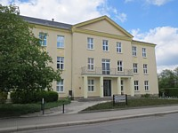Institut für Polymerforschung (Nr. 6): Bereits vor 1945 wurde das Grundstück an der Ecke Wielandstraße / Hohe Straße für wissenschaftliche Zwecke genutzt. Hier befand sich das Kaiser-Wilhelm-Institut für Lederforschung (Wielandstraße 2). Nach Zerstörung des Gebäudes wurde auf dem Areal unter Einbeziehung der Nachbargrundstücke Hohe Straße 4 und 6 in den 1950er Jahren ein Neubau errichtet. Das Institut für Polymerforschung entstand 1948 als Forschungseinrichtung der Mitteldeutschen Spinnhütte in Pirna-Copitz und widmete sich der Erforschung von neuen Werkstoffen auf Basis von Textilfasern. 1950 wurde es als Institut für Technologie der Fasern in die Deutsche Akademie der Wissenschaften aufgenommen. 1984 erhielt es den Namen Institut für Technologie der Polymere. Die bereits zu DDR-Zeiten eng mit der Technischen Universität zusammen arbeitende Forschungseinrichtung entstand am 1. Januar 1992 neu und gehört heute zur Wissenschaftsgemeinschaft Gottfried Wilhelm Leibniz e. V. Hier sind ca. 300 Mitarbeiter mit Grundlagenforschung auf dem Gebiet der Polymere beschäftigt.

Nr. 7: Die zweigeschossige Villa wurde 1866 von Hermann August Richter, einem Schüler von Hermann Nicolai, errichtet. Nach mehrfachen Besitzerwechsel lebte hier ab 1919 der Hutfabrikant Oskar Klügel, der seinen Betrieb auf der Großen Plauenschen Straße hatte. Als eines der wenigen Gebäude in diesem Teil des Schweizer Viertels überstand das Haus die Luftangriffe 1945 und blieb bis heute fast unverändert erhalten.

Nr. 8:  In diesem heute nicht mehr vorhandenen Wohnhaus lebte zwischen 1928 und 1934 der Sprachwissenschaftler Victor Klemperer. Bis 1933 war er als Professor für Romanistik an der Technischen Hochschule tätig, wurde jedoch dann wegen seiner jüdischen Herkunft entlassen. 1934 bezog Klemperer ein Haus in Dölzschen [(Am Kirschberg 19)](../../../../sudwest/dolzschen/strassen_dolzschen/), bevor er 1942 in ein ”Judenhaus” auf der Caspar-David-Friedrich-Straße umziehen musste. Nur Dank seiner Frau Eva, welche nicht unter die
nationalsozialistischen Rassegesetze fiel, und mit Glück überlebte er die Naziherrschaft und verfasste nach 1945 sein berühmtes Buch “L T I” über die Propagandasprache des Dritten Reiches.

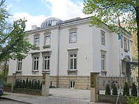Nr. 12: Die um 1875 erbaute und nach 1990 sanierte Villa ist heute Sitz eines Notariats sowie des Luxemburger Generalkonsulates _(Foto)_. Vor dem Ersten Weltkrieg war hier das Konsulat Großbritanniens untergebracht.

Bereits in dieser Zeit gab es in der Südvorstadt mehrere diplomatische Vertretungen. So befanden sich in den 1920er Jahren auf der Hohen Straße 24 die Konsulate Perus und Boliviens, in der Nr. 27 die französische Vertretung und auf der Hohen Straße 33 das Schweizerische Konsulat.

Nr. 14:  Das 1945 zerstörte einstöckige Haus zwischen Leubnitzer und Altenzeller Straße gehörte zu den ersten Gebäuden des Schweizer Viertels und stammte von 1868. Rundbogenfenster im Erdgeschoss, ein von einem Zwerchhaus geteiltes Satteldach und ein schlichter umlaufender Fries waren typische Gestaltungsmerkmale diese noch relativ bescheidenen Villen.

Nr. 15: In diesem heute nicht mehr vorhandenen Gebäude befand sich bis zur Zerstörung 1945 die Schankwirtschaft "Schweizer Höhe", eine der wenigen Gaststätten in diesem Stadtviertel. Der Name nimmt vermutlich Bezug auf die angrenzende Schweizer Straße.

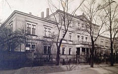Parfümerie Louis Jumpelt (Nr. 18): Das Unternehmen wurde am 20. Juli 1846 von Louis Jumpelt als Parfümeriewerkstatt gegründet und hatte seinen Sitz auf der Carolastraße. Jumpelt stammte aus einer Perückenmacher- und Friseurfamilie, deren Tradition sich bis ins 18. Jahrhundert zurück verfolgen lässt. 1831 erhielten die Jumpelts das Dresdner Bürgerrecht. Innerhalb weniger Jahre gelang es Louis Jumpelt, seine Firma zu internationaler Anerkennung zur führen. Hergestellt wurden Duftseifen, Parfüm, Raumdüfte, Puder und ähnliche Kosmetikartikel, die über Vertreter international vertrieben wurden. 1892 verlegte man den Sitz des Unternehmens zur Hohen Straße 8 (heute 18). Das große Gebäude an der Ecke zur Altenzeller Straße _(Foto)_ beherbergte die Produktions- und Verwaltungsräume. 1945 fiel das Haus den Bomben zum Opfer. An seiner Stelle entstanden in den 1950er Jahren Wohnblocks.

Trotz Zerstörung versuchte die Familie Jumpelt 1946, an den Erfolg anzuknüpfen und nahm die Produktion mit einigen wenigen Produkten wieder auf. Der Sitz wurde nach Dresden-Gruna zur Liliensteinstraße verlegt, wo das Familienunternehmen noch bis zum Tod des letzten Eigentümers Otto Louis (III.) Jumpelt existierte. 1960 wurde der Betrieb abgewickelt. Seit 2015 existiert das Unternehmen wieder und vertreibt über verschiedene Partner bzw. Online hochwertige Duftseifen in nostalgischem Design.

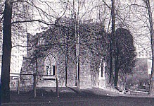Künstliche Ruine:
Das Schicksal dieses um 1865 entstandenen Kleinbaus steht exemplarisch für die Verluste an historischer Bausubstanz in der Südvorstadt nach 1945. Der burgartige neogotische Bau wurde ursprünglich als Gartenpavillon einer 1945 zerstörten Villa errichtet und besaß im Innenraum einen kleinen Kamin sowie eine über einen Treppenturm erreichbare Aussichtsplattform. Das unbeschädigte Bauwerk _(Foto)_ verfiel jedoch in der Nachkriegszeit und wurde 1975 zugunsten eines Spielplatzes abgerissen.

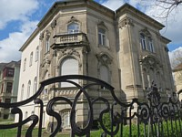Nr. 22: Diese Villa wurde 1903 von Carl Poppe für den Unternehmer Emil Oswald Jäger errichtet und erhielt eine aufwendig gestaltete Sandsteinfassade. Neben Anklängen an den Jugendstil weist das Haus reiche Neobarockformen auf, wobei sich der Architekt an den Bauten Pöppelmanns orientierte. Jäger war Inhaber der Waffelfabrik Hromadka & Jäger, deren Firmensitz sich auf der Hofmühlenstraße 14-16 befand. Nach Jägers Tod firmierte das Unternehmen bis in die Nachkriegszeit unter neuen Eigentümern als Kemat-Werk. Die Villa auf der Hohen Straße wurde in den 1930er Jahren an den Reichsinnungsverband des Bäckerhandwerks verkauft, der hier seine Bezirksstelle für Sachsen einrichtete. Das Gebäude überstand den Krieg mit einigen Schäden, blieb jedoch erhalten. Heutiger Nutzer ist der Landesinnungsverband Saxonia des Bäckerhandwerks Sachsen. 2014 wurde der teilzerstörte westliche Teil durch einen angepassten Neubau ergänzt.

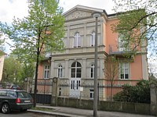Nr. 27: Die nach 1990 denkmalgerecht sanierte Villa entstand um 1870 nach einem Entwurf des Architekten Edmund Hanefeld und war bis 1946 Wohnsitz der Familie Bierling. Diese besaß in der Wilsdruffer Vorstadt ab 1848 eine bedeutende Kunst- und Glockengießerei, in welcher u.a. die Figuren der Brunnen am Albertplatz, das König-Johann-Denkmal, der Müllerbrunnen in Plauen und über 2000 Glocken entstanden. Mit der Zerstörung der Produktionsstätte an der Flemmingstraße endete 1945 die Geschichte des Unternehmens.

Nr. 35: Das Ende des 19. Jahrhunderts errichtete Haus war vor dem Ersten Weltkrieg Wohnsitz des Fabrikanten Friedrich Wilhelm Müller-Aue, Besitzer einer Tonwarenfabrik im böhmischen Preschen. Zugleich war er Konsul von Chile. Aus seiner Privatsammlung völkerkundlicher Gegenstände chilenischer Indianer kamen 1924 als Schenkung einige Stücke in den Besitz des Museums für Völkerkunde. Heute befindet sich im Haus eine Rechtsanwaltskanzlei.

Nr. 40: An der Grundstücksgrenze hinter dem Wohnhaus Hohe Straße 40 ist ein historischer Weichbildstein erhalten
geblieben, wie er einst zur Markierung der städtischen Flur verwendet wurde. Der erst 1995 wiederentdeckte Stein trägt das Dresdner Stadtwappen sowie die Jahreszahlen 1679 und 1729 und die Nr. 73. Das Wohnhaus blieb bis heute weitgehend unverändert erhalten, während sein spiegelbildliches Pendant Nr. 38 1945 zerstört und 2011 durch einen Neubau ersetzt wurde.

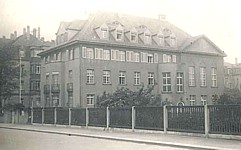Nr. 49: Auf diesem Grundstück befand sich vor 1945 das Gemeindehaus der Zionskirchgemeinde. Die [Zionskirche](../../../../zentrum/sudvorstadt/strassen_sudvorstadt/zionskirche/) war 1912 auf dem gegenüber liegenden Areal an der Ecke zur Nürnberger Straße eingeweiht worden. Ursprünglich plante der Dresdner Stadtbaurat Hans Poelzig um die Kirche die Anlage eines halbkreisförmigen Vorplatzes mit zwei markanten Schulbauten. Bedingt durch die wirtschaftliche Lage nach dem Ersten Weltkrieg kamen diese jedoch nicht zustande. Stattdessen errichte die Heimstättengesellschaft Sachsen 1927 auf dem Grundstück ein Mehrfamilienhaus, welches wenig später in den Besitz der Kirchgemeinde überging. Hier befanden sich neben dem Gemeindesaal das Pfarramt, die Büros des Kirchenvorstands sowie Wohnungen für Kirchenangestellte. 1945 wurde das Haus zerstört.

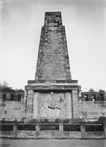Nr. 50: Das Haus befand sich ab 1898 im Besitz der Plauener Familie Fichtner und war Wohnsitz des Baumeisters William Fichtner (1865-1937). Die Familie besaß ab 1901 ein Architektur- und Baubüro, welches zunächst von Ferdinand Fichtner (1836-1906), später von seinen Söhnen William und Albert geleitet wurde. Zu den zahlreichen von ihnen ausgeführten Bauten gehören u.a. das [Rathaus Plauen](../../../../sud/plauen/), der [Fichteturm](../../../../sud/plauen/fichtepark/) und das König-Albert-Denkmal auf dem Windberg in Freital _(Foto)_. Hinzu kamen viele Villen, Wohn- und Geschäftshäuser in Plauen und Umgebung. Ihre Geschäftsräume hatten die Fichtners auf der Würzburger Straße 41. Mit dem Tod William Fichtners wurde das "Baugeschäft mit Büro für Architektur und Bauausführung" im November 1937 aufgelöst. Seine Grabstätte befindet sich auf dem [Äußerer Plauenscher Friedhof](../../../../sud/plauen/auferstehungskirche/). Die Villa Hohe Straße 50 wurde 1945 zerstört und nach 1990 durch ein Mehrfamilienhaus ersetzt.

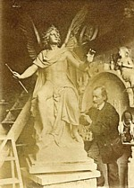Nr. 54: In dem 1945 zerstörten Gebäude hatte ab 1877 der Bildhauer Robert Henze (1827-1906) sein Atelier _(Foto um 1890)_. Als Schüler von Ernst Rietschel und Ernst Julius Hähnel gehörte er zu den bedeutendsten Dresdner Bildhauern seiner Zeit und schuf u.a. das Germania-Siegesdenkmal auf dem Altmarkt sowie verschiedene Figuren an der Semperoper und der Kunstakademie an der Brühlschen Terrasse. Sein Grab befindet sich auf dem Alten Annenfriedhof.

1940 bezog der Bildhauer Friedrich Press einige Räume auf diesem Grundstück und nutzte diese, unterbrochen durch Wehrdienst und Kriegsgefangenschaft, als Atelier. Press wurde vor allem als Gestalter sakraler Innenräume bekannt und lebte ab 1954 bis zu seinem Tod in Loschwitz.

Nr. 57: In diesem heute nicht mehr vorhandenem Eckhaus zur Bayreuther Straße befand sich um 1910 die Gaststätte "Bayreuther Hof", die übrigen Etagen wurden als Wohnungen vermietet. Nach dem Ersten weltkrieg schloss das Lokal, das Haus file 1945 dem Luftangriff zum Opfer.

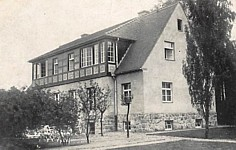Lehrlingsheim für Taubstumme (Nr. 58): Das Grundstück an der Ecke zur Hegerstraße gehörte ursprünglich als Garten zur Taubstummen-Vorschule mit Sitz auf der Chemnitzer Straße 89. Die Einrichtung war eine Zweigstelle der 1838 eröffneten [Taubstummenanstalt](../../../../sud/plauen/strassen_plauen/chemnitzer_strasse/). Unter Regie des Fürsorgevereins für Taubstumme Ostsachsen e.V. sollten in dieser Schule gehörlose Menschen auf eine Berufsausbildung vorbereitet und handwerkliche Fähigkeiten erwerben. Für auswärtige Schüler errichtete der Verein 1928 im hinteren Grundstücksteil das trotz mehrerer Umbauten in seinen Grundzügen noch erhaltene Lehrlingsheim _(Foto)_.

Nr. 62: In diesem Haus wohnte von 1891 bis zu seinem Tod 1924 der Wissenschaftler und Privatgelehrte Theodor Wolf mit seiner Familie. Theodor Wolf forschte unter anderem über Ecuador sowie die einheimische Flora und schuf die erste Landkarte des Staates. 1891 kehrte er nach Europa zurück und lebte in Plauen. Sein Grab befindet sich auf dem Inneren Plauenschen Friedhof. Am 3. September 2011 wurde an seinem früheren Wohnhaus eine Gedenktafel enthüllt.

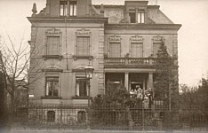Nr. 69: Die 1945 zerstörte und nach 1990 durch einen Neubau ersetzte Villa war früher Sitz eines Mädchenpensionats, wie es sie im Schweizer Viertel und den angrenzenden Stadtvierteln zahlreich gab. Gegründet wurde es um ca. 1910 von Frieda Schröter als Haushaltungspension. Hier wurden Töchter wohlhabender Familien auf ihre künftige Rolle als Mutter und Hausfrau vorbereitet. Ab 1920 gab es in der Villa zugleich die Töchterpension von Hildegard Bahmann. Mitte der 1920er Jahre fusionierten beide Einrichtungen und wurden bis um 1930 als "Pensionat Schröter-Bahmann" weitergeführt _(Foto)_. 1935 ist im Haus das Konsulat von Costa Rica im Adressbuch verzeichnet. Zuletzt nutzten bis zur Zerstörung auch die Verlagsbuchhandlung Ungelenk und der Verlag von Hans Herziger die Räume.

Nr. 70: In diesem noch heute erhaltenen Eckhaus an der Einmündung der Nöthnitzer Straße befand sich vor dem Zweiten Weltkrieg eine Bäckerei. Nach 1945 bezog die Kreuz-Apotheke die Räume. Diese war 1881 gegründet worden und hatte ihr Domizil bis 1945 auf der Chemnitzer Straße 86.

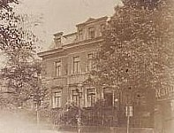Nr. 73: Das Gebäude war bis zu seiner Zerstörung 1945 Sitz des Naturheilbades Zukunft. Die Einrichtung war Anfang des 20. Jahrhunderts vom Naturheilkundler Carl August Schüller gegründet worden und bot verschiedene medizinische Kurbäder und "elektrische Behandlungen" an. Nach seinem Tod um 1925 übernahm Alfred Engel dem Betrieb des Kurbades. Das Haus _(Foto rechts)_ fiel 1945 den Bomben zum Opfer und wurde nach 1990 durch einen Neubau ersetzt.

Nr. 77: Im Vorgängerbau dieses Gebäudes (ehemals Hohe Straße 22, von 1893-1906 Nr. 10) wohnte von 1886 bis 1890 der deutsche Politiker und Arbeiterführer August Bebel (1840-1913). Bebel war wegen seiner politischen Tätigkeit während der Zeit der Sozialistengesetze 1881 aus Leipzig ausgewiesen worden und verdiente sich seinen Lebensunterhalt als Mitinhaber einer kleinen Fabrik, welche Türklinken und Fensterwirbel aus Büffelhorn produzierte. Außerdem war er in dieser Zeit Reichstagsabgeordneter des damaligen Wahlkreises Dresden 5 (Altstadt). 1890 verzog er nach Berlin. Die Villa wurde 1945 zerstört und nach 1990 durch einen Neubau ersetzt.

Nr. 80: Das Mehrfamilienhaus oberhalb des Plauenschen Rings entstand 1894 und ist typisch für den Mietshausbau dieser
Zeit. Bauausführender war der Plauener Baumeister Fichtner, der zahlreiche Gebäude im Ort entwarf. Auf Fichtners Planungen gehen auch der Fichteturm und die ehemalige Parkschänke an der Großmannstraße zurück.

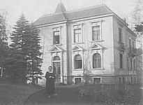Nr. 86: Die Ende des 19. Jahrhunderts in einer parkartigen Gartenanlage zwischen Gitterseestraße und Hoher Straße errichtete Villa war Wohnsitz des Architekten Kurt Diestel (1862-1946). Diestel hatte am Polytechnikum studiert und lehrte ab 1907 bis zu seiner Emeritierung 1927 als Professor für Bauformenlehre an der Technischen Hochschule. Von ihm stammten u.a. die Entwürfe für das 1945 zerstörte Haus der Landwirtschaftlichen Feuerversicherung mit dem "Kaiser-Café am Wiener Platz / Prager Straße und mehrere Villen und Geschäftshäuser. Später befand sich die Plauener Villa im Besitz von Friedrich Büchel, Direktor einer Fahrradfabrik. Das 2014/15 sanierte Gebäude wird heute als Kindertagesstätte "Villa Pat's Freunde" genutzt.

Nr. 139: Die zweigeschossige Villa entstand 1904/05 nach Entwürfen des Architekten Moritz Ackermann. Das im Landhausstil gestaltete und mit Jugendstilornamenten versehene Haus steht beispielhaft für die Architektur nach 1900, die sich immer mehr von klassischen Bauformen löste. Bemerkenswert ist die gut erhaltene Innenausstattung des Hauses.
