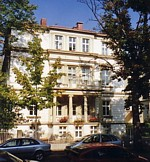
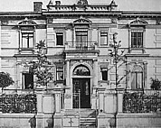
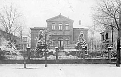
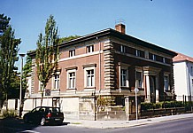
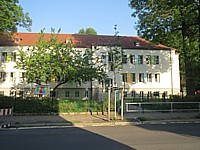
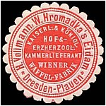
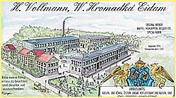
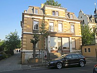
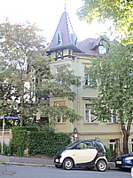

Die nach dem nahegelegenen Dorf Kaitz benannte Kaitzer Straße geht auf die Zeit der Entstehung der Südvorstadt Mitte des 19. Jahrhunderts zurück. 1851 begann die Erschließung des Areals südlich der Bahnlinie durch rechtwinklig verlaufende Straßen, die später bis auf die Höhen von Plauen und Coschütz geführt wurden. Schon bald entstanden hier die ersten Villen. In einem dieser Häuser (Nr. 4) wohnte von 1866 bis 1869 der Schriftsteller Friedrich Gerstäcker (1816-1872), Verfasser zahlreicher Abenteuerromane. Gerstäckers Wohnung war mit exotischen Gegenständen ausgestattet, die er von seinen zahlreichen Reisen mitgebracht hatte. Nach 1945 fiel stand auf dem Grundstück viele Jahre eine vom Deutschen Roten Kreuz genutzte Baracke. Künftig ist hier ein Neubau für das Leibniz-Institut für Polymerforschung mit Arbeitsstätten für Forscher, Bibliothek und Kantine geplant.

Bis zum Ersten Weltkrieg wurde die Kaitzer Straße mit Villen und Mietshäusern bebaut, wobei unterschiedliche Stilformen zur Anwendung kamen _( **Foto:** Kaitzer Str. 13)_. Leider fielen einige dieser Bauten, vor allem im unteren Teil der Straße, der Zerstörung 1945 zum Opfer. Die entstandenen Baulücken wurden Mitte der 1950er und 60er Jahre durch die Wohnungsbaugenossenschaften “Glückauf” und “Süd” mit neuen Wohnblocks geschlossen.

Einzelne Gebäude:

Nr. 9: Die 1945 zerstörte Villa wurde 1873 nach einem Entwurf der Architekten Helm & Müller errichtet. Das zweigeschossige Gebäude _(Foto)_
entstand im Stil der italienischen Renaissance und wies eine reiche Fassadengestaltung auf. Zeitweise wohnte hier der bekannte jüdische Bankier Heinrich Arnhold mit seiner Frau Lisa. Das Ehepaar
wurde vor allem als Kunstsammler und Stifter bekannt und gründete 1916 u.a. die Dresdner Zentralküche zur Armenspeisung. Im Zuge des Wiederaufbaus wurde die ausgebrannte Ruine um 1955 beseitigt.

Nr. 14: Die 1871 von Baumeister Georg Otto Ludewig im traditionellen Dresdner Stil errichtete Villa gehörte ab 1896
Elisabeth Margarethe Hohlfeld, deren Nachkommen das Haus noch heute besitzen. In den 1930er Jahren befand sich
hier eine der ersten physiotherapeutischen Praxen in Dresden. Das Gebäude überstand als eines der wenigen in diesem Bereich den Zweiten Weltkrieg ohne größere Schäden und wurde 1991 denkmalgerecht saniert.

Nr. 18: Das Haus entstand 1871 nach Plänen von Otto Solms im Stil der Semper-Nicolai-Schule. Zunächst diente das
Gebäude als Wohnhaus. Später beherbergte es das Töchterheim Küster. Auch im Nachbarhaus Nr. 22 gab es vor 1945 ein Mädchenpensionat für junge Frauen aus wohlhabenden Familien.

Nr. 26:
In diesem 1945 zerstörten Haus wohnte bis zu seinem Tod 1938 der bekannte Kunsthistoriker Cornelius Gurlitt. Der Sohn des Landschaftsmalers Louis Gurlitt gilt als einer der wichtigsten Wegbereiter der Denkmalpflege in
Sachsen und war Verfasser zahlreicher Schriften sowie zeitweise Rektor der Technischen Hochschule. Gurlitt ließ an der Fassade des Gebäudes eine wertvolle Renaissanceplastik anbringen, die nach 1945 aus den Trümmern
gerettet werden konnte. Heute ist sie am Haus Hauptstraße 21 in der Inneren Neustadt zu sehen.

Sein Sohn Hildebrand
war in den Zwanziger und Dreißiger Jahren als Kunsthändler tätig und durfte trotz seiner jüdischen Großmutter auch nach dem Machtantritt der Nationalsozialisten weiter tätig sein. U.a. war er im Auftrag von Goebbels
am Verkauf von beschlagnahmten Werken der “entarteten Kunst” sowie am Aufbau des geplanten “Führermuseums” in
Linz  beteiligt und trug selbst eine große Sammlung moderner Kunst zusammen. Ab 1943 lebte Hildebrand Gurlitt im
Haus seines Vaters. Nach dem Luftangriff galt seine Sammlung nach eigener Aussage als verbrannt. Für Aufsehen sorgte
Ende 2012 die Wiederentdeckung hunderter Werke dieser Kunstsammlung  in den Wohnung seines Sohnes in München. Unter den Fundstücken befinden sich u.a. Bilder von Gustav Courbet, Marc Chagall, Ernst Ludwig Kirchner,
Henri Matisse und Otto Dix. Die genaue Herkunft dieser Bilder ist derzeit noch ungeklärt.

Villa Bienert:
Der Ende des 19. Jahrhundert entstandene Neorenaissancebau an der Ecke Kaitzer / Würzburger Straße befand sich ab 1890 im Besitz der Mühlenbesitzerfamilie Bienert. In den Zwanziger Jahren wurde das Haus zum
Treffpunkt eines künstlerisch interessierten Freundeskreises um die Hausherrin Ida Bienert (1870-1965). Diesem gehörten u. a. Walter Gropius, Oskar Kokoschka, Paul Klee, Otto Dix und Mary Wigman an. Auch die
Tanzpädagogin Gret Palucca war oft bei Bienerts zu Gast und heiratete 1924 deren Sohn Friedrich.

Neben ihrem sozialen Engagement in ihrer Heimatgemeinde Plauen trug Ida Bienert auch eine der bedeutendsten
Dresdner Privatsammlungen an moderner Kunst zusammen. Zu dieser Galerie, die später nach München verbracht wurde, gehörten Werke von Chagall, Dix, Gauguin, van Gogh, Kokoschka und Picasso. Nach dem Wegzug der Familie
Bienerts 1945 nutzte zunächst das Stadtmuseum einige Räume im Haus. 1960 übernahm die Technische Universität - Fachbereich Hydrologie die Villa.

Nr. 58: Das zweistöckige Gebäude mit einer großen Verande im Dachgeschoss wurde 1928 auf einer Freifläche nördlich der Hegerstraße erbaut. Bis 1945 diente es als Außenstelle und Wohnheim der Dresdner [Taubstummenanstalt](../../../../sud/plauen/strassen_plauen/chemnitzer_strasse/) mit Stammsitz auf der Chemnitzer Straße 43. Nach dem Zweiten Weltkrieg wurde es als Kindergarten für Behinderte genutzt. 1998 erfolgte ein Umbau zum Wohnhaus, außerdem ist im Haus eine Arztpraxis untergebracht.

Nr. 73-77: Auf dem Ruinengrundstück entstand 1955 ein Wochenkindergarten für die im Schichtdienst beschäftigten Mitarbeiter der SDAG Wismut. 1962 übernahm die Stadt das Gebäude und richtete hier 1978 die erste kombinierte Kindertagesstätte Dresdens (Kinderkrippe und Kindergarten) ein. Heute wird diese Kita _(Foto)_ von der Arbeiterwohlfahrt betrieben.

Nr. 85:
Bis zur Zerstörung des Gebäudes 1945 wohnte hier der Kreuzorganist Herbert Collum. Collum gehört zu den wichtigsten Dresdner Musikerpersönlichkeiten des 20. Jahrhunderts und war maßgeblich am Wiederaufbau des
Musiklebens nach dem Zweiten Weltkrieg beteiligt. Zu den wenigen aus den Trümmern geretteten Gegenständen gehörte Collums Hausorgel, welche später durch seinen Sohn nach Köln kam. Künftig ist eine Aufstellung in der [Alten Kapelle](../../../../west/cossebaude/alte_kapelle/) in Cossebaude geplant.

Backwarenfabrik Dr. Quendt:

Das Unternehmen auf der Kaitzer Straße 92/94 wurde 1876 von Richard Vollmann und
Wenzel Hromadka in einem Plauener Bauerngut gegründet und produzierte unter dem Namen “Original Wiener Waffel-, Hohlhippen-, Bisquit- etc. Special-Fabrik” verschiedene
Dauerbackwaren. Nach Übernahme des Betriebes durch Richard Wiener im Jahr 1905 wurde der Betrieb weiter ausgebaut und gehörte zum offiziellen Kreis der Königlichen
Hoflieferanten. 1937 kam er in den Besitz der Unternehmersfamilie Max und Gerhard Berger und deren Compagnon Böhme und stellte fortan unter dem Namen BERBÖ (Berger &
Böhme) vor allem Waffeln und ähnliche Süßwaren her. 1945 zerstörten Bomben große Teile der Produktionsanlagen.

_Werbeanzeige der Firma Vollmann & Hromadka aus den Zwanziger Jahren_

Bereits in der unmittelbaren Nachkriegszeit konnte die Herstellung von Roggenkeksen und fettarmen Gebäck jedoch
wieder aufgenommen werden. 1957 kam das Unternehmen Berger & Böhme zu 94 % in Staatsbesitz und begann zwei
Jahre später mit der Herstellung von Russisch Brot. Der 1972 vollständig verstaatlichte VEB RuBro Dresden gehörte ab
1974 zum VEB Elite Dauerbachwaren Dresden. Leiter dieser Firma war der Erfinder der Dominosteine, Herbert Wendler, der sein Unternehmen in Klotzsche ebenfalls an den Staat abgeben musste.

Nach der politischen Wende wurde auch dieser VEB aufgelöst und 1991 als Dr. Quendt Backwaren GmbH neu gegründet. Neben der von Dr. Hartmut Quendt entwickelten modernen Anlage zur Russisch-Brot-Herstellung übernahm
das Unternehmen 1998 auch die in Konkurs gegangene Firma Herbert Wendlers und setzte bis 2009 deren Tradition als
Dominostein-Hersteller fort. Im Jahr 2000 bezog das Unternehmen moderne Produktions- und Verwaltungsräume im Coschützer Gewerbegebiet, wo der Betrieb bis heute seinen Sitz hat.

Nr. 95: Das villenartige Wohnhaus mit Ladengeschäft _(Foto)_ wurde Ende des 19. Jahrhunderts erbaut und blieb bis heute weitgehend in seinem Ursprungszustand erhalten. Im Erdgeschoss befindet sich die bekannte Plauener Konditorei Werner. Das Unternehmen wurde 1893 gegründet und 1921 von Willy Werner übernommen. Zur Spezialität wurden die “Maulschellen”, ein mit Marmelade gefülltes Hefeteiggebäck. 1972 mussten die Inhaber ihr Geschäft an den Staat verkaufen, der es bis zur Wende als volkseigenen Betrieb (VEB Dresdner Feinbackwaren) weiterführte. 1990 erhielt die Familie ihr Unternehmen zurück, welches bis heute existiert. Eine Filiale befindet sich seit 1997 in einem neu errichteten Eckhaus am F.-C.-Weiskopf-Platz, eine weitere am Nürnberger Ei.

Nr. 101:
Die eingeschossige Villa im Neorenaissancestil gehört zu den älteren Plauener Villenbauten und entstand um
1870\. Über dem Erdgeschoss befindet sich lediglich ein flaches Walmdach mit einer kleinen Dachgaube und einem
runden Fenster. Später wurden auch hier meist mehrgeschossige Gebäude errichtet. Die Planung und Realisierung des
Villenviertels übernahm der Bauverein Westend, der bis um 1900 fast alle Grundstücke bis zum Plauenschen Ring veräußert hatte.

Nr. 106: Das Mehrfamilienhaus an der Einmündung der Friedrich-Hegel-Straße entstand 1897 als Mietshaus. Wie bei den Villenbauten jener Zeit achteten auch hier die Bauherren auf eine an den Charakter des Villenortes angepasste architektonische Gestaltung mit Fachwerkgiebeln im Obergeschoss und dem für Eckbauten üblichen Dachtürmchen. Das Haus blieb bis zur Gegenwart weitgehend unverändert erhalten und wurde 1993 rekonstruiert _(Foto)_.

Nr. 123: Das Gebäude wurde Ende des 19. Jahrhunderts als Mehrfamilien-Mietshaus im oberen Teil der Kaitzer Straße
(Hohenplauen) erbaut. Im Gegensatz zu ähnlichen Bauten verzichtete man hier auf einen Keller und gestaltete das Untergeschoss als Souterrain, um so zusätzlichen Wohnraum zu gewinnen. Nach 1990 erfolgte der Ausbau des
Dachgeschosses für weitere Wohnungen.

* * *

 \[ [Home](../../../../index.html)\] \[ [Nord](../../../../nord/)\] \[ [Nordwest](../../../../nordwest/)\] \[ [Neustadt](../../../../neustadt/)\] \[ [Nordost](../../../../nordost/)\] \[ [West](../../../../west/)\] \[ [Zentrum](../../../../zentrum/)\] \[ [Südwest](../../../../sudwest/)\] \[ [Süd](../../../../sud/)\] \[ [Südost](../../../../sudost/)\] \[ [Ost](../../../../ost/)\] \[ [Register](../../../../Register/register.html)\] \[ [Kontakt](../../../../Kontakt/kontakt.html)\] \[ [Impressum](../../../../impressum/)\]
