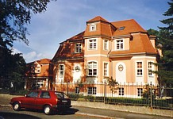
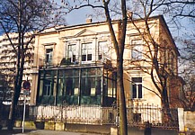
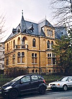
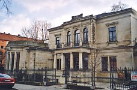

Die Leubnitzer Straße wurde um 1850 im Zusammenhang mit dem Bau des Villenviertels
hinter dem Hauptbahnhof angelegt. Ihren Namen erhielt sie nach dem Dresdner Stadtteil Leubnitz. Von den zahlreichen Villen überstanden nur wenige die Luftangriffe des Zweiten
Weltkriegs. Einige erhaltene Gebäude am westlichen Ende der Straße wurden 1976 für die Neubauten der Budapester Straße abgerissen. Die durch die Zerstörung entstandenen
Baulücken schloss man in der Nachkriegszeit mit Neubauten. Interessantester Abschnitt ist das Gebiet an der Liebig- und Hübnerstraße, wo Dank der erhaltenen
Vorkriegsbebauung noch etwas vom Flair des einstigen ”Schweizer Viertels” zu spüren ist. _( **Foto:** Leubnitzer Straße 23)_.

Einzelne Gebäude:

Nr. 5: Die dreigeschossige Villa wurde 1874 von August Rönitz errichtet. Das Gebäude folgte in seiner Gestaltung der für den Dresdner Villenbau richtungsweisenden Semper-Nicolai-Schule und besaß im Erdgeschoss eine Terrasse mit Freitreppe zum Garten, im Obergeschoss einen mit schmiedeeisernen Gittern verzierten Balkon. Die noch gut erhaltene Villa fiel 1976 dem Abbruch zum Opfer.

Nr. 6:Zu den älteren Bauten im “Schweizer Viertel” gehörte die 1864 entstandene Villa Leubnitzer Straße 6. Das vom Architekten Bär entworfene Gebäude besaß zwei Etagen sowie eine auf Säulen vorgelagerte Terrasse mit Balkon. Auch diese zu den qualitätsvollen Bauten der Nicolai-Schule gehörende Villa wurde 1976 abgerissen. An ihrer Stelle steht heute ein Supermarkt.

Nr. 7 (Villa Haniel): Das nach einem früheren Besitzer auch als Villa Haniel bezeichnete Haus entstand 1868 nach einem Entwurf von Edmund Hanefeldt. Auch Hanefeldt orientierte sich bei der Gestaltung der Neorenaissancefassade an den Vorgaben der Semper-Nicolai-Schule, die zu dieser Zeit als “Leitlinie” des privaten Villenbaus galt. Erster Besitzer war der Dresdner Bauunternehmer Carl August Ihlenburg. Erste Umbauten und Erweiterungen erfolgten bereits 1871 und 1875 nach dem Erwerb des Hauses durch August Leopold Kommer. 1884 kam noch ein Gartenhaus hinzu.

1890 erwarb der durch Beteiligungen in der Schwerindustrie des Ruhrgebietes zu Wohlstand gekommene Premierleutnant Hugo Charles Haniel das Gebäude. Nach dessen frühen Tod ließ seine Witwe Anna Sophie, Sängerin der Hofoper, das Haus 1901 vom Architekten Oscar Prüfer umbauen und deutlich vergrößern. Aus dieser Zeit stammt die teilweise erhaltene Innenausstattung mit Deckengemälden, Stuck- und Marmorverkleidungen und einem “Römischen Bad” sowie die eiserne Treppenkonstruktion der renommierten Dresdner Kunstschmiede Kühnscherf & Söhne. Nach dem Tod der Besitzerin 1932 erfolgte eine Aufteilung der Villa in Mietwohnungen. Da das Haus den Zweiten Weltkrieg fast unbeschadet überstand, nutzte man die Villa als Wohnhaus für mehrere Familien. 2001 konnte das Gebäude umfassend saniert werden und beherbergt heute Appartements und Ferienwohnungen.

Nr. 9:
Zeitgleich mit dem Nachbarhaus errichtete Edmund Hanefeldt 1868 diese zweigeschossige Villa. Auftraggeber war
der Dresdner Bauunternehmer C. M. Schlächter. Die durch Simse, Bänder und eine vorgelagerte Terrasse mit Freitreppe gegliederte Fassade ist bis heute fast unverändert erhalten geblieben.

Nr. 11:
Das repräsentative Wohnhaus an der Ecke zur Hohen Straße wurde 1866 für den Privatier Hermann Francke
errichtet. Für die Fassadengestaltung wählte Francke klassizistische Bauformen, die jedoch bei späteren Umbauten
verloren gingen. Nach 1900 diente die Villa als Töchterpensionat. 1945 fiel das Gebäude den Bomben zum Opfer.

Nr. 13:
In diesem Haus lebte bis zu seinem Tod am 2. April 1877 der erste Dresdner Oberbürgermeister Friedrich
Wilhelm Pfotenhauer als Mieter. Pfotenhauer, ausgebildeter Jurist, war nach der Bürgerlich-Demokratischen Revolution
1849 kommissarisch zum Bürgermeister ernannt wurden und durfte ab 1853 den Titel eines Oberbürgermeisters tragen.

Nr. 14:
Die Villa war ab 1926 Sitz der Dresdner Studentenverbindung Akanthus-Lusatia. Die Geschichte des Korps reichte bis 1864 zurück, als einige Studenten der Abteilung Baukunst der Kunstakademie im Gasthof “Zum Goldenen
Ring” den Verein “Junger Künstlerbund” gründeten. Ein Jahr später benannte er sich in “Akademischer Klub” um, bevor
ab 1884 die Bezeichnung “Akanthus” üblich wurde. Zu den Mitgliedern gehörten u.a. die Architekten German Bestelmeyer, Heinrich Tessenow, Emil Scherz und Max Poscharsky sowie der Historienmaler Alfred Diethe. Constantin
Lipsius und Paul Wallot wurden zu Ehrenmitgliedern ernannt.

Der nach dem Vorbild der Studentenverbindungen organisierte Klub führte neben Kneipabenden und Mensuren auch
regelmäßige Bälle und andere gesellschaftliche Veranstaltungen statt und war weit über Dresden hinaus bekannt. 1924
gehörten ihm 124 Mitglieder, darunter viele Architekten und Professoren an. Da das Rekrutiren neuer Mitglieder jedoch
schwierig war, vereinigte sich der Club “Akanthus” 1926 mit dem Studentencorps “Lusatia” der Technischen Hochschule. 1933 wurde die Verbindung durch die Nazis aufgelöst und das Haus enteignet.

Nr. 16: Die 1945 zerstörte Villa war seit den 1920er Jahren Sitz des Verlages Louis Ehlermann. Die 1823 in Hannover gegründete Verlagsbuchhandlung war 1845 vom Buchhändler Louis Ehlermann (1817-1880) übernommen worden und siedelte 1860 nach Dresden über. Neben Lehrbüchern und kulturwissenschaftlichen Werken gab der Verlag u.a. die Reihe "Volk und Dichtung" mit Werken bekannter Klassiker heraus. Nach 1945 setzte er mit Genehmigung der sowjetischen Administration seine Tätigkeit auf der Comeniusstraße 106 fort, bevor Anfang der 1950er Jahre der Sitz nach Düsseldorf verlegt wurde.

Nr. 23: Die sparsam dekorierte Villa entstand 1925 und orientiert sich an süddeutschen Bautraditionen. Deutlich ist der
Einfluss der von Stadtbaurat Hans Erlwein und Richard Riemerschmid inspirierten “Reformarchitektur” erkennbar. Ursprünglich befand sich das Grundstück im Besitz des Odol-Fabrikanten Karl August Lingner, der in der gegenüber liegenden Villa (Nr. 30) wohnte und hier einen Sommergarten mit Kegelbahn und Gewächshaus besaß. Lingners Erben verkauften das Areal nach dem Ersten Weltkrieg an den Frauenarzt Rudolf Paul, der die Villa sowie ein als Garage und Chauffeurswohnung dienendes Nebengebäude errichten ließ.

1945 wurde das Haus durch eine Luftmine getroffen, konnte jedoch gerettet werden. Paul verstarb noch im gleichen Jahr und die Villa ging in kommunalen Besitz über. Bis 2004 wurde sie als Mietshaus genutzt. Die frühere Garage wandelte man 1979 in ein Einfamilienhaus um. Seit Abschluss der Sanierung von 2004 befinden sich im Haus Physiotherapie-Praxen, im Obergeschoss Wohnungen.

Nr. 28 (Villa Möckel): Die mit einer Klinkerfassade und plastischem Schmuck gestaltete neogotische Villa gehört zu den schönsten erhaltenen Gebäuden des Schweizer Viertels. Bauherr und Architekt war Gotthilf Ludwig Möckel, der u. a. auch die 1945 zerstörte [Johanneskirche](../../../../Zentrum/Pirnaische_Vorstadt/Johanniskirche/johanniskirche.html) in der Pirnaischen Vorstadt und die [Erlöserkirche](../../../../ost/striesen/erloserkirche/) in Striesen entwarf.

An der Fassade des 1878 fertiggestellten Hauses _(Foto)_ befinden sich neben mehreren Balkons und Erkern zwei lebensgroße Kalksteinskulpturen des Bauherren und seiner Ehefrau. Auch im Inneren sind noch Teile der früheren Ausstattung erhalten.

Voco-Verlag: Nach 1945 befand sich im Haus zeitweise der Sitz des Voco-Verlages. Dieser war 1925 in Leipzig von Wolfram von Hanstein (1899-1965) gegründet worden und gab bis zum Verbot 1933 u.a. die "Republikanische Bibliothek" heraus. Hanstein galt als schillernde Figur, war Anfang der 1920er Jahre Mitglied eines Freikorps und brachte noch 1933 eine Anthologie "Wider den Nationalsozialismus" heraus, wofür er einige Monate Haft erhielt. Nach seiner Freilassung verlegte er vorwiegend historische, zum Teil von ihm selbst verfasste Romane. Nach seiner Entlassung aus der Reichsschrifttumskammer wegen "politischer Unzuverlässigkeit" siedelte er 1944 nach Tharandt über und stellte sich 1945 in den Dienst der sowjetischen Besatzer. Diese Kontakte ermöglichten ihm den Neustart als Verleger in Dresden. Neben der wiederaufgenommenen "Republikanischen Bibliothek" und verschiedenen Romanen verlegte Hanstein auch Reden, Tagebücher und politische Schriften des kommunistischen sächsischen Innenministers Kurt Fischer und des Dresdner Oberbürgermeisters Walter Weidauer.Hanstein war zudem Mitbegründer der ostdeutschen CDU, später jedoch Mitglied der SED.

Nach seiner Enttarnung als Doppelagent des sowjetischen und westlicher Geheimdienste wurde er 1952 zum Tode verurteilt und der Verlag geschlossen. Im Rahmen einer Amnestie kam er frei, ging 1956 in die Bundesrepublik, wo er erneut als Agent tätig war und 1960 wegen Landesverrats zu sechs Jahren Haft verurteilt wurde. 1965 verstarb er in der DDR. Das Haus auf der Leubnitzer Straße wurde bis 1989 zeitweise durch Behörden, als Ambulatorium und zuletzt vom VEB Pumpspeicherwerke genutzt. Eine umfassende Sanierung erfolgte 1997/98.

Nr. 30 (Villa Lingner): Die 1886/87 von Max Gutmann errichtete Villa erwarb 1895 der Odol-Fabrikant Karl August Lingner und ließ sie zehn Jahre später von Wilhelm Kreis umbauen und erweitern. Neben Wohnräumen erhielt das Haus dabei auch einen saalartigen Anbau für Lingners umfangreiche Privatbibliothek sowie einen Musiksalon mit der Privatorgel des Hausherren. Im ersten Stock befanden sich die Privaträume, während im Obergeschoss die Bediensteten untergebracht waren.

Nach Lingners Umzug ins [“Lingnerschloss”](../../../../nordost/loschwitz/albrechtsschlosser/) am Elbhang 1908 wechselten mehrfach die Besitzer. In den 1930er Jahren hatte hier die Burschenschaft "Alemannenheim" ihr Domizil. Das Haus überstand den Luftangriff 1945 ohne größere Schäden und beherbergte zunächst eine Kfz-Werkstatt, in den 1950er und 60er Jahren das Stadtbüro des Klotzscher Flughafens. Fluggäste konnten hier einchecken und wurden dann per Zubringerbus nach Klotzsche zu ihrer Maschine gebracht. Später hatte in der Villa die Bank für Landwirtschaft und Nahrungsgüterwirtschaft ihr Domizil. 2003-05 erfolgte eine umfassende Sanierung der Villa, die seitdem wieder Wohnzwecken dient. Seit Oktober 2011 hat hier außerdem das Honorarkonsulat von Kroatien seinen Sitz.

* * *

 \[ [Home](../../../../index.html)\] \[ [Nord](../../../../nord/)\] \[ [Nordwest](../../../../nordwest/)\] \[ [Neustadt](../../../../neustadt/)\] \[ [Nordost](../../../../nordost/)\] \[ [West](../../../../west/)\] \[ [Zentrum](../../../../zentrum/)\] \[ [Südwest](../../../../sudwest/)\] \[ [Süd](../../../../sud/)\] \[ [Südost](../../../../sudost/)\] \[ [Ost](../../../../ost/)\] \[ [Register](../../../../Register/register.html)\] \[ [Kontakt](../../../../Kontakt/kontakt.html)\] \[ [Impressum](../../../../impressum/)\]
