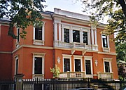
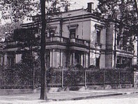
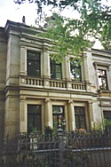
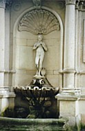
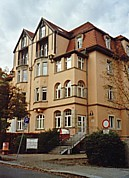

* * *

Die Liebigstraße wurde Mitte des 19. Jahrhunderts beim Bau des “Schweizer Viertels” hinter dem Hauptbahnhof angelegt und nach 1900 im Zusammenhang mit dem weiteren Ausbau der Südvorstadt bis zur Münchner
Straße verlängert. Ihren Namen erhielt sie nach dem deutschen Chemiker Justus von Liebig (1803-1873). Liebig befasste sich u.a. mit den Prozessen beim Stoffwechsel von Tieren und Pflanzen und begründete die künstliche
Düngung in der Landwirtschaft. Auch diese Straße war 1945 von Zerstörungen betroffen, so dass heute nur noch teilweise historische Bebauung erhalten geblieben ist. Die meisten Baulücken konnten jedoch bereits in den
50er und 60er Jahren geschlossen werden.

Einzelne Gebäude:

Nr. 1:
Die 1945 zerstörte Villa wurde 1879 für den Kaiserlich-Russischen Staatsrat Wassili Petrowitsch Baron von Engelhardt (1828-1915) errichtet. Zuvor hatte Engelhardt bereits ab 1877 das Nachbargrundstück Nr. 2 gepachtet, um hier eine massive Sternwarte zu errichten. Unter dem Pseudonym Basilius von Engelhardt befasste er sich mit Astronomie und schrieb u.a. die dreibändige “Observations Astronomique”, ein Standardwerk der modernen Himmelskunde. Gemeinsam mit dem befreundeten Fabrikanten Gustav Heyde, Besitzer der Firma “G. Heyde - mechanische und optische Präzisions- Werke” ließ sich Engelhardt sein Haus mit einem neuen Observatorium, einer beweglichen Beobachtungsplattform und verschiedenen Geräten zur Himmelsbeobachtung ausstatten. 1945 fielen Villa und Sternwarte den Bomben zum Opfer. Heute erinnert noch das gusseiserne Portal am Zaun mit den Initialen BvE an ihn.

Nr. 3 (ehem. Nr. 2):
Die 1873 vom Architekten Rößler für den Leutnant a. D. Albert Meurer errichtete Villa steht beispielhaft für die bis 1945 typische Bebauung des
Schweizer Viertels. Der relativ schlichte Bau mit Attika und Walmdach orientiert sich an den Vorbildern der Nicolai-Schule und weist Neorenaissance- und neoklassizistische
Elemente auf. Erst gegen Ende des 19. Jahrhunderts entschieden sich viele private Bauherren für aufwendigere Gebäude. Bereits 1880 verkauften die Eigentümer ihr Haus an
neue Besitzer. 1898 erwarb die Familie Klette das Gebäude, welches nach der neuen Hausherrin nun den Namen Villa Clara erhielt. Das Paar ließ einige Umbauten vornehmen
und fügte dem Haus um 1900 einen Wintergarten hinzu.

Nach 1945 diente die Villa bis 1995 als Mietshaus und wurde 2001 an ein Bauunternehmen verkauft. Im Anschluss
erfolgte eine denkmalgerechte Sanierung des Gebäudes, welches jetzt als Wohn- und Bürohaus genutzt wird. In Erinnerung an den Computer-Pionier Konrad Zuse trägt das Haus heute den Namen  “Konrad-Zuse-Haus”. Diese
Namensgebung erfolgte auf Anregung des Besitzers, welcher Träger der Konrad-Zuse-Medaille für Verdienste um die Informatik im Baugewerbe ist.

Nr. 7: Das repräsentative Neorenaissancegebäude mit entstand 1875 als eines der letzten Bauwerke des Schweizer Viertels im Geist der Nicolai-Schule. Ursprünglich gehörte es dem königlichen Hofjuwelier Fritz Chrambach, der zugleich das Amt eines Kaiserlich-Türkischen Konsuls innehatte. Chrambach war Mitinhaber des Juweliergeschäfts Elimeyer am Neumarkt und galt als kunstsinniger Gastgeber. So weilten u.a. der Komponist und Klaviervirtuose Anton Rubinstein, Richard Wagners Sohn Siegfried mit seiner Frau Winifred und der Literaturnobelpreisträger Karl Gjellerup in seinem Haus.

Ab 1930 diente die Villa als Privatklinik für Gynäkologie und Geburtshilfe von Prof. Dr. med. Wilhelm Rübsamen, der zeitweise auch geschäftsführender Oberarzt des Johannstädter Krankenhauses war. 1945 brannte das Haus aus, konnte jedoch bis 1949 wieder aufgebaut werden. Unter Leitung Professor Rübsamens, später unter der seiner Tochter Ursula, blieb die Frauenklinik auch zu DDR-Zeiten in Familienbesitz und gehörte zu den wenigen Privatkliniken der Stadt. Erst 1987 gab Dr. med. Ursula Rübsamen ihre Klinik aus Altersgründen auf, führte jedoch noch gelegentliche Sprechstunden durch. Ab 1992 nutzte zunächst die Diakonissenanstalt, später die Johanniter-Unfallhilfe das Gebäude. Heute hat hier eine Werbeagentur ihren Sitz. Außerdem gibt es im Haus einige Mietwohnungen.

**_Fotos:_** _Villa Liebigstraße 7 mit Wandbrunnen_

Nr. 8:
Nach der Reichsgründung 1870/71 verdrängten im Schweizer Viertel zunehmend mehrgeschossige, aufwendig
gestaltete Mietshäuser die bislang relativ schlicht ausgeführten Villen. Auch der Architekt Bär entschied sich 1873 für den
Bau eines solchen Gebäudes, welches er teilweise selbst bewohnte, zum Teil aber auch an zahlungskräftige Interessenten
vermietete. Trotz einiger baulicher Veränderungen stellt dieses Haus ein interessantes Zeugnis der Wandlung der Architekturauffassungen im letzten Drittel des 19. Jahrhunderts dar.

Nr. 13:
1893/94 entstand auf dem Grundstück Liebigstraße 13 eine romantische landhausartige Villa mit Treppenturm und
Fachwerkobergeschoss, welche heute nicht mehr vorhanden ist. Architekt war Hermann Kickelhayn, der für mehrere
Villenbauten der Südvorstadt verantwortlich zeichnete. Bekanntestes Dresdner Bauwerk seiner Hand ist das heute von der Kreuzschule genutzte ehemalige Freimaurerinstitut in Striesen.

Nr. 23:
Das seit 1965 als Ärztehaus genutzte Gebäude beherbergte vor 1933 die Importgroßhandlung des jüdischen
Kaufmanns Weiger. Bis zur Enteignung durch die Nationalsozialisten lebten im Schweizer Viertel zahlreiche wohlhabende
jüdische Familien. Während einigen noch Mitte der Dreißiger Jahre die Flucht gelang, wurden die verbliebenen Bewohner später in “Judenhäusern” konzentriert und von dort in die Vernichtungslager geschickt.

Nr. 24:
Das um 1900 errichtete Mietshaus war zeitweise Wohnsitz des Baritons Josef Herrmann (1903-1955). Bis 1945 gehörte er dem Ensemble der Dresdner Staatsoper an und war in der
Nachkriegszeit am Wiederaufbau des Musiklebens in der Stadt beteiligt. U.a. trat er am 10. August 1945 in der ersten Opernaufführung nach dem Zweiten Weltkrieg als “Figaro” auf. Im Keller des Gebäudes _(Foto)_
befindet sich seit 1991 die beliebte Gaststätte “B. Liebig”.

Nr. 29: In diesem Haus wohnte einst der Kunsthistorikers Fritz Löffler (1899-1988). Löffler
verfasste zahlreiche Werke zur Kunst- und Architekturgeschichte, darunter das populäre Buch “Das alte Dresden” (1956). Bekannt wurde er auch durch seinen unermüdlichen Einsatz für die
Bewahrung der verbliebenen historischen Bausubstanz nach 1945. An ihn erinnert das Fritz-Löffler-Gymnasium an der Bernhardstraße sowie die nach ihm benannte [Fritz-Löffler-Straße](../../../../zentrum/sudvorstadt/strassen_sudvorstadt/fritz-loffler-strasse/). 1999 wurde vor seinem früheren Wohnhaus eine Bronzestele aufgestellt.

Nr. 30: Die Villa ist seit 1998 Domizil der Evangelischen Studentengemeinde Dresden. Diese wurde 1949 von christlichen
Studenten der TH gegründet und nutzte bis 1963 eine in Eigeninitiative ausgebaute Baracke auf dem Gelände der 1945
zerstörten Zionskirche. Dann bezog sie die Kellerräume der Ruine des Pfarrhauses am Lukasplatz, bevor 1998 der Treff
zur Liebigstraße 30 verlegt wurde. Regelmäßig finden hier Gemeindeabende, Gesprächsrunden und verschiedene andere Veranstaltungen statt.

* * *

 \[ [Home](../../../../index.html)\] \[ [Nord](../../../../nord/)\] \[ [Nordwest](../../../../nordwest/)\] \[ [Neustadt](../../../../neustadt/)\] \[ [Nordost](../../../../nordost/)\] \[ [West](../../../../west/)\] \[ [Zentrum](../../../../zentrum/)\] \[ [Südwest](../../../../sudwest/)\] \[ [Süd](../../../../sud/)\] \[ [Südost](../../../../sudost/)\] \[ [Ost](../../../../ost/)\] \[ [Register](../../../../Register/register.html)\] \[ [Kontakt](../../../../Kontakt/kontakt.html)\] \[ [Impressum](../../../../impressum/)\]
