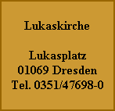
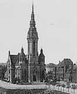
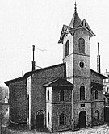
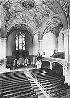
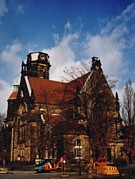
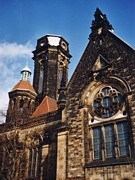

* * *

* * *

Nachdem die Einwohnerzahl der zuvor zur Kreuzkirche gehörenden Südvorstadt auf über 20.000
Menschen angestiegen war, entschloss man sich Ende des 19. Jahrhunderts zur Bildung einer eigenen Kirchgemeinde. Bereits ab Oktober 1885 fanden in der Turnhalle der 8. Bürger- und 19.
Bezirksschule an der Sedanstraße regelmäßige Gottesdienste statt. Am 13. Juli 1888 beschloss der Kirchenvorstand der Kreuzkirche die Bildung einer neuen Gemeinde, zu der neben der
Südvorstadt auch die damals noch selbständigen Dörfer Zschertnitz, Räcknitz und Kleinpestitz gehören sollten. Die am 1. Januar 1889 offiziell gegründete Lukasgemeinde erhielt ihren Namen
nach dem Evangelisten Lukas. Mit der Wahl dieses Namens waren die vier Evangelisten nun “vollzählig” vertreten, da es zu diesem Zeitpunkt in Dresden bereits eine Matthäus-, eine Johannes- und eine Markuskirche gab.

Um die Zeit bis zur Fertigstellung eines eigenen Gotteshauses zu überbrücken, errichtete die
Gemeinde 1889/90 eine Interimskirche an der Winckelmannstraße 4 _(Foto)_. Das Grundstück hatte ein Gemeindemitglied, der Bildhauer Viktor von Meyenburg,  kostenlos zur Verfügung
gestellt. Obwohl das kleine Kirchlein, finanziert von der jungen Gemeinde, nur 450 Plätze besaß, blieb es doch für viele Jahre religiöses Zentrum der Südvorstadt. Die Weihe dieser Kirche,
welche sogar einen kleinen Kirchturm besaß, erfolgte am 9. Februar 1890. Mit Fertigstellung der neuen Kirche wurde der Interimsbau im März 1903 entwidmet und wenig später wieder abgerissen.

Für den eigentlichen Kirchenbau hatte die Stadt Dresden ein Areal am oberen Ende der Werderstraße zur Verfügung
gestellt und einen deutschlandweiten Architektenwettbewerb ausgeschrieben. Um den monumentalen Charakter des Gebäudes als “Krone der Südvorstadt” zu unterstreichen, wurde der Baugrund zu einem mehrere Meter hohen Hügel
aufgeschüttet und mit einem großen Treppenaufgang versehen. Am 6. Juli 1899 erfolgte die feierliche Grundsteinlegung.
Die neue Kirche wurde nach Plänen des Leipziger Architekten Georg Weidenbach in neogotischen und Neorenaissance- Formen erbaut und erhielt einen 83 Meter hohen Turm, flankiert von zwei kleinen Seitentürmchen.

Im Frühjahr 1903 war die Lukaskirche fertiggestellt und konnte am 29. März geweiht werden.
Der Innenraum mit seinen 1.288 Sitzplätzen besaß bis 1945 eine prächtige Ausmalung im Jugendstil, die von Otto Gußmann geschaffen wurde _(Foto)_. Die vier Plastiken an den Pfeilern
stammen von Walter Sintensis und stellen Figuren aus dem Lukasevangelium dar. Außerdem erhielt die Kirche einen prächtigen Kalksteinaltar sowie eine Orgel der Dresdner Firma Jehmlich.
Die vier Bronzeglocken der Gießerei Bierling wurden 1917 eingeschmolzen und 1921 durch vier noch heute vorhandene Stahlglocken ersetzt.

Zeitgleich mit der Lukaskirche entstand das Pfarrhaus an der Lukasstraße. Zwischen 1908 und 1933 wirkte Pfarrer Johannes Keßler an der Kirche, welcher zuvor Privatlehrer und Hofprediger
der deutschen Kaiserfamilie gewesen war. Auch der spätere Reichspräsident Gustav Stresemann gehörte zeitweise der Lukaskirchgemeinde an.

Bis zur Zerstörung 1945 blieb die Lukaskirche
religiöses Zentrum der östlichen Südvorstadt, während der Westteil mit dem Schweizer Viertel ab 1912 zur [Zionskirche](../../../../zentrum/sudvorstadt/strassen_sudvorstadt/zionskirche/) an der Nürnberger
Straße gehörte. 1935 errichtete die Gemeinde in unmittelbarer Nachbarschaft des Pfarrhauses ein Gemeindehaus für die kirchliche Arbeit. Pfarrhaus und Kirche wurden beim Luftangriff 1945
schwer beschädigt. Die Kirche selbst trafen mehrere Bomben, die u. a. die Turmspitze, Teile der Dachkonstruktion und sämtliche Glasfenster zerstörten. Erhalten blieb jedoch ein Großteil der
Innenausstattung, die Kanzel und die Orgel. Nach 1945 kamen einige Gemälde des Malers Curt Querner (heute in der ehemaligen Taufkapelle) und Werke des Künstlers Matthias Kleemann
hinzu. Die neuen Glasfenster stammen aus der Werkstatt des Kunstglasers Oskar Fritz Beier.

Trotz schwieriger Voraussetzungen gelang es, die Lukaskirche bis 1948 wieder für die kirchliche Arbeit nutzbar zu machen und am 20. Juni erneut zu weihen. Bauliche Schäden führten jedoch
1954 zu einer vorübergehenden Sperrung, welche erst nach erfolgter Rekonstruktion des Innenraumes 1972 wieder aufgehoben werden konnte. Leider fielen den Umbauarbeiten die
meisten Verzierungen im Kirchensaal zum Opfer. Auch die vorhandene Ausmalung mit ihren Engelsdarstellungen, Ranken und filigranen Ornamenten verschwand unter Wand- und
Deckenverkleidungen. Um Räume für die Gemeindearbeit zu gewinnen, wurden die beiden Seitenschiffe abgetrennt und vermauert. 1964 entstand ein Notdach über dem Turmstumpf und
dem zerstörten Seitentürmchen. Seit 2002 setzt sich ein Förderverein für den Wiederaufbau des Turmes in ursprünglicher Form ein.

Neben Gottesdiensten finden in der Lukaskirche auch regelmäßig Konzerte statt. Da die Kirche eine einzigartige Akustik
besitzt, entschloss man sich schon 1958 für die Einrichtung eines Tonstudios. Unter Federführung des VEB Deutsche
Schallplatte entstanden hier zahlreiche Plattenaufnahmen mit bekannten Orchestern und Musikern, vor allem aus dem
Bereich der klassischen Musik. Auch heute nutzen gelegentlich Musikproduzenten die Kirche für Tonaufnahmen. Außerdem finden regelmäßig Konzerte statt.

Gemeindehaus:

Das Gemeindehaus der Lukaskirche wurde 1935 auf einem Grundstück an der Radetzkystraße 2 (heute Einsteinstraße)
errichtet. Mit dem Bau sollten nicht nur zusätzliche Räume für die kirchliche Arbeit gewonnen, sondern auch die Einrichtung eines Kindergartens ermöglicht werden. Dieser war bereits 1929 im
Pfarrhaus am Lukasplatz als einer der ersten evangelischen Kindergärten der Stadt  gegründet worden und befand sich bis zur Schließung 1941 im Sockelgeschoss des
Neubaus. Die Räume in der oberen Etage nutzte die Gemeinde zu Wohnzwecken. Das nach 1945 wieder aufgebaute Gebäude diente in der Nachkriegszeit zeitweise als Sitz des Landeskirchenamtes. Hier fanden viele Jahre auch die
Gottesdienste der Gemeinde statt.

* * *

 \[ [Home](../../../../index.html)\] \[ [Nord](../../../../nord/)\] \[ [Nordwest](../../../../nordwest/)\] \[ [Neustadt](../../../../neustadt/)\] \[ [Nordost](../../../../nordost/)\] \[ [West](../../../../west/)\] \[ [Zentrum](../../../../zentrum/)\] \[ [Südwest](../../../../sudwest/)\] \[ [Süd](../../../../sud/)\] \[ [Südost](../../../../sudost/)\] \[ [Ost](../../../../ost/)\] \[ [Register](../../../../Register/register.html)\] \[ [Kontakt](../../../../Kontakt/kontakt.html)\] \[ [Impressum](../../../../impressum/)\]
