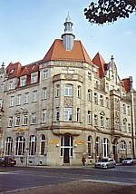
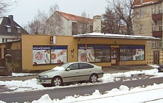
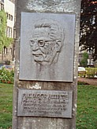

* * *

* * *

Der Münchner Platz entstand 1899 im Zuge des weiteren Ausbaus der Südvorstadt und wurde wenig später mit mehrgeschossigen Wohn- und Geschäftshäusern bebaut. Zuvor hatte hier einige Jahre der private Zirkus Herzog sein Quartier. Ursprünglich sollte auf diesem Areal eine Kirche errichtet werden. Nachdem man sich jedoch für einen anderen Standort an der Ecke Nürnberger / Hohe Straße entschieden hatte, entstand an dieser Stelle 1902/07 der Bau des Dresdner [Landgerichts](../../../../zentrum/sudvorstadt/strassen_sudvorstadt/munchner_platz/landgericht/). In den umliegenden Gebäuden befanden sich verschiedene Geschäfte und kleinere Gaststätten. Am bekanntesten war die sowohl von Juristen als auch Angeklagten und Zeugen besuchte Gaststätte "Am Münchner Platz” (Nr. 1), welche im Volksmund “Meineidschänke” genannt wurde. Heute nutzt ein kleines Café die Räume _(Foto)_. Im Eckhaus Münchner Platz 16 wohnte zeitweise der Fußballer Helmut Schön, der mit dem Dresdner SC 1944 letzter deutscher
Fußballmeister wurde und später das Amt des Bundestrainers übernahm.

Beim Bombenangriff auf Dresden wurden auch einige Gebäude am Münchner Platz getroffen. Zur Enttrümmerung der Innenstadt und des westlichen Teils der Südvorstadt legte man eine Feldbahn an, welche ab Januar 1951 über die Kaitzer und Münchner Straße zum Münchner Platz und von dort direkt in die Lehmgrube an der Nöthnitzer Straße führte. Oberhalb des Münchner Platzes entstand dafür ein großer Betriebs- und Rangierbahnhof mit Lokschuppen, Kohlendepot und Wasserkran. Gegenüber davon stand ab 1947 ein schlichter Flachbau mit Konsum-Verkaufstelle _(Foto)_. Während Lokschuppen und Werkstätten bereits kurz nach Einstellung der Trümmerbahn im Oktober 1951 verschwanden, blieb der Verkaufspavillon noch bis zum Abriss 2013 als Zeugnis der unmittelbaren Nachkriegsgeschichte erhalten. An gleicher Stelle befindet sich heute in einem Neubau wieder ein Konsum-Markt.

1974 wurde der Münchner Platz nach dem am 11. September 1973 durch einen Militärputsch gestürzten und ermordeten chilenischen Präsidenten in Salvador-Allende-Platz umbenannt. Im gleichen Jahr entstand das bis heute in der Nähe der Straßenbahnhaltestelle in Richtung Innenstadt erhaltene Denkmal mit Porträtrelief Allendes. 1991 beschloss der Stadtrat die Rückbenennung in Münchner Platz.

**_Foto:_** _Gedenkstein für Salvador Allende. Die unter dem Porträtrelief befindliche Tafel trägt die Inschrift: SALVADOR ALLENDE vom Volk gewählter Präsident Chiles ermordet von einer reaktionären Militärjunta am 11. September 1973_

* * *

 \[ [Home](../../../../index.html)\] \[ [Nord](../../../../nord/)\] \[ [Nordwest](../../../../nordwest/)\] \[ [Neustadt](../../../../neustadt/)\] \[ [Nordost](../../../../nordost/)\] \[ [West](../../../../west/)\] \[ [Zentrum](../../../../zentrum/)\] \[ [Südwest](../../../../sudwest/)\] \[ [Süd](../../../../sud/)\] \[ [Südost](../../../../sudost/)\] \[ [Ost](../../../../ost/)\] \[ [Register](../../../../Register/register.html)\] \[ [Kontakt](../../../../Kontakt/kontakt.html)\] \[ [Impressum](../../../../impressum/)\]
