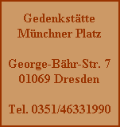
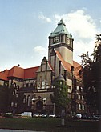
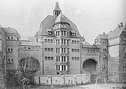
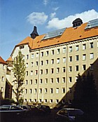
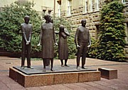

* * *

* * *

Das burgartige Gebäude wurde zwischen 1902 und 1907 als Sitz des Königlichen Landgerichts
erbaut. Die Entwürfe für den aus mehreren Einzelbauten bestehenden Komplex stammen von Oskar Kramer. Architektonisch orientierte sich der Neubau am bislang dominierenden Historismus
der Neorenaissance in Verbindung mit der aufkommenden Reformarchitektur. Der plastische Schmuck an der Fassade wurde von Ernst Hottenroth geschaffen und zeigt verschiedene Motive
zum Justizwesen. Relieftafeln  mit den Themen “Verbrechen”, “Geständnis”, “Urteil” und “Sühne” an der Außenfront des Schwurgerichtssaals weisen auf die Nutzung des Hauses hin. Die offizielle
Einweihung des Gerichtsgebäudes erfolgte am 3. September 1907.

In dem von einem Uhrturm bekrönten Hauptgebäude _(Foto oben)_ befanden sich neben mehreren Verhandlungssälen auch
Verwaltungsräume und eine kleine Anstaltskapelle. Diese diente der seelsorgerischen Betreuung der in dem angrenzenden Gefängnistrakt _(historisches Foto unten)_
untergebrachten Häftlinge.  Im Innenhof befand sich die für die Vollstreckung von Todesurteilen genutzte Guillotine, welche zunächst nur bei schweren Kapitalverbrechen zum Einsatz kam. 1936 wurde
dieser Richtplatz zu einer von zehn zentralen Hinrichtungsstätten des Deutschen Reiches erklärt.

Während der NS-Zeit wurden in der Haftanstalt an der George-Bähr-Straße
zahlreiche Gegner des Naziregimes aus dem In- und Ausland festgehalten. Hier fanden auch Prozesse des berüchtigten Volksgerichtshofs und der “Sondergerichte”
sowie des Oberlandesgerichts Posen statt, die sich gegen deutsche Widerstandskämpfer, Deserteure der Wehrmacht, aber auch gegen ausländische
Nazigegner aus den besetzten Ostgebieten und der Tschechoslowakei richteten. Zur Vollstreckung der verhängten Todesurteile nutzte man den im Innenhof befindlichen
Richtplatz mit der Guillotine. Insgesamt sind zwischen 1933 und 1945 1.328 Hinrichtungen verbürgt, unter ihnen fast zwei Drittel aus dem “Protektorat Böhmen
und Mähren”. Bekannte Opfer der Nazijustiz, die am Münchner Platz zum Tode verurteilt wurden, waren Kurt Schlosser,
Otto Galle, Herbert Blochwitz und Georg Schumann, der tschechische Major Josef Matohlina und die Funktionärin des
tschechischen Nationalen Frauenrates Anna Pollertová. Während des Luftangriffs 1945 trafen Bomben auch Teile des Landgerichts und ermöglichten einigen Gefangenen die Flucht.

Auch nach dem Zweiten Weltkrieg diente das Landgericht zunächst weiterhin seinem Zweck. Im
Mittelpunkt standen zunächst Prozesse gegen führende Nationalsozialisten bzw. Personen, die an Kriegs- und Tötungsverbrechen beteiligt waren. So fanden hier 1946/47 die Verhandlungen gegen
Ärzte der Euthansieanstalt Pirna-Sonnenstein und gegen die an Unrechtsurteilen beteiligten früheren Richter des Oberlandesgerichts Dresden statt.  Da die Räumlichkeiten am Münchner
Platz oft nicht ausreichten, verlegte man größere Prozesse in Ausweichquartiere in der Nordhalle bzw. in der Tonhalle an der Glacisstraße (heute “Kleines Haus”). Später nutzte die sowjetische
Geheimpolizei das Gebäude bis 1951 als Durchgangs- und Untersuchungsgefängnis. Dessen Insassen wurden, teilweise ohne Prozess, zu langjährigen Haftstrafen verurteilt, in geheime
Speziallager verschleppt bzw. im Hof des Gerichtsgebäudes erschossen.

Nach Gründung der DDR häuften sich Prozesse gegen politisch missliebige Gegner. So wurden zwischen 1945 und 1949
mindestens 11 Todesurteile, nach 1950 nochmals 66 vollstreckt. Opfer waren neben Schwerkriminellen auch sogenannte
“Rädelsführer” des Aufstandes vom 17. Juni 1953 und andere Oppositionelle, die sich gegen die politische Entwicklung in
der DDR gestellt hatten. Unter Angabe gefälschter Todesursachen wurden diese Personen anonym auf dem Tolkewitzer
Johannesfriedhof beigesetzt, wo seit 1998 eine Urnengemeinschaftsanlage mit 23 Einzelgräbern an sie erinnert. Ab 1952 diente der Gebäudekomplex zugleich als zentrale Hinrichtungsstätte der DDR.

1956 verlegte das Bezirksgericht Dresden seinen Sitz zur Lothringer Straße. Die nun nicht
mehr benötigten Gebäude wurden daraufhin bis 1964 für die [Technische Universität](../../../../../zentrum/sudvorstadt/technische_universitat/)
umgebaut. Aus ehemaligen Gerichtssälen und Büros entstanden Hörsäle und Seminarräume. Der frühere Zellentrakt des Gefängnisses wurde wieder aufgebaut und zu
Arbeits- und Büroräumen erweitert. In Erinnerung an den hier 1945 hingerichteten Widerstandskämpfer Georg Schumann erhielt das Gebäude den Namen Georg-
Schumann-Bau. Im ehemaligen Gefängnishof richtete man 1959 eine Gedenkstätte für die Opfer des Faschismus ein. Eine Steinplatte markiert den früheren Standort des Richtblocks. Daneben befindet sich eine
Bronzeplastik von Arndt Wittig _(Foto)_. Sechs Zellen wurden in unverändertem Zustand belassen. Weitere Räume
beherbergen eine 2012 neu gestaltete Ausstellung zur Geschichte des Justizkomplexes und der politischen Strafjustiz in der
NS-Zeit und nach 1945. Seit 1995 erinnert eine von Wieland Förster geschaffene Plastik “Namenlos - Ohne Gesicht” an
die nach 1945 zu Unrecht Verfolgten. Für dieses Werk wurde ihm 1996 der Kunstpreis der Stadt Dresden verliehen.

* * *

 \[ [Home](../../../../../index.html)\] \[ [Nord](../../../../../nord/)\] \[ [Nordwest](../../../../../nordwest/)\] \[ [Neustadt](../../../../../neustadt/)\]
 \[ [Nordost](../../../../../nordost/)\] \[ [West](../../../../../west/)\] \[ [Zentrum](../../../../../zentrum/)\] \[ [Südwest](../../../../../sudwest/)\]
 \[ [Süd](../../../../../sud/)\] \[ [Südost](../../../../../sudost/)\] \[ [Ost](../../../../../ost/)\] \[ [Register](../../../../../Register/register.html)\] \[ [Kontakt](../../../../../Kontakt/kontakt.html)\] \[ [Impressum](../../../../../impressum/)\]
