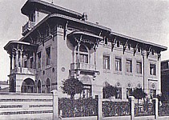
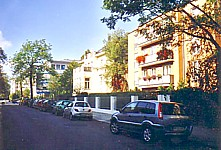

* * *

* * *

Die Schweizer Straße im westlichen Teil der Südvorstadt wurde 1856 angelegt und nach der hier gelegenen Gastwirtschaft “Zum Schweizerhäuschen” benannt. Wenig später entstanden in deren Nachbarschaft die
ersten Villen. Gasthaus und Straße waren später Namensgeber für das gesamte Wohngebiet, welches noch heute oft als “Schweizer Viertel” bezeichnet wird. Nach 1945 erfolgte der Abbruch der ausgebrannten Ruinen zugunsten
moderner Wohnblocks für die Arbeiter-Wohnungsbaugenossenschaft Süd (heute WGS “Glückauf Süd”). Nach 1990 entstanden zudem einige neue Wohn- und Bürogebäude.

**_Fotos:_** _Villa Schweizer Straße 9 (vor 1945) - Blick in die Schweizer Straße im Sommer 2006_

Einzelne Gebäude:

Schweizerhäuschen: Die kleine Gastwirtschaft (Schweizer Straße 1) entstand 1856 auf dem Gelände des “Meinertschen
Milchgartens” und wurde zunächst “Schweizerei”, später “Schweizerhäuschen” genannt. Das Lokal befand sich im Besitz
des Dresdner Gastwirts Heydel und gehörte zu den beliebten Einkehrstätten vor den Toren der Stadt. In der
angeschlossenen “Schweizerhaus-Diele” fanden bis zum Ersten Weltkrieg regelmäßig Tanzveranstaltungen statt. 1992/93
wurde auf dem Areal des 1945 zerstörten “Schweizerhäuschens” ein Büro- und Geschäftshaus für die Deutsche Bahn errichtet.

Nr. 9:
Die Villa Schweizer Straße 9 wurde 1874 erbaut und gehörte bis zu ihrer Zerstörung zu den ungewöhnlichsten
Villenbauten der Südvorstadt. Das Gebäude war im toskanischen Landhausstil gestaltet und besaß mehrere Balkons und
Veranden. Darüber lag ein flaches weitvorkragendes Dach mit abgerundeten Ecken. Der Entwurf für dieses Haus stammte von Emil Lehnert _(Foto oben links)_.

Nr. 12:
In diesem Haus wohnte Ende des 19. Jahrhunderts die Familie des evangelischen Pfarrers Julius Oster. Sohn
Hans (1887-1945) begann nach seinem Abitur eine militärische Laufbahn und gehörte während des Zweiten Weltkrieges
der Auslandsabwehr der Wehrmacht an. Im Zusammenhang mit dem Attentat auf Hitler am 20. Juli 1944 wurde Oster
verhaftet und kurz vor Kriegsende hingerichtet. An ihn erinnert die Hans-Oster-Straße in der Albertstadt und eine Gedenkstätte auf dem Nordfriedhof.

Satyrgruppe:
Die Figurengruppe, welche eine Szene aus der griechischen Mythologie darstellt und auch als „musizierender Kentaur mit Nymphe“ bezeichnet wird, befindet sich an der Straßenecke Schweizer / Budapester Straße.
Sie wurde 1971 vom Bildhauer Karl Schönherr geschaffen.

* * *

 \[ [Home](../../../../index.html)\] \[ [Nord](../../../../nord/)\] \[ [Nordwest](../../../../nordwest/)\] \[ [Neustadt](../../../../neustadt/)\] \[ [Nordost](../../../../nordost/)\] \[ [West](../../../../west/)\] \[ [Zentrum](../../../../zentrum/)\] \[ [Südwest](../../../../sudwest/)\] \[ [Süd](../../../../sud/)\] \[ [Südost](../../../../sudost/)\] \[ [Ost](../../../../ost/)\] \[ [Register](../../../../Register/register.html)\] \[ [Kontakt](../../../../Kontakt/kontakt.html)\] \[ [Impressum](../../../../impressum/)\]
