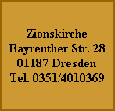
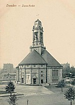
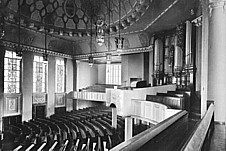
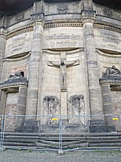
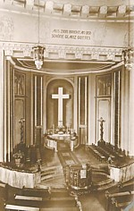
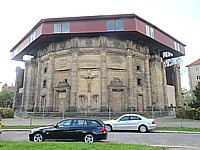
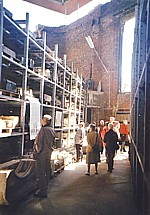
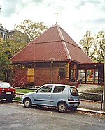

* * *

* * *

* * *

* * *

* * *

* * *

* * *

Im Zuge des weiteren Ausbaus der Südvorstadt nach 1900 plante man hier auch die Errichtung einer neuen Kirche, nachdem sich bereits 1888 die [Lukaskirchgemeinde](../../../../zentrum/sudvorstadt/strassen_sudvorstadt/lukaskirche/) aus der Parochie der Kreuzkirche herausgelöst hatte. Als Standorte waren zunächst der Münchner Platz bzw. das “Nürnberger Ei” vorgesehen. Ein kurioses Testament des Maschinenbaufabrikanten Johannes Hampel sorgte letztlich für die Entscheidung. Der streng gläubige Katholik hinterließ 1896 ein großes Vermögen, welches jedoch an die Bedingung des Baus einer evangelischen (!) Kirche in der Südvorstadt gebunden war. Außerdem legte Hampel fest, dass sowohl er als auch seine wenige Jahre zuvor verstorbene Ehefrau unter dem Dach dieses Gotteshauses beigesetzt werden sollten.

Um die gesetzte Fünf-Jahres-Frist zur Realisierung nicht ungenutzt verstreichen zu lassen, erfolgte bereits am 5. November 1901 die Grundsteinlegung an der Nürnberger Straße / Hohe Straße. Mit den eigentlichen Arbeiten wurde jedoch erst am 27. Juli 1908 begonnen. Für Probleme sorgte Hampels Bestimmung der Grablegung unter dem Kirchendach, da diese zu diesem Zeitpunkt ausschließlich für Mitglieder des Königshauses zulässig war. Die juristischen Untersuchungen und die noch nicht vorhandenen Planungen sorgten zunächst für eine mehrjährige Unterbrechung, bevor das Dresdner Architektenbüro Schilling & Gräbner im Ergebnis eines Wettbewerbes ein tragfähiges Konzept vorlegte. Dieses sah einen Zentralbau mit 1.050 Sitzplätzen vor, welche sich in Form eines Amphitheaters um die in der Mitte befindliche Kanzel gruppierten _(Foto)_. Der Pfarrer predigte somit inmitten seiner Gemeinde. Wegen dieser für den Kirchenbau revolutionären Lösung und der ungewöhnlichen künstlerischen Gestaltung des Innenraumes erregte der Bau großes Aufsehen, aber auch heftige Kritik der “Traditionalisten”. Für das Ehepaar Hampel fand sich ein Platz unter den Arkaden an der Außenseite, jedoch nicht im Inneren der Kirche. An beide erinnert eine Gedenktafel an der Grundstücksmauer.

Nach vierjähriger Bauzeit konnte die Zionskirche am 29. September 1912 geweiht werden. Ihr gehörten in den Anfangsjahren ca. 5.600 Mitglieder an, die zuvor die Lukaskirche, die Plauener Auferstehungskirche bzw. die Annenkirche besucht hatten. An der Fassade zum Vorplatz fand eine bis heute erhaltene Kreuzigungsgruppe Selmar Werners Aufstellung _(Foto)_. Weitere plastische Arbeiten stammten von Karl Groß. Bernhard Müller schuf für das Gotteshaus die Glasfenster und einige Gemälde. Außerdem erhielt die Zionskirche als erste in Sachsen eine Orgel mit rein elektrischer Traktur und Registeranlage, gebaut von der Dresdner Firma Jehmlich. Um die Wirkung des Gebäudes mit seinem 26 Meter hohen Turm noch zu vergrößern, entwarf Stadtbaurat Hans Poelzig 1916 zwei monumentale Schulbauten, die die Zionskirche halbkreisförmig umgeben und dem Vorplatz eine Fassung geben sollten. Kriegs- und inflationsbedingt wurden diese jedoch nicht gebaut. 1927 wurde an der [Hohen Straße](../../../../zentrum/sudvorstadt/strassen_sudvorstadt/hohe_strasse/) (Nr. 49) das Gemeindehaus mit Pfarramt, Gemeindesaal und einigen Wohnungen gebaut. 1945 fiel dieses dem Luftangriff zum Opfer.

In den Dreißiger Jahren wirkten die regimekritischen Pfarrer Herbert Böhme und Ringulf Siegmund an der Zionskirche. Beide gehörten dem sächsischen “Pfarrernotbund” an, der sich gegen die Einflussnahme der Nationalsozialisten in der evangelischen Kirche wehrte und am 7. Dezember 1933 seine erste Tagung in der Zionskirche abhielt. Siegmund hielt 1942 entgegen innerkirchlichen Regelungen auch die Trauerrede für die verstorbene Elisabeth Pick, einer zur Gemeinde gehörenden Jüdin und wurde dafür mit einer Geldstrafe belegt. Herbert Böhme stellte sich 1945 als Superintendent von Meißen gegen den Ausbau der Stadt zur Festung, wurde dafür zum Tode verurteilt, konnte jedoch in den Wirren der letzten Kriegstage aus dem Gefängnis entkommen. Die Zionskirche fiel am 13. Februar 1945 dem Luftangriff zum Opfer und brannte vollständig aus. Eine aus den Trümmern geborgene Kanzel befindet sich heute als Lesepult in der Kreuzkirche.

Da ein Wiederaufbau des zerstörten Gotteshauses die finanziellen Möglichkeiten der stark geschrumpften Gemeinde überfordert hätte, überließ man die Ruine der Stadt und nutzte lediglich einige Nebenräume sowie eine 1949 von der schwedischen Kirche geschenkte Baracke auf dem Grundstück als Treffpunkt. Hier traf sich auch die evangelische Studentengemeinde. 1982 konnte ein moderner Neubau an der Bayreuther Straße bezogen werden.

Die alte Zionskirche dient seit 1966 als Lapidarium zur Aufbewahrung von Plastiken und Fragmenten zerstörter oder abgetragener Gebäude. Zuvor waren diese bei der Enttrümmerung geborgenen Teile im Schloss, im Palais im Großen Garten bzw. in den Kasematten der Brühlschen Terrasse eingelagert worden. 1985 entschied man sich für die Einrichtung eines Zentrallagers in der Kirchenruine. Dafür wurden im Inneren Hochregale eingebaut, um die insgesamt ca. 7000 Fragmente fachgerecht einlagern zu können. Neben den Überresten zerstörter Bauten befinden sich hier auch erhaltenswerte Objekte aus Abrisshäusern bzw. von nach 1990 entfernten Denkmalen der DDR-Zeit. Zum Schutz der historisch wertvollen Bauteile erhielt die Kirchenruine 1994-96 ein neues Wetterschutzdach _(Foto)_.

Neue Zionskirche:

Im Tausch gegen das Areal des zerstörten Gotteshauses erhielt die Gemeinde 1979 von der Stadt Dresden das Grundstück Bayreuther Straße 28 übertragen und errichtete hier 1981/82 einen modernen Neubau. Bereits 1965 hatte der Lutherische Weltbund unter Vermittlung der schwedischen Kirche dem damaligen Bischof  Dr. Gottfried Noth aus Anlass seines 60. Geburtstages den Bau eines Gemeindezentrums versprochen. Als Standort war ursprünglich ein Grundstück in Niedersedlitz vorgesehen. Den Bauantrag sowie weitere Folgeanträge an verschiedenen Orten in Sachsen lehnten jedoch staatliche Stellen immer wieder ab. Erst im Zuge einer liberaleren Politik gegenüber den Kirchen in der DDR stimmte die Stadt 1979 einem Kirchenneubau zu und erteilte die Baugenehmigung.

Die Grundsteinlegung zur neuen Zionskirche _(Foto)_ erfolgte am 5. Juni 1981. Mit materieller und technischer Unterstützung der schwedischen Kirche und des Bauingenieurs Erik Granbom konnten die Arbeiten innerhalb von 18 Monaten abgeschlossen werden. Zahlreiche Gemeindemitglieder und Studenten der TU waren am Bau beteiligt, der am 31. Oktober 1982 geweiht werden konnte.

Dievom Stockholmer Architekten Rolf Bergh entworfene Kirche besteht aus zwei miteinander verbundenen Holzbauten, die als Kirchensaal und Gemeindezentrum dienen. Zur Ausstattung gehören eine kleine Sauer-Orgel, vier aus der alten Zionskirche geborgene Sandsteinreliefs und ein um 1420 geschaffenes Kruzifix. Im Untergeschoss gibt es einen weiteren Gemeindesaal sowie ein von der Gemeinde bewirtschaftetes Obdachlosen-Café. Hinter der Kirche erinnert ein schlichtes Holzkreuz an den schwedischen Bauleiter Erik Granbom.

Der Zionskirchgemeinde gehören heute ca. 1200 Mitglieder an. Ein Schwesterkirchverhältnis besteht mit der [Auferstehungskirche](../../../../sud/plauen/auferstehungskirche/) in Plauen und der [Kirchgemeinde Coschütz-Gittersee](../../../../sud/coschutz/kirchgemeinde_coschutz/).

* * *

 \[ [Home](../../../../index.html)\] \[ [Nord](../../../../nord/)\] \[ [Nordwest](../../../../nordwest/)\] \[ [Neustadt](../../../../neustadt/)\] \[ [Nordost](../../../../nordost/)\] \[ [West](../../../../west/)\] \[ [Zentrum](../../../../zentrum/)\] \[ [Südwest](../../../../sudwest/)\] \[ [Süd](../../../../sud/)\] \[ [Südost](../../../../sudost/)\] \[ [Ost](../../../../ost/)\] \[ [Register](../../../../Register/register.html)\] \[ [Kontakt](../../../../Kontakt/kontakt.html)\] \[ [Impressum](../../../../impressum/)\]
