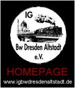
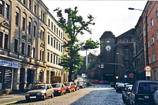
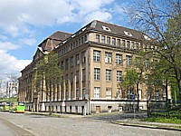
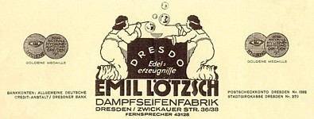
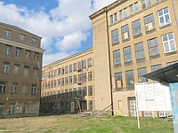
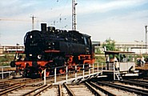
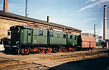
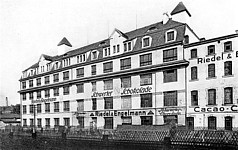
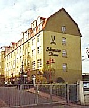

* * *

* * *

* * *

Die Zwickauer Straße wurde auf Plauener Flur bereits Mitte des 19. Jahrhunderts angelegt und ab 1856 Falkenstraße genannt, da sich hier einst eine Falknerei des sächsischen Hofes befand. Um die parallel verlaufende stark frequentierte Chemnitzer Straße zu entlasten, entschloss man sich 1873 zum Ausbau dieser Straße in Richtung Stadtzentrum. Gleichzeitig nahm sie die teilweise vom Mühlenbesitzer Bienert finanzierte Hauptschleuse für die in Plauen anfallenden Abwässer auf. Nach Abtragung des ehemaligen Pfarrgutes in Altplauen begann 1881 die Bebauung der Straße mit Wohnhäusern.

Da das Areal zwischen Chemnitzer Straße und Bahnlinie 1878 als Gewerbegebiet ausgewiesen worden war, siedelten sich an der Falkenstraße zahlreiche Industriebetriebe an. Bekannte Unternehmen waren u.a. die Firmen Kynast (Süßwaren), Riedel & Engelmann
(“Schwerter”-Schokolade), Koch & Sterzel (Röntgentechnik) Richard Greiling (Zigaretten), Seelig & Hille (“Teekanne”) sowie die [Chemische Fabrik Karl August Lingners](../../../../zentrum/sudvorstadt/strassen_sudvorstadt/zwickauer_strasse/lingner-werke/). Weitere Flächen nutzte die Sächsische Staatsbahn für ihr
Bahnbetriebswerk Dresden-Altstadt. Um den Warentransport zu erleichtern, wurde die Straße ab 1902 ausgebaut und verbreitert. In diesem Zusammenhang trug man auch die Erhebung des Hahnebergrückens ab. Mit der
Eingemeindung Plauens wurde die Falkenstraße am 1. Januar 1904 in Zwickauer Straße umbenannt.

Obwohl vor allem im unteren Teil erhebliche Zerstörungen durch die Bombenangriffe von 1945 zu verzeichnen waren,
blieb das Areal an der Zwickauer Straße auch in der Nachkriegszeit wichtiges Industrie- und Gewerbegebiet. Erwähnenswert sind u. a. die [Bau Union Süd](../../../../zentrum/sudvorstadt/strassen_sudvorstadt/zwickauer_strasse/bau_union_sud/)(später VEB Autobahnbaukombinat) im Gebäude der ehemaligen
Firma “Teekanne”, die “Tabak-Uni” (bis 1945 “Universelle”) als Hersteller von Zigarettenmaschinen sowie weitere Betriebe des Maschinenbaus und der Nahrungs- und Genußmittelindustrie. Nach 1990 stellten die meisten
dieser Unternehmen die Produktion ein. Die Gebäude dienen heute als Domizil klein- und mittelständischer Unternehmen, als Bürohäuser und Einkaufsmärkte. Das in der Nähe der Nossener Brücke gelegene Bahnbetriebswerk ist
seit einigen Jahren beim “Dampflokfest” alljährlich Anziehungspunkt für Eisenbahnfreunde. Unweit des Geländes befindet sich im Wohnhaus Zwickauer Straße 135 die originelle Kneipe “Die Schachtel”, welche ebenfalls mit
Eisenbahnutensilien ausgestaltet ist.

Unternehmen auf der Zwickauer Straße vor 1945 (Auswahl)

J. G. Kynast (Süßwaren, Russisch Brot)

Richard Greiling (Zigaretten und Tabakwaren)

Riedel & Engelmann (“Schwerter”-Schokolade)

Seelig & Hille (“Teekanne”- Teebeutel, Spezialmaschinen)

Koch & Sterzel (Röntgengeräte)

Odol-Werke Lingner (Mundwasser, Pharmazieprodukte)

Universelle (Zigaretten - und Verpackungsmaschinen)

Brotfabrik Schlüter (Backwaren)

Fa. Louis Hermann

Fa. Willi Hiller

Fa. Max Lösch

Fa. Würker (Strickautomaten)

Bahnbetriebswerk Dresden-Altstadt

Cigarettenfabrik “Helios”

Teekanne: Das Gebäude auf der Zwickauer Straße 27 beherbergte bis 1945 den Stammsitz der Firma [Seelig & Hille](../../../../zentrum/sudvorstadt/strassen_sudvorstadt/zwickauer_strasse/teekanne/), die hier unter dem Markennamen “Teekanne” Teebeutel und Verpackungsmaschinen herstellte. Der nach dem Zweiten Weltkrieg enteignete Betrieb wurde 1948 nach Radebeul verlegt. Das als einer der wenigen Industriebauten der Zwickauer Straße weitgehend unbeschädigte Gebäude war zu DDR-Zeiten Sitz der [Bau Union Süd GmbH](../../../../zentrum/sudvorstadt/strassen_sudvorstadt/zwickauer_strasse/bau_union_sud/) (später zeitweise VEB Autobahnbaukombinat - Betrieb Brückenbau). Nach dem Konkurs des zuletzt zum österreichischen Maculan-Konzerns gehörenden Betriebes nutzen heute verschiedene kleinere Firmen das Haus.

Seifenfabrik Emil Lötzsch: Das Unternehmen entstand Ende des 19. Jahrhunderts und ist 1898 als Dampfseifenseifenfabrik Emil Lötzsch im Handelsregister verzeichnet. Der Firmensitz befand sich auf der Zwickauer Straße 36/38. Hergestellt wurden verschiedene Reinigungsmittel, die man unter dem Markennamen "Dresdo" verkaufte. Auf der I. Internationalen Hygieneausstellung 1911 erhielt die Firma für eines ihrer Produkte eine Goldmedaille. Auch nach 1945 blieb die Firma als Privatbetrieb bestehen. Alleiniger Gesellschafter auf Lebenszeit war ab 1946 Friedrich Heinrich August Schmidt. Ab 1947 lautete die offizielle Firmierung "Emil Lötzsch - Gesellschaft mit beschränkter Haftung - DRESDO-Seifenwerk". Hergestellt wurden neben Seife und Waschmittel, u.a. das Vollwaschmittel "dress". Wie viele andere Unternehmen wurde die Firma 1972 verstaatlicht und stellte später ihre Produktion ein.

Koch & Sterzel: Die Firma auf der Zwickauer Straße 42 wurde am 1. Oktober 1904 vom Techniker Franz Joseph Koch
und dem Chemiker Karl August Sterzel gegründet und entwickelte sich bis zum Ersten Weltkrieg zu einem der führenden
Hersteller elektrotechnischer Anlagen in Deutschland. In enger Zusammenarbeit mit der damaligen Technischen Hochschule
spezialisierte sich das Unternehmen auf Prüf- und Hochspannungstechnik sowie auf die Herstellung von Röntgengeräten.
1920 erfolgte die Umwandlung zur Aktiengesellschaft. Da die Räumlichkeiten an der Zwickauer Straße nicht mehr
ausreichten, erwarb das Unternehmen zwei Jahre später das Gelände des früheren Kaditzer Flugplatzes und errichtete hier
moderne Produktionsstätten für die Transformatorenherstellung. Im Betriebsteil Zwickauer Straße wurden nun bis zur
völligen Zerstörung 1945 ausschließlich Röntgenapparate hergestellt. Aus dem Kaditzer Betriebteil ging 1948 das [Transformatoren- und Röntgenwerk](../../../../nordwest/ubigau/strassen_ubigau/koch___sterzel/) hervor.

Universelle: Die Firma wurde im 19. Jahrhunderts vom Ingenieur Otto Bergsträsser und dem Kaufmann Max Klinge als Spezialhersteller für Zigaretten- und Verpackungsmaschinen gegründet. 1880 erfolgte hier der Bau der ersten deutschen Zigaretten-Strangmaschine nach einem Patent Bergsträssers. Nachdem der ursprüngliche Firmensitz auf der Rosenstraße zu klein geworden war, verlegte man das Werk 1898 auf die Zwickauer Straße 48-54. Nach Vereinigung mit der 1897 gegründeten “United Cigarette Machine Compagnie” (1930) und der Dresdner Firma “Progreߔ (1935) firmierte das Unternehmen bis 1945 unter dem Namen “Universelle”. Hergestellt wurden Spezialmaschinen für die Tabakbe- und -verarbeitung, Mundstück-Zigarettenmaschinen, Rohtabak-Mischanlagen sowie Röst- und Schneidemaschinen. Nach Beseitigung von Kriegsschäden erfolgte die Umwandlung in einen volkseigenen Betrieb, der bis 1990 als VEB Tabak- und Industriemaschinenbau (“Tabak-Uni”) Maschinen für die Zigarettenindustrie produzierte. Später nutzten verschiedene Gewerbebetriebe den ausgedehnten Gebäudekomplex. Eine Sanierung für eine künftige Nutzung als Gründer- und Gewerbezentrum ist für 2017/18 geplant.

Zigarettenfabrik Greiling: Die mit ca. 4000 Angestellten zu den größten Dresdner Zigarettenherstellern gehörende Firma
Richard Greiling erwarb nach dem Ersten Weltkrieg ein Areal zwischen Zwickauer, Nossener und Eisenstuckstraße und
ließ sich hier 1926/27 ein modernes Büro- und Verwaltungsgebäude errichten. Der im Bauhausstil gestaltete Bau mit einem
zwölfstöckigen Turm entstand nach Plänen von M. Krautschick und nahm neben Produktions- und Lagerräumen auch eine
werkseigene Druckerei und die Kartonagenherstellung auf. 1934 wurde hier die erste Filterzigarette der Welt hergestellt.

Beim Luftangriff wurde das Gebäude zu 85 % zerstört, konnte jedoch bis 1947 notdürftig wiederhergestellt werden. Nach
Verstaatlichung kam der Betrieb als Zweigwerk zum VEB Vereinigte Zigarettenfabriken und diente noch bis 1990 als
Importlager. Trotz ihrer architektonischen Bedeutung und Einsprüchen der Denkmalpflege ließen die neuen Besitzer die Bauten 1998 abbrechen.

Bahnbetriebswerk Dresden-Altstadt:
Das Bahnbetriebswerk Dresden-Altstadt wurde 1872 als “Heizhausanlage” für die kurz zuvor verstaatlichte [Albertbahn](../../../../sud/plauen/plauenscher_grund/albertbahn/) angelegt. Auf dem
Gelände des Altstädter Güterbahnhofes entstanden ausgedehnte Abstellanlagen für Lokomotiven und Wagen, vier Lokschuppen mit Drehscheiben sowie Werkstätten für
kleinere Reparaturen. Seit 1896 gab es hier auch ein Gaswerk der Firma Pintsch zur Erzeugung des für die Innenbeleuchtung der Personenwaggons erforderlichen Ölgases.
Hinzu kamen Kohlelagerplätze und Beschickungs- und Verladeeinrichtungen.

Die Anlagen des später als Bahnbetriebswerk Dresden-Altstadt bezeichneten Betriebes wurden mehrfach an den Bedarf
angepasst. So erfolgten Erweiterungen der Lokomotivschuppen sowie 1926 der Bau einer Werkstatt mit Hebebühne. Bis
zu 120 Dampflokomotiven aller gängigen Baureihen waren zeitweise im Bw Dresden-Altstadt beheimatet. Am 17. April
1945 fielen große Teile des Bahnbetriebswerkes, darunter auch die Lokschuppen 2 und 3 den Bomben zum Opfer. Die
verbliebenen Gebäude und Gleisanlagen wurden repariert und noch bis 1967 als eigenständiger Betrieb genutzt.

Mit der Zusammenlegung aller Dresdner Bahnbetriebswerke und dem letzten
planmäßigen Dampflokeinsatz am 24. 9. 1977 verlor das Werk an Bedeutung. Stattdessen nutzte man die historischen Gebäude als Depot und Werkstatt für die
historischen Eisenbahnfahrzeuge des Dresdner Verkehrsmuseums. Heute hat hier das Eisenbahnmuseum sein Domizil. Regelmäßig findet auf dem Areal das Dampflokfest der IG Bahnbetriebswerk Dresden-Altstadt statt _(Fotos)_. 2006 entstand auf dem Gelände eine modernen Wartungs- und Reinigungshalle für Regionalzüge der Deutschen Bahn AG.

Firma J. G. Kynast: Die 1886 gegründete Firma wurde vor allem als Hersteller von Schokolade der Marken “Amles” und “Mein Ideal” bekannt. Zum Produktionsprogramm gehörten außerdem Fondant, Pfefferminzbonbons, Ostereier, Pralinen, Zuckerstreusel und andere Süßigkeiten. Eine besondere Spezialität war “Russisch Brot”. 1945 fielen die Betriebsgebäude auf der Zwickauer Straße 72/74 den Bomben zum Opfer. Trotzdem gelang es, die Produktion eingeschränkt wieder aufzunehmen. 1953 erfolgte die Verstaatlichung des Unternehmens und seine Eingliederung  in den VEB Dresdner Süßwarenfabriken “Elbflorenz”.

Milchkuranstalt Sanitas (Nr. 74/76): Auf diesem Grundstück hatte bis ca. 1935 die Milchkuranstalt "Sanitas" ihren Sitz. Das Unternehmen war 1883 von Max Winkler gegründet worden und besaß mehrere Filialen in der Stadt. Zum Areal in der Nähe der Nossener Brücke gehörte 1907 eine Stallanlage für Milchkühe und ein Rundstall, um den sich die zum Unternehmen gehörigen Arbeitsräume sowie ein Kranken- und Quarantänestall gruppierten. Hergestellt wurde keimfreie Kur- und Kindermilch, die vor allem als Ersatznahrung für Säuglinge verkauft wurde. Der gute Ruf der Anstalt zeigte sich in der Ernennung Winklers zum königlichen Hoflieferanten. Nach dem Tod Winklers wurde die Firma geschlossen und die Räume bis zur Zerstörung 1945 vermietet.

Schokoladenfabrik Riedel & Engelmann:
Das Unternehmen wurde im September 1888 auf der Rosenstraße gegründet und gehörte zu den einst zahlreichen Dresdner Schokoladenherstellern. Eigentümer der “Chocoladen- und
Zuckerwarenfabrik” waren Oswald Heinrich Riedel und Karl Rudolf Engelmann. 1890 erfolgte die Verlegung des Betriebes in die damals noch selbstständige Gemeinde Plauen. Die unter dem Markennamen “Schwerter-Schokolade”
produzierende Firma auf der Zwickauer Straße 118 stand 1902 mit 113 Arbeitern an sechster Stelle der örtlichen Industrie und wurde 1912-16 nochmals erweitert. Das Recht auf Führung der sächsischen Kurschwerter als
Markenzeichen war den Inhabern bereits kurz nach Firmengründung vom sächsischen Königshaus verliehen worden.

Nach dem Tod der beiden Inhaber 1910 bzw. 1915 übernahmen Prokuristen die Führung des Unternehmens, welches formal den minderjährigen Töchtern der Firmengründer gehörte.
Allerdings kam es nach dem Ersten Weltkrieg zu Unregelmäßigkeiten in der Geschäftsführung und wirtschaftlichen Problemen und schließlich zum Konkurs der Firma 1935. Im Anschluss
wurde das Unternehmen an die Kaufleute Walter Knaack und Max Hensel verkauft und blieb bis 1972 in Privatbesitz. Hergestellt wurden u.a. Bonbons, Marzipan und Schokoladenstreusel.
1972 kam das Werk als Betriebsteil zum VEB Dresdner Süßwarenfabriken “Elbflorenz” und stellte 1974 die Schokoladenproduktion ein. Zuletzt wurden bis 1989 nur noch Schokostreusel
gefertigt. Das erhaltene Hauptgebäude dient nach seiner Sanierung heute als “Schwerter Bürohaus” _(Foto)_.

* * *

 \[ [Home](../../../../index.html)\] \[ [Nord](../../../../nord/)\] \[ [Nordwest](../../../../nordwest/)\] \[ [Neustadt](../../../../neustadt/)\] \[ [Nordost](../../../../nordost/)\] \[ [West](../../../../west/)\] \[ [Zentrum](../../../../zentrum/)\] \[ [Südwest](../../../../sudwest/)\] \[ [Süd](../../../../sud/)\] \[ [Südost](../../../../sudost/)\] \[ [Ost](../../../../ost/)\] \[ [Register](../../../../Register/register.html)\] \[ [Kontakt](../../../../Kontakt/kontakt.html)\] \[ [Impressum](../../../../impressum/)\]
