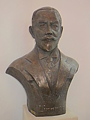
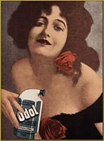
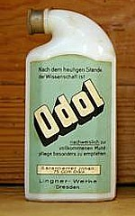

* * *

* * *

**Karl August Lingner**

**_Markenzeichen des Unternehmens_**

* * *

Die Geschichte der Lingner-Werke begann im Jahr 1888, als der junge Drogist Karl August
Lingner gemeinsam mit einem befreundeten Unternehmer auf der [Wölfnitzstraße 16](../../../../../zentrum/friedrichstadt/strassen_friedrichstadt/) (heute Nr.
11) einen Kleinbetrieb für Haushaltartikel einrichtete. In dem ab 1892 als “Chemisches Laboratorium” bezeichneten Betrieb stellte Lingner mit seinen drei Mitarbeitern zunächst
Rückenkratzer, Stiefelzieher und andere Artikel des täglichen Bedarfs her. Außerdem widmete er sich hier verschiedenen Experimenten. 1892/93 gelang es ihm, ein bis dahin völlig
unbekanntes kosmetisches Produkt zu entwickeln. Das der Zahn- und Mundpflege dienende “Zahn-Oel” erhielt den Namen “Odol” (griechisch “odos” = Zahn + “oleum” = Öl) und machte
den jungen Unternehmer innerhalb weniger Jahre zum Multimillionär.

Lingners Erfindung wurde von ihm mit einer für die damalige Zeit beispiellosen Werbekampagne begleitet. Insbesondere die typische Flaschenform mit dem “Seitenhals”-Ausguss
_(Foto: Wikipedia)_ und die zahllosen Werbeanzeigen und Plakate verhalfen dem “Odol”-Mundwasser zum Durchbruch. Um den Bedarf befriedigen zu können, erwarb Lingner 1897 ein Grundstück an der [Zwickauer Straße](../../../../../zentrum/sudvorstadt/strassen_sudvorstadt/zwickauer_strasse/) / Ecke Nossener Straße (Nr. 2-4) und verlegte die Produktion in die neuen Gebäude. Ab 1909
betrieb der Unternehmer auch ein eigenes Serumwerk, in dem er weitere medizinisch-kosmetische Produkte herstellen ließ.

Der nicht zuletzt wegen seines extravaganten Lebensstils bekannte
Karl August Lingner widmete sich neben seiner Unternehmertätigkeit auch gesundheitspolitischen und sozialen Fragen. So ließ er bereits 1903 eine Sonderschau zum Thema “Volkskrankheiten und ihre
Bekämpfung” einrichten, unterstützte den Kinderarzt Arthur Schloßmann bei der Gründung seiner ersten Säuglingsklinik der Welt und stiftete eine “Zentralstelle für Zahnhygiene”. Sein
wichtigster Verdienst war jedoch die Organisation der I. Internationalen Hygieneausstellung 1911, die Grundlage für das
1930 eingerichtete Deutsche Hygiene-Museum war. Privat wohnte Lingner zunächst in der Südvorstadt auf der [Leubnitzer\
Straße](../../../../../zentrum/sudvorstadt/strassen_sudvorstadt/leubnitzer_strasse/) 30, bevor er 1906 das [“Lingnerschloss”](../../../../../nordost/loschwitz/albrechtsschlosser/) am Loschwitzer Elbhang bezog.

Die Lingner-Werke wurden auch nach seinem Tod 1916 von den Nachfolgern fortgeführt und produzierten bis 1945. Beim Luftangriff fiel das Gebäude an der Zwickauer Straße den Bomben zum Opfer und wurde im Zusammenhang mit
dem Neubau der Nossener Brücke beseitigt. Nach der Verstaatlichung des Unternehmens verlegten Lingners Erben den
Betrieb nach Bühl (Baden), wo unter dem Namen Lingner + Fischer auch weiterhin Odol-Mundwasser im klassischen
Design hergestellt wurde. In der DDR wurde die Tradition im Dresdner VEB Elbe-Chemie fortgesetzt. Heute gehört das Unternehmen zum Konzern GlaxoSmithCline.

* * *

 \[ [Home](../../../../../index.html)\] \[ [Nord](../../../../../nord/)\] \[ [Nordwest](../../../../../nordwest/)\] \[ [Neustadt](../../../../../neustadt/)\]
 \[ [Nordost](../../../../../nordost/)\] \[ [West](../../../../../west/)\] \[ [Zentrum](../../../../../zentrum/)\] \[ [Südwest](../../../../../sudwest/)\]
 \[ [Süd](../../../../../sud/)\] \[ [Südost](../../../../../sudost/)\] \[ [Ost](../../../../../ost/)\] \[ [Register](../../../../../Register/register.html)\] \[ [Kontakt](../../../../../Kontakt/kontakt.html)\] \[ [Impressum](../../../../../impressum/)\]
