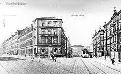
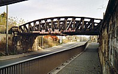
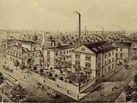
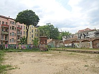
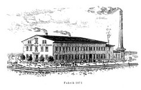
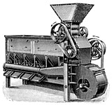
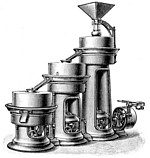
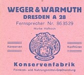
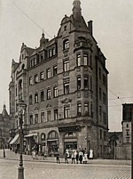

Die Freiberger Straße verbindet die Wilsdruffer Vorstadt mit dem Stadtteil
Löbtau und gehörte bereits im Mittelalter zu den wichtigsten Fernverbindungen der Stadt. Ihren Anfang nahm sie am früheren Wilsdruffer Tor (Postplatz) und führte von dort als Freybergische Straße
ins Erzgebirge. 1564 wurde sie erstmals in den Urkunden erwähnt, ist jedoch bedeutend älter. In der Nähe des Freiberger Platzes befand sich bis ins 19. Jahrhundert der “Freibergische Schlag” zur Erhebung der Akzise für
nach Dresden eingeführte Waren. Ein weiteres Einnehmerhaus stand bis 1885 an der Einmündung Tharandter Straße in Löbtau. Während der
stadtnähere Teil seit 1871 durchgängig als Freiberger Straße bezeichnet wird, erhielt der anschließende Straßenverlauf ab Löbtau 1904 den Namen [Kesselsdorfer Straße](../../../sudwest/lobtau/strassen_lobtau/kesselsdorfer_strasse/). Der Abschnitt zwischen Stadtgrenze und Weißeritzbrücke trug ab
1871 bis zur Eingemeindung Löbtaus den Namen Tharandter Straße.

Während im Innenstadtbereich bis zur Zerstörung 1945 vor allem Wohn- und Geschäftshäuser dominierten, siedelten
jenseits der Bahnanlagen verschiedene gewerbliche Unternehmungen an, u. a. der Fiskalische Kohlenbahnhof, die Maschinenfabrik Lehmann und das [Glaswerk](../../../zentrum/wilsdruffer_vorstadt/freiberger_strasse/glaswerk_lobtau/) der Familie Siemens. Zur Unterbringung der zahlreichen zugewanderten
Glasarbeiter wurden um 1890 Mietshäuser durch die “Aktiengesellschaft für Glasindustrie” errichtet (Freiberger Straße 104 und 106). Auch hier richteten die Bomben des Zweiten Weltkriegs erhebliche Schäden an.

Einzelne Gebäude:

Nr. 2 - 6:
Die drei Hochhäuser entstanden 1962 bis 64 auf dem Areal der zerstörten Vorkriegsbebauung. Markantestes Gebäude ist das Haus Nr. 2, welches auf dem Dach eine Leuchtreklame mit dem Schriftzug “Dresden
grüßt seine Gäste” trägt. Die nachts mit farbigen Blumenmotiven versehene Werbung wurde 2012 bei der Sanierung
des Hauses demontiert und später in leicht veränderter Form wieder an der Fassade des Hauses angebracht. 2012/13
entstanden außerdem auf den Grünflächen zwischen den Gebäuden drei Neubauten mit 26 Eigentumswohnungen (Nr. 2 a-c).

Nr. 5 - 27: Die fünfgeschossige Wohnzeile wurde Mitte der 1960er Jahre errichtet und nach 1990 saniert. In diesem
Zusammenhang erhielten die Eingänge künstlerische Gestaltungen mit Motiven der Tierkreiszeichen, was dem Wohnblock den Namen “Sternbildhäuser” einbrachte.

Kohlenbahnhöfe: Der Fiskalische Kohlenbahnhof (früher auch Albertbahnhof) wurde 1856 im Zusammenhang mit dem Bau der [Albertbahn](../../../sud/plauen/plauenscher_grund/albertbahn/) angelegt und diente als Umschlagplatz für die im Döhlener Revier geförderten Steinkohle, welche über Kohlezweigbahnen nach Dresden transportiert wurde. Unmittelbar daneben befand sich der Städtische Kohlenbahnhof. Später nutzten auch die hier ansässigen Fabriken, u.a. das Siemens-Glaswerk, die Gleisanlagen. Eine 1880 errichtete Brücke über die abgesenkte Freiberger Straße stellte die Verbindung zur Hauptstrecke nach Chemnitz her. Weitere [Gleisanschlüsse](../../../Zentrum/Friedrichstadt/Dresden_-_Berlin/Anschlussbahn_Kohlebahnhof/Anschlussbahn_Kohlebahnhof.html)
verbanden den Kohlebahnhof mit den Kaianlagen am Elbufer.

Nach 1990 endete der Betrieb der Industriebahn, deren Gleisanlagen man wenig später entfernte. Zuletzt diente das Gelände als Bauhof für den Neubau des Wold Trade Centers. Die erhaltenen Lagerschuppen werden heute z. T. von Speditionen genutzt. Auf den brachliegenden Restflächen entstand 2006/07 eine parkartige Grünfläche mit Radweg. Künftig sind jedoch auch hier wieder gewerbliche Ansiedlungen geplant.

**_Foto:_** _ehemalige Eisenbahnbrücke über die Freiberger Straße (abgerissen im März 2007)_

Militäreffekten-Fabrik Geißler & Hast: Die Gold- und Silbermanufaktur und
Militär-Effekten-Fabrik Löbtau entstand 1815 und befand sich zunächst im Besitz von Leopold Zilliger. Das zu den ältesten Löbtauer Gewerbebetrieben gehörende
Unternehmen wurde 1868 von Friedrich Geißler erworben, der zwei Jahre später Max Hast als Teilhaber aufnahm, so dass der Betrieb fortan als “Geißler & Hast”
firmierte. Hergestellt wurden vorrangig Zubehörteile für Uniformen wie Schärpen, Säbelteile und Schulterstücke für den Bedarf der sächsischen Armee.

Insgesamt gehörten in Dresden vier Betriebsteile zu dieser Firma, die ihren Stammsitz auf der Freiberger Straße 47/49 und der Papiermühlengasse 9 hatte. Verarbeitet wurden sowohl
Edelmetalle wie Gold und Silber, aber auch Seide, Leder und Baumwolle. U.a. gehörte eine Gold- und Silberspinnerei, eine Gürtlerei und eine Sattlerei zum Betrieb, um alle erforderlichen Produktionsschritte vor Ort
vornehmen zu können. Neben der sächsischen Armee, die fast ihren gesamten Bedarf bei Geißler und Hast herstellen
ließ, gehörten auch preußische Regimenter zum Kundenkreis. Hinzu kamen Reiseutensilien wie Koffer, Taschen und Jagdzubehör.

Nr. 75: In diesem heute nicht mehr vorhandenen Gebäude gründete im August 1911 der Unternehmer Edmund Kussi gemeinsam mit den aus Löbtau stammenden Brüdern Johann und Friedrich Cruse die Firma "RHEOSTAT - Spezialfabrik elektrischer Apparate Edmund Kussi". Kussi, der zuvor bereits als Staubsaugervertreter tätig war und zugleich Inhaber einer Entstaubungsmaschinenhandlung an der Waisenhausstraße 24 ließ in seinem Werk verschiedenene elektrische Bauteile, Widerstände, Schalter u.ä. herstellen. Bereits 1913 verzog die Firma zur [Leipziger Straße 31](../../../neustadt/leipziger_vorstadt/leipziger_strasse/), 1919 zur Großenhainer Straße 130/132 und existierte dort, nach 1945 als Betriebsteil des VEB Elektroschaltgerätewerkes Dresden, bis 1990.

Nr. 93: Das markante Eckhaus an der Einmündung der Oederaner Straße beherbergte früher das Restaurant “Zum
heiteren Blick”. Zu DDR-Zeiten befand sich hier ein Ladenlokal mit Reparatur- und Wäscheannahme. Seit ca. 1990 steht das Haus leer. Eiinige Nachbargebäude wurden mittlerweile abgetragen und unter Einbeziehung eines
Schornsteinfundaments zu einem kleinen Stadtplatz gestaltet.

Nr. 99: Das Wohn- und Geschäftshaus beherbergte vor dem Ersten Weltkrieg das Restaurant “Zur Edelweiß-
Schänke”, welches sich im Besitz des Schankwirts Ernst Hänel befand und zu den zahlreichen kleinen Lokalen in der dichtbesiedelten Vorstadt Löbtau gehörte. Ab 1912 ist die Gaststätte als “Edelweißschänke” im Adressbuch
verzeichnet. In den 1930er Jahren befand sich hier der „Dresdensia Hutvertrieb“ von Hilda Werner. Heute werden die Räume des nach 1990 rekonstruierten Hauses gewerblich genutzt.

Nr. 101:
Das im Dreieck zwischen Freiberger, Oederaner und Saxoniastraße gelegene Grundstück war ursprünglich mit mehreren Gebäuden bebaut. Im Vorderhaus befanden sich Wohnungen, während die beiden Hintergebäude
gewerblich genutzt wurden. 1930 hatte hier die Firma A. Georg Pöschmann ihren Sitz. Nach dem Tod des Inhabers übernahm dessen früherer Werkmeister Otto
Püschel die Leitung des Klempnerbetriebes und führte ihn unter dem Namen Püschel & Co. weiter. Weitere Räume dienten als Geschäftsräume für den
Klischeefabrikanten Johannes Hoffmann. Im linken Hintergebäude befand sich vor dem Ersten Weltkrieg “Schreibers Amerikanische Dampf- Wäscherei und
Kunstplätt-Anstalt”. Später nutzte Victor Wodwarka die Räume für seine Färberei. 1942 betrieb Elsa Müller eine Wäscheschneiderei. Erst nach 1990 verschwanden die verbliebenen Gebäude zugunsten eines Sport- und
Spielplatzes. Dabei wurden Teile, u.a. der Sockel eines alten Industrieschornsteins, in die Gestaltung einbezogen.

Maschinenfabrik J. M. Lehmann:

Das Unternehmen wurde 1834 von Johann Martin Lehmann (1802-1869) in
Dresden gegründet und baute vorrangig Maschinen zur Herstellung von Kakao-, Schokoladen- und Zuckerwaren. Zu den Entwicklungen der jungen Firma gehörten u.a. eine neuartige Walzenreibemaschine für Schokolade
sowie die erste Kakaoentölungs-Presse mit hydraulischer Handpumpe.

Nach dem Tod seines Vaters übernahm der erst 17-jährige Sohn Louis Bernhard 1869 den Betrieb.Aus Platzgründen erwarb er 1870/71 ein
Grundstück an der Freiberger Straße 108-116 und richtete hier die neuen Produktionshallen ein. Mit ca. 600 Angestellten war die Fabrik um 1900 zweitgrößter
Betrieb in Löbtau. Zehn Jahre später verfügte das Unternehmen bereits über 420 moderne Werkzeugmaschinen und eine eigene Kraftzentrale. Filialen gab es u.a. in Paris, London
und New York, von denen aus die umfangreichen Exportgeschäfte der Firma abgewickelt wurden. Mehrfach erhielten diese internationale Auszeichnungen, so auf den
Weltausstellungen in Chicago 1893, Paris 1900 und Brüssel 1910. 1912 entstand ein weiterer Betriebsteil in Mügeln (Heidenau), welcher nach dem Ersten Weltkrieg zum Hauptwerk avancierte. Leiter war ab 1920 Franz Bernhard
Lehmann, der Enkel des Firmengründers. Bis zum Zweiten Weltkrieg galt das Unternehmen als bedeutendster Hersteller von Schokoladenmaschinen auf der Welt.

Während das Dresdner Werk 1945 vollständig zerstört wurde, gelang es mit Hilfe aus den
Trümmern geborgener Maschinen, die Produktion in Heidenau fortzusetzen. Unter dem Namen VEB Schokoladen-, Seifen- und Farbenmaschinenwerke Heidenau gehörte die
Firma bis 1989 zum Kombinat VVB NAGEMA und wurde dann als Heidenauer Maschinenfabrik GmbH privatisiert. Franz Bernhard Lehmann hatte Dresden bereits kurz
nach Kriegsende verlassen und in Wasseralfingen in Württemberg einen Neuanfang versucht. Der nach seinem Tod 1949 an eine Schweizer Holding verkaufte Betrieb gehört heute zur niederländischen Royal Company.

**_Bilder:_** _Meyers Großes Konversations-Lexikon, Band 17. Leipzig 1909_

Nr. 116: Das Wohnhaus sowie das angrenzende Grundstück gehörten bis 1945 zum ausgedehnten Betriebsgelände der Maschinenfabrik Lehmann. Im Erdgeschoss des
Vorderhauses gab es vor dem Ersten Weltkrieg eine kleine Schankwirtschaft. Nachdem in den Zwanziger Jahren die Hauptproduktion der Maschinenfabrik nach Heidenau
verlegt worden war, vermietete man einige nicht mehr benötigte Gebäude an Fremdfirmen. U.a. hatte hier der Konservenhersteller Weger & Warmuth seine
Geschäftsräume. Hergestellt wurden verschiedene Marmeladen- und Feinkostprodukte, die unter dem Markennamen “Hofkoch” vetrieben wurden. Weitere Räume waren an
die Dresdner Offset-Pressenfabrik Rudolf Horn und ab 1935 an die Bauabteilung Dresden der Reichsautobahnen vermietet. 1945 fielen die Gebäude dem Luftangriff zum Opfer.

Löbtauer Faß (Nr. 120): Die kleine Biergaststätte im Wohnhaus Freiberger Str. 120 gehörte bis 1989 zu den
preiswerten Bierlokalen und wurde gern von Angestellten der umliegenden Betriebe aufgesucht. 1930 befand sich in den Räumen die Westapotheke. Später wurden diese als Farbenhandlung und seit Mitte der 1930er Jahre als
Schankwirtschaft genutzt. Ursprünglich trug diese den Namen “Lyra”, wurde jedoch 1968 in “Löbtauer Faߔ umbenannt. Markantes Erkennungszeichen war der in Form eines Bierfasses gestaltete Eingang zum Lokal. Nach
fehlgeschlagener Privatisierung schloss die Gaststätte Anfang 1990 und stand seitdem leer. Das Mitte der 1990er Jahre bei einem Brand schwer beschädigte Gebäude wurde im Herbst 2006 abgerissen.

Nr.: 113-121: Die Gebäude zwischen Saxoniastraße und Ebertplatz gehören zur Wohnanlage des Dresdner Spar- und Bauvereins und wurden 1919-1921 nach Plänen von Paul Beck errichtet.

Nr. 132 / 134: Die beiden repräsentativen Geschäftshäuser entstanden Ende des 19.
Jahrhunderts unmittelbar an der [Bismarckbrücke](../../../sudwest/lobtau/strassen_lobtau/lobtauer_brucken/) über die Weißeritz. Zusammen mit dem
gegenüberliegenden Wohnhaus Nr. 123 und den anschließenden Gebäuden des [Crispiplatzes](../../../sudwest/lobtau/strassen_lobtau/ebertplatz/) bildeten sie den repräsentativen Brückenkopf der Flußquerung
_(Foto)_. Während die Obergeschosse Wohnungen beherbergten, gab es im Erdgeschoss verschiedene Geschäfte, u.a. eine Apotheke und eine Niederlassung des “Waaren-
Einkaufs-Verein zu Görlitz”. Das Ensemble überstand den Luftangriff ohne größere Schäden, wurde jedoch in den 1980er leergezogen und 1988 für die neue Hochstraße in
Verlängerung der Nossener Brücke gesprengt. Heute befindet sich hier eine Grünfläche sowie der Auftakt zum “Grünzug Weißeritz”, der  parallel zur Freiberger Straße entlang des
alten Flussbettes bis zum Bahnhof Mitte führt.

* * *

 \[ [Home](../../../index.html)\] \[ [Nord](../../../nord/)\] \[ [Nordwest](../../../nordwest/)\] \[ [Neustadt](../../../neustadt/)\] \[ [Nordost](../../../nordost/)\] \[ [West](../../../west/)\] \[ [Zentrum](../../../zentrum/)\] \[ [Südwest](../../../sudwest/)\] \[ [Süd](../../../sud/)\] \[ [Südost](../../../sudost/)\] \[ [Ost](../../../ost/)\] \[ [Register](../../../Register/register.html)\] \[ [Kontakt](../../../Kontakt/kontakt.html)\] \[ [Impressum](../../../impressum/)\]
