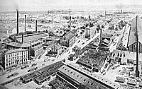
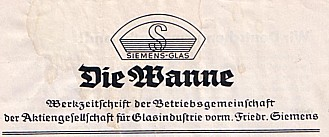
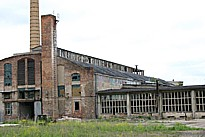

* * *

* * *

Das Löbtauer Glaswerk wurde Mitte des 19. Jahrhunderts als Tafelglashütte an der [Löbtauer Straße](../../../../sudwest/lobtau/strassen_lobtau/lobtauer_strasse/) gegründet. Zuvor hatte es bereits im 18. Jahrhundert eine Glashütte in der Wilsdruffer Vorstadt gegeben, die jedoch im Siebenjährigen Krieg einging. Maßgeblich beeinflusst wurde die Glasherstellung durch August den Starken, der
seinen “Porzellanmacher” Johann Friedrich Böttger auch mit Verbesserungen der Herstellung verschiedener Glasprodukte beauftragte. Neben Gebrauchsgläsern wurden in den Brennöfen Porzellanverschlüsse sowie kleinere Schüsseln und Laborbehälter gefertigt.

Mitte des 19. Jahrhunderts kam es an der Löbtauer Straße vor den Toren der Stadt zur Neugründung. 1862 kaufte Hans Dietrich Siemens dieses Unternehmen für 30.000 Taler. Nach seinem Tod übernahm 1867 Bruder Friedrich August Siemens die Fabrik. Der Techniker und Erfinder stellte die Produktion auf Behälterglas um und führte in seiner Fabrik zahlreiche Neuerungen ein, darunter ein modernes Verfahren zur kontinuierlichen Glasschmelze. Mit Hilfe dieser Technologie gelang es Siemens, die Produktivität des Betriebes deutlich zu steigern und das Löbtauer Glaswerk zum
größten Dresdner Industrieunternehmen zu machen. 1888 wurde das Glaswerk in eine Aktiengesellschaft umgewandelt. Zweigbetriebe befanden sich u.a. in Freital-Döhlen, in Gleiwitz, Neusattl bei Karlsbad (Karlovy Vary) und im österreichischen Graz. Die “Aktiengesellschaft für Glasindustrie vorm. Friedrich Siemens” war bis 1914 mit insgesamt ca. 7000 Angestellten zu einem der größten Glasproduzenten der Welt geworden.

Friedrich Siemens war jedoch nicht nur als Unternehmer erfolgreich, sondern sorgte auch durch verschiedene Erfindungen für Aufsehen. Neben neuen Herstellungsverfahren, die er in seiner Fabrik ausprobierte, entwarf er um 1875 einen Leichenverbrennungsofen, der nach erfolgreichen Versuchen zum Wegbereiter der Feuerbestattung in Deutschland wurde. Zur Verbesserung der Lebensbedingungen seiner Arbeiter ließ er in der Nähe seiner Löbtauer Fabrik Werkswohnungen und eine Badeanstalt errichten. 1901 erhielt der Dresdner Unternehmer den ersten Ehrendoktortitel der Technischen Hochschule. Friedrich Siemens starb am 24. Mai 1904. Sein Grab befindet sich auf dem [Neuen Annenfriedhof](../../../../sudwest/Lobtau/Friedenskirche/Neuer_Annenfriedhof/neuer_annenfriedhof.html) an der Kesselsdorfer Straße.

Der Betrieb war jedoch auch ein Zentrum der organisierten Arbeiterbewegung. Der hier beschäftigte Glasarbeiter Georg Horn
wurde 1875 erster Vorsitzender der am 20. September in Dresden gegründeten Deutschen Glasarbeiter- Gewerkschaft „Allgemeiner Glaskünstlerbund Deutschland“
. Bereits drei Jahre später löste er diese wegen des drohenden Verbots durch das “Sozialistengesetz” wieder auf und rettete so deren Vermögen vor der Enteignung. Die
Gelder wurden in eine betriebseigene Kranken- und Sterbekasse zur Unterstützung der Arbeiterfamilien überführt, was
Horn jedoch einen Gerichtsprozess und seine Entlassung einbrachte. Zwischen 1895 und 1918 gehörte er als Abgeordneter der SPD dem Deutschen Reichstag an. Ein Jahr später verstarb er in seinem Haus in Radebeul-Lindenau.

_Kopf der Betriebszeitung der Siemens-Glaswerke von 1944_

Auch nach dem Tod Friedrich Siemens\` blieb das Dresdner Glaswerk ein Wegbereiter der modernen Glasherstellung.
So wurde hier 1909 zum ersten Mal eine Owens-Maschine zur maschinengeblasenen Flaschenfertigung eingesetzt. Hinzu
kamen moderne Schmelzwannen und die Umstellung auf elektrischen Betrieb. Trotz dieser Rationalisierungsmaßnahmen
geriet die Firma während der Weltwirtschaftskrise in Schwierigkeiten und musste ihre Produktion 1931 einstellen. Erst
1938 gelang eine Wiederaufnahme des Betriebes. Hergestellt wurden neben Glasflaschen in unterschiedlichsten Formen
und Größen auch Konservengläser, Drahtglas, Glasziegel und Beleuchtungskörper. Bis 1940 gab es im Dresdner Werk
auch zwei Porzellanbrennöfen, welche man zur Fertigung von Flaschenverschlüssen und für verschiedene Versuche nutzte. 1945 wurde das Werk zu 90 % zerstört.

1946 erfolgte die Überführung des Löbtauer Glaswerkes in Volkseigentum. Unter großen Anstrengungen konnte 1947 erstmals wieder Glas geschmolzen werden. Im
Zuge der Konzentration der volkseigenen Betriebe wurde die Flaschenfertigung 1963 eingeschränkt und die Firma auf die Herstellung von Beleuchtungsglaskörpern
umgerüstet. Das nunmehr VEB Vereinigte Beleuchtungsglaswerke Dresden genannte Unternehmen gehörte ab 1979 zum Kombinat Lausitzer Glas mit Sitz in Weißwasser.
Zu den größten Herausforderungen an die Belegschaft zählte die Anfertigung der Glasteile für die Rekonstruktion des Kronleuchters der Semperoper. 1990 erfolgte
die Umwandlung des bestehenden Kombinates zur Sächsisch-Brandenburgischen Glashütten GmbH. Am 20. Dezember 1991 wurde das Unternehmen durch die Treuhandanstalt geschlossen, womit die Geschichte der Glasproduktion in
Dresden endete. Der Abriss der Gebäude erfolgte 2005. Zwei Jahre später entstand auf Teilen des Areals der “Grünzug
Weißeritz” mit Ruhe- und Spielplätzen sowie einigen Schautafeln, welche über die Geschichte des Gebietes informieren.

* * *

 \[ [Home](../../../../index.html)\] \[ [Nord](../../../../nord/)\] \[ [Nordwest](../../../../nordwest/)\] \[ [Neustadt](../../../../neustadt/)\] \[ [Nordost](../../../../nordost/)\] \[ [West](../../../../west/)\] \[ [Zentrum](../../../../zentrum/)\] \[ [Südwest](../../../../sudwest/)\] \[ [Süd](../../../../sud/)\] \[ [Südost](../../../../sudost/)\] \[ [Ost](../../../../ost/)\] \[ [Register](../../../../Register/register.html)\] \[ [Kontakt](../../../../Kontakt/kontakt.html)\] \[ [Impressum](../../../../impressum/)\]
